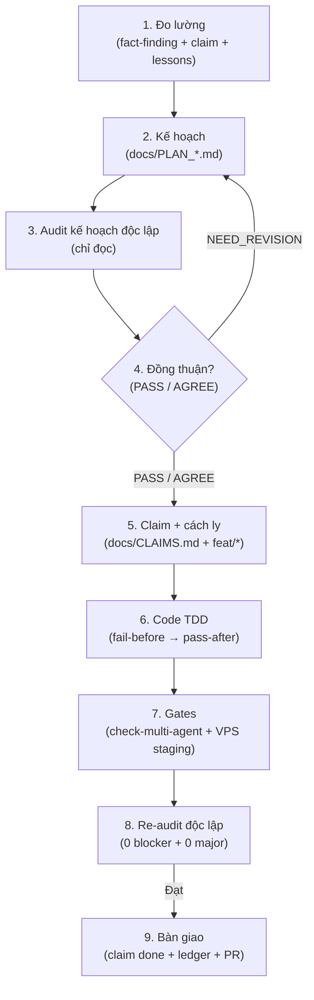

# Workflow Dev Loop — Vòng Kín Mặc Định (vninvest)

> **Nguyên tắc vàng:** `AGENTS.md`, `docs/AGENT_PROTOCOL.md`, `docs/CLAIMS.md` của repo đang làm việc luôn thắng skill này khi xung đột.

Học từ `erp-dev-loop` (ERP-Edusuccess): giữ khung 9 bước khép kín + 5 luật cứng; thay toàn bộ chi tiết ERP (S1–S7 frappe, `bench`, `gates/run-all.mjs`, `docs/lessons`, site Frappe) bằng tooling vninvest.

## 0. Kích hoạt mặc định

Mọi nhiệm vụ liên quan mã nguồn (thêm tính năng, sửa lỗi, refactor, test, PR, solo hay song song) **bắt buộc chạy 9 bước dưới đây**. Gọi skill này **trước dòng code đầu tiên**.

Khi ≥ 2 agent song song: đọc thêm skill `multi-agent-workflow` + `docs/AGENT_PROTOCOL.md` §10 (worktree, merge queue, DB riêng).

## 1. Chi tiết 9 bước (profile vninvest)

### B1. Đo lường (fact-finding, cấm đoán)
- Mở phiên: `pwsh -File scripts/agent-sync.ps1` (rebase → check migration → gate) rồi mới `git status` — gate/status trước rebase đọc code cũ (L-003).
- `git status --short` (main tree) + đọc `docs/CLAIMS.md`: file định chạm có ai giữ `in-progress` không. Có → **DỪNG**.
- Nạp skill `project-lessons` (`taskDescription` + `filePaths` + `actions`) → ghi nhận `LESSONS APPLICABLE` + `MANDATORY CHECKLIST` (`docs/AGENT_PROTOCOL.md` §11). Chỉ đọc 1–2 file lesson theo tag.
- Mọi số liệu đo bằng lệnh thật trên repo. Cấm suy ra từ `grep` rỗng, cấm tin comment/`file:line` người khác ghi khi chưa mở file đọc.
- `node packages/web/scripts/check-multi-agent.mjs` phải PASS trước khi sửa.

### B2. Kế hoạch (`docs/PLAN_*.md`)
- Mục tiêu + bằng chứng `file:line` đã tự mở đọc. Tiêu chí nghiệm thu `Given/When/Then`.
- Bảng baseline exit-code các cổng hiện tại. `SCOPE` (file chạm) + `LIMIT` (số vòng) + non-goals + rollback.
- Plan ghi `Lessons áp dụng: [...]` (hoặc `NONE – <lý do>`). Viết check tái hiện **trước** dòng code đầu tiên.

### B3. Audit độc lập + B4. Đồng thuận
- Auditor khác (người/model khác), **chỉ đọc**. Không tự audit việc của chính mình. Verdict: `PASS` | `AGREE` (+reservation: ai đóng, ở bước nào) | `NEED_REVISION` (objection đánh số) | `REJECT`. Verdict PHẢI ghi thành file văn bản (quy tắc 6) mới được chuyển B5.
- Gate B4→B5: `PASS`/`AGREE`. `NEED_REVISION` → sửa plan → audit lại, tối đa 3 vòng; quá thì ghi `blocker`, trả partial state, dừng.

### B5. Claim + cách ly (`docs/CLAIMS.md`)
- Append 1 dòng cuối bảng **trước dòng code đầu tiên**, commit riêng. Tên branch = `feat/<tên-agent>` đúng ký tự (L-M02).
- File agent khác giữ `in-progress` → DỪNG, không sửa. Không commit thẳng `dev`/`main`.
- Song song: mỗi agent 1 worktree (`scripts/new-agent.ps1`, `scripts/agent-install-hooks.sh`) + DB riêng; đụng staging/DB dùng chung → xin coordinator + ghi rõ phạm vi trong claim, không tự ý (thử nghiệm chạy trên VPS staging theo RUNBOOK, cấm local Docker).
- 5 nhóm deny-list §2 không claim/sửa; `docs/CLAIMS.md` chỉ append cuối file; ledger được append Entry của mình (ngoại lệ Owner 2026-10-03) — cần sửa nhóm deny-list thì ghi vào claim + báo coordinator.

### B6. Code (fail-before → pass-after) + bất biến vninvest
- Chứng minh đỏ trước (test mới fail trên code cũ), rồi mới xanh. Tối đa 3 vòng sửa/bước, sau đó ghi `blocker`.
- Không tự đặt số migration (để `makemigrations` sinh). Không `npm/pip install` khi chưa hỏi.
- Sau mỗi lần ghi file: `git diff --numstat` — đổi hàng loạt dòng khi chỉ sửa ít là hỏng line-ending, dừng lại.
- Không đọc nội dung tiếng Việt qua output console của shell (mojibake) — đọc bằng công cụ đọc file. Không `print()` tiếng Việt trong mã chạy thật.

### B7. Gates (chạy lại sau mọi rebase/sửa)
- `node packages/web/scripts/check-multi-agent.mjs` · `node scripts/check-experiment-env.mjs` · `node scripts/normalize-eol.mjs` · `node scripts/check-lessons.mjs` (khi đụng `docs/LESSONS/`) · `node scripts/pre-push-gate.mjs` · `npx tsc --noEmit`. Gate chỉ đáng tin sau rebase: kết phiên chạy lại `agent-sync.ps1` (rebase → check migration → gate, L-003).
- BE test / FE test / build **chỉ trên VPS staging** (`14.225.255.47`, xem `docs/STAGING_VPS_RUNBOOK.md`). **CẤM local Docker** — kể cả `docker ps`, kể cả container tạm 1 lần.
- Cổng nào không chạy được → ghi `CHƯA CHẠY` + lý do. Cấm báo `PASS` cho thứ chưa chạy.

### B8. Re-audit độc lập
- Auditor khác kiểm trên revision mới nhất, tự suy ra lại mọi số liệu. Cổng ra: test toàn Pass (+`CHƯA CHẠY` được chấp nhận) và audit 0 blocker + 0 major, kết quả ghi thành file văn bản (quy tắc 6). Chưa đạt → về B6, tối đa 3 vòng.

### B9. Bàn giao
- Claim → `done`. Prepend 1 `## Entry N` vào `docs/CODE_CHANGE_AUDIT_LEDGER.md` + commit riêng.
- Commit message ghi rõ đã chạy gì + `CHƯA CHẠY` gì. Push → `pwsh -File scripts/agent-pr.ps1` → PR merge-commit (không squash).
- Sau merge: `pwsh -File scripts/agent-cleanup.ps1 -Branch <b> -Execute`, xóa junction trước khi xóa cây.

## 2. Sáu luật cứng (5 giữ từ erp-dev-loop + 1 vninvest, Owner chốt 2026-10-24)

1. **Auditor luôn độc lập, chỉ đọc.** Không audit việc của chính mình.
2. **Quy tắc 3 lần thử.** Một bước hỏng sửa tối đa 3 lần; quá thì `blocker` + dừng, không thử sai làm nát code.
3. **Bảo toàn encoding & line-ending.** Sau mỗi lần ghi file: `git diff --numstat` khớp dự kiến; file LF; dính mojibake/EOL là dừng (L-T01).
4. **Không đọc tiếng Việt qua console shell Windows.** Console render sai (mojibake); đọc file trực tiếp UTF-8; console chỉ xem exit code/số lượng.
5. **Trung thực số liệu tuyệt đối.** Mọi con số kèm lệnh tái hiện; không tái hiện được → ghi `ƯỚC LƯỢNG` hoặc bỏ. Không `PASS` giả.
6. **Mọi audit / đề xuất / review PHẢI thành văn bản — không ngoại lệ.** Verdict audit (B3), đồng thuận (B4), re-audit (B8), báo cáo bàn giao (B9) và mọi kết luận điều tra phải được ghi thành file trong repo (`docs/evidence/<slice>/` hoặc `docs/<TÊN>_*.md`) TRƯỚC khi coi bước đó xong. Báo cáo miệng/chat-only = bước chưa hoàn thành, auditor sau từ chối nghiệm thu. Không có ngoại lệ kể cả "việc nhỏ".

## 3. Bản đồ skill hỗ trợ — gọi đúng bước loop

| Bước loop | Skill (id, đã xác minh tồn tại) | Khi nào gọi |
|---|---|---|
| B1 đọc codebase lớn | `lean-ctx` | Đọc file, AST, nén context |
| B2 yêu cầu mơ hồ | `ba-requirements` | BRD/user story/AC `Given/When/Then` — chạy trước `brainstorming` |
| B2 làm rõ phương án | `brainstorming` | Đối thoại → 2–3 phương án → spec có gate duyệt |
| B2 kế hoạch thực thi | `writing-plans` | Spec → plan chi tiết cho implementer |
| B2 giao diện mới | `theme-factory` + `brand-guidelines` | Bảng màu/typography; `artifacts-builder` dựng prototype HTML review trước khi code; art tĩnh → `canvas-design` |
| B3/B8 audit sâu | `staff-engineer-review` | Review plan/PR (giữ auditor độc lập) |
| B3/B8 audit bảo mật | `code-security-auditor` | Quét tĩnh trước khi chạy code lạ |
| B6 mọi code | `test-driven-development` | Red-green-refactor nghiêm |
| B7 test đỏ sau refactor | `test-fixing` | Gom nhóm lỗi, fix theo root cause |
| B7 làm feedback review | `review-implementing` | Checklist từng item |
| B7 verify web (VPS staging, §12) | `webapp-testing` / `playwright-skill` | Chạy trên VPS staging (§12.3/12.4); local chỉ review diff, cấm test/build/E2E local |
| B5/B9 cách ly & kết thúc | `using-git-worktrees` / `finishing-a-development-branch` | Worktree + menu merge/PR/cleanup (trong vninvest: PR merge-commit + script repo) |

> Viết skill mới → gọi `skill-creator`. Nạp bài học → `project-lessons` (B1, bắt buộc). Song song → `multi-agent-workflow`.

## 4. Tiếp tục phiên sau

Đọc theo thứ tự: `AGENTS.md` → kế hoạch (`docs/PLAN_*.md`) → con trỏ tiến độ → tiếp tục đúng bước đã ghi, không suy diễn lại từ đầu.
