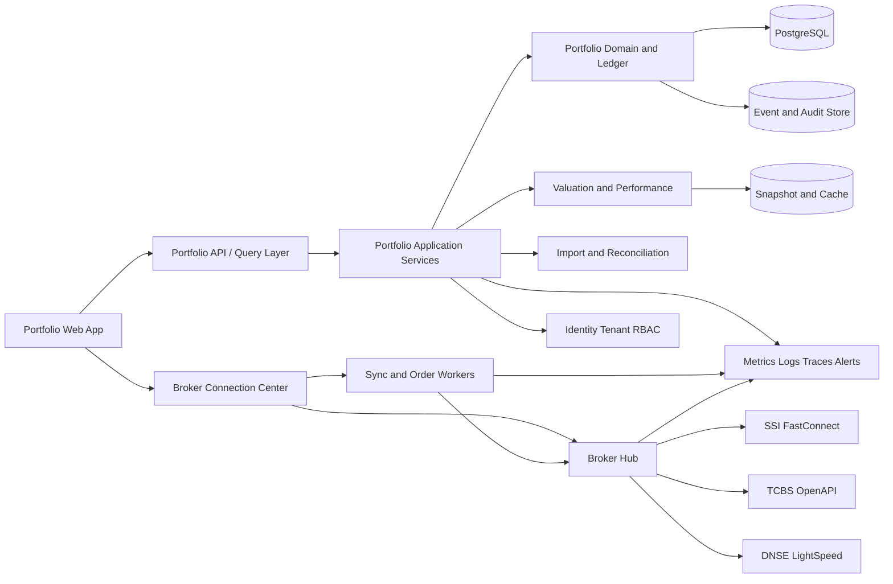
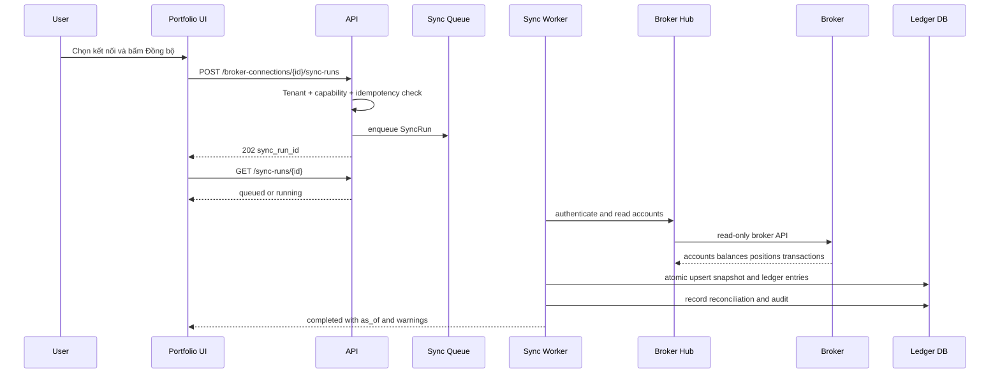
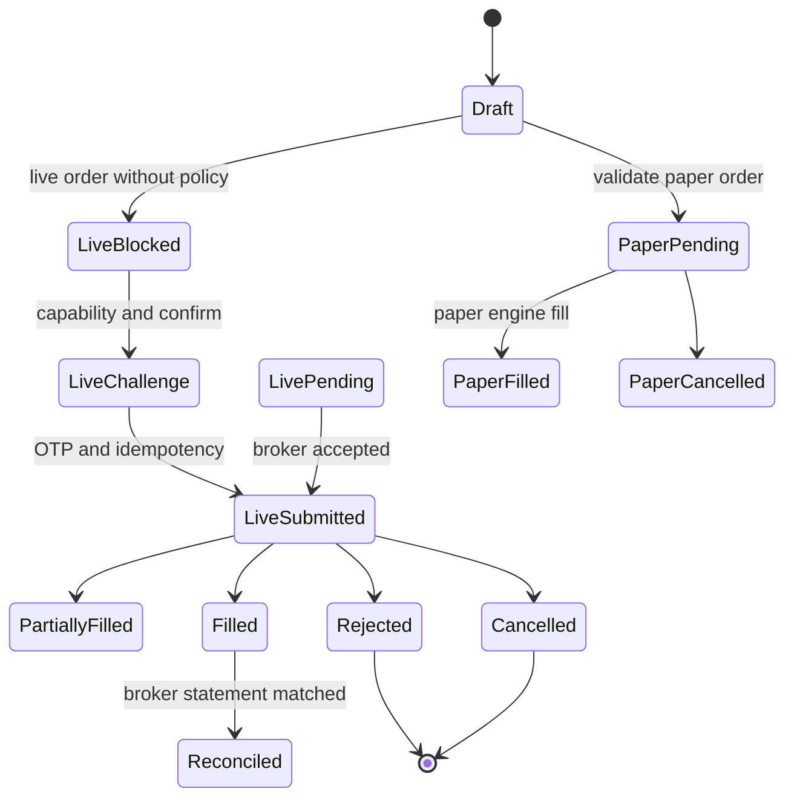
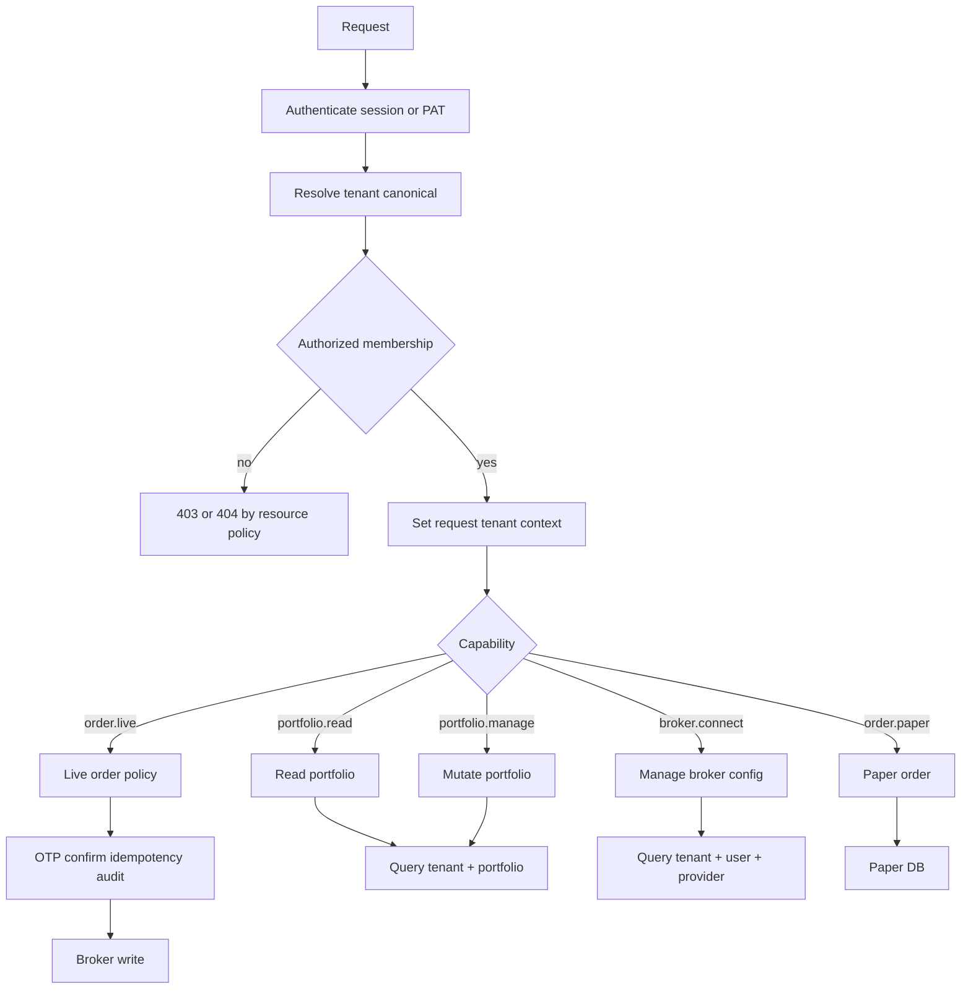
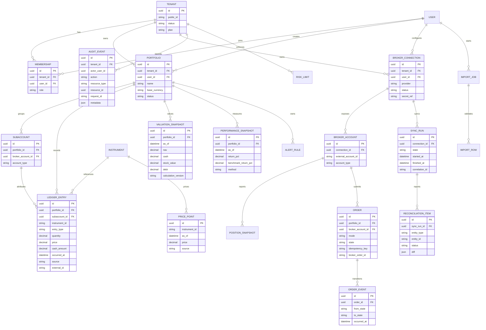

# Audit và thiết kế lại Danh mục/Portfolio thương mại

**Ngày audit:** 2026-09-25  
**Baseline:** branch `dev`, HEAD `8b479d24`  
**Phạm vi:** route `/portfolios`, Portfolio/Transaction/SubAccount, native portfolio analytics, broker hub DNSE/SSI/TCBS, UI shell, tenant/permission, audit log, i18n, test và tài liệu broker hiện có.  
**Loại công việc:** audit + thiết kế, không sửa runtime trong phiên này.  
**Kết luận điều hành:** **NO-GO cho live-money**. Chỉ nên tiếp tục read-only/sandbox sau khi đóng nhóm P0 an toàn, security, tenant scope, migration và tính đúng của sổ cái.

> **Rev.1 (2026-09-25, verification pass):** bổ sung minh chứng đã kiểm chứng bằng đọc code/scan cục bộ cho secret thật nằm trong file tracked, FE lưu tenant ở `localStorage` trong khi transport đọc `sessionStorage`, migration `0008` query field `TenantMember.is_active` không tồn tại, `TenantQuotaMiddleware` dùng `CoreTenant`/`logger` chưa import, và legacy `DNSE_CREDENTIAL_FERNET_KEY` không được inject trong `docker-compose.prod.yml`. Các phát hiện này được chuyển thành gate bắt buộc trong `docs/IMPLEMENTATION_PLAN_PORTFOLIO_COMMERCIAL_HARDENING_20260925.md`.

## 0. Tóm tắt điều hành

Bảy vấn đề nghiêm trọng nhất đã được đối chiếu với code và tái hiện local:

1. **P0-SAFETY-01 — các DNSE write action không fail-closed.** Nút “Giao dịch DNSE (thử nghiệm)” không gửi `dry_run` tại `packages/web/src/components/DNSEConnectionPanel.js:190-225`; backend mặc định `dry_run=False` tại `packages/core/backend/src/user_workspace/views_dnse.py:181-213`. Hai endpoint tạo challenge, `send-email-otp` và `create-trading-token`, cũng parse thiếu `dry_run` thành live tại `views_dnse.py:99-176`; adapter không tự fail-closed tại `packages/web/src/adapters/core/workspace.js:341-356`. Cùng kiểu lỗi xuất hiện trong WIP `packages/web/src/components/advisory/AdvisoryOrderTicket.js`.
2. **P0-ISO-01 — analytics portfolio bỏ qua tenant scope, đã tái hiện HTTP 200.** `_get_user_portfolio()` chỉ lọc `user` tại `packages/core/backend/src/user_workspace/portfolio_analytics_views.py:25-27`; các endpoint holdings/summary/chart/allocation/sync/technicals tại `:64-252` dùng `IsAuthenticated` và gọi helper này. Probe cùng user thuộc Tenant A+B, chọn header Tenant B nhưng đọc portfolio Tenant A đã trả `200` cùng holdings; test hiện có chỉ chứng minh user ownership tại `packages/core/backend/src/user_workspace/test_portfolio_analytics_native_routes.py:98-102`.
3. **P0-ISO-02 — tenant selection bị hỏng ở cả FE lẫn BE.** FE ghi `tenant_id` vào `localStorage` tại `packages/web/src/context/PortfolioContext.js:25-28,103-107,296-300`, nhưng transport chỉ đọc `sessionStorage` tại `packages/web/src/adapters/core/transport.js:169-177,335-338` và không có call site `tenantIdStorage.setTenantId()`. BE có resolver thứ hai trong `packages/core/backend/src/user_workspace/permissions.py:25-90`; quota middleware còn dùng `CoreTenant`/`logger` chưa import tại `packages/core/backend/src/identity_access/middleware.py:305-407`, gây `NameError` trong các nhánh enterprise over-quota và PAT update failure.
4. **P0-MIG-01 — migration tenant `0008` lỗi khi có bản ghi.** Migration query `TenantMember.objects.filter(..., is_active=True)` tại `packages/core/backend/src/user_workspace/migrations/0008_backfill_transaction_subaccount_tenant.py:74`, nhưng historical model tại `packages/core/backend/src/identity_access/migrations/0004_tenantmember_tenantinvite.py:17-27` không có field này. Fresh DB rỗng bypass nhánh lỗi; seeded migration có Transaction/SubAccount đã reproduce `FieldError`.
5. **P0-DATA-01 — financial ledger chưa đủ để tính NAV/P&L đáng tin cậy.** `Transaction` không có validator cho giá/khối lượng/phí/thuế tại `packages/core/backend/src/user_workspace/models.py:56-98`; `_compute_holdings()` bỏ qua dividend, bán vượt số lượng bị clamp và không thu nợ phí/thuế bán tại `packages/core/backend/src/user_workspace/portfolio_analytics_views.py:30-61`. Đây là rủi ro sai số tài chính, không phải lỗi cosmetic.
6. **P0-SEC-01 — GitHub PAT thực hình đang được track.** `git grep` xác nhận PAT dạng `github_pat_...` trong `DOCKER_STARTUP_GUIDE.md:14,116`, `docker-start.ps1:8`, `set-docker-env.ps1:4`; phải coi là đã lộ, revoke/rotate ngay và kiểm tra audit log. `compose.prod.env.example:122` chỉ là placeholder, không tính là secret thật.
7. **P0-LEGAL-01 — dependency thương mại chưa được phép.** `C:\Mujoco Projects\vnbroker\LICENSE.md:9-21` cấm mục đích thương mại và tích hợp vào sản phẩm trả phí; repo đang ghim package này tại `packages/core/backend/requirements.txt:29-30`. Không được coi là blocker kỹ thuật đã đóng.

Các blocker trước khi mở rộng UI là: revoke/rotate secret bị lộ, sửa migration `0008`, thống nhất tenant scope, order/challenge mode fail-closed, ledger/valuation semantics và commercial license. Các phần còn lại chỉ tiếp tục theo roadmap read-only-first sau khi các gate P0 trên xanh.

---

## 1. Phương pháp, bằng chứng và giới hạn

### 1.1 Phương pháp

Đã thực hiện:

- đọc route, page, adapter, context, CSS và i18n của Portfolio;
- đọc model, serializer, view, URL, Celery task, broker adapter, migration và test backend;
- đối chiếu native `/core/v1/` với legacy `/api/` và test contract;
- đọc tài liệu broker hiện có trong `docs/IMPLEMENTATION_PLAN_BROKER_MANAGEMENT_20260923.md` và audit liên quan;
- nghiên cứu benchmark TradingView, Koyfin, Portfolio Performance, Morningstar;
- đối chiếu tài liệu chính thức của SSI FastConnect, TCBS OpenAPI và DNSE LightSpeed với local adapter;
- probe `http://localhost:8080/portfolios` bằng HTTP và Playwright fresh context.

Không có credential live và không thực hiện đặt lệnh thật. Không kết luận live behavior của DNSE/SSI/TCBS khi chưa có sandbox hợp lệ.

### 1.2 Runtime probe

| Kiểm tra | Kết quả |
|---|---|
| `GET http://localhost:8080/portfolios` | HTTP 200 ở probe HTTP |
| Playwright fresh context | redirect tới `/login` |
| Title sau redirect | `VNInvest — Quản lý Danh mục Đầu tư` |
| Console error trong fresh context | không thấy |
| Kết luận | xác minh được unauthenticated redirect; chưa xác minh được các thao tác trong screenshot authenticated |

### 1.3 Working tree

Baseline không sạch trước audit. Đã có WIP AI Advisory, test và thay đổi i18n. Không revert hoặc ghi đè các thay đổi này. Báo cáo phân biệt:

- **HEAD baseline:** commit `8b479d24`;
- **working tree:** gồm WIP hiện tại, trong đó `portfolio_analytics_views.py` có thay đổi AI advisory không liên quan;
- **kết luận audit:** dựa trên file đang đọc trong working tree, không coi WIP là feature Portfolio đã merge.

### 1.4 Runtime/adversarial reproduction

Các kiểm chứng dưới đây chạy trong process cô lập với `DJANGO_DEBUG=true`, `CORE_DATABASE_URL=sqlite:///:memory:`, `CORE_PAT_PEPPER=local-audit-pepper` và secret Django chỉ dùng cho local test. Không gọi broker live, không sửa DB thật và không dùng bất kỳ PAT nào tìm thấy.

| Kiểm chứng | Kết quả có thể tái hiện |
|---|---|
| `python manage.py check` | PASS |
| `makemigrations --check --dry-run` | Không có model drift |
| Fresh migration tới `0007`, tạo Transaction/SubAccount tenantless, migrate tới `0008` | `FieldError: Cannot resolve keyword 'is_active' into field`; đây không phải vấn đề chỉ do SQLite/fresh DB |
| Local `src/core_dev.sqlite3` | 0 Portfolio/Transaction/SubAccount nên không thể đo orphan/lock production |
| API holdings cùng user thuộc Tenant A+B, header chọn Tenant B | HTTP `200`, trả holdings của Portfolio Tenant A |
| Enterprise quota vượt giới hạn qua `APIRequestFactory` | `NameError: name 'CoreTenant' is not defined` tại `identity_access/middleware.py:311` |
| PAT update nhưng `update_session` ném exception | `NameError: name 'logger' is not defined` tại `identity_access/middleware.py:407` |
| `test_broker_retail` | 5 tests: 2 pass, 3 error vì private package `vnbroker` không được cài; test patch target trước khi vào endpoint |
| `git grep -Il -E 'github_pat_[A-Za-z0-9_]+'` | PAT dạng thật trong 3 tracked file; không ghi lại giá trị. `compose.prod.env.example:122` là placeholder |
| Built-in `security-audit` | Trả “passed” nhưng bỏ sót các PAT trên; kết quả này không đủ làm security gate |
| `docker compose -f docker-compose.prod.yml config` với biến bắt buộc dạng audit-placeholder | PASS; cả 5 core build đều nhận build secret `vnbroker_github_token`. Kết quả này chỉ xác nhận private dependency lúc build, không chứng minh runtime legacy `DNSE_CREDENTIAL_FERNET_KEY` đã được inject |

Các test/probe bị chặn bởi môi trường được ghi rõ ở §J2; không dùng `skip` để ngụ ý blocker đã được đóng.

## A. Bản đồ kiến trúc hiện tại

| File | Vùng đã đọc | Trách nhiệm | Nhận xét |
|---|---:|---|---|
| `packages/web/src/main.tsx` | `22-37` | Resolve route id sang registry | `/portfolios` được map sang `core-portfolios` |
| `packages/web/src/pages/pageRegistry.js` | `189-213` | Lazy page registry | Có cả shell page và core page |
| `packages/web/src/app/routeCatalog.js` | `119-137` | Menu/capability route | Cả route bị khóa bằng `workspace.portfolios.manage` |
| `packages/web/src/pages/PortfoliosPage.tsx` | `30-142` | Danh sách và tạo/xóa portfolio | Không render holdings/analytics/sub-account |
| `packages/web/src/pages/TransactionsPage.tsx` | `39-146` | CRUD giao dịch | Không hoạt động nếu thiếu `portfolioId` |
| `packages/web/src/components/DNSEConnectionPanel.js` | `19-513` | Credential, sync, OTP, order | Một panel quá nhiều trách nhiệm; order không fail-closed |
| `packages/web/src/adapters/core/workspace.js` | `14-183,340-370` | Portfolio, transaction, analytics, DNSE client | Có các method native nhưng contract FE chưa dùng hết |
| `packages/web/src/adapters/coreApiAdapter.d.ts` | `74-102` | Type contract | Khai báo nhiều method không có implementation tương ứng |
| `packages/web/src/context/PortfolioContext.js` | `7-355` | Auth, tenant state, portfolio CRUD | Ghi tenant vào `localStorage`, không đồng bộ storage mà transport dùng |
| `packages/web/src/adapters/core/transport.js` | `169-177,328-338` | Auth/tenant headers | Đọc tenant từ `sessionStorage`; không có app call site ghi qua `tenantIdStorage.setTenantId()` |
| `packages/web/src/providers/QueryProvider.tsx` | `5-25` | React Query | Chỉ invalidate tenant-admin trên tenant change |
| `packages/web/src/hooks/useCoreQuery.ts` | `3-24` | Query helper | Cố ý scope user, không tenant |
| `packages/web/src/i18n/vi.js` | `3571-3634` | Portfolio i18n | Đã có key nhưng page hiện tại hardcode |
| `packages/web/src/i18n/en.js` | `3573-3636` | Portfolio i18n EN | Tương tự, page chưa dùng |
| `packages/web/src/pages/PortfoliosPage.css` | `1-341` | Layout/visual | Hardcode token cục bộ, global `button` selector |
| `packages/web/src/components/DNSEConnectionPanel.css` | `1-294` | DNSE visual | Hardcode dark palette, thiếu light-mode/contrast system |
| `packages/core/backend/src/user_workspace/models.py` | `17-109,328-442,452-590` | Portfolio, transaction, subaccount, broker config | Có tenant ở model nghiệp vụ nhưng chưa đồng nhất store |
| `packages/core/backend/src/user_workspace/views.py` | `44-198,336-458` | CRUD native | Có double filter cho CRUD chính |
| `packages/core/backend/src/user_workspace/portfolio_analytics_views.py` | `25-252` | Holdings/summary/analytics | Native nhưng chỉ user scope; chưa có ledger/valuation đầy đủ |
| `packages/core/backend/src/user_workspace/serializers.py` | `24-85` | Input/output DTO | Không có validation tài chính nghiệp vụ |
| `packages/core/backend/src/user_workspace/views_dnse.py` | `48-307` | DNSE sync/order/OTP | Mặc định live order; đọc store mới nhưng task vẫn đọc store cũ |
| `packages/core/backend/src/user_workspace/views_broker.py` | `53-200` | Broker config/test | Mirror secret sang store legacy; không tenant scope |
| `packages/core/backend/src/user_workspace/tasks.py` | `34-308` | Sync DNSE/test connection | Tạo record thiếu tenant; gọi network trong HTTP qua view |
| `packages/core/backend/src/user_workspace/broker/adapters.py` | `94-329` | Interface DNSE/SSI/TCBS | SSI/TCBS adapter không authenticate trước read |
| `packages/core/backend/src/user_workspace/broker/ssi.py` | `77-106` | SSI test connection | Có `authenticate()` market-only |
| `packages/core/backend/src/user_workspace/broker/tcbs.py` | `68-87` | TCBS test connection | Chỉ format/unverified vì cần OTP |
| `packages/core/backend/src/user_workspace/urls.py` | `49-109` | Native/legacy routes | Route duplicate broker ở `81-86` và `98-104` |
| `packages/core/backend/src/vninvest_core/legacy_proxy.py` | `56-108` | Proxy `/api/*` | Không có URL legacy trong test env gây UnsupportedProtocol |
| `packages/core/backend/src/vninvest_core/pagination.py` | `35-40` | Cursor pagination | Response không có `count` |
| `packages/core/backend/src/ops_audit/middleware.py` | `15-70` | Access audit | Chỉ ghi generic HttpRequest, không domain audit |
| `packages/core/backend/src/ops_audit/models.py` | `12-43` | AuditEvent | Không có resource/order/financial event taxonomy |
| `packages/core/backend/src/identity_access/throttles.py` | `30-112` | PAT throttle | Session auth không bị throttle |
| `packages/core/backend/src/identity_access/middleware.py` | `212-461` | Tenant resolution, quota, PAT metadata | Hai symbol `CoreTenant`/`logger` chưa import trong nhánh lỗi đã reproduce |
| `packages/core/backend/src/identity_access/migrations/0004_tenantmember_tenantinvite.py` | `17-27` | Historical TenantMember | Không có field `is_active` mà migration `0008` cần |
| `packages/core/backend/src/user_workspace/permissions.py` | `14-90` | Tenant permission | Resolver khác middleware; analytics không dùng |
| `packages/core/backend/src/user_workspace/migrations/0008_backfill_transaction_subaccount_tenant.py` | `7-111` | Backfill tenant | Query field không tồn tại khi có row; seeded migration đã lỗi |
| `packages/core/backend/src/user_workspace/migrations/0012_enforce_tenant_not_null_real.py` | `15-39` | Alter tenant fields | `blank=True` vẫn được giữ |
| `packages/core/backend/src/user_workspace/migrations/0017_user_broker_config.py` | `14-119` | Broker config migration | Copy credential theo user, không theo tenant |
| `packages/core/backend/src/user_workspace/test_portfolio_analytics_native_routes.py` | `16-116` | Native/legacy analytics contract | Không test cross-tenant analytics |
| `packages/core/backend/src/vninvest_core/tests/test_user_workspace_tenant_isolation.py` | `22-531` | Tenant integration | Có gap ở multi-tenant analytics và pagination |
| `packages/core/backend/src/user_workspace/test_broker_adapters.py` | `48-164` | Normalization unit tests | Không test auth/session thực |
| `packages/core/backend/src/user_workspace/test_vnbroker_broker_signatures.py` | `46-143` | Broker signature contract | Live contract bị skip nếu không bật env |
| `packages/core/backend/src/user_workspace/test_broker_retail.py` | `33-67` | Retail API tests | 3/5 error vì patch `vnbroker.Vnbroker` khi private package chưa được cài |
| `DOCKER_STARTUP_GUIDE.md`; `docker-start.ps1`; `set-docker-env.ps1` | `14,116`; `8`; `4` | Local startup documentation/scripts | Chứa PAT dạng thật; phải revoke/rotate, không thêm giá trị vào tài liệu audit |
| `C:\Mujoco Projects\vnbroker\vnbroker\connector\dnse\core\config.py` | `7-15` | Local DNSE connector config | Version `2026-05-07`, HMAC-SHA256 |
| `packages/core/backend/requirements.txt` | `29-30` | External package pin | Git SHA vnbroker |
| `C:\Mujoco Projects\vnbroker\LICENSE.md` | `9-21` | License | Non-commercial only |

---

## B. Luồng dữ liệu đã trace

### B1. Mở trang `/portfolios`

1. `main.tsx:22-37` nhận route id `portfolios` và đổi registry id thành `core-portfolios`.
2. `pageRegistry.js:210-211` lazy-load `PortfoliosPage.tsx`.
3. `PortfoliosPage.tsx:30-58` gọi `coreApiAdapter.getPortfolios()`.
4. `workspace.js:14-16` gọi `GET /workspace/portfolios/`.
5. `urls.py:51` map tới `PortfolioListCreateView`.
6. `views.py:93-113` lọc `user + tenant` và cursor-paginate.
7. `PortfoliosPage.tsx:101-142` render DNSE panel, form tạo portfolio và bảng danh sách.

**Kết luận:** route hiện tại là “portfolio list + DNSE credential form”, chưa phải portfolio workspace.

### B2. Đọc holdings/summary

1. Client hiện tại không gọi các method analytics từ `PortfoliosPage.tsx`.
2. Adapter có method `getPortfolioHoldings`, `getPortfolioSummary`, `getPortfolioAnalytics`, `getPortfolioTechnicals` tại `workspace.js:145-183`.
3. `urls.py:54-57` đăng ký các native route.
4. Mỗi view gọi `_get_user_portfolio()` tại `portfolio_analytics_views.py:25-27`.
5. Helper chỉ lọc `pk` và `user`, không lọc `request.tenant`.
6. Holdings được tính lại từ toàn bộ `Transaction` mỗi request tại `portfolio_analytics_views.py:30-61`.

**Kết luận đã tái hiện:** probe cùng một user là owner của Tenant A và active member của Tenant B, chọn `X-Tenant-ID: <B>` nhưng yêu cầu portfolio A đã trả HTTP `200` cùng holdings của A. Đây là tenant-isolation breach thực tế, không còn chỉ là giả định từ tĩnh.

### B3. Đồng bộ DNSE

1. `DNSEConnectionPanel.js:112-154` gọi sync account/balance/reconcile.
2. `workspace.js` gọi các endpoint DNSE.
3. `views_dnse.py:98-176` kiểm tra credential rồi gọi Celery task trực tiếp. `send-email-otp` và `create-trading-token` cũng không có `dry_run`, nên missing field bị parse thành live flow.
4. `tasks.py:56-125` đọc `DNSECredential`, tạo portfolio/subaccount.
5. `tasks.py:103-119` `update_or_create` subaccount không truyền `tenant`.
6. `models.py:344-352` subaccount có `tenant=null=False`.
7. `tasks.py:234-247` tạo transaction không truyền `tenant`.
8. `models.py:72-81` transaction có `tenant=null=False`.

**Điểm nguy hiểm:** các record mới từ sync có thể gặp integrity error trước khi tới bước cập nhật tenant. Đây là lỗi code-path, chưa gọi broker live trong audit.

### B4. Đặt lệnh DNSE

1. UI lấy `tradingToken` từ state và validate input cơ bản tại `DNSEConnectionPanel.js:190-203`.
2. UI gọi `coreApiAdapter.placeDNSEOrder()` tại `DNSEConnectionPanel.js:204-225`.
3. `workspace.js:359-370` gửi payload nguyên trạng.
4. `views_dnse.py:181-191` parse `dry_run` với default `False`.
5. `views_dnse.py:204-213` gọi trực tiếp `client.post_order()`.
6. UI gọi nút “Đặt lệnh thử nghiệm” tại `DNSEConnectionPanel.js:387-500` nhưng không truyền `dry_run: true`.

**Kết luận:** nhãn thử nghiệm không phải safety boundary. Chỉ cần caller bỏ qua UI là live order vẫn được phép.

### B5. Chọn tenant

Luồng chọn tenant hiện có ba lớp không đồng nhất:

- `PortfolioContext.switchTenant()` và bootstrap ghi `tenant_id` vào `localStorage` tại `packages/web/src/context/PortfolioContext.js:25-28,103-107,296-300`;
- transport tạo `X-Tenant-ID` từ `tenantIdStorage`/`sessionStorage` tại `packages/web/src/adapters/core/transport.js:169-177,335-338`; grep toàn `packages/web/src` không có call site `tenantIdStorage.setTenantId()`, nên chọn tenant từ UI không được gửi theo đường này;
- middleware toàn cục ưu tiên header, sau đó owner/first member tại `identity_access/middleware.py:212-237`; `user_workspace/permissions.py:25-41,59-90` lại ưu tiên `X-Tenant-Code`/query.

Các view CRUD dùng `TenantScopePermission`, còn analytics chỉ dùng `IsAuthenticated`. Không có một tenant context duy nhất cho toàn bộ Portfolio feature; trong tenant đa thành viên, request có thể âm thầm rơi về owner/first member thay vì tenant người dùng chọn.

---

## C. CONTRADICTIONS giữa tài liệu, kỳ vọng và code

| Mã | Tài liệu/kỳ vọng | Code thực tế | Tác động |
|---|---|---|---|
| C-01 | `views.py:12-14` nói tất cả view double-filter `user + tenant` | `portfolio_analytics_views.py:25-27,64-252` chỉ lọc user | Analytics có thể đọc cross-tenant khi user đa tenant |
| C-02 | Model/migration được gọi là tenant-enforced | `models.py:30-38,72-81,344-352` có `null=False` nhưng `0012...:18,28,38` vẫn `blank=True`; worker create path bỏ tenant | Contract DB và code tạo record không nhất quán |
| C-03 | `views_broker.py:4-6` nói mọi I/O broker chạy trong Celery | `views_dnse.py:111,140,169` gọi task trực tiếp trong request | HTTP latency, timeout, retry semantics không đúng thiết kế |
| C-04 | `views_broker.py:4,31-32` nói SSI/TCBS chỉ là khung chưa hỗ trợ | `FULLY_SUPPORTED` chứa cả ba tại `:31-32`; test và factory expose read methods | UI có thể hiểu thành đã hỗ trợ trong khi contract chưa hoàn chỉnh |
| C-05 | `coreApiAdapter.d.ts:79-83` khai báo detail/positions/performance/risk | `workspace.js` không có các method đó; có holdings/summary/analytics/technicals | Có thể gọi method không tồn tại hoặc phải ép kiểu |
| C-06 | `PortfoliosPage.tsx:12-19` giả định `currency`, `status` | `PortfolioSerializer` chỉ trả `id,name,description,is_default,created_at` tại `serializers.py:41-45` | Cột tiền tệ/trạng thái hiển thị rỗng; create field `currency` bị bỏ qua |
| C-07 | Có namespace `portfolioManagement` ở `vi.js:3571-3634` và `en.js:3573-3636` | `PortfoliosPage.tsx:101-142` và `DNSEConnectionPanel.js:227-509` hardcode chuỗi | EN/VI không thật sự đi qua LangContext |
| C-08 | Test T11 yêu cầu `{count,next,previous,results}` tại `test_user_workspace_tenant_isolation.py:279-292` | `CoreCursorPagination` kế thừa CursorPagination tại `pagination.py:35-40` | Backend test fail vì `count` không có |
| C-09 | `AdvisoryOrderTicket` được mô tả là có hai bước xác nhận | Hai bước không thay thế `dry_run`/capability/order policy ở backend | UX an toàn bị hiểu nhầm thành security control |
| C-10 | DNSE local dùng API version `2026-05-07` tại `C:\Mujoco Projects\vnbroker\...\config.py:7-15` | OpenAPI DNSE hiện tại được tài liệu chính thức mô tả version mới hơn | Cần contract test/pinning trước production, không tự đổi version trong app |
| C-11 | `models.py:393-405` nói `DNSECredential` deprecated, store mới là source of truth | `tasks.py:59,131,189` vẫn query store cũ; `views_broker.py:68-81` mirror hai nơi | Secret/status có thể lệch, rollback và tenant scope không nhất quán |
| C-12 | `subaccount` có tenant trong model | Test T09/T10 chỉ query DB trực tiếp tại `test_user_workspace_tenant_isolation.py:244-277`, chưa gọi API cross-tenant | Có thể tưởng đã bảo vệ trong khi endpoint chưa được chứng minh |
| C-13 | `makemigrations --check` PASS và audit ban đầu cho rằng tenant backfill có thể triển khai | Fresh DB rỗng không chạy nhánh có dữ liệu; seeded migration tới `0008` lỗi vì historical `TenantMember` không có `is_active` | Quality gate không phát hiện migration upgrade blocker; deploy có dữ liệu có thể dừng |
| C-14 | `PortfolioContext.switchTenant()` được dùng như tenant switch | FE ghi `localStorage`; transport đọc `sessionStorage` và không có call site setter tương ứng tại `PortfolioContext.js:296-300`, `transport.js:169-177,335-338` | Header tenant không phản ánh lựa chọn; backend có thể fallback owner/first member |
| C-15 | Test tenant/middleware xanh được xem là đủ | 20 middleware tests PASS nhưng không chạm quota/PAT exception; analytics test không có user đa tenant | False confidence; các nhánh lỗi thực tế vẫn là `NameError` và cross-tenant `200` |
| C-16 | Security audit được dùng làm quality gate | Built-in scanner trả `passed` nhưng `git grep` tìm thấy PAT thực hình trong 3 tracked files | Gate báo xanh giả; secret phải revoke/rotate và history phải được đánh giá |
| C-17 | `UserBrokerConfig` được mô tả là gộp hai DNSE store và key do `SECRET_KEY` derive | Legacy `UserDNSECredential` bắt buộc `DNSE_CREDENTIAL_FERNET_KEY` tại `identity_access/models.py:861-879`; `docker-compose.prod.yml` không inject biến này trong khi route vẫn bật tại `identity_access/urls.py:68` | POST legacy credential và các task đọc store cũ có thể lỗi cấu hình trong production |

---

## D. Findings

### D1. P0 — Safety, isolation và correctness

#### P0-SAFETY-01: “đặt lệnh thử nghiệm” có thể đặt lệnh thật

- **Bằng chứng:** `views_dnse.py:190` parse `dry_run` default `False`; `DNSEConnectionPanel.js:207-218` không gửi field này; nhãn ở `:388,500` gọi là thử nghiệm. `dnse_send_email_otp_api` và `dnse_create_trading_token_api` tại `views_dnse.py:127-176` cũng không có mode guard.
- **Tác động:** người dùng có thể gửi lệnh thật hoặc bước xác thực live khi tưởng đang kiểm tra; agent sinh order không có idempotency hoặc order-policy gate.
- **Đề xuất:** mặc định server `dry_run=True`; bắt buộc `mode=paper|live`; live phải có capability, feature flag, confirm token, idempotency key, rate limit, audit event và chống gọi lặp. Tách route `paper-order` và `live-order`; không dùng nhãn UI làm kiểm soát.
- **Acceptance:** test contract gửi payload thiếu `dry_run` phải không đặt lệnh; test live mode bị từ chối khi thiếu policy/OTP/confirmation; log không chứa token.

#### P0-ISO-01: Analytics portfolio không tenant scope

- **Bằng chứng:** `portfolio_analytics_views.py:25-27`; các view `:64-252` chỉ dùng `IsAuthenticated`.
- **Tác động:** user đa tenant có thể đọc holdings, NAV, giá trị và trạng thái của portfolio thuộc tenant khác nếu có ID.
- **Đề xuất:** dùng một dependency `resolve_active_tenant(request)`; mọi endpoint analytics bắt buộc `TenantScopePermission` và query `user + tenant`; lỗi scope trả 404, không trả 403 để tránh oracle.
- **Acceptance:** thêm ma trận test user A ở tenant A+B, portfolio A/B; mọi endpoint trả đúng dữ liệu theo tenant đang chọn; test cả `/api/` và `/core/v1/`.

#### P0-ISO-02: Tenant switch không truyền đúng tenant và BE có hai resolver

- **Bằng chứng:** `PortfolioContext.js:25-28,103-107,296-300` ghi `localStorage`; `transport.js:169-177,335-338` đọc `sessionStorage` và không có call site setter từ app. BE `identity_access/middleware.py:212-237` dùng `X-Tenant-ID`; `user_workspace/permissions.py:59-90` dùng `X-Tenant-Code`/query. Hai probe chạm nhánh quota/PAT tại `middleware.py:305-407` đều lỗi do thiếu import `CoreTenant`/`logger`.
- **Tác động:** lựa chọn tenant của người dùng có thể không được gửi; request rơi về owner/first member; các nhánh quota và PAT failure trả `500` thay vì trả lỗi nghiệp vụ an toàn.
- **Đề xuất:** một SSOT `localStorage` và helper ghi đồng thời storage contract của transport; canonical tenant resolver dùng public tenant ID duy nhất; reject header/query mâu thuẫn; sửa/import đầy đủ middleware.
- **Acceptance:** test switch tenant thực sự đổi `X-Tenant-ID`; không còn hai fallback độc lập; request context có `tenant_id`, `tenant_code`, `tenant_role` nhất quán; quota/PAT exception tests xanh.

#### P0-ISO-03: Broker config không gắn tenant

- **Bằng chứng:** `models.py:452-511` chỉ có `user`, `provider`, `label`; unique constraint không có tenant; migration `0017_user_broker_config.py:102-117` cũng vậy.
- **Tác động:** user đa tenant không thể có credential riêng theo tenant; thao tác đổi tenant có thể dùng nhầm secret; audit/authorization không thể chứng minh broker thuộc tenant nào.
- **Đề xuất:** thêm `tenant` FK bắt buộc, unique `(tenant, user, provider, label)`, mọi lookup theo cả ba khóa; migration backfill có ownership decision và quarantine record không thuộc.
- **Acceptance:** hai tenant của cùng user không thể đọc/trạng thái/sync credential của nhau.

#### P0-MIG-01: Migration `0008` không chạy được khi đã có dữ liệu

- **Bằng chứng:** `migrations/0008_backfill_transaction_subaccount_tenant.py:74` query `TenantMember.objects.filter(..., is_active=True)`; historical `TenantMember` tại `identity_access/migrations/0004_tenantmember_tenantinvite.py:17-27` không có `is_active`. Seeding một Transaction/SubAccount tenantless rồi migrate tới `0008` đã reproduce `FieldError`.
- **Tác động:** fresh test DB rỗng có thể xanh trong khi production có dữ liệu sẽ dừng deployment; rollout/rollback plan hiện không an toàn.
- **Đề xuất:** không sửa migration đã có thể chạy bằng rewrite trực tiếp nếu chưa release; tạo migration repair đúng version policy, thay điều kiện bằng state tồn tại ở historical model, dry-run orphan/backfill và rollback rehearsal.
- **Acceptance:** migration test seed dữ liệu tenantless ở `0007` rồi chạy `0008`; multi-tenant ambiguous rows được report/quarantine, không đoán sai tenant; full migration chain xanh trên PostgreSQL compatibility target.

#### P0-SEC-01: GitHub PAT bị track trong tài liệu và startup scripts

- **Bằng chứng:** PAT dạng thực xuất hiện tại `DOCKER_STARTUP_GUIDE.md:14,116`, `docker-start.ps1:8`, `set-docker-env.ps1:4`; không ghi lại giá trị. `compose.prod.env.example:122` chỉ là placeholder.
- **Tác động:** bất kỳ ai có quyền đọc repo/lịch sử Git đều có thể lấy credential; không thể chứng minh token còn an toàn chỉ bằng việc xóa ở HEAD.
- **Đề xuất:** revoke/rotate ngay; audit GitHub access/token activity; thay bằng secret manager/env reference; xóa khỏi HEAD và đánh giá/purge history bằng công cụ chuyên dụng; bật secret scanning pre-commit/CI.
- **Acceptance:** token cũ bị thu hồi, secret scan sạch, repo history không còn bản sao có thể truy cập, và không có credential thật trong tài liệu mới.

#### P0-DATA-01: Worker DNSE tạo record thiếu tenant

- **Bằng chứng:** `tasks.py:78-84` tạo `Portfolio` không truyền tenant; `tasks.py:103-119` tạo `SubAccount` không truyền tenant; `tasks.py:234-247` tạo `Transaction` không truyền tenant. Model yêu cầu tenant tại `models.py:30-38,72-81,344-352`.
- **Tác động:** sync có thể fail integrity hoặc tạo dữ liệu không đúng scope; nếu DB cũ còn null thì dữ liệu không đáng tin.
- **Đề xuất:** worker nhận `tenant_id`/context bắt buộc, chỉ tạo qua service có transaction; không tự “first portfolio” nếu chưa resolve tenant.
- **Acceptance:** test end-to-end sync với user đa tenant và tenant không có portfolio; kiểm tra đúng tenant ở mọi row, không có IntegrityError.

#### P0-DATA-02: Transaction không enforce giá/khối lượng/tài chính

- **Bằng chứng:** `models.py:82-98` không có `MinValueValidator`; `serializers.py:24-38` chỉ tính `total_value`; `views.py:171-179` lưu trực tiếp sau `is_valid()`.
- **Tác động:** có thể lưu số lượng 0/âm, giá âm, phí/thuế không nhất quán; holdings và P&L sai.
- **Đề xuất:** validation theo loại giao dịch; BUY/SELL quantity > 0, price > 0; fee/tax >= 0; DIVIDEND có cash-flow semantics; idempotency theo `external_id`; kiểm tra oversell tại service/ledger.
- **Acceptance:** unit/API test ma trận giá, số lượng, phí, thuế, duplicate external ID, oversell và concurrent sell.

#### P0-DATA-03: Holdings algorithm không phải sổ cái

- **Bằng chứng:** `portfolio_analytics_views.py:35-61` loại DIVIDEND, cộng phí BUY nhưng không trừ phí/thuế SELL, clamp số lượng bán bằng `min()` và giữ cost zero khi hết hàng.
- **Tác động:** cost basis, realized P&L, cash, dividend, corporate actions và NAV không thể tái tạo.
- **Đề xuất:** tách `LedgerEntry`/`CashFlow`, tính lot/cost method rõ ràng, snapshot giá theo ngày, lưu provenance và reconciliation status.
- **Acceptance:** có golden fixtures cho buy/sell/dividend/fee/tax/split/rights/corporate action; NAV khớp broker trong tolerance đã định nghĩa.

#### P0-LEGAL-01: vnbroker license chặn thương mại hóa

- **Bằng chứng:** `C:\Mujoco Projects\vnbroker\LICENSE.md:9-21`, `pyproject.toml:13`; dependency ghim tại `packages/core/backend/requirements.txt:29-30`.
- **Tác động:** không được ship sản phẩm trả phí dùng connector này nếu chưa có written permission.
- **Đề xuất:** ký commercial license hoặc thay connector bằng SDK/contract được phép; ghi SHA, license artifact và CI check.
- **Acceptance:** pháp chế ghi nhận bằng văn bản; CI fail nếu license thay đổi hoặc không có approval.

### D2. P1 — Reliability, security và contract

#### P1-TENANT-01: SubAccount API chưa có test matrix tenant thực tế

- **Bằng chứng:** model có tenant tại `models.py:344-352`; API có filter tenant tại `views.py:336-458`; test T09/T10 chỉ query ORM tại `test_user_workspace_tenant_isolation.py:244-277`.
- **Tác động:** có thể còn lỗi ở create/detail/transactions dù query DB đúng.
- **Đề xuất:** test API hai tenant, user chung membership, header/query conflict, cross-tenant 404, tenantless legacy row fail-closed.

#### P1-SYNC-01: View gọi Celery task đồng bộ

- **Bằng chứng:** `views_dnse.py:111,140,169` gọi `sync_*_task(user.id)` trực tiếp, trong khi broker design mô tả worker ở `views_broker.py:4-6`.
- **Tác động:** timeout HTTP, worker recursion/unexpected context, duplicate sync khi request retry.
- **Đề xuất:** `.delay()`/enqueue idempotent, trả 202 với `sync_run_id`; client poll status; bounded retry và circuit breaker.

#### P1-SYNC-02: DNSE store mới/cũ split-brain

- **Bằng chứng:** `views_dnse.py:53-62` đọc `UserBrokerConfig` trước; `views_broker.py:68-81` mirror sang `DNSECredential`; `tasks.py:59,131,189` vẫn query `DNSECredential`.
- **Tác động:** xóa/đổi secret/status có thể không áp dụng giống nhau; scheduled task có thể chạy bằng credential cũ.
- **Đề xuất:** một repository duy nhất trong 1 release, migration cutover có checksum/reconciliation, sau đó drop store legacy.

#### P1-AUTH-01: SSI/TCBS generic adapter chưa đảm bảo authenticate

- **Bằng chứng:** `broker/adapters.py:210-219,287-296` chỉ khởi tạo client; `list_accounts/get_balance/...` gọi read method ngay tại `:228-279,305-329`. SSI schema riêng có `authenticate()` tại `broker/ssi.py:91-98`, nhưng generic adapter không gọi.
- **Tác động:** adapter có thể tưởng available nhưng request thực tế thiếu session/token; lỗi xuất hiện không đồng nhất.
- **Đề xuất:** `BrokerSession` có `authenticate`, `refresh`, `close`; generic adapter bắt buộc gọi auth theo capability; TCBS `unverified` không được đánh dấu connected.

#### P1-AUTH-02: Không có permission/role cho read, write, trade

- **Bằng chứng:** `routeCatalog.js:134` dùng một capability `workspace.portfolios.manage` cho toàn route; view portfolio/subaccount chủ yếu `IsAuthenticated + TenantScopePermission`; DNSE order chỉ `IsAuthenticated` tại `views_dnse.py:179-181`.
- **Tác động:** viewer có thể thấy route nhưng backend không có ma trận read/write/trade rõ; nguy cơ user có tenant nhưng không có quyền đặt lệnh.
- **Đề xuất:** `portfolio.read`, `portfolio.manage`, `broker.connect`, `broker.sync`, `order.paper`, `order.live`; policy test theo role.

#### P1-AUDIT-01: Audit chỉ ghi access, không ghi mutation tài chính

- **Bằng chứng:** `ops_audit/middleware.py:53-68` tạo event loại `ACCESS`, resource `HttpRequest`; model taxonomy chỉ có create/update/delete/access/auth/revoke tại `ops_audit/models.py:12-19`.
- **Tác động:** không truy vết ai sửa transaction, ai đổi credential, ai đặt/hủy lệnh, ai reconcile dữ liệu; khó điều tra và chứng minh compliance.
- **Đề xuất:** domain event có actor, tenant, portfolio, account, resource, before/after hash, reason, request_id, broker order ID; append-only, redacted secrets.

#### P1-RATE-01: Session auth không được throttle order/sync

- **Bằng chứng:** `identity_access/throttles.py:43-61` chỉ throttle khi `request.auth` là `CorePATCredential`; DNSE order/sync dùng session `IsAuthenticated` tại `views_dnse.py:98-101,127-129,150-152,179-181`.
- **Tác động:** spam sync/OTP/order, tăng rủi ro tài khoản broker và tải upstream.
- **Đề xuất:** `UserSessionRateThrottle` theo user+tenant+provider+action, stricter cho OTP/live order; rate limit fail policy theo security policy.

#### P1-CRED-01: Production thiếu key cho legacy DNSE store

- **Bằng chứng:** `identity_access/models.py:861-879` yêu cầu `DNSE_CREDENTIAL_FERNET_KEY`; `identity_access/urls.py:68` vẫn expose credential route; `docker-compose.prod.yml:84-100` không inject biến này. Store mới dùng key derive từ `SECRET_KEY` tại `vninvest_core/utils/encryption.py:10-17`. Riêng build-time private `vnbroker` đã PASS: `docker compose.prod.yml config` xác nhận cả 5 core build nhận `vnbroker_github_token`; kết quả này không thay thế runtime credential key.
- **Tác động:** POST `/core/v1/dnse-credential/` và task đọc `UserDNSECredential` có thể lỗi `RuntimeError`; mirror DNSE trong `views_broker.py:68-81` tạo hai nguồn secret với lifecycle khác nhau.
- **Đề xuất:** trước cutover, inject key qua secret store hoặc retire route/store legacy cùng task reader; không dùng hardcoded dev key; kiểm tra rotation/decryptability khi deploy.
- **Acceptance:** compose config validate có key, secret rotation test xanh, và mọi credential reader dùng một store/key contract.

#### P1-JOB-01: Broker job status không kiểm tra ownership; rate limit không atomic

- **Bằng chứng:** `views_broker.py:169-178` dùng `cache.get` rồi `cache.set`; `views_broker.py:184-200` nhận `job_id` và đọc `AsyncResult` mà không kiểm tra user/tenant. Docstring chỉ dựa vào “UUID khó đoán” tại `:185`.
- **Tác động:** request song song có thể vượt quota; nếu job ID bị lộ/log, user khác có thể đọc trạng thái/result của connection test.
- **Đề xuất:** `cache.add`/atomic increment, scope key theo user+tenant; persist `job_id,user_id,tenant_id,config_id` và kiểm tra ownership trước khi đọc result.
- **Acceptance:** test cross-user/tenant job trả `404`, concurrent test không vượt limit, job result không chứa secret.

#### P1-IDEMP-01: Broker sync `update_or_create` không có DB uniqueness tương ứng

- **Bằng chứng:** `tasks.py:103-119` và `:220-247` dùng `update_or_create` theo external/account identifiers; `models.py:100-106` (`Transaction`) và `:384-387` (`SubAccount`) không có unique constraint tương ứng. Race giữa hai worker có thể tạo row trùng.
- **Tác động:** sync/retry/concurrent job sinh duplicate transaction hoặc subaccount, làm holdings/reconciliation sai và phá idempotency audit.
- **Đề xuất:** unique key theo provider + account + external transaction ID; xử lý IntegrityError bằng re-read/compare; thêm idempotency key cho mỗi sync run.
- **Acceptance:** hai worker chạy song song trên cùng payload không tạo row thứ hai; reconciliation mismatch phải fail-closed.

#### P1-MID-01: External broker I/O giữ transaction DB

- **Bằng chứng:** `tasks.py:87-247` mở `transaction.atomic()` quanh vòng gọi adapter/network và ghi nhiều row.
- **Tác động:** timeout/partial provider response giữ row locks lâu, tạo partial state và làm retry khó phân biệt lỗi upstream với lỗi DB.
- **Đề xuất:** fetch/normalize ngoài transaction, ghi theo batch/idempotent staging, commit ngắn; retry có `SyncRun` status và partial failure.
- **Acceptance:** test giả lập network timeout không giữ transaction/row lock lâu; retry sau partial write là idempotent.

#### P1-LEGACY-01: Proxy URL thiếu cấu hình làm test không deterministic

- **Bằng chứng:** `settings.py:146` mặc định `LEGACY_BACKEND_URL=''`; `legacy_proxy.py:58-77` tạo `/api/...` rồi gọi httpx; test suite chạy không override setting.
- **Tác động:** portfolio native/legacy contract test fail bằng `httpx.UnsupportedProtocol` thay vì assert contract.
- **Đề xuất:** fail-fast settings validation, test fixture mock proxy hoặc set deterministic legacy URL; tách compatibility test khỏi native test.

#### P1-CONTRACT-00: Broker routes bị đăng ký trùng

- **Bằng chứng:** `user_workspace/urls.py:81-86` và `:99-104` đăng ký cùng providers/schema/config/test/status/job paths.
- **Tác động:** Django resolver dùng pattern phía trước; reverse/route introspection có thể chỉ thấy một nhóm, che drift giữa native/legacy và làm smoke test không phát hiện route chết.
- **Đề xuất:** giữ một route canonical, xóa nhóm duplicate trong một change set có route contract test; không đổi URL public nếu chưa có migration plan.
- **Acceptance:** enumerate toàn bộ broker URL names/path trong test, mỗi path resolve đúng view duy nhất.

#### P1-CONTRACT-01: FE type declarations không khớp implementation

- **Bằng chứng:** `coreApiAdapter.d.ts:79-83` khai báo `getPortfolioDetail`, `getPortfolioPositions`, `getPortfolioPerformance`, `getPortfolioRisk`; grep implementation trong `core/workspace.js` không có các method này, thay vào đó có holdings/summary/analytics/technicals tại `:145-183`.
- **Tác động:** component mới dễ gọi API không tồn tại hoặc bị `as any` làm mất type safety.
- **Đề xuất:** một contract source từ OpenAPI; type `PortfolioId`, `Currency`, `Money`, `Holding`, `PortfolioSummary`; bỏ `any` sau khi contract ổn định.

#### P1-DATA-02: Page hiển thị field không tồn tại

- **Bằng chứng:** `PortfoliosPage.tsx:12-19,125-133` dùng `currency/status`; `PortfolioSerializer` chỉ có `id,name,description,is_default,created_at` tại `serializers.py:41-45`.
- **Tác động:** UI có cột trống và tạo portfolio gửi `currency` nhưng backend bỏ qua; người dùng hiểu nhầm sản phẩm có multi-currency/status.
- **Đề xuất:** hoặc thêm model/contract cho currency/status có kiểm soát, hoặc bỏ field UI; không hiển thị giá trị giả.

#### P1-DATA-03: Analytics thiếu pagination/cache/provenance

- **Bằng chứng:** module tự ghi “no pagination/caching” tại `portfolio_analytics_views.py:7-8`; mỗi request tính holdings và query giá riêng.
- **Tác động:** tăng latency, tải DB, khó tái tạo số liệu giữa các request.
- **Đề xuất:** async snapshot/materialized view, `as_of`, `source`, `stale`, `calculation_version`; cache theo tenant+portfolio+as_of.

#### P1-SEC-01: `base_url` của TCBS chưa có allowlist rõ

- **Bằng chứng:** schema nhận `base_url` tùy chọn tại `broker/tcbs.py:47-55`, truyền vào client tại `broker/adapters.py:292-295`.
- **Tác động:** nếu endpoint cho phép URL tùy ý, có nguy cơ SSRF và gửi credential tới host không tin cậy.
- **Đề xuất:** chỉ allow domain production/sandbox theo config, validate scheme/host, không nhận URL từ client sau khi deploy; egress firewall.

#### P1-DNSE-01: Version/signature cần contract test

- **Bằng chứng:** local config version `2026-05-07` tại `C:\Mujoco Projects\vnbroker\vnbroker\connector\dnse\core\config.py:7-15`; app dùng SHA ghim tại `requirements.txt:29-30`; DNSE spec chính thức là nguồn thay đổi ngoài repo.
- **Tác động:** thay đổi upstream có thể làm sync/order fail hoặc ký sai.
- **Đề xuất:** contract fixture cho signature/header/version, sandbox smoke test, canary và rollback khi connector đổi SHA.

### D3. P2 — Product/UX và vận hành

#### P2-UX-01: IA sai trọng tâm

- **Bằng chứng:** `PortfoliosPage.tsx:101-105` đặt `DNSEConnectionPanel` trước form portfolio; không có dashboard tổng tài sản, holdings, allocation, performance, risk, activity.
- **Tác động:** người dùng phải hiểu credential/API trước khi hiểu danh mục; page không phục vụ câu hỏi “tôi đang có bao nhiêu tiền, đang đầu tư gì, lãi/lỗ bao nhiêu”.
- **Đề xuất:** Portfolio Overview là home; Broker Connections và Sync Center là route riêng; order ticket là feature gated.

#### P2-UX-02: Hardcode Việt Nam và locale cố định

- **Bằng chứng:** `PortfoliosPage.tsx:101-142`, `TransactionsPage.tsx:103-146`, `DNSEConnectionPanel.js:227-509` hardcode; `PortfoliosPage.tsx:133` dùng `toLocaleDateString("vi-VN")` dù đã có `portfolioManagement` EN/VI.
- **Tác động:** không đáp ứng language switch, vi phạm i18n convention và làm EN UI không đầy đủ.
- **Đề xuất:** dùng `useI18n`, `localeTag`, namespace `portfolioManagement`/`brokerConnections`; hardcode scan CI.

#### P2-UX-03: Không có empty/loading/error state đúng cho broker

- **Bằng chứng:** `DNSEConnectionPanel.js:227-229` trả text loading; lỗi/success hiện ở `:299-305,345-361`; không có skeleton, last sync, stale age, reconnect, cancellation.
- **Tác động:** người dùng không biết dữ liệu đang stale, job đang chạy hay đã thất bại; thao tác lặp có thể tạo sync duplicate.
- **Đề xuất:** state machine `unconfigured → verifying → connected/unverified/error → syncing → stale/disconnected`, hiển thị `as_of`, `last_success`, `next_retry`, error code an toàn.

#### P2-UX-04: Token/passcode nhạy cảm bị giữ trong React state và gửi lại qua UI

- **Bằng chứng:** `DNSEConnectionPanel.js:72-83` giữ `passcode`, `tradingToken`; input token là text tại `:402-409`; submit lặp lại qua callback.
- **Tác động:** tăng bề mặt lộ token qua DOM, clipboard, extension, screenshot; không phù hợp live-money.
- **Đề xuất:** không render token đầy đủ; dùng session/OTP challenge server-side, one-time masked reference, CSP, auto-clear, không log analytics.

#### P2-UX-05: A11y và visual token chưa đạt design system

- **Bằng chứng:** `PortfoliosPage.css:2-10,172-183` đặt token cục bộ ở `:root` và có global `button`; DNSE CSS `:2-13,15-20` hardcode dark palette; `ShellPageChrome` chỉ cung cấp region/landmark cơ bản tại `ShellPageTemplate.js:87-134`.
- **Tác động:** light mode, contrast, focus, keyboard semantics và các trang khác có thể bị ảnh hưởng bởi global selector.
- **Đề xuất:** dùng `theme/tokens.css`/`soc.module.css`, scope `.core-portfolios-page button`, bổ sung label/help/error/loading semantics, test light/dark và keyboard.

#### P2-UX-06: Xóa danh mục không có confirmation keyword/impact graph

- **Bằng chứng:** `PortfoliosPage.tsx:86-98` dùng confirm modal chung; i18n có mô tả xóa cả subaccount/transaction tại `vi.js:3627-3630` nhưng page không dùng key.
- **Tác động:** wording không nhất quán, người dùng không thấy rõ cascade; khó phục hồi.
- **Đề xuất:** confirm typed portfolio name, impact preview, soft-delete/archive, audit event, retention/export trước delete.

#### P2-OPS-01: Không có SyncRun/Job UX bền vững

- **Bằng chứng:** các route sync trả kết quả trực tiếp hoặc `sync_queued` tại `views_dnse.py:111-124` và `portfolio_analytics_views.py:223-230`.
- **Tác động:** không có job history, retry, cancel, progress, partial failure hoặc reconciliation report.
- **Đề xuất:** model `BrokerSyncRun`, trạng thái per account, metrics, backoff, dashboard operator.

#### P2-OPS-02: Thiếu import/export/reconciliation UX

- **Bằng chứng:** hiện chỉ có CRUD transaction tay; không có import CSV, mapping column, duplicate preview, reconciliation với broker.
- **Tác động:** khó onboarding dữ liệu lịch sử và không chứng minh dữ liệu khớp broker.
- **Đề xuất:** wizard import → preview → validation → commit idempotent; export có provenance và cap dòng.

---

## E. Benchmark và research

### E1. TradingView

Nguồn chính thức đã đọc:

- `https://www.tradingview.com/support/solutions/43000760937-tradingview-portfolios-track-your-assets-know-your-trades/`
- `https://www.tradingview.com/support/solutions/43000756011-portfolio-page/`
- `https://www.tradingview.com/support/solutions/43000764138-tradingview-strategy-report-how-to-start/`
- `https://www.tradingview.com/support/solutions/43000520149-introduction-to-tradingview-alerts/`
- `https://www.tradingview.com/support/solutions/43000516466-paper-trading-main-functionality/`
- `https://www.tradingview.com/pricing/`
- `https://www.tradingview.com/policies/`

Đối chiếu sản phẩm:

| Năng lực | TradingView | VNInvest hiện tại | Target |
|---|---|---|---|
| Portfolio overview | Có, tổng giá trị/gain/holding count | Không có | Bắt buộc |
| Holdings/transactions/analysis | Có các nhóm chức năng | Chỉ list + form transaction | Bắt buộc |
| Nhiều portfolio | Có | Backend có, UI chưa có navigation | Bắt buộc |
| Strategy/report | Có | Không có | P2 |
| Alerts | Có | Có alert center riêng, chưa gắn portfolio | Tích hợp P2 |
| Paper trading | Có, tách khỏi live | Nhãn “thử nghiệm” nhưng backend default live | Bắt buộc P0/P1 |
| Plan/entitlement | Có giới hạn theo plan | Có capability nhưng route gộp manage/read | Tách capability |

Kết luận: TradingView là benchmark trải nghiệm; không dùng TradingView làm nguồn dữ liệu runtime hoặc phụ thuộc API không được cấp phép.

### E2. Koyfin, Portfolio Performance, Morningstar

- Koyfin: `https://www.koyfin.com/features/portfolio-tools/` — portfolio tools, holdings, performance, allocation, watchlist và nhiều nguồn dữ liệu; bài học chính là tách portfolio khỏi data-provider.
- Portfolio Performance: `https://www.portfolio-performance.info/en/` — mô hình portfolio, tài khoản, giao dịch, import file và báo cáo; bài học là ledger/import/reconciliation là first-class.
- Morningstar: `https://www.morningstar.com/mm/investor/learn` — taxonomy, performance/risk/holdings; bài học là dùng taxonomy chuẩn và hiển thị assumptions, không gắn nhãn performance khi thiếu dữ liệu.

### E3. Broker research

#### SSI FastConnect

Nguồn:

- `https://guide.ssi.com.vn/ssi-products/fastconnect-trading/api-specs.md`
- `https://guide.ssi.com.vn/ssi-products/fastconnect-trading/connection-guide.md`
- `https://guide.ssi.com.vn/ssi-products/service-registration.md`

Điểm cần đưa vào connector contract:

- base trade API: `https://fc-tradeapi.ssi.com.vn`;
- stream: `https://fc-tradehub.ssi.com.vn`;
- ConsumerID/Secret/PrivateKey;
- OTP/PIN/SmartOTP và fixed-IP/registration requirements;
- contract có account, balance, position, order.

Kết luận local: `broker/ssi.py:77-106` mới chỉ test market-only; generic `adapters.py:210-279` chưa gọi `authenticate()` và chưa có private-key/session lifecycle. Không được gắn nhãn “connected” khi mới chỉ import được client.

#### TCBS OpenAPI

Nguồn:

- `https://developers.tcbs.com.vn/docs/v1.0.0/workflow/`
- `https://developers.tcbs.com.vn/docs/v1.0.0/auth/token/`
- `https://developers.tcbs.com.vn/docs/v1.0.0/stock/get-orders/`
- `https://developers.tcbs.com.vn/docs/v1.0.0/stock/place-order/`

Điểm cần đưa vào connector contract:

- API key → JWT token flow;
- subaccount/custody, balance, stock value, margin/purchasing power;
- order list/place order;
- OTP có thể là bước bắt buộc trước giao dịch.

Kết luận local: `broker/tcbs.py:68-87` cố ý trả `unverified` khi chưa có OTP; đây là hành vi an toàn, nhưng UI phải phân biệt `unverified` với `error` và không cho order.

#### DNSE LightSpeed

Nguồn:

- `https://hdsd.dnse.com.vn/san-pham-dich-vu/dnse-lightspeed-api/dnse-lightspeed-api-v2.md`
- `https://hdsd.dnse.com.vn/die-u-khoa-n-di-ch-vu-dnse/dieu-khoan-san-pham-dich-vu/dieu-khoan-san-pham-lightspeed-api.md`
- `https://raw.githubusercontent.com/dnse-tech/openapi-sdk/main/spec/dnse-openapi-2026-09-15.yaml`
- `https://raw.githubusercontent.com/dnse-tech/openapi-sdk/main/python/dnse/api/client.py`
- `https://raw.githubusercontent.com/dnse-tech/openapi-sdk/main/python/dnse/api/common.py`

Điểm cần đưa vào connector contract:

- HMAC-SHA256, `X-API-Key`, `X-Aux-Date`, `X-Signature`, version header;
- base `https://openapi.dnse.com.vn`;
- current official spec/version có thay đổi theo thời điểm;
- market/trading/portfolio/deals/streaming khác nhau;
- không dùng username/password retail.

Kết luận local: `vnbroker_dnse_compat.py:42-50` dựng client bằng API key/secret; `dnse_adapter.py:27,54-95` mô tả token nhưng trả session marker thay vì quản lý access token; phải đối chiếu header/signature/version với SDK chính thức trước khi release. Không hard-code “đã tương thích” nếu chưa có fixture.

---

## F. Thiết kế sản phẩm target

### F1. Nguyên tắc

1. **Read-only-first:** portfolio, holdings, valuation, allocation, performance và risk là đường chính.
2. **Broker connection là capability riêng:** không đặt credential form ở trên portfolio overview.
3. **Paper trước live:** paper engine dùng cùng order contract nhưng không gọi broker write endpoint.
4. **Live order là privileged workflow:** OTP/confirm/capability/idempotency/audit/rate limit bắt buộc.
5. **Mọi metric có provenance:** `as_of`, nguồn, stale age, calculation version, currency.
6. **Mọi tenant resource scoped hai khóa:** `tenant_id + user_id` hoặc `tenant_id + portfolio_id`.
7. **Không dùng số 0 giả:** thiếu dữ liệu phải là `null`/empty state có giải thích.
8. **Import/reconcile trước AI:** ledger đúng mới làm performance/risk đáng tin.

### F2. Information hierarchy

```text
Danh mục
├── Danh sách danh mục
│   ├── Tạo / archive / export
│   └── Chuyển tenant / chuyển danh mục
├── Tổng quan
│   ├── Tổng NAV và dòng tiền
│   ├── Lãi/lỗ realized + unrealized
│   ├── Biểu đồ NAV
│   ├── Top holding / contribution
│   └── Trạng thái dữ liệu và nguồn
├── Danh mục con
│   ├── Tiểu khoản / broker account
│   └── Phân bổ theo tài khoản
├── Vị thế
│   ├── Holdings
│   ├── Cost basis / average cost
│   └── Corporate actions / reconciliation
├── Giao dịch
│   ├── Activity timeline
│   ├── Import CSV / broker statement
│   └── Transaction detail / edit policy
├── Phân tích
│   ├── Performance
│   ├── Attribution
│   ├── Allocation
│   ├── Risk
│   └── Benchmark
├── Kết nối môi giới
│   ├── DNSE
│   ├── SSI
│   ├── TCBS
│   ├── Secret vault / verify / revoke
│   └── Sync history / reconciliation
└── Paper / Trading
    ├── Paper orders
    ├── Live orders (feature gated)
    ├── Risk limits
    └── Audit trail
```

### F3. Screen specification

#### Portfolio list

- card/table: tên, tenant badge, danh mục con, NAV, P&L ngày, P&L từ đầu năm, stale status;
- action: mở, rename, archive, export, tạo;
- empty state: CTA tạo danh mục hoặc import statement;
- không đưa form credential vào list.

#### Portfolio overview

- KPI: NAV, cash, stock value, debt, unrealized P&L, realized P&L, day change;
- chart: NAV theo ngày, có toggle actual/benchmark;
- holdings top N + contribution;
- allocation;
- data freshness banner;
- quick links: transactions, reconcile, broker connections.

#### Holdings

- quantity, average cost, market price, market value, weight, unrealized/realized P&L;
- stale price indicator;
- drill-down vào transaction lots;
- không dùng giá trung bình nếu cost method chưa được chốt.

#### Transactions/activity

- filter symbol/type/account/date/source;
- import/export;
- edit/delete chỉ khi record manual và policy cho phép;
- broker-synced record là immutable/reconciliation-aware.

#### Broker connection

- provider card: DNSE/SSI/TCBS;
- status `not_configured`, `verifying`, `connected`, `unverified`, `expired`, `error`;
- masked secret preview;
- test connection async;
- last verified, last successful sync, next retry;
- no live-order action trong connection screen.

#### Performance/Risk

- return theo ngày/tháng/quý/năm;
- time-weighted và money-weighted khi có cash flow;
- benchmark, volatility, drawdown, beta/alpha nếu có đủ dữ liệu;
- risk limit và stress scenario;
- luôn hiển thị data coverage/assumptions.

### F4. UX wireframe chữ

```text
[Portfolio] [Danh mục chính ▼] [Tenant: ... ▼] [Sync: 2m ago] [Reconcile]

NAV 1.284.320.000 VND   Day +1,8%   YTD +12,4%   Cash 180.000.000
[NAV chart --------------------------------------------] [Allocation donut]
[Top holdings -----------------------------------------] [Cash / debt bridge]
[Recent activity --------------------------------------] [Data quality banner]
```

Broker connection và order ticket không được chiếm không gian trên overview.

---

## G. Kiến trúc target

### G1. Kiến trúc tổng thể



### G2. Luồng đồng bộ read-only



### G3. State machine order



Invariant bắt buộc:

- không có transition trực tiếp từ `Draft` sang live write nếu thiếu `live_mode`, policy, OTP, confirm và idempotency;
- mọi transition có audit event;
- retry không tạo order thứ hai;
- reconcile failure không tự xóa fill.

### G4. Tenant và permission flow



### G5. ERD target



### G6. Data model bổ sung

| Model | Mục đích | Invariant |
|---|---|---|
| `BrokerConnection` | Credential reference theo tenant/user/provider | Không lưu secret plaintext; key rotation theo version |
| `BrokerAccount` | External account mapping | Unique provider + external account trong tenant |
| `LedgerEntry` | Nguồn sự thật giao dịch | Append-only sau commit; `external_id` unique theo account/provider |
| `CashFlow` | Tiền mặt, phí, thuế, cổ tức | Không trộn vào quantity cost |
| `PositionSnapshot` | Vị thế theo ngày | Có source/as_of |
| `ValuationSnapshot` | NAV/cash/debt | Tính bằng calculation version |
| `SyncRun` | Job và kết quả | Idempotent theo connection + window |
| `ReconciliationItem` | Diff local/broker | Không âm thầm overwrite |
| `Order` + `OrderEvent` | Order lifecycle | Idempotency key bắt buộc |
| `ImportJob` + `ImportRow` | CSV/statement onboarding | Preview và validation trước commit |
| `RiskLimit` | Live order policy | Deny by default |
| `AuditEvent` | Domain audit | Không chứa raw secret/token |

---

## H. Function inventory FE/BE

### H1. Frontend hiện có và target

| Nhóm | Hiện có | Target |
|---|---|---|
| Portfolio list | `usePortfolios()` tại `PortfoliosPage.tsx:30-58` | Query key tenant + portfolio list, stale/loading/empty |
| Portfolio CRUD | `createPortfolio`, `deletePortfolio` tại `:69-98` | rename/archive/export, capability-aware |
| Broker config | `DNSEConnectionPanel` toàn bộ `:19-513` | Tách `BrokerConnectionsPage` + `SyncCenter` |
| Transaction list | `TransactionsPage.tsx:39-146` | Portfolio context, filters, import/export, activity timeline |
| Holdings | Không có page | `HoldingsPanel`, cost/market/P&L |
| Summary | Không dùng adapter | `PortfolioSummaryCards` |
| Performance | Không có | `PerformancePanel`, benchmark/method selector |
| Allocation | Không có | `AllocationPanel` |
| Risk | Không có | `RiskPanel`, data coverage, stress tests |
| Sync jobs | Chỉ button sync | `SyncRunTimeline`, retry/cancel |
| Order | Panel test nghiệm + advisory WIP | Paper ticket trước; live gated |
| i18n | Key tồn tại nhưng không dùng | Toàn bộ qua `useI18n` |
| Accessibility | Một số label cơ bản | keyboard, live regions, focus, contrast test |
| Cache | `useCoreQuery` user-only | key tenant-aware + invalidation event |
| Telemetry | Không thấy portfolio journey | event funnel, error/latency/SLO |

### H2. Backend hiện có và target

| Nhóm | Hiện có | Target |
|---|---|---|
| CRUD portfolio | `views.py:93-198` | service + domain events + archive policy |
| Analytics | `portfolio_analytics_views.py:64-252` | ledger-backed valuation, pagination, freshness |
| Broker config | `views_broker.py:84-200` | tenant-scoped vault, capability, audit |
| DNSE sync | `views_dnse.py:98-176` + `tasks.py:56-254` | async sync runs, reconciliation, DLQ |
| DNSE order | `views_dnse.py:179-220` | separate paper/live services |
| SSI/TCBS test | schema-only | authenticated read sessions + sandbox |
| Adapters | `broker/adapters.py` | provider capability matrix, typed DTO, retry |
| Audit | generic request | domain audit + before/after hash |
| Rate limit | PAT only | session + tenant + action policy |
| Import | Không thấy | validated idempotent import jobs |
| Risk | Không thấy | limits and exposure calculation |
| Observability | generic middleware | broker latency/error, sync freshness, NAV drift |

### H3. API target

```text
GET    /core/v1/workspace/portfolios
POST   /core/v1/workspace/portfolios
GET    /core/v1/workspace/portfolios/{id}
PATCH  /core/v1/workspace/portfolios/{id}
POST   /core/v1/workspace/portfolios/{id}/archive
GET    /core/v1/workspace/portfolios/{id}/summary
GET    /core/v1/workspace/portfolios/{id}/holdings
GET    /core/v1/workspace/portfolios/{id}/allocation
GET    /core/v1/workspace/portfolios/{id}/performance
GET    /core/v1/workspace/portfolios/{id}/risk
GET    /core/v1/workspace/portfolios/{id}/transactions
POST   /core/v1/workspace/portfolios/{id}/transactions
POST   /core/v1/workspace/portfolios/{id}/imports
GET    /core/v1/workspace/imports/{id}

GET    /core/v1/workspace/broker-connections
POST   /core/v1/workspace/broker-connections
POST   /core/v1/workspace/broker-connections/{id}/verify
POST   /core/v1/workspace/broker-connections/{id}/revoke
POST   /core/v1/workspace/broker-connections/{id}/sync-runs
GET    /core/v1/workspace/broker-connections/{id}/sync-runs
GET    /core/v1/workspace/sync-runs/{id}
GET    /core/v1/workspace/sync-runs/{id}/reconciliation

POST   /core/v1/workspace/paper-orders
GET    /core/v1/workspace/paper-orders
POST   /core/v1/workspace/live-orders/preview
POST   /core/v1/workspace/live-orders
POST   /core/v1/workspace/live-orders/{id}/cancel
```

Mọi response resource phải có:

```json
{
  "data": {},
  "meta": {
    "tenant_id": "public-id",
    "portfolio_id": "id",
    "as_of": "2026-09-25T10:00:00+07:00",
    "source": "broker_sync|manual|valuation",
    "stale": false,
    "calculation_version": "v1"
  }
}
```

---

## I. Roadmap triển khai

### Wave 0 — Safety stop, 1–2 ngày

**Mục tiêu:** ngăn thiệt hại, chưa làm UI đẹp.

- Revoke/rotate PAT bị lộ; audit token activity và đánh giá purge history; cấm secret thật trong guide/script.
- `dry_run=True` mặc định cho order, OTP và trading-token challenge; tách paper/live endpoint.
- Disable live order ở FE cho tới khi có policy.
- Audit mọi credential/order/sync mutation.
- Thêm `broker.connect`, `order.live` capability.
- Chặn sync/order nếu tenant context không resolve; sửa storage mismatch và middleware exception.
- Gắn license blocker vào release checklist.

**AC:** PAT cũ bị thu hồi và secret scan sạch; test missing `dry_run` không gọi broker write; test thiếu tenant trả 403/404; live route bị từ chối mặc định.

### Wave 1 — Tenant và ledger correctness, 3–5 ngày

- canonical tenant resolver và đồng bộ FE storage/header; sửa `CoreTenant`/`logger` imports.
- repair migration `0008` có seeded-data test trước khi chạm migration history.
- thêm tenant cho `UserBrokerConfig` và migration/backfill.
- thay mọi query bằng repository `tenant + user + resource`.
- tạo `LedgerEntry`, `CashFlow`, validation và idempotency.
- sửa DNSE worker tạo portfolio/subaccount/transaction với tenant; unique constraints cho external IDs.
- sửa job ownership/rate-limit atomicity và test connection/retail dependency.
- test cross-tenant analytics, multi-tenant user, duplicate broker event.

**AC:** toàn bộ portfolio/broker resource có tenant bắt buộc; migration `0008` chạy được trên DB có dữ liệu; không còn fallback “first portfolio” không rõ tenant; job status cross-user bị chặn; test matrix xanh.

### Wave 2 — Read-only portfolio foundation, 5–8 ngày

- query layer cho summary/holdings/allocation/performance;
- valuation snapshot, `as_of`, stale và provenance;
- portfolio list/overview shell dùng tokens/i18n;
- holdings và activity table;
- caching/materialized snapshot;
- pagination contract thống nhất.

**AC:** một portfolio có thể tạo, import transaction, xem holdings/summary/allocation với dữ liệu thật; không có field UI giả; loading/error/empty đầy đủ.

### Wave 3 — Broker Hub và Sync Center, 5–10 ngày

- cutover một store `UserBrokerConfig`;
- async sync runs, queue, retry/backoff, cancellation;
- DNSE contract fixtures theo official spec;
- SSI market-only read session và account/balance/holdings;
- TCBS OTP/unverified state;
- reconciliation report, không overwrite im lặng.

**AC:** mỗi provider có capability matrix, sandbox test, last sync/freshness/error code; không claim connected khi chỉ format-valid.

### Wave 4 — Paper trading và analysis, 5–8 ngày

- paper order engine dùng cùng contract;
- performance/risk/allocation/benchmark;
- import CSV/statement;
- alerts gắn portfolio/holding;
- data coverage và assumptions.

**AC:** paper order không gọi broker write; performance reproducible từ ledger; import idempotent.

### Wave 5 — Live trading gated, 5–10 ngày

- live order risk limits;
- OTP/confirm challenge;
- idempotency và duplicate protection;
- live audit, alerting, kill switch theo tenant/provider;
- canary với account nội bộ và giới hạn số lượng lệnh;
- license/contract approval.

**AC:** không live-enable nếu thiếu bất kỳ gate nào; sau canary mới mở rộng plan.

### Wave 6 — Commercial hardening

- MFA/secret rotation;
- retention/export/delete policy;
- observability/SLO/on-call;
- DR/restore rehearsal;
- dependency/license SBOM;
- penetration test và incident runbook.

---

## J. Quality gates và kết quả hiện tại

### J1. Frontend

| Gate | Kết quả |
|---|---|
| `npm run lint` | PASS: 0 errors, 3.545 warnings |
| `npm run build` | PASS: TypeScript + Vite, 3.663 modules; warning eval trong `node_modules/vninvestcharts-widget/dist/index.js:3124`, chunk >1.000 kB |
| `npm test` | PASS: 17/17 suites, 239/239 tests |
| `npm run test:components` | PASS tại lần chạy audit chính: 90 files / 502 tests. Vì working tree có WIP chạy song song, release gate của portfolio phải chạy 3 lần liên tiếp cùng commit và cả 3 lần đều xanh mới được ký |
| `npm run check:shell` | PASS/exit 0 |
| `npm run i18n:scan` | exit 0 nhưng log nhiều `__STRING_NOT_TRANSLATED__`; không dùng làm parity gate duy nhất, phải kèm i18n key-set parity test |

Các gate trên đã chạy lại sau khi ghi báo cáo audit; không thay đổi runtime.

### J2. Backend targeted audit run

Đã chạy với môi trường tối thiểu:

```text
DJANGO_DEBUG=true
DJANGO_ALLOWED_HOSTS=localhost,127.0.0.1
CORE_PAT_PEPPER=local-audit-pepper
DJANGO_SECRET_KEY=local-audit-secret-key-2026
```

Kết quả:

| Nhóm | Tổng | Pass | Fail | Error | Skip |
|---|---:|---:|---:|---:|---:|
| Portfolio analytics + broker adapters + broker signatures | 16 | 13 | 0 | 1 | 2 |
| Tenant isolation | 26 | 20 | 1 | 5 | 0 |

Lỗi baseline portfolio/legacy:

```text
httpx.UnsupportedProtocol: Request URL is missing an 'http://' or 'https://' protocol.
```

Xảy ra trong native/legacy contract test khi gọi `/api/portfolio/portfolios/1/holdings/`; nguyên nhân test chưa override `LEGACY_BACKEND_URL`, trong khi `settings.py:146` default rỗng. Không được gọi đây là lỗi native portfolio nếu chưa tách proxy fixture.

Lỗi tenant suite:

- `test_T11_portfolio_list_pagination_format` thiếu `count` do `CoreCursorPagination` không cung cấp field này;
- các error còn lại gồm legacy proxy `UnsupportedProtocol`; cần giữ raw traceback khi sửa, không đoán nguyên nhân ngoài bằng chứng.

Lỗi mới đã reproduce ngoài test count:

- cross-tenant holdings: HTTP `200` trả portfolio Tenant A khi request chọn Tenant B;
- quota middleware: `NameError: CoreTenant`;
- PAT update exception: `NameError: logger`;
- seeded migration: `FieldError` cho `TenantMember.is_active`;
- retail suite: 3 `ModuleNotFoundError: vnbroker` do private package không có trong audit env.

Các suite xanh không được dùng để suy ra blocker đã đóng: middleware 20/20 không chạm các exception branch vừa nêu, còn broker config 18/18 không phủi isolation tenant/job ownership.

### J3. Coverage gap

- Không có test riêng cho cross-tenant analytics với user thuộc cả hai tenant; probe hiện đã chứng minh lỗi.
- Không có test end-to-end DNSE sync tạo record mới và kiểm tra tenant.
- Không có test order default dry-run/paper/live cho cả order, OTP và trading-token challenge.
- Không có test financial invariant cho fee/tax/dividend/oversell hoặc concurrent idempotency.
- Không có test contract FE cho `getPortfolioDetail/Positions/Performance/Risk`.
- Không có component test cho Portfolio Overview, Holdings, Allocation, Performance, Sync Center.
- `test_vnbroker_broker_signatures.py` live contract chỉ chạy khi `VNBROKER_RUN_LIVE_CONTRACT=1`; local run bị skip.
- Không có test i18n/route cho page Portfolio hiện tại.
- Không có test migration seed tenantless row ở `0007` trước `0008`.
- Không có test middleware quota/PAT exception sau khi 20 middleware tests đã xanh.
- Không có test FE storage mismatch (`localStorage` vs `sessionStorage`) và job-status ownership.
- Không có test cho missing `DNSE_CREDENTIAL_FERNET_KEY` trong production compose.

---

## K. Security, compliance và observability

### K1. Security bắt buộc

- **Incident trước tiên:** các PAT/Fernet key thật đang nằm trong file tracked (`DOCKER_STARTUP_GUIDE.md:14,116`, `docker-start.ps1:8`, `set-docker-env.ps1:4`, `compose.dev.env:16`, default trong `docker-compose.dev.yml:82,127`). Không ghi lại giá trị. Bắt buộc revoke/rotate, rà soát activity, loại khỏi HEAD, đánh giá history purge và bật secret scan fail-closed.
- secret vault/KMS thay vì Fernet key dựa hoàn toàn vào `SECRET_KEY` ở tương lai; legacy `DNSE_CREDENTIAL_FERNET_KEY` phải có owner, rotation và compose contract riêng.
- key rotation theo `secret_version`;
- redaction logs, metrics và error payload;
- CSP, secure headers, CSRF policy cho session order;
- egress allowlist cho broker host;
- MFA/re-auth cho live order và secret change;
- tenant + user + portfolio + provider authorization ở mọi query;
- idempotency/replay protection;
- audit append-only, clock sync, request correlation.

### K2. Data/compliance

- nêu rõ nguồn và độ trễ dữ liệu;
- không gọi dữ liệu là “real-time” nếu là snapshot ngày;
- giữ provenance broker/manual/import;
- export/delete/retention theo tenant;
- legal review cho broker API, market data, vnbroker và điều khoản thương mại;
- không dùng TradingView làm runtime data dependency nếu chưa có license/contract.

### K3. Metrics/SLO đề xuất

| Metric | Mục tiêu |
|---|---|
| Portfolio API p95 | < 500 ms read-only, < 1 s cold |
| NAV freshness | 99% portfolio có snapshot trong SLA theo provider |
| Sync success | > 99% theo window, false negative được cảnh báo |
| Reconciliation drift | 0 bản ghi lệch chưa được operator xử lý |
| Order duplicate | 0 |
| Live order blocked by missing policy | 100% |
| Audit completeness | 100% mutation/order có event |
| Tenant isolation test | 100% resource matrix |
| License/SBOM check | fail CI khi dependency/approval thay đổi |

Alert:

- `broker_sync_stale`;
- `broker_auth_expired`;
- `nav_drift_exceeded`;
- `reconciliation_unresolved`;
- `order_idempotency_conflict`;
- `live_order_policy_denied`;
- `tenant_scope_mismatch`.

---

## L. Câu hỏi cần khách hàng/team quyết định

1. Portfolio là **personal**, **shared household**, hay cả hai? Có cần nhiều user cùng sở hữu danh mục không?
2. Tiền tệ đầu tiên là VND; có cần multi-currency/FX từ v1 không?
3. Cash dividend, rights, stock split, bonus, fees và tax lấy theo cost method nào?
4. Dữ liệu lịch sử nhập từ đâu: broker statement, CSV, manual hay cả ba?
5. DNSE/SSI/TCBS có sandbox contract và test account chính thức không?
6. Có ký commercial license cho vnbroker không, hay thay connector?
7. Có cho phép live order trong phạm vi VNInvest, hay chỉ paper/portfolio analytics trong release đầu?
8. Ai được quyền xem, export, sửa transaction và approve live order?
9. Có cần portfolio benchmark theo VN30/VN100 và calculation method TWR/MWR nào?
10. SLA freshness mong muốn cho từng provider?

---

## M. Đánh giá tổng thể

| Hạng mục | Đánh giá |
|---|---|
| Implementable | Có, nhưng phải chia wave và giữ read-only-first |
| Blocker live-money | Có |
| Blocker read-only UI | Có, vì tenant/ledger/contract chưa đủ |
| Tenant isolation | **FAIL** — analytics cross-tenant đã trả `200`; FE storage/header mismatch; broker config không tenant |
| Financial correctness | **FAIL** — ledger thiếu invariants và idempotency |
| Migration readiness | **FAIL** — `0008` lỗi với seeded tenantless rows; cần repair migration rehearsal |
| Security readiness | **FAIL** — PAT thực hình đang tracked; built-in scanner bỏ sót |
| Broker readiness | Partial; DNSE có glue nhưng store/task/contract chưa nhất quán; SSI/TCBS chưa production-ready; legacy Fernet key thiếu trong prod compose |
| UX hiện tại | Partial; có form/list nhưng chưa phải portfolio product |
| i18n/design system | FAIL một phần; key tồn tại nhưng page hardcode |
| Test readiness | FAIL một phần; có unit/signature tests nhưng thiếu cross-tenant, migration seed, ledger, order safety, job ownership và E2E; component pagination gate vừa tái hiện intermittent fail |
| Legal readiness | **FAIL**; vnbroker license chưa cho phép thương mại |

**Kết luận cuối:** chưa nên ship `/portfolios` như một sản phẩm “đầy đủ” hoặc bật đặt lệnh DNSE live. Hợp đồng đầu tiên hợp lý là một release read-only gồm portfolio list, import/manual transactions, holdings, summary, allocation và freshness banner sau khi P0/P1 được đóng. Live order chỉ nên là wave riêng, sau paper trading, audit, risk limit và commercial approval.

## Appendix — Evidence index

- Route/page: `packages/web/src/main.tsx:22-37`, `packages/web/src/pages/pageRegistry.js:189-213`, `packages/web/src/pages/PortfoliosPage.tsx:30-142`.
- FE tenant contract: `packages/web/src/context/PortfolioContext.js:25-28,103-107,296-300`, `packages/web/src/adapters/core/transport.js:169-177,335-338`; không có call site `tenantIdStorage.setTenantId()` trong `packages/web/src`.
- Native API: `packages/core/backend/src/user_workspace/urls.py:49-109`, `packages/core/backend/src/user_workspace/views.py:44-198`.
- Analytics: `packages/core/backend/src/user_workspace/portfolio_analytics_views.py:25-252`; cross-tenant HTTP 200 reproduction in §1.4.
- Broker/DNSE: `packages/core/backend/src/user_workspace/views_dnse.py:48-307`, `views_broker.py:53-200`, `tasks.py:34-308`; duplicate routes `urls.py:81-86,99-104`.
- Migration: `packages/core/backend/src/user_workspace/migrations/0008_backfill_transaction_subaccount_tenant.py:74`, `identity_access/migrations/0004_tenantmember_tenantinvite.py:17-27`; seeded reproduction in §1.4.
- Tenant/audit: `identity_access/middleware.py:212-461`, `user_workspace/permissions.py:14-90`, `ops_audit/middleware.py:15-70`, `ops_audit/models.py:12-43`.
- Credential/config: `identity_access/models.py:861-947`, `identity_access/dnse_credential_views.py:35-83`, `user_workspace/models.py:452-555`, `docker-compose.prod.yml:84-100`.
- Secret incident: `DOCKER_STARTUP_GUIDE.md:14,116`, `docker-start.ps1:8`, `set-docker-env.ps1:4`; only paths and counts are recorded, never values.
- Broker adapters: `packages/core/backend/src/user_workspace/broker/adapters.py:94-329`, `broker/ssi.py:77-106`, `broker/tcbs.py:68-87`.
- License/dependency: `C:\Mujoco Projects\vnbroker\LICENSE.md:9-21`, `packages/core/backend/requirements.txt:29-30`.
- Build dependency: `docker-compose.prod.yml:73-288,571-572` và `packages/core/backend/Dockerfile:22-36`; compose validation xác nhận 5/5 core build nhận `vnbroker_github_token`, không thay thế kiểm tra runtime legacy Fernet key.
- Research: các URL TradingView/Koyfin/Portfolio Performance/Morningstar/SSI/TCBS/DNSE ở mục E.
