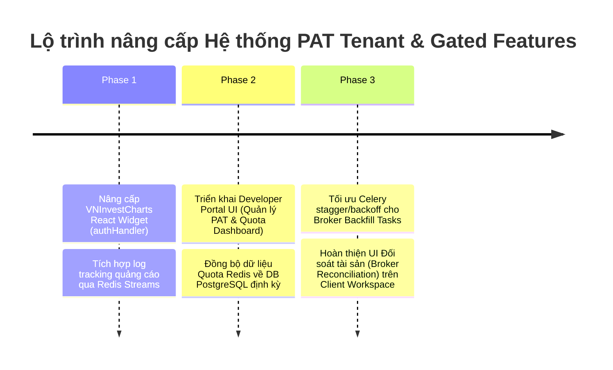

# BÁO CÁO RÀ SOÁT & ĐỀ XUẤT NÂNG CẤP HỆ THỐNG PAT TENANT, VNINVEST OPENAPIS, VNINVESTCHARTS VÀ VNBROKER

**Tài liệu**: `AUDIT_REPORT_PAT_TENANT_INTEGRATION_20260615.md`  
**Ngày tạo**: 2026-06-15  
**Trạng thái**: Sẵn sàng thảo luận  
**Workstream**: PAT-Tenant Audit  

---

## 1. Mục Tiêu Tài Liệu

Tài liệu này ghi lại kết quả rà soát chi tiết hệ thống quản lý khách thuê (Multi-Tenancy), cơ chế xác thực Personal Access Token (PAT) và đánh giá khả năng kiểm soát dữ liệu trên 3 cấu phần dịch vụ cốt lõi:
1. **vninvest OpenApis** (Hệ thống OpenAPI phục vụ đối tác/khách hàng B2B).
2. **vninvestcharts** (Gói biểu đồ nhúng standalone `VNInvestCharts Widget`).
3. **vnbroker** (Hệ thống tích hợp liên kết tài khoản chứng khoán người dùng, tiêu biểu là DNSE).

Tài liệu đồng thời chỉ ra các điểm thiếu hụt (Gaps) hiện tại và đề xuất lộ trình nâng cấp khả thi để hoàn thiện trải nghiệm SaaS Native của dự án VNInvest.

---

## 2. Hiện Trạng Kiến Trúc PAT & Tenant Isolation

Dự án đã hoàn thành nâng cấp nền tảng SaaS Native với các cơ chế kiểm soát truy cập và bảo vệ dữ liệu tự động cho từng request (per-request enforcement):

1. **SSOT `CoreTenant`**: Quản lý trạng thái Tenant (`Active`, `Trial`, `Suspended`, `Deprovisioned`) và các gói cước (`Free`, `Starter`, `Pro`, `Enterprise`) tại [identity_access/models.py](file:///c:/Mujoco%20Projects/vninvest/packages/core/backend/src/identity_access/models.py#L42).
2. **Xác thực PAT (`CorePATCredential`)**: Cấp phát Personal Access Token bảo mật bằng băm mã hóa **HMAC-SHA256** kết hợp với pepper trong môi trường ([models.py:L177](file:///c:/Mujoco%20Projects/vninvest/packages/core/backend/src/identity_access/models.py#L177)). Xác thực được xử lý qua lớp [CorePATAuthentication](file:///c:/Mujoco%20Projects/vninvest/packages/core/backend/src/identity_access/authentication.py#L9) qua header `Authorization: Bearer <raw_pat>`.
3. **Per-Request Guard (`IsTenantActive`)**: Lớp [IsTenantActive](file:///c:/Mujoco%20Projects/vninvest/packages/core/backend/src/identity_access/permissions.py#L65) được cấu hình trong `DEFAULT_PERMISSION_CLASSES` của Django REST Framework. Bất kỳ khi nào trạng thái Tenant chuyển sang `Suspended` hoặc `Deprovisioned`, truy cập API sẽ bị chặn ngay lập tức.
4. **API Metering (`TenantQuotaMiddleware`)**: Lớp [TenantQuotaMiddleware](file:///c:/Mujoco%20Projects/vninvest/packages/core/backend/src/identity_access/middleware.py#L15) đếm số cuộc gọi API theo ngày của Tenant lưu trong **Redis**, tự động trả về lỗi `429 (Quota Exceeded)` khi Tenant vượt quá hạn mức cước.

---

## 3. Rà Soát Chi Tiết Từng Phân Hệ

### 3.1. vninvest OpenApis
* **Hiện trạng Backend**: Đã hoàn thiện. Hệ thống có 75+ endpoint công khai được lọc tự động dữ liệu (Tenant Scoping) theo định dạng PAT gửi lên để chống rò rỉ chéo thông tin. Các API phục vụ Tenant tự quản trị (Self-Admin) như quản lý Service Account, tạo/xoay vòng/thu hồi PAT đã sẵn sàng tại [partner_urls.py](file:///c:/Mujoco%20Projects/vninvest/packages/core/backend/src/identity_access/partner_urls.py).
* **Đánh giá & Thiếu hụt (Gaps)**:
  - **Developer Portal UI (Frontend)**: Giao diện Client Portal chưa được tích hợp hoàn chỉnh các API tự phục vụ của đối tác (Partner Routes). Đối tác chưa thể tự đăng ký tài khoản, tự phát hành và theo dõi lượng hạn mức Quota đã dùng trên giao diện web.
  - **Lưu trữ Quota định kỳ**: Dữ liệu tích lũy API calls trong Redis cần được đồng bộ định kỳ về DB PostgreSQL qua Celery task phục vụ xuất hóa đơn (Billing).
* **Đề xuất nâng cấp**:
  - Hoàn thiện UI Developer Dashboard cho phép Tenant quản trị Service Accounts và PAT.
  - Kích hoạt Celery task đồng bộ dữ liệu quota Redis về PostgreSQL `commercial.UsageMeter` mỗi 5-15 phút.

### 3.2. vninvestcharts (VNInvestCharts Widget)
* **Hiện trạng**: Đã đổi tên thương hiệu thành công từ `vnstockcharts` sang `vninvestcharts` ở cả frontend và backend. Backend đã có app [advertising](file:///c:/Mujoco%20Projects/vninvest/packages/core/backend/src/advertising/) (Ad Server) phục vụ việc ẩn/hiện quảng cáo dựa trên Tenant PAT.
* **Cơ chế kiểm soát qua Tenant**:
  - View [ContentDisplayView](file:///c:/Mujoco%20Projects/vninvest/packages/core/backend/src/advertising/views.py#L30) nhận diện `tenantPat` được gửi từ Widget.
  - Nếu Tenant thuộc gói cước trả phí (`starter`, `pro`, `enterprise`...), backend trả về cờ ẩn quảng cáo (`show_ads = False`, `hide_trademark = True`).
  - Nếu là Tenant gói `free` hoặc chưa đăng nhập, backend trả về quảng cáo động (`show_ads = True`, `hide_trademark = False`) tương ứng kích thước yêu cầu, mã chứng khoán đang xem.
* **Đánh giá & Thiếu hụt (Gaps)**:
  - **Uncontrolled Widget Integration**: React Widget `VNInvestCharts` chưa tự động gửi `tenantPat` kèm theo các request lấy dữ liệu và hiển thị quảng cáo từ API. Parent component (workstation) vẫn phải can thiệp quản lý token và truyền thủ công qua props.
* **Đề xuất nâng cấp**:
  - Tích hợp thuộc tính `authHandler` hoặc sử dụng React Context trong component `VNInvestCharts` ở frontend để widget tự động lấy token và đính kèm vào các cuộc gọi API.
  - Đảm bảo cơ chế thu thập log impression/click quảng cáo qua Redis Streams và Celery của app `advertising` chạy mượt mà và không gây nghẽn DB chính.

### 3.3. vnbroker (Kết nối Tài khoản Chứng khoán)
* **Hiện trạng**: Sử dụng thư viện private `vnbroker` thông qua adapter `vnbroker_adapter.py`. 
  - Operator (Ban quản trị) quản lý cấu hình provider (circuit breaker, timeout, rate limits) qua SOC Config UI (VnbrokerPanel - chỉ dành cho Admin/Superuser).
  - Khách hàng (Tenant/User) liên kết tài khoản chứng khoán của họ (như DNSE) qua API `core/v1/dnse-credential/` ([DNSECredentialView](file:///c:/Mujoco%20Projects/vninvest/packages/core/backend/src/identity_access/dnse_credential_views.py#L28)) và các API `/broker/dnse/...` ([views_dnse.py](file:///c:/Mujoco%20Projects/vninvest/packages/core/backend/src/user_workspace/views_dnse.py)). api_key và api_secret được mã hóa đối xứng AES qua Fernet Key an toàn trước khi ghi vào cơ sở dữ liệu. Các API này đều chịu sự kiểm soát của permission `IsTenantActive`.
* **Đánh giá & Thiếu hụt (Gaps)**:
  - **Third-party Rate Limiting**: Khi nhiều Tenant thực hiện backfill giao dịch hoặc cào dữ liệu on-demand diện rộng, API bên thứ ba (DNSE) có thể trả về lỗi Rate Limit. Cơ chế Stagger/Backoff hiện tại trong Celery tasks cần được tối ưu hóa để đảm bảo độ bền vững.
  - **Workspace Broker UI**: Giao diện đồng bộ tài sản, đối soát giao dịch (Reconciliation) cho Broker trên Client Workspace cần được trực quan hóa tốt hơn để người dùng tự theo dõi trạng thái đồng bộ.
* **Đề xuất nâng cấp**:
  - Hoàn thiện cơ chế hàng đợi Stagger và thử lại thông minh (Exponential Backoff) cho Celery backfill tasks như [User self-serve backfill](file:///c:/Mujoco%20Projects/vninvest/packages/core/backend/src/data_ingest/tasks.py#L1963).
  - Xây dựng UI đối soát tài sản (Reconciliation) trực quan trên Client Workspace.

---

## 4. Lộ Trình Triển Khai Tiếp Theo (Roadmap)

---

**Tài liệu tham khảo liên quan**:
- [identity_access/models.py](file:///c:/Mujoco%20Projects/vninvest/packages/core/backend/src/identity_access/models.py) - Mô hình dữ liệu CoreTenant, CorePATCredential.
- [identity_access/authentication.py](file:///c:/Mujoco%20Projects/vninvest/packages/core/backend/src/identity_access/authentication.py) - Xác thực PAT.
- [identity_access/permissions.py](file:///c:/Mujoco%20Projects/vninvest/packages/core/backend/src/identity_access/permissions.py) - Phân quyền IsTenantActive.
- [identity_access/middleware.py](file:///c:/Mujoco%20Projects/vninvest/packages/core/backend/src/identity_access/middleware.py) - Middleware giới hạn Quota.
- [advertising/views.py](file:///c:/Mujoco%20Projects/vninvest/packages/core/backend/src/advertising/views.py) - API hiển thị quảng cáo theo Tenant cước.
- [user_workspace/views_dnse.py](file:///c:/Mujoco%20Projects/vninvest/packages/core/backend/src/user_workspace/views_dnse.py) - API tích hợp Broker DNSE.
