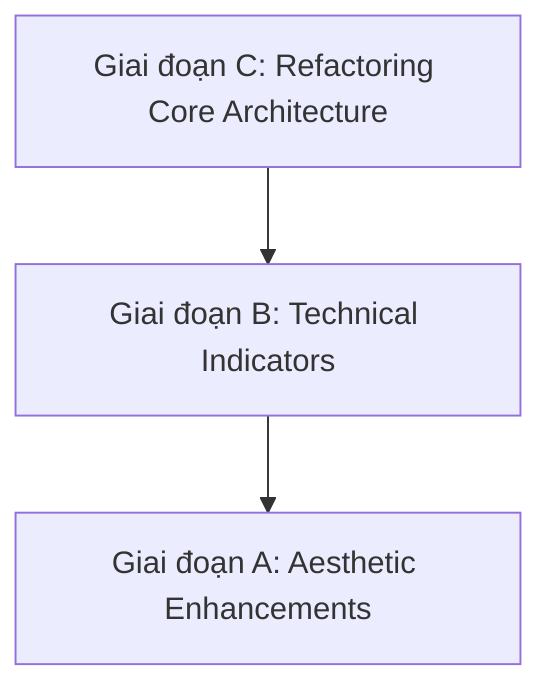

# Tài liệu Kỹ thuật Tối ưu: Smart Watchlist Radar (Phiên bản Hiệu chỉnh)

📅 **Ngày lập**: 2026-04-20
🎯 **Mục tiêu**: Định nghĩa kiến trúc dữ liệu và lộ trình triển khai tính năng Watchlist theo tiêu chuẩn "High-performance Financial Radar".

---

## 1. Chiến lược Xử Lý Dữ liệu Hybrid

Dựa trên phân tích hiệu suất và tính nhất quán dữ liệu, hệ thống sẽ áp dụng mô hình Hybrid Processing:

### 1.1 Backend Compute (Lớp Tính toán)
*   **Nhiệm vụ**: Xử lý các chỉ báo kỹ thuật nặng và yêu cầu dữ liệu lịch sử.
*   **Các chỉ số**:
    - **RSI(14)**: Relative Strength Index.
    - **Smoothing Moving Averages (MA20, MA50)**.
    - **RVOL (Relative Volume)**: So sánh volume hiện tại với trung bình 10-20 phiên.
    - **Market Cap & Volume Aggregation**: Tổng hợp dữ liệu quy mô lớn.
*   **Lý do**: Đảm bảo tính nhất quán (Data Integrity), giảm tải cho thiết bị đầu cuối (đặc biệt là Mobile) và bảo mật công thức tính toán.

### 1.2 Frontend Visualization (Lớp Hiển thị)
*   **Nhiệm vụ**: Hiệu ứng thị giác thời gian thực và tương tác người dùng.
*   **Các thành phần**:
    - **Price Glow/Flash**: Hiệu ứng nhấp nháy xanh/đỏ khi có tick mới.
    - **Mini-Sparklines**: Sử dụng SVG để hiển thị xu hướng giá 24h.
    - **Interaction Synchronization**: Đồng bộ hóa sự kiện giữa Watchlist, Chart và AI Advisory.
*   **Lý do**: Tận dụng sức mạnh rendering của Canvas/SVG và giảm độ trễ (Latency UX).

---

## 2. Lộ trình Triển khai "Refactor First"

Thứ tự ưu tiên được điều chỉnh để giải quyết các khoản nợ kỹ thuật (Technical Debt) trước khi đắp thêm tính năng:

### Giai đoạn C: Tái cấu trúc Hệ lõi (Ưu tiên cao nhất)
*   **Tách rời logic**: Trích xuất toàn bộ logic xử lý dữ liệu, chuẩn hóa (normalization) và sắp xếp (sorting) ra khỏi Component UI. Xây dựng hook chuyên biệt `useWatchlistDataProcessor`.
*   **Component hóa**: Chia nhỏ file `Watchlist.jsx` (2k lines) thành các nguyên tử: `WatchlistHeader`, `WatchlistTable`, `WatchlistSidebar`.
*   **Data Contract**: Định nghĩa interface dữ liệu chuẩn giữa Websocket và UI để tránh việc re-render không cần thiết.

### Giai đoạn B: Siêu nạp Chỉ báo Kỹ thuật
*   Mở rộng payload Websocket từ Backend để gửi kèm RSI, MA, RVOL.
*   Tích hợp các chỉ báo này vào bảng Watchlist với các cột có khả năng sort và filter thời gian thực.

### Giai đoạn A: Tối ưu Thẩm mỹ & Trải nghiệm
*   Triển khai hiệu ứng Glow/Flash.
*   Chế độ "Compact Mode" (Mật độ cao).
*   Tích hợp trạng thái Whale Alert (Shark/Whale icons).

---

## 3. Các Giải pháp Tối ưu Hiệu năng Cụ thể

Nhằm khắc phục các vấn đề nhận diện được từ `PortfolioHeatmap.jsx`, các giải pháp sau sẽ được áp dụng:

1.  **Web Workers cho Sparklines**: Chuyển logic tạo chuỗi SVG sang Web Worker để giải phóng UI thread, đảm bảo 60 FPS khi cuộn bảng.
2.  **Memoization thông minh**:
    - Cache kết quả của các hàm styling như `resolveHeatTileStyle`.
    - Sử dụng `React.memo` cho từng dòng (Row) của bảng để chỉ update những mã có thay đổi giá.
3.  **Chuẩn hóa dữ liệu một lần (Single Pass)**: Tránh việc gọi `toNumber()` hoặc tính toán căn bậc hai (`sqrt`) lặp đi lặp lại trong vòng lặp render.
4.  **Virtualization**: Áp dụng cho danh sách theo dõi có số lượng mã lớn (>100 symbols).

---

## 4. Các câu hỏi Kiến trúc cần thảo luận thêm

1.  **Web Worker Pattern**: Nên sử dụng file `.worker.js` rời hay giải pháp inline-string worker để tối ưu hóa quá trình Build/Deploy?
2.  **Indicator Throttling**: Tần suất tính toán RSI/MA trên Backend là bao nhiêu (mỗi giây hay mỗi 10 giây) để cân bằng giữa độ nhạy và CPU Load?
3.  **Visualization Stack**: Tiếp tục tối ưu ECharts bằng bộ đệm dữ liệu mới hay cân nhắc chuyển sang D3/Canvas chuyên biệt cho các thành phần UI siêu nhỏ?

> [!IMPORTANT]
> Việc Refactoring (Giai đoạn C) không chỉ để code sạch hơn, mà là điều kiện tiên quyết để đạt được hiệu suất "Zero Lag" khi xử lý dữ liệu streaming nén cao.
