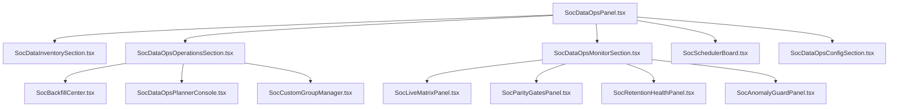

# Báo Cáo Đánh Giá Khoảng Cách Tính Năng SOC DataOps: Legacy vs SaaS Native

**Mã tài liệu**: `docs/AUDIT_SOC_DATAOPS_MIGRATION_GAP_20260625.md`  
**Ngày lập**: 2026-06-25  
**Trạng thái**: 🔴 Chưa đạt parity (Khoảng cách tính năng ~50%)  
**Đối tượng rà soát**:  
- Legacy: `frontend/src/components/soc/DataOpsPanel.jsx` (2,777 dòng)  
- SaaS Native mới: `packages/web/src/components/soc/`  

---

## 1. i18n & Terminology Gaps (Lỗ hổng dịch thuật)

Hiện tại, giao diện SaaS Native mới đang bị lỗi hiển thị các key dịch thô (như `soc.scheduler.title`) do thiếu namespace dịch trong tệp tin ngôn ngữ.

* **Thiếu namespace `soc.scheduler`**: Tệp tin [SocSchedulerBoard.tsx](file:///c:/Mujoco Projects/vninvest/packages/web/src/components/soc/SocSchedulerBoard.tsx) gọi nhiều key dịch không tồn tại trong `vi.js` và `en.js`:
  - `soc.scheduler.title` (Tiêu đề quản lý lịch chạy)
  - `soc.scheduler.loading` (Trạng thái đang tải)
  - `soc.scheduler.pause` (Nút tạm dừng)
  - `soc.scheduler.resume` (Nút kích hoạt lại)
  - `soc.scheduler.trigger` (Nút chạy thử)
  - `soc.scheduler.confirm_action` (Tiêu đề popup xác nhận)
  - `soc.scheduler.reason` (Trường nhập lý do)
  - `soc.scheduler.reason_placeholder` (Gợi ý nhập lý do)
* **Thiếu key `soc.actions.confirm`**: Nút xác nhận trong các popup modal đang dùng key không có sẵn, dẫn đến việc nút bị trống hoặc hiển thị key thô.

---

## 2. Tab 1: Kho dữ liệu (Inventory / Data)

Mặc dù đã hiển thị các thẻ metric cơ bản, phần chi tiết của tab Kho dữ liệu bị thiếu hụt nhiều quy tắc nghiệp vụ quan trọng từ legacy:

* **Bảng Coverage theo nhóm (Coverage by Group)**:
  - **Thiếu cột "Ngày lịch" (`calendar_days`)**: Cột này rất quan trọng để operator kiểm tra tính liên tục của dữ liệu. Legacy hiển thị số ngày kèm theo cảnh báo màu vàng và icon nguy cấp `⚠` nếu số ngày lịch nhỏ hơn 30 (`calendar_days < 30`).
  - **Thiếu nhận diện Custom Groups**: Các nhóm mã tự chọn do operator tự định nghĩa không được đánh dấu bằng icon ngôi sao đặc trưng `★` và không được chuyển màu chữ xanh mượt (`text-teal-300`).
  - **Thừa cột không thuộc legacy**: Cột "Recent (30d)" không hề có trong thiết kế bảng coverage của legacy, cần được loại bỏ hoặc thay thế bằng cột Ngày lịch để đồng bộ.
* **Loại dữ liệu (Data types grid)**:
  - Legacy có cơ chế kiểm tra nếu loại dữ liệu có bản ghi (`total_rows > 0`) thì viền bao quanh card sẽ chuyển sang màu xanh lá (`border-emerald-800 bg-emerald-950/30`), ngược lại thì hiển thị viền xám mặc định. Bản native hiện tại đang render đồng nhất viền giống nhau, làm mất đi tính tương phản trực quan.
* **Metric phụ bổ sung**:
  - Legacy hiển thị một dòng 4 thẻ stats phụ ngay trên Queue Tiers bao gồm: *Tổng mã hoạt động*, *Số tầng hàng đợi*, *Số ngày decay*, và *Thời điểm cập nhật cuối*.

---

## 3. Tab 2: Điều phối (Operations / Ops)

Đây là nơi có **sự sai lệch cấu trúc nghiêm trọng nhất**. Đội code đã gộp hai tính năng có luồng xử lý và dữ liệu hoàn toàn độc lập vào làm một:

* **Sự sai lệch của Backfill và Planner**:
  - **Legacy**: Chia làm 2 panel độc lập hoặc song song. **Backfill Center** dùng để bổ sung dữ liệu diện rộng theo Nhóm mã / Custom symbols trên một Khoảng ngày nhất định. **Planner Console** dùng để operator gõ trực tiếp danh sách mã vào textarea, xem trước (Preview) để hệ thống tự động tính toán xem mã nào thiếu (planned) mã nào đã đủ (skipped) rồi mới bấm Run.
  - **Native**: Gom tất cả vào một component [SocDataOpsBackfillForm.tsx](file:///c:/Mujoco Projects/vninvest/packages/web/src/components/soc/SocDataOpsBackfillForm.tsx) dẫn đến việc mất đi giao diện **Planner Console**.
* **Các tính năng của Planner Console bị lược bỏ**:
  - Không có khung gõ danh sách mã tự do (textarea lớn hỗ trợ phân tách dấu phẩy/xuống dòng).
  - Không có bảng hiển thị chi tiết **Planned Items** (mã sẽ chạy) và **Skipped Items** (mã bỏ qua) kèm theo phân trang và lý do bỏ qua cụ thể.
* **Thiếu Custom Symbol Group CRUD Manager**:
  - Legacy tích hợp một trình quản lý nhóm mã tự do (CRUD Symbol Groups) nằm ngay trong Operations tab. Operator có thể tạo nhóm mới (ví dụ: `NHOM_TEST` gồm `AAA, BBB, CCC`) hoặc xóa nhóm đi. Nhóm tự tạo này sẽ ngay lập tức được đồng bộ vào danh sách radio của Backfill và Monitor tab. Bản native hoàn toàn không có tính năng này.

---

## 4. Tab 3: Giám sát (Monitor)

Tệp tin [SocDataOpsMonitorSection.tsx](file:///c:/Mujoco Projects/vninvest/packages/web/src/components/soc/SocDataOpsMonitorSection.tsx) hiện tại là một **khung rỗng**. Hầu hết các panel giám sát phức tạp đều bị bỏ qua:

* **Raw JSON Dump**: Thay vì xây dựng bảng ma trận phân bổ độ phủ dữ liệu (datasets x freshness states), đội code chỉ kết xuất trực tiếp thẻ `<pre>` chứa dữ liệu JSON thô của `coverage`. Điều này hoàn toàn không thể sử dụng để giám sát vận hành thực tế.
* **Live Snapshot Matrix**: Thiếu toàn bộ giao diện điều khiển ma trận cào dữ liệu song song (không có provider toggles, group filter, nút Start/Abort cycle và không tích hợp canvas heatmap [SocMatrixScrapeMonitor.tsx](file:///c:/Mujoco Projects/vninvest/packages/web/src/components/soc/SocMatrixScrapeMonitor.tsx)).
* **Quan sát vận hành (Observability)**:
  - Thiếu **Parity Gates (24h/72h)**: Đánh giá cổng đối chiếu dữ liệu strict vs relaxed, hiển thị nhãn Pass/Fail và xu hướng tăng/giảm kèm danh sách 7 kỳ lịch sử.
  - Thiếu **Retention Health**: Giám sát sức khỏe lưu trữ, hiển thị số lượng bản ghi bị xóa, xu hướng lưu trữ và biểu đồ histogram dạng cột tự co giãn chiều cao theo Peak Deleted.
  - Thiếu bảng chi tiết **Backlog theo dataset** và **Backlog theo queue tier**.
  - Thiếu bảng cảnh báo **Starvation** và **Anomaly Guard** (bao gồm danh sách mã bị trễ dữ liệu Critical Gap Symbols và danh sách mã vi phạm chu kỳ cào Hot Tier Breach).
  - Thiếu danh sách lỗ hổng ưu tiên **Top Gaps** có phân trang và hành động khuyến nghị tiếp theo (`next_recommended_action`).

---

## 5. Tab 5: Cấu hình (Config)

* **Trùng lặp Scheduler board**:
  - Tại cuối tệp [SocDataOpsConfigSection.tsx](file:///c:/Mujoco Projects/vninvest/packages/web/src/components/soc/SocDataOpsConfigSection.tsx#L185) đang nhúng component `SocSchedulerBoard`.
  - Đây là sự trùng lặp thừa thãi và không hợp lý về mặt giao diện, vì "Lịch chạy" (Scheduler) đã có riêng một subtab độc lập được định tuyến rõ ràng trên thanh tab chung.

---

## 6. Đề xuất sơ đồ phân rã & Tái cấu trúc mới

Để giải quyết triệt để và mang lại giao diện hoàn chỉnh, chúng tôi đề xuất phân rã lại cấu trúc các tệp tin trong `packages/web/src/components/soc/` như sau:

### Kế hoạch hành động cụ thể:

1. **Bước 1: Sửa chữa i18n & Terminology**
   - Khai báo đầy đủ block `soc.scheduler.*` và `soc.actions.confirm` trong cả `vi.js` và `en.js`.
2. **Bước 2: Xây dựng lại Tab Operations (Điều phối)**
   - Tạo mới `SocDataOpsPlannerConsole.tsx` (bảng Planned/Skipped items có phân trang, symbols textarea).
   - Tạo mới `SocCustomGroupManager.tsx` để quản lý CRUD các nhóm mã.
   - Khôi phục [SocDataOpsBackfillForm.tsx](file:///c:/Mujoco Projects/vninvest/packages/web/src/components/soc/SocDataOpsBackfillForm.tsx) về đúng chức năng của Backfill Center (không gộp với Planner).
3. **Bước 3: Hoàn thiện Tab Monitor (Giám sát)**
   - Viết các panel giao diện chuyên biệt: `SocLiveMatrixPanel`, `SocParityGatesPanel`, `SocRetentionHealthPanel`, `SocAnomalyGuardPanel` thay thế cho JSON dump thô.
   - Tích hợp canvas heatmap [SocMatrixScrapeMonitor.tsx](file:///c:/Mujoco Projects/vninvest/packages/web/src/components/soc/SocMatrixScrapeMonitor.tsx) đã có sẵn.
4. **Bước 4: Dọn dẹp Config Tab**
   - Loại bỏ component `SocSchedulerBoard` trùng lặp ở cuối tệp Config.
5. **Bước 5: Đồng bộ hóa css**
   - Khai báo đầy đủ các class CSS mới trong [soc.module.css](file:///c:/Mujoco Projects/vninvest/packages/web/src/components/soc/soc.module.css) để phục vụ cho các bảng và biểu đồ cột histogram mới.
