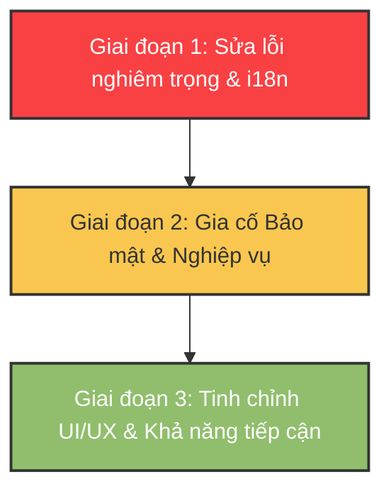

# Báo cáo Audit toàn diện: UI/UX & Lỗ hổng kỹ thuật hệ thống Tenant Admin (VNInvest)

Tài liệu này tổng hợp kết quả phân tích, đánh giá mã nguồn, thiết kế UI/UX, tính bản địa hóa (i18n), bảo mật và khả năng tương thích của cả 13 trang thuộc khu vực quản trị dành cho Tenant (Tenant Admin). Qua đó đề xuất lộ trình nâng cấp tổng thể nhằm tăng độ ổn định, hoàn thiện trải nghiệm và loại bỏ hoàn toàn các lỗi tiềm ẩn.

---

## 1. Tóm tắt kết quả (Executive Summary)

Sau khi kiểm tra sâu toàn bộ mã nguồn của các trang `/packages/web/src/pages/tenant-admin/*` và các thành phần chia sẻ, chúng tôi ghi nhận:
*   **Độ phủ Tính năng (Feature Completeness):** Đạt khoảng 80%. Tuy nhiên có một số lỗi luồng nghiệp vụ nghiêm trọng (ví dụ: Nâng cấp gói cước không thực thi API thanh toán thực tế, rò rỉ thông tin trước khi kiểm tra quyền truy cập).
*   **Trải nghiệm người dùng (UI/UX & Accessibility):** Giao diện mang phong cách hiện đại nhưng thiếu tính nhất quán. Hầu hết các Modal được xây dựng thủ công (inline), thiếu khả năng điều khiển bằng bàn phím (phím ESC), bẫy tiêu điểm (Focus Trap) và các thuộc tính hỗ trợ tiếp cận (ARIA).
*   **Kỹ thuật & Kiến trúc (Technical Gaps):** 
    *   Tồn tại tệp tin cấu hình định tuyến cũ `main.js` không còn sử dụng gây nhầm lẫn (hệ thống thực tế chạy `main.tsx`).
    *   Hàng trăm dòng mã CSS inline cần được chuẩn hóa về CSS Modules.
    *   Các hàm tải dữ liệu (`useEffect`) thiếu cơ chế hủy yêu cầu (`AbortController`), dễ dẫn đến lỗi cập nhật trạng thái trên component đã hủy (Memory Leak).
*   **Bản địa hóa (i18n):** Phát hiện lỗi đặc biệt nghiêm trọng khi hai phân hệ lớn là **Báo cáo (tenantReports)** và **Bảo mật (tenantSecurity)** hoàn toàn trống rỗng trong tệp dịch tiếng Việt (`vi.js`), khiến người dùng Việt Nam chỉ nhìn thấy các mã khóa thô (Raw Key Strings).

---

## 2. Rà soát cấu trúc định tuyến (Routing & Legacy Code)

*   **Tệp tin dư thừa:** Tồn tại cả `main.js` and `main.tsx` trong thư mục gốc `/src`. Tệp cấu hình chạy thực tế của Vite là `main.tsx` (nhúng qua `index.html`). Tuy nhiên, định tuyến trong `main.js` bị lệch (thiếu 5 trang Tenant Admin con).
    > [!WARNING]
    > **Khuyến nghị:** Cần xóa bỏ hoàn toàn tệp tin `main.js` để tránh hiểu nhầm cho các lập trình viên sau này và đảm bảo một nguồn sự thật duy nhất (SSOT) cho cấu hình định tuyến hệ thống.

---

## 3. Phân tích chi tiết từng trang (Page-by-Page Deep Audit)

### 3.1. TenantAdminHomePage.tsx
*   **Lỗi logic (Bugs):**
    *   *Đóng hộp thoại khi lỗi:* Trong hàm xử lý hủy kích hoạt Tenant (`handleDeprovision`), hàm `setShowDeprovision(false)` nằm trong khối `finally`. Nếu API trả về lỗi, hộp thoại vẫn đóng lập tức, người dùng chỉ thấy lỗi chớp qua mà không kịp đọc.
    *   *Nuốt lỗi đồ thị:* Hàm `handleTrendDaysChange` bắt lỗi qua `.catch((_err: unknown) => {})` hoàn toàn trống rỗng. Nếu API lỗi, biểu đồ đứng yên không cập nhật mà không báo gì cho người dùng.
    *   *Điều kiện Checklist sai:* Kiểm tra trạng thái mã Token hết hạn dùng `done: summary?.pats_expiring_soon !== undefined`. Điều này luôn đúng nếu trường dữ liệu tồn tại trong API, ngay cả khi số lượng token sắp hết hạn khác `0`. Logic đúng phải là `summary?.pats_expiring_soon === 0`.
    *   *Checklist quyền hạn bị sai nghĩa:* Mục SSO và Webhooks sử dụng quyền truy cập `ability.can("read", ...)` làm điều kiện hoàn thành (done). Điều này có nghĩa là nếu người dùng có quyền admin, checklist hiển thị đã hoàn thành mặc dù Tenant chưa hề cấu hình SSO hay Webhook.
*   **Hạn chế UI/UX:**
    *   Không có vòng xoay tải dữ liệu (Loading Spinner) hoặc khung xương (Skeleton), chỉ có dòng chữ đơn điệu `Loading...`.
    *   Ký tự biểu thị ngày bị fix cứng tiếng Anh (`7d`, `14d`, `30d`) thay vì sử dụng i18n.
    *   Định nghĩa component con `KpiCard` nằm lồng bên trong hàm render của component cha, bị tạo mới liên tục mỗi khi re-render (ảnh hưởng hiệu năng).

### 3.2. TenantAdminBillingPage.tsx
*   **Lỗi logic nghiêm trọng (🚨 CRITICAL BUG):**
    *   *Lỗi thực thi nâng cấp:* Hàm `handleUpgrade` gọi hàm `operatorClient.previewPlanChange(targetPlan)` — đây là API chỉ để **xem trước (preview)** giá trị và lượng tài nguyên thay đổi, không phải API thực thi nâng cấp. Tuy nhiên sau đó UI lại gọi `setUpgradeDone(true)` khiến người dùng tưởng rằng đã nâng cấp thành công. Người dùng không thể tự nâng cấp gói cước trên giao diện.
    *   *Trích xuất hóa đơn không an sau:* Lệnh `setInvoices(invData.results || invData.data || invData || [])` có nguy cơ gây lỗi ứng dụng (Crash) nếu `invData` là một đối tượng thường không chứa mảng, khi đó lệnh `.map` phía dưới sẽ bị lỗi.
*   **Hạn chế UI/UX & Kỹ thuật:**
    *   Fix cứng ký hiệu tiền tệ `"VND"` trong toàn bộ giao diện và đồ thị.
    *   Thông tin gói cước (số lượng thành viên tối đa, giới hạn API) bị viết cứng (hardcoded) ở Frontend thay vì lấy động từ API bản ghi cấu hình gói cước của Backend.
    *   Không có hộp thoại xác nhận khi bấm nâng cấp gói cước (dễ gây click nhầm phát sinh chi phí).
    *   *Lỗi dịch thuật (i18n):* 6 mã khóa cấu hình biểu đồ chi phí (như `tenantBilling.costTrendTitle`, `tenantBilling.costTotal`,...) tồn tại ở `en.js` nhưng **thiếu hoàn toàn** ở `vi.js`.

### 3.3. TenantAdminUsagePage.tsx & TenantAdminUsageHistoryPage.tsx
*   **Lỗi logic (Bugs):**
    *   *Nuốt lỗi im lặng:* Có tới 3 khối `catch` tải dữ liệu dự báo, biểu đồ lịch sử và cấu hình cảnh báo có ghi chú `// silently fail` và để trống. Người dùng gặp lỗi mạng sẽ thấy các phần này trống rỗng vô lý mà không biết lý do.
    *   *Mã Meter cứng:* Mảng `METER_CODES` (`["api_calls", "ai_regenerate", "whale_symbols", "exports"]`) bị viết cứng ở cả 2 trang độc lập. Nếu phía Backend bổ sung thêm loại tài nguyên giám sát mới, giao diện sẽ không hiển thị được.
    *   *Lỗi tính toán Peak Day:* Sử dụng hàm `.reduce()` trên mảng dữ liệu đồ thị lịch sử nhưng không kiểm tra mảng rỗng, dẫn đến hiển thị ngày cao điểm bị trống hoặc lỗi.
*   **Hạn chế UI/UX:**
    *   Thanh Tab điều hướng được làm từ các thẻ `div` tùy biến, hoàn toàn không hỗ trợ bàn phím, không có các thẻ ARIA tiêu chuẩn cho trình đọc màn hình (`role="tablist"`, `aria-selected`).
    *   Biểu đồ lịch sử tải lại dữ liệu liên tục mỗi khi người dùng chuyển qua lại giữa các tab (không có bộ nhớ đệm tạm thời).

### 3.4. TenantAdminMembersPage.tsx
*   **Lỗi logic (Bugs):**
    *   *Hủy lời mời:* Khi bấm hủy một lời mời thành viên chưa kích hoạt (`handleCancelInvite`), giao diện lọc bỏ hoàn toàn bản ghi đó khỏi danh sách (`filter`), thay vì chuyển trạng thái hiển thị thành "Đã hủy". Nếu người dùng tải lại trang, bản ghi bị xóa tạm ở Frontend có thể xuất hiện lại nếu Backend chưa đồng bộ kịp.
    *   *Fix cứng nhãn vai trò:* Nhãn hiển thị của các cột vai trò `"Owner"` và `"Admin"` bị viết cứng bằng tiếng Anh thay vì gọi từ i18n key.
    *   *Thiếu mã dịch:* Khóa `tenantMembers.searchPlaceholder` được gọi nhưng không có trong tệp dịch tiếng Việt.
*   **Hạn chế UI/UX:**
    *   Không hỗ trợ đổi vai trò (Role Change) của thành viên đang hoạt động, chỉ hỗ trợ xóa khỏi tổ chức (phải xóa đi mời lại từ đầu rất bất tiện).
    *   Tự nhúng chuỗi CSS lớn (`MEMBER_CSS`) thông qua thẻ `<style>` inline trong hàm render.

### 3.5. TenantAdminServiceAccountsPage.tsx
*   **Lỗi bảo mật & Logic (Security & Logic Gaps):**
    *   *🚨 Rò rỉ thông tin trước khi kiểm tra quyền:* Trang kiểm tra trạng thái tải dữ liệu (`loading` và `error`) và thực hiện gọi API trước khi kiểm tra quyền hạn của người dùng (`canRead`). Người dùng không có quyền truy cập vẫn kích hoạt API gọi lên server, sau đó mới thấy thông báo chặn quyền.
    *   *Nguy cơ lỗi cú pháp API:* Hàm xóa Service Account dùng `handleDeleteSA(saId!)` với toán tử khẳng định khác null (`!`). Nếu tài khoản dịch vụ không có ID, tham số gửi đi sẽ là chuỗi `"undefined"` dẫn đến lỗi HTTP 404 hoặc 400.
    *   *Bật/tắt trạng thái không xác nhận:* Khi click vào nút bật/tắt (Enable/Disable) tài khoản dịch vụ, hệ thống thực thi ngay lập tức mà không có cảnh báo xác nhận. Việc này có thể làm gián đoạn các kết nối API đang chạy của hệ thống production nếu click nhầm.

### 3.6. TenantAdminPATsPage.tsx
*   **Lỗi dịch thuật & Fix cứng ngôn ngữ (i18n):**
    *   Mặc dù trang này vừa được tinh chỉnh, giao diện vẫn còn một số nhãn tiếng Việt bị viết cứng trực tiếp trong code như: `"+ Tạo Service Account"`, `"Quyền hạn của Service Account:"`, `"Không có quyền hạn"`, `"30 ngày"`,...
    *   *Xung đột tên biến:* Biến cục bộ trong vòng lặp lọc token được đặt tên là `t` (ví dụ: `tokens.filter(t => t.status === "active")`), làm ẩn đi hàm dịch thuật `t` của context `useI18n()`. Điều này cực kỳ nguy hiểm, dễ dẫn đến các lỗi dịch thuật sai lệch nếu vô tình gọi `t()` trong các biểu thức lân cận.
*   **Hạn chế UI/UX & Kỹ thuật:**
    *   Thiếu nút thu hồi hàng loạt (Bulk Revoke) mặc dù mã dịch đã được khai báo sẵn.
    *   Việc tính toán thời gian hết hạn sử dụng `toISOString().slice(0, 16)` lấy theo múi giờ UTC, lệch 7 tiếng so với múi giờ thực tế của người dùng Việt Nam (UTC+7), dẫn đến thời gian hiển thị mặc định trên ô nhập liệu bị sai giờ.

### 3.7. TenantAdminSSOPage.tsx
*   **Lỗi logic & Rủi ro cấu hình (Bugs & Risks):**
    *   *Mất dữ liệu chưa lưu khi chạy thử:* Khi bấm nút "Chạy thử SSO", hệ thống gán trực tiếp link vào `window.location.href`. Nếu người dùng đang chỉnh sửa dở cấu hình nhưng chưa lưu, toàn bộ dữ liệu sẽ bị mất sạch mà không có cảnh báo.
    *   *🚨 Cho phép sửa thông tin của Hệ thống (SP):* Các trường dữ liệu `SP Entity ID` và `SP ACS URL` (đầu ra của hệ thống để admin copy cấu hình sang Azure AD / Okta) lại được hiển thị dưới dạng ô nhập liệu cho phép chỉnh sửa. Nếu admin sửa nhầm các trường này, cơ chế SAML SSO sẽ hỏng hoàn toàn. Chúng bắt buộc phải hiển thị dạng Read-Only kèm nút Copy.
    *   *Thông báo thành công không tự tắt:* Biểu ngữ báo lưu thành công hiển thị vĩnh viễn cho đến khi người dùng tự thay đổi giá trị trên form.
*   **Hạn chế UI/UX:**
    *   Thiếu nút Tải xuống tệp Metadata XML (cấu hình SAML chuẩn hóa) để import nhanh vào các hệ thống IdP.
    *   Thiếu các nút sao chép nhanh (Copy to Clipboard) cho cấu hình SP.

### 3.8. TenantAdminSecurityPage.tsx
*   **Lỗi nghiêm trọng (🚨 CRITICAL BUG):**
    *   *🚨 Mất toàn bộ mã dịch tiếng Việt:* Phân hệ `tenantSecurity` (bao gồm các tiêu đề, thông tin phiên đăng nhập hoạt động, lịch sử lỗi đăng nhập,...) **hoàn toàn biến mất** khỏi tệp dịch `vi.js`. Người dùng Việt Nam sẽ thấy giao diện hiển thị toàn bộ dạng mã thô như `tenantSecurity.title`.
    *   *Lỗi gọi hàm thời gian:* Hàm tính toán thời gian `timeAgo` gọi hàm `vaint("common.justNow", t)` nhưng nhãn `common.justNow`, `common.minutesAgo`,... không hề tồn tại trong hệ thống ngôn ngữ, gây lỗi hiển thị cột thời gian hoạt động.
*   **Hạn chế UI/UX:**
    *   Bảng phiên hoạt động hiển thị cột `login_at` nhưng không hiển thị cột `last_active_at`, khiến admin không biết phiên nào đang thực sự tương tác gần nhất.
    *   Không có tính năng chặn IP từ danh sách các lần đăng nhập sai (Recent Failures).

### 3.9. TenantAdminWebhooksPage.tsx
*   **Lỗi logic & Bảo mật (Bugs & Security):**
    *   *🚨 Lỗi hiển thị Secret sau khi tạo:* Đoạn code hiển thị mã khóa bí mật (Secret Key) kiểm tra trạng thái `secretReveal` ngay sau khi cập nhật bằng `setSecretReveal(result.raw_secret)`. Vì cơ chế cập nhật trạng thái của React là bất đồng bộ (async), biến `secretReveal` tại thời điểm kiểm tra vẫn là `null`, dẫn đến hộp thoại thành công bị đóng ngay lập tức và người dùng không bao giờ nhìn thấy Secret Key để copy.
    *   *🚨 Lỗ hổng bỏ qua phân quyền:* Trang này **không hề kiểm tra quyền hạn** của người dùng thông qua `ability` như các trang quản trị khác. Bất kỳ thành viên nào biết đường dẫn đều có thể vào tạo, xóa hoặc cấu hình lại webhook của tổ chức.
    *   *Thiếu mã dịch:* Thiếu hoàn toàn các khóa dịch cho nhãn sự kiện như `tenantWebhooks.eventMember`, `eventPAT`, `eventSA`, `eventQuota`,... dẫn đến hiển thị thô lỗi trên giao diện.

### 3.10. TenantAdminAuditLogsPage.tsx
*   **Lỗi logic (Bugs):**
    *   *Lỗi bất đồng bộ khi xóa bộ lọc:* Hàm `handleClearFilters` dùng `setTimeout(() => loadLogs(""), 0)` để đợi các bộ lọc được reset về rỗng rồi mới tải lại danh sách. Đây là giải pháp không an toàn vì React có thể gộp các bản cập nhật trạng thái (State Batching), dẫn đến việc bộ lọc cũ vẫn bị gửi lên API. Giải pháp đúng là truyền trực tiếp tham số rỗng vào hàm tải dữ liệu.
    *   *🚨 Thống kê dữ liệu sai lệch:* Các biểu đồ tròn tỷ lệ sự kiện, đồ thị tần suất hoạt động hàng ngày được tính trực tiếp từ mảng dữ liệu `logs` của trang hiện tại (chỉ gồm 20 hoặc 50 bản ghi đang hiển thị). Điều này làm sai lệch nghiêm trọng số liệu thống kê (ví dụ: Trang 1 chỉ có 3 loại sự kiện nhưng thực tế trong cơ sở dữ liệu có 30 loại sự kiện khác nhau).

### 3.11. TenantAdminReportsPage.tsx
*   **Lỗi logic & Dịch thuật (Bugs & i18n Gaps):**
    *   *🚨 Mất toàn bộ mã dịch tiếng Việt:* Toàn bộ phần dịch thuật của Báo cáo định kỳ (`tenantReports`) **hoàn toàn trống rỗng** trong tệp `vi.js`.
    *   *Thiếu nút Tạo mới:* Khi danh sách báo cáo đã có dữ liệu, giao diện ẩn hoàn toàn nút "Tạo mới" (nút này chỉ xuất hiện khi danh sách trống rỗng ở Empty State).
    *   *Không có chức năng sửa:* Chỉ hỗ trợ Tạo và Xóa, admin không thể sửa tên báo cáo, danh sách email nhận tin hay chu kỳ gửi báo cáo.

### 3.12. TenantAdminCapabilitiesPage.tsx
*   **Lỗi logic & Giao diện:**
    *   *Sai kiểu dữ liệu:* Hàm `formatQuotaValue` khai báo nhận tham số kiểu `number` nhưng bên trong lại kiểm tra xem giá trị có phải `null` hay `undefined` hay không. Phía gọi hàm ép kiểu thô bằng `as number`, dễ lọt giá trị rỗng gây lỗi hiển thị.
    *   *Biểu đồ tiến độ vô nghĩa:* Thanh tiến độ (Progress Bar) chỉ hiển thị giá trị nhị phân: Hoặc là đầy 100% nếu giá trị lớn hơn 0, hoặc là rỗng 0% nếu bằng 0. Nó không hề so sánh lượng đã dùng thực tế với hạn mức cho phép.
    *   *Lọc cứng quyền:* Giao diện chỉ hiển thị 3 nhóm quyền chính: `read`, `write`, `admin`. Mọi hành động tùy biến khác (như `manage`, `create`, `delete`...) bị ẩn đi hoàn toàn trên bảng phân tích năng lực.

---

## 4. Đánh giá chất lượng hạ tầng dùng chung (Shared Infrastructure)

### 4.1. Khả năng tiếp cận & Phím điều khiển (Accessibility)
Hầu hết các trang Tenant Admin đều sử dụng chung cách dựng hộp thoại (Modal) thủ công bằng các đoạn mã HTML thuần lồng ghép. Các hộp thoại này gặp các lỗi chung sau:
*   Không bắt tiêu điểm (Focus Trap): Khi mở hộp thoại, người dùng nhấn phím `Tab` vẫn có thể duyệt qua các nút nằm ẩn phía dưới giao diện chính.
*   Không có phím đóng nhanh (ESC Key): Người dùng không thể nhấn phím `Escape` để hủy bỏ thao tác nhanh.
*   Không thân thiện với trình đọc màn hình: Thiếu thuộc tính `role="dialog"`, `aria-modal="true"`.

### 4.2. Quản lý bất đồng bộ (Async Lifecycle)
Không có component nào sử dụng `AbortController` trong hook `useEffect` để hủy bỏ các yêu cầu API đang chạy khi người dùng chuyển trang nhanh. Điều này dễ dẫn đến cảnh báo lỗi bộ nhớ: `"Can't perform a React state update on an unmounted component"`.

### 4.3. Đồng bộ hóa mã dịch (i18n Sync Gaps)
Hệ thống tiếng Anh (`en.js`) có cấu trúc rất đầy đủ, tuy nhiên hệ thống tiếng Việt (`vi.js`) bị bỏ quên rất nhiều tài nguyên lớn. Bảng dưới đây tóm tắt các khu vực bị thiếu hụt:

| Phân hệ / Khóa dịch | Trạng thái ở `vi.js` | Mức độ nghiêm trọng | Ảnh hưởng |
|---|---|---|---|
| `tenantSecurity` | **THIẾU HOÀN TOÀN** | 🔴 Cực kỳ nghiêm trọng | Hỏng hiển thị toàn bộ trang bảo mật |
| `tenantReports` | **THIẾU HOÀN TOÀN** | 🔴 Cực kỳ nghiêm trọng | Hỏng hiển thị toàn bộ trang báo cáo định kỳ |
| `tenantBilling.costTrend*` | **THIẾU HOÀN TOÀN** | 🟡 Cao | Biểu đồ chi phí hiển thị nhãn tiếng Anh |
| `tenantWebhooks.event*` | **THIẾU HOÀN TOÀN** | 🟡 Cao | Các loại sự kiện webhook hiển thị mã thô |
| `tenantMembers.searchPlaceholder` | **THIẾU** | 🟢 Thấp | Ô tìm kiếm hiển thị mã key |

---

## 5. Kế hoạch hành động & Lộ trình nâng cấp (Action Plan)

Chúng tôi đề xuất lộ trình xử lý chia làm 3 giai đoạn cụ thể như sau:

### Giai đoạn 1: Sửa lỗi nghiêm trọng & Đồng bộ hóa Bản dịch (Độ ưu tiên: Cao nhất)
1.  **Đồng bộ hóa tiếng Việt cho `vi.js`:** Sao chép cấu hình dịch hệ thống từ `en.js` sang `vi.js` cho các trường `tenantSecurity` và `tenantReports`. Biên dịch nghĩa hoàn chỉnh sang tiếng Việt có dấu.
2.  **Sửa lỗi luồng thanh toán tại Billing Page:** Chuyển đổi lệnh gọi từ `previewPlanChange` sang endpoint thực hiện nâng cấp thực tế (kèm cơ chế hiển thị cổng thanh toán).
3.  **Sửa lỗi hiển thị Secret tại Webhook Page:** Sửa logic hiển thị hộp thoại thành công để lấy trực tiếp chuỗi mật khẩu thô từ kết quả phản hồi của API thay vì chờ state cập nhật.
4.  **Dọn dẹp code dư thừa:** Xóa bỏ hoàn toàn tệp tin định tuyến cũ `main.js` để tránh xung đột cấu hình định tuyến.

### Giai đoạn 2: Gia cố Bảo mật & Chuẩn hóa Nghiệp vụ (Độ ưu tiên: Trung bình)
1.  **Bảo vệ trang Webhooks:** Thêm kiểm tra quyền truy cập `ability.can("write", "TenantWebhookView")` ngay đầu trang Webhooks để chặn truy cập trái phép.
2.  **Chuyển đổi các trường nhập liệu SSO:** Đưa các trường cấu hình của nhà cung cấp dịch vụ (`SP Entity ID`, `SP ACS URL`) về dạng hiển thị chỉ đọc (Read-only) và bổ sung nút "Copy" kế bên.
3.  **Sửa lỗi phân quyền rò rỉ thông tin ở Service Accounts Page:** Di chuyển phần kiểm tra quyền hạn lên trên đầu trang, trước các dòng lệnh kiểm tra trạng thái tải và gọi API.
4.  **Xác nhận trước các hành động nguy hiểm:** Bổ sung hộp thoại cảnh báo (Confirm Modal) khi người dùng đổi trạng thái hoạt động của Service Accounts hoặc bật/tắt báo cáo/webhook.

### Giai đoạn 3: Nâng cấp trải nghiệm UI/UX & Khả năng tiếp cận (Độ ưu tiên: Tiêu chuẩn)
1.  **Xây dựng Component `AdminModal` dùng chung:** Thay thế toàn bộ các modal tự chế bằng một component modal chuẩn hóa được thiết kế có sẵn các bẫy tiêu điểm (Focus Trap) và cơ chế bắt sự kiện phím `Escape` để tự đóng.
2.  **Thống nhất định dạng CSS:** Loại bỏ các thuộc tính CSS inline, chuyển sang sử dụng hệ thống biến CSS Tokens trong `soc.module.css` để đồng bộ giao diện glassmorphic cao cấp.
3.  **Bổ sung `AbortController`:** Thêm cơ chế hủy yêu cầu mạng bất đồng bộ vào tất cả các hook `useEffect` phục vụ việc tải dữ liệu.
4.  **Tối ưu hóa các biểu đồ thống kê:** Thiết kế lại phần hiển thị tiến độ của trang Capabilities (so sánh lượng dùng thực tế với giới hạn) và sửa lỗi thu thập số liệu sai lệch của Audit Logs Page.
