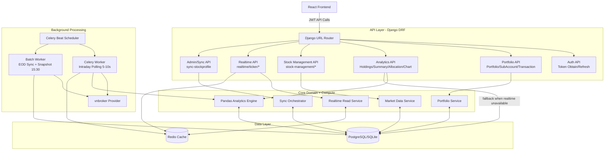
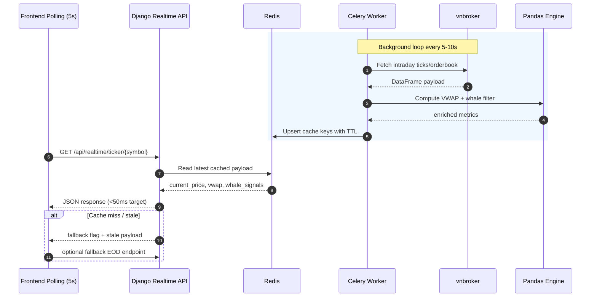

# Backend Technical Diagram - Level 2

Tai lieu nay luu so do ky thuat muc 2 de tai su dung cho:
- Thiet ke he thong
- Onboarding thanh vien moi
- Review scope Sprint 7-14
- Truyen thong giua BE/FE/QA/DevOps

## 1) So do thanh phan muc 2 (Container + Service decomposition)

## 2) So do luong nghiep vu muc 2 (Realtime intraday)

## 3) Phan ra module backend (Level 2)

1. Authentication Module
- JWT issue/refresh
- Permission enforcement (IsAuthenticated, role-based extension)

2. Portfolio Domain Module
- Portfolio/SubAccount/Transaction CRUD
- UserConfig (theme, whale threshold)
- AccountSnapshot generation

3. Analytics Engine Module
- Weighted average cost
- Holdings and unrealized/realized P/L
- NAV/Allocation/Chart series

4. Market Data Module
- StockProfile sync
- DailyPrice EOD sync
- Securities groups and tracked symbols

5. Realtime Module
- Intraday collector worker
- Redis key-value cache for low-latency serving
- Whale tracking and VWAP metrics

6. Screener and Advisor Module (target)
- JSON rule parser/evaluator
- Technical signal scoring
- Entry/SL/TP recommendation by ATR

## 4) Redis key schema de xuat (Level 2 detail)

- realtime:ticker:{symbol}
- realtime:user:{user_id}:watchlist
- realtime:alerts:{user_id}
- meta:sync:last_success

TTL de xuat:
- Intraday ticker payload: 20-40s
- Alert queue snapshot: 60-120s
- Last success marker: den cuoi ngay giao dich

## 5) API namespace mapping hien tai va muc tieu

Hien tai:
- /api/auth/*
- /api/* (portfolio urls)
- /api/stock-management/*
- /api/sync-stockprofile/

Muc tieu sau chuan hoa:
- /api/auth/*
- /api/portfolio/*
- /api/stock-management/*
- /api/realtime/*
- /api/admin-sync/* (hoac gom vao stock-management/sync)

## 6) Kiem soat chat luong cho so do muc 2

- p95 latency Realtime API < 50ms
- p95 latency Portfolio summary < 200ms
- Worker success rate > 99% trong gio giao dich
- 0 endpoint mismatch giua frontend va backend sau Sprint 7
