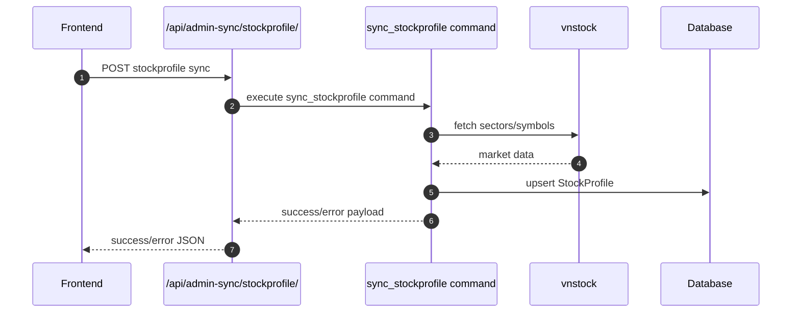

# Backend Technical Diagram - Level 2.1

Muc tieu:
- Luu so do ky thuat chi tiet hon Level 2.
- Mapping truc tiep toi namespace route va endpoint hien co.
- Dung cho implement Sprint 7 (route consistency + contract alignment).

## 1) Route decomposition hien tai (from config urls)

```mermaid
flowchart LR
    C[Client FE]
    C --> U0[/api/auth/token/]
    C --> U1[/api/auth/token/refresh/]
    C --> U2[/api/portfolio/* -> portfolio.urls]
    C --> U3[/api/stock-management/* -> portfolio.urls_stock]
    C --> U4[/api/admin-sync/* -> portfolio.urls_admin_sync]

    U0 --> A[TokenObtainPairView]
    U1 --> B[TokenRefreshView]
    U2 --> P[Portfolio URL set]
    U3 --> S[Stock Management URL set]
    U4 --> X[Admin Sync URL set]
```

## 2) Portfolio API map (level 2.1)

```mermaid
flowchart TB
    subgraph PortfolioNamespace[/api/portfolio/* (portfolio.urls)]
        P1[/portfolios/] --> V1[PortfolioListCreateView]
        P2[/portfolios/{id}/] --> V2[PortfolioDetailView]
        P3a[/userconfig/] --> V3a[UserConfigView]
        P3[/subaccounts/] --> V3[SubAccountListCreateView]
        P4[/subaccounts/{id}/] --> V4[SubAccountDetailView]
        P5[/subaccounts/{sub_account_id}/transactions/] --> V5[TransactionListCreateView]
        P6[/transactions/{id}/] --> V6[TransactionDetailView]
        P7[/portfolios/{id}/holdings/] --> V7[HoldingsView]
        P8[/portfolios/{id}/summary/] --> V8[SummaryView]
        P9[/portfolios/{id}/chart/] --> V9[ChartDataView]
        P10[/portfolios/{id}/allocation/] --> V10[AllocationView]
        P11[/portfolios/{id}/sync/] --> V11[SyncPricesView]
    end

    V1 --> DB[(DB)]
    V2 --> DB
    V3a --> DB
    V3 --> DB
    V4 --> DB
    V5 --> DB
    V6 --> DB
    V7 --> AN[analytics.py]
    V8 --> AN
    V9 --> AN
    V10 --> AN
    V11 --> SV[services.py]
    AN --> DB
    SV --> DB
    SV --> MKT[vnstock]
```

## 3) Stock-management API map (level 2.1)

```mermaid
flowchart TB
    subgraph StockNamespace[/api/stock-management/* (portfolio.urls_stock)]
        S1[/stocks/] --> W1[StockProfileListView]
        S2[/stocks/{symbol}/] --> W2[StockProfileDetailView]
        S4[/groups/] --> W4[SecuritiesGroupListCreateView]
        S5[/groups/{id}/] --> W5[SecuritiesGroupDetailView]
        S6[/groups/{id}/items/] --> W6[SecuritiesItemCreateView]
        S7[/items/{id}/] --> W7[SecuritiesItemDeleteView]
        S8[/seed/] --> W8[SecuritiesSeedView]
        S9[/sync/] --> W9[SecuritiesSyncView]
        S10[/tracked-symbols/] --> W10[TrackedSymbolListCreateView]
        S11[/tracked-symbols/{id}/] --> W11[TrackedSymbolDeleteView]
    end

    W1 --> DB[(DB)]
    W2 --> DB
    W4 --> DB
    W5 --> DB
    W6 --> DB
    W7 --> DB
    W8 --> SRV[fetch_market_sectors_and_groups]
    W9 --> PRC[fetch_and_save_daily_prices]
    W10 --> DB
    W11 --> DB
    SRV --> MKT[vnstock]
    PRC --> MKT
```

## 4) Sync endpoint detail (config level)



## 5) Endpoint ownership matrix (for Sprint 7)

| Namespace | Endpoint group | Backend owner | Frontend impact | Priority |
|---|---|---|---|---|
| /api/auth/* | token, refresh | BE | Login flow | P0 |
| /api/portfolio/* | portfolio core + user config | BE | Dashboard, Transactions | P0 |
| /api/stock-management/* | stock list/group/item | BE | Watchlist page | P0 |
| /api/admin-sync/* | sync command trigger | BE | Watchlist action button | P1 |

## 6) Route consistency target (Level 2.1 extension)

Hien tai dang co 2 nhom route song song:
- /api/* cho portfolio namespace
- /api/stock-management/* cho stock namespace

Muc tieu chuan hoa Sprint 7:
1. Chot endpoint nao thuoc portfolio, endpoint nao thuoc stock-management.
2. Giam endpoint trung y nghia giua route cu va moi.
3. Bo sung deprecation notes cho endpoint cu.

## 7) Quick validation checklist

- [ ] Tat ca endpoint trong so do map duoc toi view that.
- [ ] Frontend API client khong goi nham namespace.
- [ ] Sync stockprofile endpoint tra ve JSON status ro rang.
- [ ] Khong con 404 do lech route tren Dashboard/Transactions/Watchlist.
