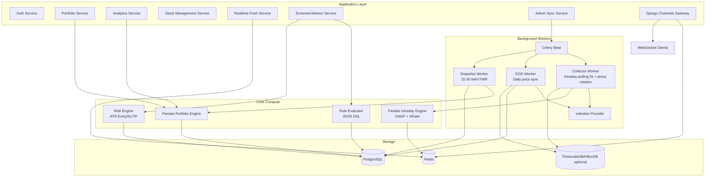
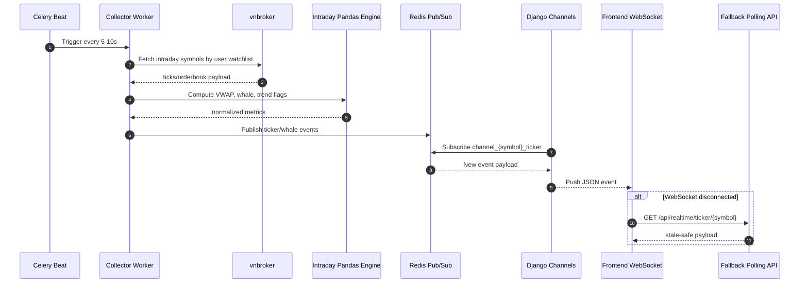

# Backend Technical Diagram - Level 2.2 (Target State)

Muc tieu:
- Mo ta kien truc to-be sau khi chuan hoa route va contract API.
- Dung lam tai lieu trien khai cho Sprint 7 -> Sprint 10.

## 1) API namespace target (to-be)

```mermaid
flowchart LR
    FE[Frontend App] --> GW[Django API Router]

    GW --> N1[/api/auth/*]
    GW --> N2[/api/portfolio/*]
    GW --> N3[/api/stock-management/*]
    GW --> N4[/api/realtime/*]
    GW --> N5[/api/admin-sync/*]

    N1 --> A1[JWT Auth Service]
    N2 --> A2[Portfolio Domain Service]
    N3 --> A3[Stock Catalog Service]
    N4 --> A4[Realtime Read Service]
    N5 --> A5[Sync Orchestrator]
```

## 2) Service decomposition target (L2.2)



## 3) Realtime to-be flow



## 4) Target endpoint matrix (to-be)

| Namespace | Main endpoints | Purpose | Sprint |
|---|---|---|---|
| /api/auth/* | token, refresh, me | Xac thuc va phien dang nhap | 7 |
| /api/portfolio/* | portfolios, subaccounts, transactions, holdings, summary, chart, allocation | Nghiep vu danh muc va bao cao | 7-9 |
| /api/stock-management/* | stocks, groups, items, tracked-symbols | Danh muc ma thi truong | 7 |
| /api/realtime/* | ticker, watchlist, alerts | Du lieu trong phien tu Redis | 10-11 |
| /api/admin-sync/* | stockprofile sync, eod sync, snapshot trigger | Van hanh va dong bo | 7-10 |

## 5) Migration path from 2.1 to 2.2

1. Chot route ownership va deprecate endpoint trung y nghia.
2. Frontend doi API map theo namespace moi.
3. Bo sung /api/realtime/* va Redis read service.
4. Chuyen sync endpoint ve /api/admin-sync/* (hoac stock-management/sync).
5. Ban hanh OpenAPI v1.1 va contract tests.

## 6) Acceptance criteria for L2.2 rollout

- Khong con endpoint overlap giua portfolio va stock-management.
- 100% endpoint moi co contract docs.
- Frontend pages chinh khong con goi route legacy.
- Realtime API p95 < 50ms tren moi truong test.
