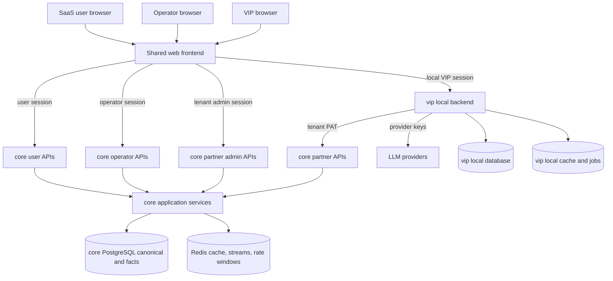

# CORE WEB VIP APP INTEGRATED ARCHITECTURE

**Date:** 2026-05-02  
**Status:** Architecture foundation for execution planning  
**Purpose:** Tao mot SSOT tich hop cho `core`, `web`, `opencore`, va `vip-app` o muc du de lam nen cho implementation plans chi tiet. Tai lieu nay chot ro ownership, chuc nang, database planes, API families, auth model va hard boundaries.

**Companion artifacts:**

- [ENTERPRISE_CORE_PLATFORM_ARCHITECTURE_BLUEPRINT_20260502](./ENTERPRISE_CORE_PLATFORM_ARCHITECTURE_BLUEPRINT_20260502.md)
- [ENTERPRISE_CORE_CONTRACT_PACK_20260502](./ENTERPRISE_CORE_CONTRACT_PACK_20260502.md)
- [ENTERPRISE_CORE_PARTNER_API_CONTRACT_DRAFT_20260502](./ENTERPRISE_CORE_PARTNER_API_CONTRACT_DRAFT_20260502.md)
- [ENTERPRISE_CORE_ADMIN_UI_ARCHITECTURE_20260502](./ENTERPRISE_CORE_ADMIN_UI_ARCHITECTURE_20260502.md)
- [WEB_VIP_APP_SHARED_FRONTEND_BLUEPRINT_20260502](./WEB_VIP_APP_SHARED_FRONTEND_BLUEPRINT_20260502.md)
- [PACKAGES_PARALLEL_MIGRATION_EXECUTION_PLAN_20260502](./PACKAGES_PARALLEL_MIGRATION_EXECUTION_PLAN_20260502.md)
- [B2B_ENTERPRISE_ARCHITECTURE_PROPOSAL_20260501](./B2B_ENTERPRISE_ARCHITECTURE_PROPOSAL_20260501.md)
- [VNINVEST_OVERALL_SYSTEM_ARCHITECTURE_20260501](./VNINVEST_OVERALL_SYSTEM_ARCHITECTURE_20260501.md)

---

## 1. Executive summary

Kien truc tong the nen duoc chot theo 4 package ownership ro rang:

1. `core` la **nen tang du lieu va nghiep vu duy nhat**.
2. `web` la **frontend shell dung chung cho SaaS va VIP build**.
3. `opencore` la **package phan phoi / commercial funnel cho community, self-host va upgrade journey**, nhung khong phai backend truth rieng.
4. `vip-app` la **local backend + local admin plane + orchestrator**, khong phai mot frontend codebase rieng.

> [!IMPORTANT]
> Owner da chap nhan mo hinh `packages-first parallel migration` ngay 2026-05-02:
> - kien truc moi duoc xay trong `packages/` va `shared/`,
> - legacy runtime hien tai giu vai tro reference/fallback cho toi cutover,
> - khi packages dat parity va van hanh on dinh, legacy runtime se bi decommission.

He qua kien truc:

- khong clone frontend de lam VIP hoac OpenCore,
- khong dat admin React shell trong `core`,
- khong bien `opencore` thanh entitlement truth hoac backend truth rieng,
- khong de `vip-app` so huu market truth hoac signal business rules,
- khong de browser VIP cam machine PAT goi truc tiep `core`.

Tai lieu nay la lop o giua:

- tam nhin B2B2C cap cao,
- va implementation plans theo slice cho `core`, `web`, `opencore`, `vip-app`.

---

## 2. Cac quyet dinh kien truc bat buoc

### 2.1 `core` la SSOT duy nhat cho du lieu canonic

`core` phai so huu:

- market reference,
- ticker va chart serving facts,
- session facts va signal intelligence,
- entitlement / quota / billing,
- operator APIs,
- partner APIs,
- audit va runtime semantics.

### 2.2 `web` la UI shell duy nhat

`web` phai so huu:

- toan bo React shell,
- user workspace surfaces,
- Community / OpenCore build variant,
- Central Operator Admin,
- Tenant Admin Console,
- VIP Internal Admin build variant,
- shared chart, table, form, layout, navigation va capability gating.

### 2.3 `opencore` la package distribution va commercial funnel

`opencore` phai so huu:

- community / self-host distribution bundle,
- install scripts va deployment overlays cho lane OpenCore,
- activation / upgrade funnel assets,
- public-safe onboarding docs va feature catalog,
- packaging wrappers quanh community/pro trial experiences.

`opencore` khong phai so huu:

- backend truth cho entitlement, quota, billing,
- frontend source clone tach khoi `web`,
- market truth, signal truth, hoac VIP local control plane.

### 2.4 `vip-app` la local control plane

`vip-app` phai so huu:

- local auth va RBAC,
- local sub-users,
- local branding,
- local secret storage,
- local prompt studio,
- local usage analytics,
- AI orchestrator,
- outbound integration toi `core` bang partner APIs.

### 2.5 `web`, `opencore` va `vip-app` khac nhau o plane, khong khac nhau o frontend source

Su khac nhau duoc quan ly bang:

1. `BUILD_TARGET` o compile-time,
2. capability snapshot o runtime,
3. API adapter layer theo ownership plane,
4. route taxonomy tach `shared`, `saas`, `vip`,
5. distribution / activation layer nam trong `opencore`, khong nam trong mot frontend source thu hai.

### 2.6 Mo hinh chuyen doi da duoc phe duyet

Execution mode da duoc chot nhu sau:

1. Khong sua truc tiep legacy runtime de bien no thanh kien truc moi.
2. Khong bulk-move `backend/`, `frontend/`, `mobile-app/`, `opennews-main/`, `infra/` vao `packages/` trong mot dot rename lon.
3. Tao va xay kien truc moi trong `packages/core`, `packages/web`, `packages/opencore`, `packages/mobile`, `packages/vip-app`, va `shared`.
4. Dung legacy runtime lam reference/fallback lane cho den khi packages dat parity, validation gates, va cutover readiness.
5. Sau cutover, legacy runtime phai duoc decommission thay vi duy tri song song vo thoi han.

---

## 3. System topology

> [!NOTE]
> `opencore` khong xuat hien nhu mot backend node rieng trong runtime topology vi no la package distribution/commercial funnel dung build artifacts tu `web` va contracts tu `core`.

---

## 4. Architecture planes and ownership

| Plane | Owner | Primary consumers | Database owner | API owner |
|---|---|---|---|---|
| Market data plane | `core` | `web`, `vip-app`, `mobile`, AI | `core` | `core` |
| Signal intelligence plane | `core` | `web`, `vip-app`, AI | `core` | `core` |
| Control plane | `core` | operator UI, tenant admin UI, `vip-app` | `core` | `core` |
| Commercial plane | `core` | `opencore`, tenant admin UI, `vip-app` | `core` | `core` |
| Shared presentation plane | `web` | SaaS users, operators, tenant admins, VIP users | none authoritative | none |
| OpenCore distribution plane | `opencore` | community users, self-host users, upgrade funnel | none authoritative | `core` |
| VIP local organization plane | `vip-app` | VIP admins, VIP sub-users | `vip-app` | `vip-app` |
| VIP local AI plane | `vip-app` | VIP admins, VIP AI users | `vip-app` | `vip-app` |
| Local observability and audit plane | `vip-app` + `core` | VIP admins, VNInvest operator | split ownership | split APIs |

---

## 5. Functional architecture by package

## 5.1 `core` functional responsibilities

| Domain | `core` phai lam | `core` khong nen lam | Main storage plane | Main API families |
|---|---|---|---|---|
| Identity and access | tenant, service account, PAT, capability snapshot, actor resolution | local VIP user CRUD day du | control-plane tables | `/core/v1/session/*`, `/core/v1/access/*`, `/core/v1/partner/*` |
| Market reference | symbol metadata, sector/group reference, universe projection | UI-specific filtering logic | reference tables | `/core/v1/reference/*` |
| Market serving | ticker snapshots, chart serving, depth snapshot, symbol snapshot | browser presentation formatting | market serving read models | `/core/v1/market/*` |
| Signal intelligence | session facts, whale events, unified alerts, screener projections | VIP-local rules editor UI | signal canonical + read models | `/core/v1/signals/*` |
| Workspace support | portfolio/watchlist/user alerts | VIP-local sub-user management | user workspace tables | user APIs |
| Commercial | plan, entitlement, quota, invoices, usage meters | local VIP cost allocation by sub-user | commercial ledgers | `/core/v1/opencore/*`, `/core/v1/partner/usage/*`, `/core/v1/partner/billing/*` |
| AI runtime | effective provider/model/readiness, advisory context contracts | luu local VIP provider secrets | ai runtime tables | `/core/v1/ai/*` |
| Operator runtime | health, jobs, audits, policy status | VIP-local app settings | ops/audit tables | `/core/v1/operator/*` |

### 5.1.1 `core` service boundaries de xuat

- `identity_access_service`
- `market_reference_service`
- `market_snapshot_service`
- `workspace_service`
- `signal_intelligence_service`
- `entitlement_service`
- `quota_billing_service`
- `ai_runtime_service`
- `partner_projection_service`
- `operator_runtime_service`

---

## 5.2 `web` functional responsibilities

| Surface | `web` phai lam | `web` khong nen lam | Data source | Runtime gate |
|---|---|---|---|---|
| Shared investing workspace | dashboard, stock detail, whale alerts, advisory shell, watchlist, portfolio UX | tu tinh signal semantics, tu giu market truth | `core` user APIs | capability + plan |
| Shared presentation system | layout, nav, charts, forms, tables, i18n, interactions | service business rules | none authoritative | build target + capability |
| Central Operator Admin | pages, filters, tables, forms, admin navigation | token validation, quota accounting, billing semantics | `core` operator APIs | `BUILD_TARGET=saas` + operator roles |
| Tenant Admin Console | human tenant admin pages | machine PAT usage in browser | `core` partner admin APIs | `BUILD_TARGET=saas` + tenant admin roles |
| VIP Internal Admin build variant | shared shell for VIP local admin pages | luu local secrets, local auth state server-side | `vip-app` local APIs | `BUILD_TARGET=vip` + local roles |

### 5.2.1 Quy tac quan trong cho `web`

1. `web` khong so huu database nghiep vu rieng.
2. `web` khong import logic tu `core` backend hoac `vip-app` backend.
3. `web` chi tieu thu APIs va capability payloads.
4. `web` la mot source, nhieu build variants; community build duoc `opencore` package hoa de phan phoi.

---

## 5.3 `opencore` functional responsibilities

| Domain | `opencore` phai lam | `opencore` khong nen lam | Main asset plane | Main API/build families |
|---|---|---|---|---|
| Community/self-host distribution | compose bundles, install scripts, environment templates, release manifests | fork `packages/web` source hoac tao backend truth rieng | package manifests | `build-community`, `build-community-pro`, release metadata |
| Activation and upgrade funnel | onboarding, activation hooks, upgrade CTA assets, pricing/feature catalog public-safe | phat minh entitlement/quota/billing truth rieng | funnel assets | `/core/v1/opencore/*`, `/core/v1/access/*` |
| Public-safe docs and support assets | quickstart, migration path tu community/pro len SaaS/VIP, support artifacts | lo private operator/vip internals | docs-public | docs + package version metadata |
| Self-host wrapper lane | community/pro lane defaults, health helpers, packaging policy | tro thanh operator admin hay VIP local control plane | deployment overlays | core health + opencore commercial APIs |

### 5.3.1 Quy tac quan trong cho `opencore`

1. `opencore` khong co backend truth rieng cho entitlement, quota, billing hay market data.
2. `opencore` khong fork frontend source khoi `packages/web`.
3. `opencore` package hoa build/community lane va goi commercial APIs tu `core`.
4. `opencore` la funnel truoc VIP, khong phai ban rut gon cua `vip-app`.

---

## 5.4 `vip-app` functional responsibilities

| Domain | `vip-app` phai lam | `vip-app` khong nen lam | Main storage plane | Main API families |
|---|---|---|---|---|
| Local identity | local login, sub-user CRUD, local roles, local sessions | tro thanh tenant identity source-of-truth cho `core` | vip local auth tables | `/vip/v1/auth/*`, `/vip/v1/users/*` |
| Organization settings | branding, white-label, organization profile, domain settings | sua central tenant billing data | vip organization tables | `/vip/v1/org/*` |
| Core connection management | luu encrypted PAT, test connection, health checks, scope diagnostics | expose PAT cho browser | vip secrets + integration tables | `/vip/v1/core-connection/*` |
| Local AI plane | provider keys, prompt studio, prompt revisions, orchestration jobs | store central AI runtime truth | vip ai config tables | `/vip/v1/ai/*`, orchestrator internal APIs |
| Local usage analytics | AI token cost by sub-user, chat logs, local audit, local rate controls | thay the central quota/billing ledger | vip local analytics tables | `/vip/v1/usage/*`, `/vip/v1/audit/*` |
| Data mediation | proxy/adapter tu browser toi core partner APIs, optional short-lived cache | phat minh market data rules rieng | vip integration cache | `/vip/v1/market/*`, `/vip/v1/signals/*` |

### 5.4.1 `vip-app` internal sub-services de xuat

- `vip_identity_service`
- `vip_org_settings_service`
- `vip_secret_vault_service`
- `vip_core_gateway_service`
- `vip_prompt_policy_service`
- `vip_ai_orchestrator_service`
- `vip_usage_analytics_service`
- `vip_local_audit_service`

---

## 6. Database architecture

## 6.1 `core` database architecture

`core` dung mot PostgreSQL source-of-record va mot Redis runtime substrate o phase dau. Logical families can chot nhu sau:

| Logical family | Vai tro | Candidate resources / tables |
|---|---|---|
| `identity_access` | tenant, service accounts, PAT, capability state | `CoreTenant`, `CoreTenantMembership`, `CoreServiceAccount`, `CoreAccessPolicy`, `CorePATCredential`, `CoreTokenSecretVersion`, capability snapshots |
| `market_reference` | symbol metadata, groups, sectors, market universe | `StockProfile`, `SecuritiesGroup`, `SecuritiesItem`, `SectorReferenceSnapshot`, `MarketUniverseSnapshot` |
| `market_serving` | symbol snapshot, chart serving, ticker/depth serving | `DailyPrice`, `TickerSessionClose`, `CoreSymbolSnapshot`, `PriceBoardSnapshot`, `RealtimeTickerSnapshot` |
| `signal_intelligence` | whale/order-flow/unified alerts, session facts | `WhaleAlertEvent`, `WhaleAdvisory`, `SignalServiceRun`, `SessionFacts`, `UnifiedAlertProjection`, `SymbolSignalSummary` |
| `workspace` | portfolios, watchlists, tracked symbols, user alerts | `Portfolio`, `SubAccount`, `Transaction`, `WatchlistGroup`, `WatchlistItem`, `TrackedSymbol`, `PriceAlertRule` |
| `commercial` | entitlements, quotas, invoices, usage | `DPIPlan`, `DPILicense`, `DPIQuotaTracker`, `DPIInvoice`, `DPISubscription`, `CoreUsageMeter`, `CoreUsageAggregateHourly`, `TenantQuotaLedger`, `CoreBillingAccount` |
| `ai_runtime` | runtime readiness and effective config | `AICommandCenterConfig`, `SystemAISettings`, `AIRuntimeCapabilitySnapshot` |
| `ops_audit` | health, jobs, policy audit, token usage audit | runtime snapshots, service runs, token audit logs, anomaly logs |

### 6.1.1 `core` hard DB rule

- `IntradayTick` la staging/recovery input, khong phai primary serving truth cho partner/public paths.
- Public APIs phai doc tu canonical tables hoac materialized read models.

---

## 6.2 `web` storage architecture

`web` **khong co authoritative database rieng**.

`web` chi duoc so huu:

- browser session state,
- local storage cho auth tokens neu can,
- in-memory query cache,
- UI preferences tam thoi.

Moi user-facing persisted business data phai nam trong `core`.

Neu can luu user preferences lau dai, no phai di vao `core` workspace hoac user config layer, khong tao `web` DB rieng.

---

## 6.3 `vip-app` local database architecture

`vip-app` can mot local database nhe, uu tien PostgreSQL nhe hoac SQLite/PostgreSQL theo packaging tier. Logical families de xuat:

| Logical family | Vai tro | Candidate resources / tables |
|---|---|---|
| `vip_identity` | local users, roles, sessions, memberships | `VipUser`, `VipRole`, `VipUserRole`, `VipSession`, `VipAuthAudit` |
| `vip_org` | organization profile, branding, white-label | `VipOrganizationProfile`, `VipBrandingSettings`, `VipDomainSetting` |
| `vip_secrets` | encrypted PAT, provider keys, secret rotations | `VipSecretVaultEntry`, `VipCoreConnection`, `VipProviderCredential`, `VipSecretRotationAudit` |
| `vip_ai_config` | prompt studio, policy revisions, agent configs | `VipPromptProfile`, `VipPromptRevision`, `VipAgentPolicy`, `VipCustomRule` |
| `vip_ai_runtime` | chat sessions, orchestrator runs, AI token usage | `VipAIConversation`, `VipAIMessage`, `VipAIRun`, `VipAITokenUsageEvent` |
| `vip_usage_local` | local usage dashboards and internal showback | `VipUsageAggregateDaily`, `VipUserCostAllocation`, `VipQuotaWarningLog` |
| `vip_workspace_local` | optional local customer portfolios and private notes | `VipPortfolio`, `VipWatchlist`, `VipNote`, `VipBacktestConfig` |
| `vip_audit_ops` | local audit, app health, sync jobs, connection checks | `VipAuditLog`, `VipSyncJobRun`, `VipCoreRequestLog`, `VipHealthSnapshot` |

### 6.3.1 `vip-app` hard DB rules

1. Khong luu raw market dataset day du trong `vip-app` nhu mot source-of-truth song song.
2. Neu co local cache market data, no phai duoc danh dau la ephemeral projection.
3. Chat logs, prompt rules, provider keys va local sub-users la du lieu local canonic cua `vip-app`.

---

## 6.4 Cache and ephemeral data

| Layer | Muc dich | Hard rule |
|---|---|---|
| `core` Redis | ticker cache, streams, rate windows, hot projections | khong thay the Postgres contracts |
| `vip-app` Redis or local cache | short-lived market response cache, job queues, connection status | khong tro thanh market truth |
| browser cache | UX performance | khong chua machine credentials |

---

## 7. API architecture

## 7.1 Auth model across the system

Phai tach ro 4 loai principal:

1. **SaaS human user session**: dung cho nha dau tu tren web.
2. **Operator / tenant admin human session**: dung cho admin pages trong web.
3. **VIP local human session**: dung cho user va admin trong vip build.
4. **Machine service account + PAT**: dung cho `vip-app` local backend goi `core`.

Khong tron 4 loai principal nay vao cung mot token model.

---

## 7.2 `core` user API functions cho `web`

| API function | Endpoint family | Chuc nang | Consumer |
|---|---|---|---|
| Session bootstrap | `GET /core/v1/session/me` | tra ve user, plan, tenant scope, bootstrap state | web SaaS |
| Capability bootstrap | `GET /core/v1/access/capabilities` | route gating, menu gating, action gating | web SaaS, admin UIs |
| Symbol reference | `GET /core/v1/reference/symbols*` | tim kiem ma, profile, sector metadata | web SaaS |
| Ticker snapshot | `GET /core/v1/market/tickers` | batch ticker va heat path snapshot | web SaaS |
| Symbol snapshot | `GET /core/v1/market/symbols/{symbol}/snapshot` | price, liquidity, exchange, day stats | web SaaS |
| Chart data | `GET /core/v1/market/symbols/{symbol}/chart` | OHLCV va overlays nhe | web SaaS |
| Session facts | `GET /core/v1/market/symbols/{symbol}/session-facts` | CVD, strength, selected-session truth | web SaaS, AI |
| Signal feeds | `GET /core/v1/signals/*` | whale events, unified alerts, screener snapshots | web SaaS |
| Advisory context | `GET /core/v1/ai/advisory-context/{symbol}` | context goi AI advisory | web SaaS |
| Workspace APIs | user workspace families | watchlist, portfolio, alerts | web SaaS |

---

## 7.3 `core` operator and partner API functions

| API function | Endpoint family | Chuc nang | Main consumer |
|---|---|---|---|
| Platform health | `GET /core/v1/operator/health` | runtime health va materialization status | operator UI |
| Jobs and lineage | `GET /core/v1/operator/jobs` | signal jobs, materializers, schedulers | operator UI |
| Tenant registry | operator tenant routes | tenant listing, status, suspend/resume | operator UI |
| Service account management | `/core/v1/partner/service-accounts*` | list/create/update machine principals | tenant admin UI, operator UI, vip-app |
| PAT lifecycle | `/core/v1/partner/pats*` | issue/list/rotate/revoke tokens | tenant admin UI, operator UI, vip-app |
| Usage meters | `/core/v1/partner/usage/meters` | usage theo meter va ky | tenant admin UI, vip-app |
| Quota snapshots | `/core/v1/partner/usage/quotas` | remaining quota, reset windows, hard stop state | tenant admin UI, vip-app |
| Billing summary | `/core/v1/partner/billing/*` | subscription, invoices, credits, overage | tenant admin UI, vip-app |
| AI runtime config | `GET /core/v1/ai/runtime-config` | effective central ai/runtime capability | tenant admin UI, vip-app |
| Partner market access | `/core/v1/market/*`, `/core/v1/signals/*` | stable tenant-scoped data-plane access | vip-app |

---

## 7.4 `vip-app` local API functions cho VIP build

Browser VIP khong goi thang `core`. VIP build phai noi chuyen voi `vip-app` local APIs:

| API function | Endpoint family de xuat | Chuc nang | Owner |
|---|---|---|---|
| Local auth | `/vip/v1/auth/*` | login, logout, session refresh, current actor | vip-app |
| Sub-user admin | `/vip/v1/users/*` | CRUD sub-users, assign roles, disable accounts | vip-app |
| Organization settings | `/vip/v1/org/*` | branding, white-label, domain settings | vip-app |
| Core connection | `/vip/v1/core-connection/*` | save encrypted PAT, test scopes, connection health | vip-app |
| Provider key management | `/vip/v1/ai/providers/*` | save/rotate provider keys, readiness checks | vip-app |
| Prompt studio | `/vip/v1/ai/prompts/*` | prompt profiles, revisions, publish/rollback | vip-app |
| Local AI usage | `/vip/v1/usage/ai/*` | token usage, cost by sub-user, budget warnings | vip-app |
| Local audit | `/vip/v1/audit/*` | chat audit, admin actions, local access logs | vip-app |
| Market proxy | `/vip/v1/market/*` | local facade/proxy cho market snapshots tu core | vip-app |
| Signal proxy | `/vip/v1/signals/*` | local facade/proxy cho whale and alert feeds | vip-app |
| Advisory orchestration | `/vip/v1/ai/advisory/*` | run debate/orchestration with local settings | vip-app |

### 7.4.1 Quy tac cứng cho local APIs

1. Local APIs duoc phep doi shape cho hop local UX, nhung adapter sang `core` phai version-aware.
2. Local APIs khong forward PAT ve browser.
3. Local APIs co the cache va enrich response, nhung khong duoc sua nghia canonical cua market facts tu `core`.

---

## 8. End-to-end flows

## 8.1 SaaS investor flow

1. Browser vao `web` build SaaS.
2. `web` bootstrap `session/me` va `access/capabilities` tu `core`.
3. User mo ma co phieu.
4. `web` goi `core` user APIs lay symbol snapshot, chart, session facts, unified alerts.
5. Neu goi AI, `web` su dung advisory context contracts tu `core`.

## 8.2 Central operator flow

1. Operator login vao `web`.
2. `web` gating menu theo operator capability snapshot.
3. Operator mo `/admin/core/*`.
4. `web` goi operator APIs cua `core` de xem health, tenants, PATs, jobs, billing va audit.

## 8.3 VIP end-user flow

1. Browser VIP vao VIP build cua `web`.
2. `web` bootstrap local session tu `vip-app`.
3. User mo ma co phieu.
4. `web` goi local market facade o `vip-app`.
5. `vip-app` goi `core` bang service account + PAT.
6. `core` tra ve market/signal facts.
7. `vip-app` co the them local context roi tra ve browser.

## 8.4 VIP admin flow

1. VIP admin login local.
2. Mo `/vip-admin/*`.
3. Browser goi local APIs de quan ly sub-users, branding, keys, prompts.
4. Khi can doi PAT, `vip-app` goi `core` partner APIs server-side.

---

## 9. Hard boundaries and anti-patterns

1. Khong tao frontend codebase thu hai cho VIP.
2. Khong dat React admin shell trong `core` package.
3. Khong de `vip-app` browser cam PAT va goi truc tiep `core`.
4. Khong luu market truth day du trong `vip-app` local DB.
5. Khong expose raw staging data nhu `IntradayTick` ra partner/public contracts.
6. Khong de `web` tu tinh signal semantics tu raw payloads.
7. Khong tron human session voi machine credential.
8. Khong coi quota, entitlement, billing la concern phu; do la mot phan cua `core`.

---

## 10. Workstreams duoc sinh ra tu kien truc nay

Moi implementation plan chi tiet sau nay nen duoc tach theo 7 workstream:

1. **Core foundation workstream**
   - tenant, service account, PAT, quota, billing, capability snapshot.
2. **Core serving workstream**
   - symbol snapshot, chart, session facts, unified alerts, advisory context.
3. **Web shared shell workstream**
   - build targets, route catalog, shared adapters, nav gating.
4. **OpenCore distribution and funnel workstream**
   - community/self-host bundle, activation, upgrade funnel, public-safe docs.
5. **Web admin surfaces workstream**
   - Central Operator Admin, Tenant Admin Console.
6. **VIP local backend workstream**
   - local auth, sub-users, branding, secret vault, local APIs.
7. **VIP AI and operations workstream**
   - prompt studio, provider keys, orchestration, local usage analytics.

Neu implementation plan nao khong map duoc vao 1 trong 7 workstream nay, can xem lai vi co the boundary dang sai.

Execution sequencing cua 6 workstream nay duoc rang buoc boi tai lieu [PACKAGES_PARALLEL_MIGRATION_EXECUTION_PLAN_20260502](./PACKAGES_PARALLEL_MIGRATION_EXECUTION_PLAN_20260502.md).

---

## 11. Exit criteria de bat dau implementation plans chi tiet

Co the bat dau viet implementation plans chi tiet khi 10 dieu kien sau da ro:

1. Ownership cua `core`, `web`, `vip-app` da duoc chap nhan.
2. Da chap nhan quyet dinh `1 frontend source, nhieu build variants`.
3. Da chap nhan `web` khong co authoritative DB rieng.
4. Da chap nhan `vip-app` la local control plane, khong phai market truth plane.
5. Da chap nhan auth separation giua human sessions va machine PAT.
6. Da chap nhan API families cua `core` va local APIs cua `vip-app`.
7. Da chap nhan logical database families cho `core` va `vip-app`.
8. Da chap nhan vai tro cua `opencore` la package distribution/commercial funnel, khong phai backend truth rieng.
9. Da chap nhan 7 workstream de lap implementation plans.
10. Da chap nhan mo hinh `packages-first parallel migration`, parity gates, va quy tac decommission legacy runtime.

---

## 12. Ket luan

Kien truc dung cho VNInvest khong phai la `web` va `vip-app` moi ben tu phat trien mot he rieng. Kien truc dung la:

- `core` la backend platform duy nhat,
- `web` la UI shell dung chung,
- `opencore` la package distribution/commercial funnel de dua user vao trai nghiem Community/Pro truoc khi len VIP,
- `vip-app` la local backend va local admin plane,
- duong thuc thi la `packages-first parallel migration` cho toi khi cutover xong,
- market truth, signal truth, quota truth va billing truth deu o `core`,
- local organization truth, local prompts, local keys, local sub-users va local AI logs o `vip-app`.

Khi chot tai lieu nay, team co the di tiep sang implementation plans chi tiet ma khong con mo ho ve ownership, database va API functions nua.
