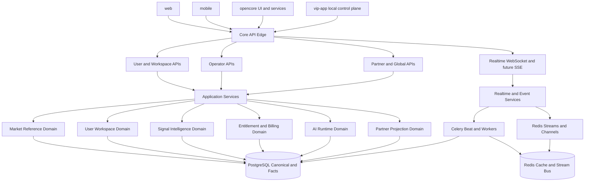

# ENTERPRISE CORE PLATFORM ARCHITECTURE BLUEPRINT

**Date:** 2026-05-02  
**Status:** Current-code-aligned execution blueprint for `core`  
**Purpose:** Chốt kiến trúc tổng thể nhưng đủ chi tiết cho `core` để phục vụ `web`, `opencore`, `vip-app`, `mobile` mà không phải dựng greenfield platform mới.

**Companion artifacts:**

- [ENTERPRISE_CORE_CONTRACT_PACK_20260502](./ENTERPRISE_CORE_CONTRACT_PACK_20260502.md)
- [ENTERPRISE_CORE_ADMIN_UI_ARCHITECTURE_20260502](./ENTERPRISE_CORE_ADMIN_UI_ARCHITECTURE_20260502.md)
- [ENTERPRISE_CORE_ADMIN_RBAC_CAPABILITY_MATRIX_20260502](./ENTERPRISE_CORE_ADMIN_RBAC_CAPABILITY_MATRIX_20260502.md)
- [ENTERPRISE_CORE_ADMIN_SCREEN_SPEC_20260502](./ENTERPRISE_CORE_ADMIN_SCREEN_SPEC_20260502.md)
- [ENTERPRISE_CORE_OPERATOR_ADMIN_API_CONTRACT_BACKLOG_20260502](./ENTERPRISE_CORE_OPERATOR_ADMIN_API_CONTRACT_BACKLOG_20260502.md)
- [ENTERPRISE_CORE_OPERATOR_ADMIN_API_DETAILED_CONTRACTS_20260502](./ENTERPRISE_CORE_OPERATOR_ADMIN_API_DETAILED_CONTRACTS_20260502.md)
- [ENTERPRISE_CORE_ACCESS_CAPABILITY_PAYLOAD_CONTRACT_20260502](./ENTERPRISE_CORE_ACCESS_CAPABILITY_PAYLOAD_CONTRACT_20260502.md)
- [ENTERPRISE_CORE_ADMIN_IMPLEMENTATION_TASKBOARD_20260502](./ENTERPRISE_CORE_ADMIN_IMPLEMENTATION_TASKBOARD_20260502.md)
- [ENTERPRISE_CORE_RESOURCE_FREEZE_CHECKLIST_20260502](./ENTERPRISE_CORE_RESOURCE_FREEZE_CHECKLIST_20260502.md)
- [ENTERPRISE_CORE_STORAGE_SCHEMA_STRATEGY_20260502](./ENTERPRISE_CORE_STORAGE_SCHEMA_STRATEGY_20260502.md)
- [ENTERPRISE_CORE_SCHEMA_ANALYSIS_20260502](./ENTERPRISE_CORE_SCHEMA_ANALYSIS_20260502.md)
- [ENTERPRISE_CORE_PARTNER_API_CONTRACT_DRAFT_20260502](./ENTERPRISE_CORE_PARTNER_API_CONTRACT_DRAFT_20260502.md)

---

## 1. Vai trò của `core`

Trong roadmap enterprise của VNInvest, `core` không chỉ là backend Django hiện tại đổi tên. `core` phải là **nền tảng dữ liệu và nghiệp vụ duy nhất** cung cấp:

- dữ liệu thị trường chuẩn hóa,
- session facts và signal intelligence,
- entitlement, quota, billing và audit,
- AI runtime context và orchestration contracts,
- operator controls và health surfaces,
- global APIs đủ ổn định để các package khác tiêu thụ mà không phải biết logic nội bộ.

`web`, `opencore`, `vip-app`, `mobile` không được tự dựng logic dữ liệu lõi song song. Mọi package còn lại chỉ nên tiêu thụ `core` thông qua contracts và capability boundaries.

---

## 2. Core phải phục vụ package nào và phục vụ bằng gì

| Package tiêu thụ | Core phải cung cấp | Package đó không nên tự làm |
|---|---|---|
| `web` | Auth/session state, portfolio workspace APIs, market snapshot APIs, whale/order-flow signals, realtime websocket, AI advisory context | Không tự dựng data adapters, không tự suy luận session facts từ raw ticks |
| `opencore` | Plan/quota/billing, feature flags, usage analytics, premium capability checks | Không giữ entitlement logic riêng bên ngoài `core` |
| `vip-app` | PAT/tenant-scoped APIs, stable JSON contracts, AI runtime capability envelope, partner projection feeds | Không nhận logic phát hiện whale/dark-flow hay business rules nội bộ của `core` |
| `mobile` | Snapshot APIs, chart APIs, watchlist/portfolio APIs, alert feed gọn | Không đọc trực tiếp raw event stores hoặc operator surfaces |

Hệ quả: `core` phải được thiết kế theo hướng **facts-first, API-first, tenant-ready**, chứ không chỉ là tập hợp endpoint Django rời rạc.

---

## 3. Nguyên tắc thiết kế bắt buộc cho `core`

1. **Facts-first trước query-time composition**
   Global APIs chỉ được dựa trên canonical tables và materialized read models; không dựa vào nhiều upstream fetch tại request time.
2. **Cache-first nhưng không cache-only**
   Redis là lớp tăng tốc; PostgreSQL vẫn là source-of-record cho canonical events, summaries và commercial state.
3. **Staging tách khỏi canonical**
   `IntradayTick` là staging/recovery input ngắn hạn; whale events, session facts, symbol snapshots mới là nguồn phục vụ consumers.
4. **Internal API và partner/global API không đồng nhất hoàn toàn**
   API nội bộ có thể giàu ngữ cảnh hơn; partner/global API phải ổn định, versioned, tenant-aware và không để lộ logic nội bộ.
5. **Entitlement là phần của core platform**
   Quota, billing, feature gating và PAT accounting không phải tiện ích phụ; đó là capability backbone cho B2B.
6. **Async pipeline là citizen hạng nhất**
   Scheduler, workers, stream consumers và materializers là một phần của kiến trúc `core`, không phải background jobs “đi kèm”.

### 3.1 Các pattern `core` phổ biến nên áp dụng vào VNInvest

Để `core` phục vụ được `vip-app` và future partner consumers theo kiểu enterprise thực tế, nên bám 4 pattern đã được chứng minh rộng rãi ở các hệ SaaS/API platform lớn:

1. **Stripe-style entitlements + metered billing**
   Feature access phải tách khỏi usage metering. Gói sản phẩm quyết định khách hàng được dùng tính năng nào; meter quyết định khách hàng đã dùng bao nhiêu và có bị tính overage hay không.
2. **AWS-style usage plans + throttling layers**
   API token không tự thân định nghĩa toàn bộ quyền. Token chỉ là credential gắn vào một client plan; throttling phải có nhiều lớp: per-token, per-tenant, per-route family và burst controls.
3. **GitHub-style fine-grained PAT**
   Token phải có resource owner rõ, scope nhỏ, hạn dùng bắt buộc, cơ chế rotate, approve, revoke và audit. Không dùng một token toàn quyền, vô hạn hạn, phục vụ mọi route.
4. **B2B SaaS identity-plane tách khỏi machine access**
   User người thật, tenant, service account và API credential phải là các thực thể khác nhau. `vip-app` không nên dùng token cá nhân của người vận hành làm machine credential dài hạn.

Hệ quả cho VNInvest: `core` phải có đủ 5 lớp khái niệm độc lập nhưng liên kết với nhau: `principal`, `tenant`, `service account`, `token credential`, `usage meter`.

### 3.2 Đặc tính contract của các API platform production mà `core` nên học theo

Nếu muốn `core` thực sự giống các hệ đang vận hành production thay vì chỉ “có nhiều endpoint”, cần chốt thêm các đặc tính contract sau:

1. **Resource-oriented contract trước endpoint-oriented contract**
   Hệ production mạnh thường neo quanh resource rõ ràng như `tenant`, `service-account`, `token`, `meter`, `invoice`, `symbol-snapshot`, `session-facts`, thay vì tạo hàng loạt endpoint ad-hoc theo màn hình.
2. **Additive-first change policy**
   Thêm field optional, thêm endpoint mới, thêm enum value mới là bình thường; đổi tên field, đổi type, đổi auth semantics, thêm required parameter phải được xem là breaking change.
3. **Version pinning rõ ràng cho integrations**
   Các integration production cần pin được version contract để tránh vỡ ngầm. `core` nên học cách tách breaking changes khỏi additive changes.
4. **Idempotency cho write APIs**
   Những route tạo token, rotate token, issue credits, tạo invoice adjustment hoặc thay đổi tenant policy phải retry-safe.
5. **Cursor pagination thay vì page-number pagination cho feeds lớn**
   Feed alerts, token audit, invoices, request logs, whale events, usage events nên dùng cursor để ổn định hơn khi dữ liệu thay đổi liên tục.
6. **Request identity và traceability là first-class**
   Mọi response đối ngoại nên có request id để partner và operator cùng truy vết được.
7. **Projection contract nhỏ và có kiểm soát**
   Response nên có default payload gọn; các field đắt tiền hoặc nested sâu chỉ nên bật qua `include` hoặc `expand` whitelist.
8. **Schema evolution đi sau contract evolution**
   Hệ production thực tế thường chốt contract và semantics trước, rồi mới quyết định có cần tách bảng, tách schema hay tách storage không.

Kết luận: thứ cần freeze đầu tiên không phải PostgreSQL schema, mà là **resource model, field semantics, auth semantics, pagination semantics và change policy**.

---

## 4. Kiến trúc logic tổng thể của `core`

### 4.1 API edge layers

`core` nên có 4 lớp API rõ ràng:

- **User APIs:** phục vụ `web` và `mobile`, bám theo user/session context.
- **Operator APIs:** admin ops, runtime controls, health, jobs, audit surfaces.
- **Partner/Global APIs:** tenant/PAT-scoped, stable, versioned, không dùng trực tiếp các composite endpoint còn nhiều fallback.
- **Realtime channels:** WebSocket cho nội bộ; SSE hoặc streaming contracts cho orchestrator/vip ở phase sau.

### 4.2 Application service layers

Phía sau API edge, `core` nên gom logic thành các application services thay vì dồn hết vào views:

- `identity_access_service`
- `market_reference_service`
- `market_snapshot_service`
- `workspace_service`
- `signal_intelligence_service`
- `entitlement_service`
- `quota_billing_service`
- `ai_runtime_service`
- `partner_projection_service`
- `operator_runtime_service`

Trong repo hiện tại, các trách nhiệm này đang rải trong `market_data_service.py`, `services_whale_analytics_snapshot.py`, `opencore_*`, `tasks_*`, `views_*`. Blueprint này chốt hướng gom chúng lại thành boundary logic của `core` trước khi move vật lý sang package riêng.

### 4.3 Mô hình vận hành `contract-first` cho `core`

Trước khi code read models mới, partner APIs mới, hay split schema CSDL, `core` phải có một **contract pack** đủ nhỏ nhưng đủ chặt. Đây là cách các hệ production giảm rủi ro drift giữa consumer và backend.

`Contract pack` tối thiểu của `core` nên gồm 8 artifact:

1. **Resource catalog**
   Danh sách resource lõi: `tenant`, `service-account`, `pat`, `usage-meter`, `invoice`, `symbol-snapshot`, `session-facts`, `whale-event`, `unified-alert`.
2. **Endpoint matrix**
   Mỗi resource có các method nào: `get`, `list`, `create`, `rotate`, `revoke`, `search`, `export`.
3. **Field dictionary**
   Tên field, type, nullable hay không, source-of-truth, additive/breaking policy của từng field quan trọng.
4. **Auth and scope matrix**
   Endpoint nào dùng user session, endpoint nào dùng tenant PAT, scope nào bắt buộc.
5. **Quota and billing semantics**
   Endpoint nào match meter nào, charge theo unit nào, quota check ở lớp nào.
6. **Error model**
   Error codes, HTTP status, retryability, param-level validation behavior.
7. **Examples and fixtures**
   Request/response mẫu cho `web`, `mobile`, `vip-app`, `opencore`.
8. **Change policy**
   Điều gì là additive, điều gì là breaking, khi nào phải bump version, khi nào được rollout âm thầm.

Nếu thiếu một trong 8 artifact này thì chưa nên coi contract đã “chốt”.

---

## 5. Tổ chức CSDL của `core`

### 5.1 Quyết định vật lý giai đoạn đầu

- **Một PostgreSQL chính** tiếp tục làm source-of-record.
- **Một Redis runtime bus** tiếp tục làm cache, Celery broker/result và Redis Streams/Channels substrate.
- **Không tách ClickHouse ở phase đầu.**

### 5.1.1 Không tách schema CSDL vật lý trước khi contract ổn định

Ở giai đoạn hiện tại, `core` nên bám mô hình đang thấy ở nhiều hệ production trưởng thành khi còn trong pha chuẩn hóa platform: **boundary logic tách trước, physical schema tách sau**.

Điều này có nghĩa là:

- chưa tạo Postgres schema riêng theo package chỉ để “trông giống microservices”,
- chưa tách `core_identity`, `core_market`, `core_signals`, `core_billing` thành physical schema riêng nếu contract giữa các vùng vẫn còn dịch chuyển,
- chưa build migration pipeline nhiều chiều chỉ để phục vụ một sơ đồ tổ chức chưa được consumer xác nhận.

Lý do rất thực tế:

1. Split schema quá sớm thường làm contracts đổi liên tục nhưng migration cost tăng mạnh.
2. Khi consumer contracts chưa ổn định, data ownership chưa rõ sẽ dẫn đến duplicate facts, join chéo khó kiểm soát và backfill khó rollback.
3. Với repo hiện tại, rủi ro lớn nhất không phải “thiếu schema split”, mà là **thiếu stable contracts và serving read models**.

### 5.1.2 Dùng logical ownership map thay cho physical schema split ở phase đầu

Thay vì tách schema DB thật ngay, `core` nên dùng **logical ownership map**:

| Logical namespace | Owner boundary | Contract consumer chính | Candidate future schema |
|---|---|---|---|
| `identity_access` | `identity_access_service` | `vip-app`, `opencore`, operator | `core_identity` |
| `market_reference` | `market_reference_service` | tất cả package | `core_reference` |
| `market_serving` | `market_snapshot_service` | `web`, `mobile`, `vip-app` | `core_market_serving` |
| `signal_intelligence` | `signal_intelligence_service` | `web`, `vip-app`, AI | `core_signals` |
| `commercial` | `entitlement_service`, `quota_billing_service` | `opencore`, `vip-app` | `core_billing` |
| `ai_runtime` | `ai_runtime_service` | `web`, `vip-app` | `core_ai` |
| `ops_audit` | `operator_runtime_service` | operator surfaces | `core_ops` |

Ở phase đầu, các namespace này chỉ là **quy ước ownership và review**, chưa phải physical Postgres schema bắt buộc.

### 5.1.3 Chỉ được tách schema CSDL khi qua đủ phase gate

Một vùng dữ liệu của `core` chỉ nên được tách thành physical schema riêng khi thỏa đồng thời các điều kiện sau:

1. Có ít nhất 2 consumer độc lập đang dùng cùng một contract ổn định.
2. Field dictionary của resource liên quan đã được chốt và có change policy rõ.
3. Read path chính không còn phụ thuộc join chéo ad-hoc sang vùng khác trong request path.
4. Có migration/backfill plan và rollback plan đã viết rõ.
5. Có contract tests hoặc snapshot tests cho ít nhất một consumer thực.
6. Có lý do vận hành thật sự như retention khác biệt, permission boundary khác biệt, hoặc scale profile khác biệt.

Nếu chưa đạt đủ 6 điều kiện trên, tiếp tục để trong một schema vật lý chung nhưng giữ ownership logic rõ vẫn là lựa chọn tốt hơn.

### 5.2 Tổ chức logic dữ liệu theo domain và data tier

`core` nên được hiểu theo 7 vùng dữ liệu logic sau, dù hiện tại vẫn cùng nằm trong Django/PostgreSQL.

| Vùng dữ liệu logic | Mục đích | Bảng hiện có | Bảng/read model nên bổ sung |
|---|---|---|---|
| Identity and package access | User identity, package capabilities, tenant readiness | `auth_user`, `UserConfig` | `CoreTenant`, `CoreTenantMembership`, `CoreServiceAccount`, `CoreAccessPolicy`, `CorePATCredential`, `CoreTokenSecretVersion`, `CoreBuildCapabilitySnapshot` |
| Market reference | Danh mục mã, nhóm ngành, metadata tĩnh | `StockProfile`, `SecuritiesGroup`, `SecuritiesItem`, `MarketGroupSyncLog`, `StockProfileSyncLog` | `SectorReferenceSnapshot`, `MarketUniverseSnapshot` |
| User workspace | Portfolio, watchlist, tracked symbols, alerts | `Portfolio`, `SubAccount`, `Transaction`, `AccountSnapshot`, `WatchlistGroup`, `WatchlistItem`, `TrackedSymbol`, `PriceAlertRule` | `UserWorkspaceSnapshot` nếu cần read-model nhanh |
| Market time-series staging | Giá ngày, session close, intraday staging | `DailyPrice`, `TickerSessionClose`, `IntradayTick` | `PriceBoardSnapshot`, `RealtimeTickerSnapshot` |
| Signal intelligence canonical | Whale/dark-flow events, screener/materialization runs, forensic windows | `WhaleAlertEvent`, `WhaleAdvisory`, `SignalServiceRun`, `MoneyFlowForensicWindow`, `WhaleConfigVersion`, `WhaleConfigDraft`, `ScreenerRule` | `SessionFacts`, `SymbolSignalSummary`, `UnifiedAlertProjection` |
| AI runtime and operator control | AI config, system settings, runtime control | `AICommandCenterConfig`, `AICommandCenterAuditLog`, `SystemAISettings`, `SystemAISettingsAuditLog`, `RuntimeVnstockConfig`, `SystemSetting`, `CrawlJob`, `CrawlRun` | `AIRuntimeCapabilitySnapshot`, `PartnerPromptPolicy` |
| Commercial and entitlement | Plan, license, quota, billing, analytics | `DPIPlan`, `DPILicense`, `DPIUsageMetrics`, `DPIEntitlement`, `DPIQuotaTracker`, `DPIAPICallLog`, `DPIFeatureUsage`, `DPIAnalyticsSnapshot`, `DPIInvoice`, `DPISubscription`, `DPIPayment` | `CoreUsageMeter`, `CoreUsageAggregateHourly`, `CoreBillingAccount`, `TenantQuotaLedger`, `PartnerConsumptionSnapshot`, `BillingCreditGrant` |

### 5.3 Phân tầng dữ liệu vận hành

Để phục vụ nhiều package mà không kéo nhau chậm đi, `core` nên áp dụng mô hình dữ liệu 5 tầng:

1. **L1 - Reference and identity**
   Dữ liệu tĩnh hoặc thay đổi chậm: user/package capability, symbol metadata, group metadata.
2. **L2 - Realtime staging**
   Dữ liệu ngắn hạn, tốc độ cao: Redis stream ticks, `IntradayTick`, prefetch metadata, scheduler states.
3. **L3 - Canonical events**
   Sự kiện nghiệp vụ có nghĩa lâu dài: `WhaleAlertEvent`, future dark-flow canonical events, signal run records, audit logs.
4. **L4 - Facts and read models**
   Session facts, symbol snapshots, sector snapshots, unified alert projections, partner projections.
5. **L5 - Commercial and compliance**
   Quota, invoices, subscriptions, PAT audit, partner consumption, forensic windows.

### 5.4 Chính sách retention và partition cho `core`

| Dataset | Vai trò | Chính sách đề xuất |
|---|---|---|
| `IntradayTick` | staging/recovery input | Partition theo `trade_date`, giữ ngắn hạn; không dùng làm primary read path lâu dài |
| Redis streams `vninvest:ticks:*` | realtime bus | Bounded length + trim policy, chỉ là transport layer |
| `WhaleAlertEvent` | canonical signal event store | Giữ dài hạn hơn staging; index theo `symbol`, `trade_date`, `occurred_at` |
| `SignalServiceRun` | operational lineage | Giữ trung hạn; cleanup riêng nhưng không quá ngắn để còn audit |
| `MoneyFlowForensicWindow` | selective evidence storage | Giữ theo policy severity và compliance needs |
| `DailyPrice`, `TickerSessionClose` | reference and snapshots | Giữ dài hạn; hỗ trợ historical chart và off-hours fallback |
| Future `SessionFacts` / `SymbolSnapshot` | serving layer chính | Giữ đủ dài để phục vụ all packages và partner APIs |

### 5.5 Redis keyspace strategy cho `core`

Để tránh drift, keyspace Redis của `core` nên được chuẩn hóa theo domain:

- `core:ticker:*` cho ticker snapshots và metadata
- `core:session:*` cho session facts, selected-session snapshots
- `core:signals:*` cho unified alerts, whale/dark-flow hot projections
- `core:quota:*` cho quota counters, PAT rate windows
- `core:ai:*` cho AI runtime ephemeral caches
- `core:ops:*` cho scheduler meta, health aggregates, materialization status

Hiện tại repo đã có nhiều key dạng `ticker:*`, `realtime:*`, `whale:*`. Giai đoạn đầu chưa bắt buộc rename toàn bộ, nhưng mọi key mới nên đi theo quy ước rõ ràng để chuẩn bị package hóa `core`.

### 5.6 Mô hình user, tenant, token, billing và quota cho `vip-app`

Đây là phần quan trọng nhất nếu muốn `vip-app` đi đúng hướng enterprise thay vì trở thành một client cầm chung một API key toàn quyền.

| Thực thể | Vai trò | Nguyên tắc bắt buộc |
|---|---|---|
| `CoreTenant` | Khách hàng B2B hoặc VIP self-host organization | Là billing owner và security owner cho mọi machine access |
| `CoreTenantMembership` | Gắn user người thật vào tenant với role | Role quyết định quyền quản trị tenant, không quyết định trực tiếp machine quota |
| `CoreServiceAccount` | Danh tính máy của `vip-app`, bot hoặc integration worker | Mỗi môi trường `prod/staging/dev` và mỗi workload nhạy cảm nên có service account riêng |
| `CoreAccessPolicy` | Tập quyền ở mức domain/scope | Phải fine-grained theo nhóm như `market:read`, `signals:read`, `ai:invoke`, `billing:read`, `tenant:tokens:write` |
| `CorePATCredential` | Credential hiển thị một lần để gọi `/core/v1/...` | Chỉ lưu hash + prefix; có `expires_at`, `revoked_at`, `last_used_at`, `last_ip`, `issued_by` |
| `CoreTokenSecretVersion` | Phiên bản bí mật của token phục vụ rotate không downtime | Cho phép overlap ngắn giữa key cũ và key mới khi rollout |
| `CoreUsageMeter` | Định nghĩa billable unit | Không dùng log request thô làm sản phẩm billing trực tiếp |
| `CoreUsageAggregateHourly` | Rollup usage để quota/billing không phải scan request logs | Là nguồn cho dashboard, alerts, invoice rating |
| `CoreBillingAccount` | Chủ thể thương mại của tenant | Neo vào plan, currency, tax profile, invoice rules, credit balance |
| `TenantQuotaLedger` | Sổ cái quota và overage | Tách riêng `entitled amount`, `consumed amount`, `reserved amount`, `overage amount` |

#### 5.6.1 Chuỗi quan hệ chuẩn cho `vip-app`

`user` người thật đăng nhập vào `vip-app` cục bộ không nên đồng nghĩa với việc `core` phải phát token riêng cho từng user đó. Chuỗi đúng nên là:

`CoreTenant` -> `CoreServiceAccount` -> `CorePATCredential` -> gọi `partner/global APIs`

Trong các thao tác cần audit người khởi phát, `vip-app` gửi thêm delegated actor context, ví dụ `x-core-actor-user-id` hoặc actor claims tương đương. Như vậy `core` có thể phân biệt:

- ai là **machine principal** đang gọi API,
- ai là **human actor** kích hoạt hành động ở phía `vip-app`,
- tenant nào phải chịu quota và billing.

#### 5.6.2 Quy tắc token cho `vip-app`

1. `vip-app` chỉ dùng **server-side PAT**, không bao giờ lộ PAT ra browser hoặc mobile client.
2. Mỗi token phải gắn với đúng một `tenant` và đúng một `service account`.
3. Mỗi token phải có scope nhỏ nhất đủ dùng; không phát token `full-access` mặc định.
4. Token phải có hạn dùng mặc định, ví dụ 30-90 ngày; token không hết hạn chỉ cho tenant đặc biệt và phải bật bằng policy rõ ràng.
5. Chỉ lưu hash của token; UI chỉ hiển thị prefix + metadata sau lần tạo đầu tiên.
6. Rotate token theo mô hình tạo mới trước, cắt token cũ sau; tránh inplace mutation của secret.
7. Phải có cơ chế revoke tức thì theo tenant, theo service account và theo token riêng lẻ.
8. Token issuance quan trọng nên có `approval_required` hoặc `dual-control` cho tenant enterprise lớn.

#### 5.6.3 Quy tắc user management cho `vip-app`

`vip-app` nên dùng mô hình 2 lớp user management:

1. **Local user management ở `vip-app`**
   Quản lý user nội bộ của khách hàng: operator, analyst, manager, compliance reviewer.
2. **Tenant-facing identity ở `core`**
   Chỉ giữ thông tin đủ để map tenant owners/admins, service accounts, token issuers và audit actors.

Điều này giúp bảo vệ IP của `core` và tránh việc `core` phải trở thành HR directory đầy đủ cho từng khách hàng self-host.

#### 5.6.4 Mô hình billing cho `vip-app`

`vip-app` nên dùng billing model lai, vì đây là mô hình phổ biến nhất cho B2B data platforms:

1. **Base subscription fee**
   Trả cho quyền truy cập nền tảng, SLA, tenant isolation, operator surfaces.
2. **Feature entitlements**
   Plan quyết định có được dùng `signals`, `ai advisory`, `partner export`, `extended retention`, `operator APIs` hay không.
3. **Metered overage**
   Tính phí phần usage vượt mức hoặc tính theo từng feature usage nặng như AI inference, large screener export, bulk snapshot feed.
4. **Credits/prepaid buckets**
   Phù hợp cho tenant muốn mua trước một lượng advisory requests hoặc market export units.

Không nên gắn hóa đơn trực tiếp với tổng số HTTP request thô. Billing nên dựa trên billable meters đã được chuẩn hóa.

#### 5.6.5 Bộ meter đề xuất cho `vip-app`

| Meter | Ý nghĩa | Đơn vị tính đề xuất | Có quota không |
|---|---|---|---|
| `market_snapshot_read` | Đọc ticker/symbol snapshot | request hoặc batch-unit | Có |
| `session_facts_read` | Đọc session facts/signal facts | request-unit | Có |
| `signal_feed_delivery` | Nhận feed whale/order-flow/unified alerts | event-unit hoặc stream-minute | Có |
| `ai_advisory_request` | Gọi advisory/orchestrator context | request-unit | Có, rất quan trọng |
| `bulk_export_unit` | Export dữ liệu số lượng lớn | file-unit hoặc row-bucket | Có |
| `realtime_channel_minute` | Giữ kết nối realtime mức enterprise | connection-minute | Tùy plan |

#### 5.6.6 Quota và throttling phải là 4 lớp riêng

1. **Entitlement gate**
   Có được dùng feature hay không.
2. **Rate limit gate**
   Requests per second/minute theo token, tenant và route family.
3. **Consumption quota gate**
   Giới hạn theo ngày/tháng/quý của từng meter.
4. **Budget protection gate**
   Ngưỡng cảnh báo chi phí, hard stop khi vượt overage policy hoặc credit cạn.

Nếu trộn 4 lớp này vào một biến “quota” duy nhất thì vận hành sẽ rất khó hiểu và billing sẽ sai.

#### 5.6.7 Response và audit semantics tối thiểu

Các partner/global APIs của `core` nên chuẩn hóa thêm:

- `X-Core-RateLimit-Limit`
- `X-Core-RateLimit-Remaining`
- `X-Core-RateLimit-Reset`
- `X-Core-Quota-Meter`
- `X-Core-Quota-Remaining`
- `X-Core-Tenant`

Mỗi request từ `vip-app` cần ghi ít nhất:

- tenant,
- service account,
- token prefix hoặc token id,
- actor user nếu có,
- route family,
- meter matched,
- units charged,
- latency bucket,
- response status,
- source IP hoặc gateway identity.

---

## 6. Services architecture của `core`

### 6.1 Nhóm synchronous serving services

| Service boundary | Trách nhiệm | Anchor hiện có | Hướng tổ chức |
|---|---|---|---|
| `identity_access_service` | Tenant identity, service account lifecycle, PAT policy, actor resolution | auth models, `UserConfig`, future tenant tables | Lớp mới bắt buộc cho B2B/VIP |
| `market_reference_service` | Symbol metadata, groups, listing, exchange, classification | `StockProfile`, `SecuritiesGroup`, sync logs | Tách rõ khỏi market snapshot logic |
| `market_snapshot_service` | Ticker, chart, symbol snapshot, price-board snapshot, session close | `market_data_service.py` | Chuyển dần sang đọc từ read models trước, upstream adapters sau |
| `workspace_service` | Portfolio, watchlist, tracked symbols, alerts, holdings views | `views.py`, trading views, models | Giữ user-facing context ở đây, không trộn vào partner APIs |
| `signal_intelligence_service` | Whale analytics, order flow, unified alerts, screener facts | `services_whale_analytics_snapshot.py`, `order_flow.py`, `services_global_whale_alerts.py` | Chuẩn hóa canonical event store + facts projections |
| `entitlement_service` | Plan, feature gating, license status, plan capabilities | `opencore_dpi.py`, `opencore_premium.py`, `opencore_api.py` | Dùng chung cho web, opencore, vip-app |
| `quota_billing_service` | Quota tracking, usage summary, invoice/subscription logic | `opencore_analytics.py`, `opencore_revenue.py` | Chuẩn bị tenant/PAT accounting |
| `ai_runtime_service` | Resolve effective provider/model/key, runtime readiness, prompt policy | `ai_runtime_config.py`, `views_ai_runtime_stats.py`, `AICommandCenterConfig` | Mở rộng current SSOT thay vì greenfield |
| `partner_projection_service` | Convert internal facts sang stable global contracts | chưa có ranh giới rõ | Phải là lớp mới cho B2B/VIP |
| `operator_runtime_service` | Health, jobs, materialization status, runtime settings | `config/health.py`, admin ops views, `RuntimeVnstockConfig` | Giữ riêng khỏi user-facing APIs |

### 6.2 Nhóm asynchronous core services

| Async service | Trách nhiệm | Anchor hiện có | Vai trò dài hạn |
|---|---|---|---|
| `realtime_universe_scheduler` | Chọn universe `hot/warm/cold`, áp upstream budgets | `build_realtime_symbol_universe_snapshot`, `schedule_realtime_prefetch_shards` | Nền cho cache-first serving |
| `realtime_prefetch_worker` | Warm `ticker:*` cache theo shard | `prefetch_realtime_ticker_shard` | Duy trì low-latency ticker APIs |
| `realtime_collect_publish_service` | Collect intraday, publish ticker/whale/advisory events | `collect_and_publish_realtime` | Nối upstream với stream bus và websocket |
| `stream_persistence_service` | Ghi stream vào DB, broadcast WS, trigger alert-engine | `run_stream_consumer_batch`, stream consumers | Backbone realtime của `core` |
| `symbol_snapshot_materializer` | Tạo shared symbol snapshot phục vụ web/mobile/partner | chưa có riêng | P0 bắt buộc |
| `session_facts_materializer` | Tạo facts theo session/day cho signals, AI, partner APIs | mới có từng phần trong whale snapshot/order flow | P0 bắt buộc |
| `price_board_snapshot_materializer` | Thay fetch-on-demand cho depth/price-board | chưa có riêng | P0 bắt buộc cho mass concurrency |
| `sector_regime_materializer` | Sector breadth, peer rank, regime, money-flow | từng phần trong market views | P1 ưu tiên cao |
| `signal_detection_service` | Whale/dark-flow detection, unified signal projections | `tasks_whale_service.py`, `tasks_order_flow.py` | Canonical intelligence engine |
| `news_fundamental_enrichment_service` | Profile sync, sentiment, digest, financial enrichment | `sync_stock_profiles_from_snapshot`, `sync_news_sentiment`, digest tasks | Enrichment layer dùng chung cho tất cả package |
| `commercial_accounting_service` | Monthly reset, invoice generation, analytics snapshots, overquota checks | OpenCore celery tasks/schedules | Nền commercialization của `core` |
| `usage_meter_rollup_service` | Rollup request usage thành aggregates cho quota và billing | chưa có riêng | P0 bắt buộc cho `vip-app` enterprise |
| `token_audit_anomaly_service` | Phát hiện token bị lạm dụng, IP drift, scope abuse, credential leak signals | chưa có riêng | P1 quan trọng cho partner security |

### 6.3 Service decomposition rule

Giai đoạn đầu chỉ cần **boundary-level decomposition**, chưa cần microservices. Nghĩa là:

- có module/service boundary rõ ràng,
- có queue naming và ownership rõ,
- có read models riêng theo domain,
- nhưng vẫn deploy trong cùng `backend` + `celery_worker` + `celery_beat`.

Chỉ tách thành deployable riêng khi một boundary có một trong các trigger sau:

- throughput isolation thực sự cần queue/process pool riêng,
- lifecycle phát hành khác với monolith,
- cần cô lập IP hoặc partner runtime,
- scaling pattern khác biệt hoàn toàn với phần còn lại.

---

## 7. Global APIs mà `core` bắt buộc phải có

### 7.1 Phân loại API surfaces

`core` cần 4 họ API, mỗi họ có mục tiêu khác nhau:

1. **Internal user APIs**
   Dùng cho `web` và `mobile`, có thể gắn user context và package plan.
2. **Operator APIs**
   Dùng cho admin/data ops/runtime observability.
3. **Partner/global APIs**
   Dùng cho `vip-app` và đối tác, bắt buộc versioned và tenant-scoped.
4. **Realtime APIs**
   WebSocket nội bộ và streaming contracts cho future orchestrator.

### 7.2 Bộ global APIs tối thiểu cần thiết

| Nhóm API | Endpoint mục tiêu | Dữ liệu trả về | Consumer chính | Read source bắt buộc |
|---|---|---|---|---|
| Identity and capabilities | `GET /core/v1/session/me` | user, plan, package capabilities, tenant scope | `web`, `mobile`, `vip-app` | `UserConfig`, entitlement snapshot |
| Identity and capabilities | `GET /core/v1/access/capabilities` | feature flags, surface permissions, build/runtime gates | `web`, `opencore`, `vip-app` | entitlement + system settings |
| Reference | `GET /core/v1/reference/symbols` | danh sách mã, filter ngành/sàn | `web`, `mobile`, `vip-app` | `StockProfile`, `SecuritiesGroup` |
| Reference | `GET /core/v1/reference/symbols/{symbol}` | profile chuẩn hóa của mã | tất cả package | `StockProfile` |
| Market snapshot | `GET /core/v1/market/tickers` | batch ticker snapshot | `web`, `mobile`, `vip-app` | cache-first ticker snapshot |
| Market snapshot | `GET /core/v1/market/symbols/{symbol}/snapshot` | symbol snapshot chuẩn: price, change, liquidity, 52W, exchange | tất cả package | future `CoreSymbolSnapshot` |
| Market snapshot | `GET /core/v1/market/symbols/{symbol}/chart` | OHLCV + overlays nhẹ | `web`, `mobile`, `vip-app` | `DailyPrice` + chart read model |
| Market snapshot | `GET /core/v1/market/symbols/{symbol}/session-facts` | session facts, imbalance, CVD, flow strength, selected session metadata | `web`, `vip-app`, AI | future `SessionFacts` |
| Market snapshot | `GET /core/v1/market/symbols/{symbol}/depth-snapshot` | price board/depth snapshot | `web`, `mobile`, `vip-app` | future `PriceBoardSnapshot` |
| Sector regime | `GET /core/v1/market/sectors/{sector}/snapshot` | breadth, leaders, laggards, sector flow | `web`, `vip-app` | future `SectorRegimeSnapshot` |
| Signals | `GET /core/v1/signals/whale/events` | canonical whale events, filters theo symbol/date/severity | `web`, `vip-app`, mobile alerts | `WhaleAlertEvent` |
| Signals | `GET /core/v1/signals/order-flow/snapshot` | order-flow/dark-flow latest snapshot | `web`, `vip-app` | order-flow facts/projection |
| Signals | `GET /core/v1/signals/unified-alerts` | merged alerts feed | `web`, `mobile`, `vip-app` | unified alert projection |
| Signals | `GET /core/v1/signals/screener/snapshot` | global screener projection | `web`, `vip-app` | screener materialized snapshot |
| AI runtime | `GET /core/v1/ai/runtime-config` | effective provider/model/readiness/capabilities | `web`, `vip-app` | `AICommandCenterConfig`, `SystemAISettings` |
| AI runtime | `GET /core/v1/ai/advisory-context/{symbol}` | symbol context cho advisory/orchestrator | `web`, `vip-app` | symbol snapshot + session facts + signals |
| OpenCore | `GET /core/v1/opencore/license` | license, plan, feature matrix | `web`, `opencore` | `DPILicense`, `DPIPlan` |
| OpenCore | `GET /core/v1/opencore/usage` | usage/quota summary | `web`, `opencore`, `vip-app` | `DPIQuotaTracker`, analytics snapshot |
| Billing | `GET /core/v1/opencore/invoices` | invoices/subscription summary | `opencore`, `vip-app` | `DPIInvoice`, `DPISubscription` |
| Partner control | `GET /core/v1/partner/tenant` | tenant identity, plan, PAT scopes | `vip-app` | future tenant tables |
| Partner control | `GET /core/v1/partner/service-accounts` | danh sách machine principals của tenant | `vip-app` | future tenant tables |
| Partner control | `POST /core/v1/partner/service-accounts` | tạo machine principal mới | `vip-app`, operator | future tenant tables |
| Partner control | `POST /core/v1/partner/pats/issue` | PAT issuance/rotation | `vip-app`, operator | future PAT tables |
| Partner control | `GET /core/v1/partner/pats` | danh sách token metadata, expiry, last used | `vip-app` | future PAT tables |
| Partner control | `POST /core/v1/partner/pats/{tokenId}/rotate` | rotate credential không downtime | `vip-app`, operator | future PAT tables |
| Partner control | `POST /core/v1/partner/pats/{tokenId}/revoke` | revoke credential ngay | `vip-app`, operator | future PAT tables |
| Partner usage | `GET /core/v1/partner/usage/meters` | usage theo meter và kỳ | `vip-app`, `opencore` | usage aggregates |
| Partner usage | `GET /core/v1/partner/usage/quotas` | remaining quota theo meter | `vip-app` | quota ledger |
| Partner billing | `GET /core/v1/partner/billing/subscription` | plan, entitlements, overage policy | `vip-app`, `opencore` | billing account + subscription |
| Partner billing | `GET /core/v1/partner/billing/invoices` | invoices cho tenant | `vip-app`, `opencore` | invoice store |
| Operator | `GET /core/v1/operator/health` | runtime health aggregate | operator surfaces | `config/health.py` + ops snapshot |
| Operator | `GET /core/v1/operator/jobs` | latest signal/materialization jobs | operator surfaces | `SignalServiceRun` |

### 7.3 Ánh xạ từ API hiện tại sang API lõi mục tiêu

| API hiện tại | Vấn đề hiện tại | API lõi mục tiêu |
|---|---|---|
| `/api/realtime/ticker/<symbol>/` | tốt nhưng naming còn theo route cục bộ | `/core/v1/market/tickers` và `/core/v1/market/symbols/{symbol}/snapshot` |
| `/api/realtime/tickers/` | batch ticker tốt, chưa phải contract toàn cục | `/core/v1/market/tickers` |
| `/api/stock-management/stocks/<symbol>/overview/` | composite nặng, cache ngắn, chưa B2B-ready | `/core/v1/market/symbols/{symbol}/snapshot` |
| `/api/realtime/price-board/<symbol>/` | miss còn hit upstream | `/core/v1/market/symbols/{symbol}/depth-snapshot` |
| `/api/portfolio/whale/analytics/<symbol>/` | tốt cho UI chuyên sâu nhưng contract còn nội bộ | `/core/v1/market/symbols/{symbol}/session-facts` + `/core/v1/signals/whale/events` |
| `/api/opencore/license/*`, `/api/opencore/usage/*`, `/api/opencore/billing/*` | đã có nền nhưng còn user-centric | `/core/v1/opencore/*` và future tenant overlays |
| `/api/ai-config/`, `/api/ai-options/` | runtime config đã có, chưa tenant-scoped | `/core/v1/ai/runtime-config` |

### 7.4 Quy tắc cứng cho partner/global APIs

1. Không expose thẳng các endpoint composite còn fallback sang upstream.
2. Không buộc partner đọc `IntradayTick` hay raw whale snapshot payload nội bộ.
3. Mọi partner API phải có versioning (`/core/v1/...`).
4. Mọi partner API phải gắn tenant/PAT scope, quota accounting và audit log.
5. Mọi partner/global API phải đọc từ canonical tables hoặc materialized projections.

### 7.5 Quy tắc thực thi riêng cho `vip-app`

1. `vip-app` browser session và `core` partner token là hai lớp khác nhau; không dùng cùng một credential cho cả UI login lẫn machine API access.
2. Mỗi môi trường `vip-app` (`prod`, `staging`, `dev`) phải có service account và token riêng.
3. Read-only market access và write-capable tenant management phải dùng token khác nhau.
4. Quota phải được tính theo `tenant` trước, sau đó mới phân rã theo `service account` và `token`.
5. `429` chỉ dùng cho throttling/rate limit; block vì entitlement hoặc tenant suspended phải trả semantic khác rõ ràng hơn như `403`.
6. Invoice phải được tạo từ meter aggregates; không dựng hóa đơn trực tiếp từ raw API logs.
7. Các route AI cho `vip-app` phải có meter riêng và budget guard riêng vì đây là vùng dễ phát sinh overage nhất.

### 7.6 Chuẩn contract bắt buộc cho partner/global APIs

Để `core` giống các API platform production đang hoạt động, partner/global APIs nên bị ràng buộc bởi một bộ quy tắc contract rõ ràng:

1. **Path version cố định ở major level**
   Dùng `/core/v1/...` làm base path ổn định.
2. **Header version pin cho integrations nhạy cảm**
   Cho `vip-app` và partner integrations pin thêm header như `X-Core-Api-Version` khi cần khóa semantics theo đợt release.
3. **List APIs dùng cursor pagination**
   Dùng các trường như `limit`, `starting_after`, `ending_before` hoặc `next_cursor`, không dùng page-number cho feeds thay đổi liên tục.
4. **Mutating POST yêu cầu idempotency key**
   `POST /partner/pats/issue`, `POST /partner/pats/{tokenId}/rotate`, credit grants, policy changes phải yêu cầu `Idempotency-Key`.
5. **Mọi response đối ngoại có request id**
   Trả `X-Core-Request-Id` để partner report lỗi và operator truy vết.
6. **Error body chuẩn hóa**
   Nên có ít nhất `code`, `message`, `param`, `request_id`, `retryable`, `docs_url` khi phù hợp.
7. **Projection mặc định nhỏ**
   Không trả full nested objects mặc định; chỉ bật các field nặng qua `include` hoặc `expand` whitelist.
8. **Không có hidden auth semantics**
   Thay đổi về scopes, tenant requirements, throttling family hoặc meters phải được xem là thay đổi contract, không rollout âm thầm.

### 7.7 Danh sách contract cần được chốt trước khi code

Trước mọi implementation thực chất cho `vip-app` partner layer hoặc global APIs, phải chốt ít nhất các contract sau:

1. `Tenant contract`
   Trả những field nào cho tenant identity, plan, status, suspension state, billing owner.
2. `Service account contract`
   Tên resource, lifecycle states, environment tagging, allowed policies.
3. `PAT contract`
   Create, list, rotate, revoke, last used, expiry, approval state, secret visibility rules.
4. `Usage meter contract`
   Meter names, unit types, aggregation windows, rounding rules, backfill policy.
5. `Quota contract`
   Remaining, soft limit, hard limit, reset timestamp, overage behavior.
6. `Billing contract`
   Subscription summary, entitlement summary, invoice list, credits balance, outstanding amount.
7. `Market serving contracts`
   Symbol snapshot, session facts, whale events, unified alerts, depth snapshot.
8. `Error and pagination contract`
   Danh sách error codes, cursor fields, default ordering, retry semantics.

Nếu một trong 8 contract này còn mơ hồ thì chưa nên migrate bảng hay tạo public route tương ứng.

### 7.8 Phase gate: contract freeze trước implementation

`core` chỉ nên được phép triển khai ra code khi đi qua 3 gate rõ ràng:

1. **Gate G0 - Contract freeze**
   Resource catalog, endpoint matrix, field dictionary, error model, pagination model, auth/scope matrix đã được chốt.
2. **Gate G1 - Serving model freeze**
   Đã chốt resource nào đọc từ read model nào, resource nào còn là internal-only, resource nào chưa public.
3. **Gate G2 - Storage decision**
   Chỉ sau khi G0 và G1 ổn định mới quyết định có cần thêm bảng, tách schema hay vẫn giữ chung physical schema.

Theo thứ tự này, `core` đi đúng hướng thực tế: **contract trước, serving model sau, storage split cuối cùng**.

---

## 8. Package-to-core consumption map

### 8.1 `web`

`web` cần bộ API giàu ngữ cảnh người dùng nhất, nhưng không được tự tính toán signal semantics. `web` nên tiêu thụ:

- session/me,
- capabilities,
- tickers,
- symbol snapshot,
- chart,
- session facts,
- unified alerts,
- AI runtime config,
- opencore license and usage,
- websocket realtime feed.

### 8.2 `opencore`

`opencore` khong phai backend truth rieng, nhung nay phai duoc xem la mot **package** rieng cho distribution/commercial funnel chay tren `core`, can:

- license,
- feature matrix,
- usage,
- invoices,
- build/runtime capabilities,
- premium feature access,
- self-host/community distribution bundle,
- activation va upgrade journey.

### 8.3 `vip-app`

`vip-app` cần 2 nhóm contract:

- **control-plane contracts:** tenant, PAT, quota, AI runtime capabilities,
- **data-plane contracts:** market snapshots, session facts, signal events, advisory context.

`vip-app` cũng cần 3 nguyên tắc vận hành cứng:

- local users ở `vip-app` không mặc định trở thành users đầy đủ trong `core`,
- outbound calls tới `core` luôn đi qua service account + PAT của tenant,
- delegated actor chỉ là audit context, không thay thế machine credential.

`vip-app` không được nhận:

- admin ops write APIs,
- raw staging datasets,
- source code business rules của whale/dark-flow.

### 8.4 `mobile`

`mobile` cần một subset ổn định hơn:

- session/me,
- capabilities,
- tickers,
- symbol snapshot,
- chart,
- watchlist/portfolio APIs,
- compact alert feeds.

Mobile không nên tiêu thụ operator APIs hay payload chuyên sâu kiểu whale analytics full internal contract.

### 8.5 `Core Admin UI`

`Core Admin UI` là human-facing control console, nên thuộc `web` chứ không thuộc `core` backend package.

`core` chỉ nên cung cấp:

- operator APIs,
- partner control APIs,
- partner billing/quota APIs,
- capability and audit metadata.

`web` nên cung cấp:

- central operator admin UI,
- tenant admin console,
- gated routes theo build target/capabilities.

`vip-app` chỉ nên giữ local admin backend và self-host operator surfaces cho tenant-local concerns, không trở thành nơi chứa shared admin React shell. Chi tiết xem [ENTERPRISE_CORE_ADMIN_UI_ARCHITECTURE_20260502](./ENTERPRISE_CORE_ADMIN_UI_ARCHITECTURE_20260502.md).

---

## 9. Lộ trình triển khai `core` thực dụng

> [!IMPORTANT]
> Không triển khai public partner APIs, không tách schema CSDL và không materialize read models đối ngoại khi chưa qua `Gate G0` và `Gate G1` ở phần contract.

### Phase C0 - Chuẩn hóa boundaries trong monolith hiện tại

- Giữ deploy hiện tại.
- Chuẩn hóa service boundaries trong code và docs.
- Tạo contract inventory cho market, signals, AI, opencore.
- Chốt `resource catalog`, `endpoint matrix`, `field dictionary`, `error model`, `pagination model`, `auth/scope matrix`.
- Chốt logical ownership map cho dữ liệu, nhưng **chưa tách physical schema**.

### Phase G0 - Contract freeze gate

- Review chéo giữa `web`, `opencore`, `vip-app`, `mobile` trên cùng contract pack.
- Chốt additive vs breaking rules.
- Chốt request headers chuẩn: version, request-id, idempotency, quota metadata.
- Chưa viết implementation public nếu contract pack còn chưa hoàn chỉnh.

### Phase C1 - Chốt serving layer của `core`

- Tạo `CoreSymbolSnapshot` read model.
- Tạo `SessionFacts` read model.
- Tạo `PriceBoardSnapshot` read model.
- Chuyển các route nặng sang đọc từ read models trước.

### Phase G1 - Serving model freeze gate

- Chốt resource nào public, resource nào internal-only.
- Chốt endpoint nào cho `web/mobile`, endpoint nào cho `vip-app`, endpoint nào cho operator.
- Chốt meter mapping và quota mapping cho từng partner route family.

### Phase C2 - Chốt commercial and tenant layer

- Thêm `CoreTenant`.
- Thêm `CoreServiceAccount` và `CoreAccessPolicy`.
- Thêm `CorePATCredential`.
- Thêm `CoreTokenSecretVersion` để rotate token an toàn.
- Thêm PAT quota accounting gắn vào `DPIQuotaTracker` hoặc tenant ledger mới.
- Thêm `CoreUsageMeter`, `CoreUsageAggregateHourly`, `CoreBillingAccount`.

### Phase G2 - Storage decision gate

- Đánh giá lại có thật sự cần tách schema CSDL vật lý không.
- Nếu chưa đủ điều kiện, tiếp tục giữ một schema vật lý chung với ownership logic rõ.
- Nếu đủ điều kiện, chỉ tách schema theo vùng có contract đã ổn định và đã có migration/backfill plan.

### Phase C3 - Dựng global APIs versioned

- Tạo `/core/v1/...` wrappers đọc từ read models ổn định.
- Tách partner/global API khỏi internal composite APIs.
- Dựng token management, usage metering và billing visibility APIs cho `vip-app`.

### Phase C4 - Chỉ khi cần mới move vật lý sang `packages/core/`

- Khi contracts, read models, tenant layer và package consumers đã ổn định.

---

## 10. Kết luận kiến trúc

`core` của VNInvest nên được thiết kế như một **core platform monolith có boundaries rõ**, chứ không phải microservices vội vàng và cũng không phải “backend Django như cũ nhưng thêm vài endpoint”.

Kiến trúc đúng cho giai đoạn này là:

- PostgreSQL canonical + facts,
- Redis cache + streams,
- Django ASGI API edge,
- Celery workers cho materialization và enrichment,
- service boundaries rõ theo domain,
- global APIs versioned chỉ đọc từ facts/read models,
- entitlement/quota/billing là phần native của `core`,
- `web`, `opencore`, `vip-app`, `mobile` cùng bám vào một lõi duy nhất.

Nếu chốt được blueprint này, các package còn lại sẽ có một trục phụ thuộc rõ ràng: **không package nào phải tự tái tạo logic thị trường hay signal intelligence nữa; mọi thứ đi qua `core`**.