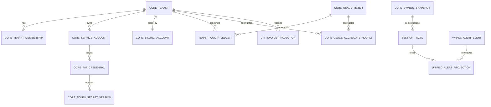

# ENTERPRISE CORE SCHEMA ANALYSIS

**Date:** 2026-05-02  
**Status:** Detailed schema analysis before implementation  
**Purpose:** Phân tích sâu candidate schema của `core` theo domain, quan hệ dữ liệu, cardinality, storage class, hot paths, và split boundaries để chốt trước khi viết migrations.

---

## 1. Vai trò của tài liệu này

Tài liệu này đứng sau:

- architecture blueprint,
- contract pack,
- resource freeze checklist,
- storage/schema strategy.

Nó không nhằm viết migration SQL cụ thể, mà để trả lời câu hỏi: `core` thực sự nên có những nhóm bảng nào, quan hệ với nhau ra sao, nhóm nào phải append-only, nhóm nào phải materialized, và nhóm nào tuyệt đối chưa nên tách schema vật lý.

---

## 2. Tóm tắt quyết định schema cho `core`

### 2.1 Kết luận lớn

`core` nên có 4 lớp schema logic:

1. **Control-plane schema**
   tenant, service accounts, PATs, access policies.
2. **Commercial schema**
   billing accounts, meters, quota ledgers, invoice projections.
3. **Market and signal serving schema**
   symbol snapshots, session facts, unified alerts, regime snapshots.
4. **Ops and audit schema**
   token usage logs, anomaly logs, service runs, policy audit logs.

### 2.2 Kết luận split boundary

Ở phase hiện tại, 4 lớp trên nên là **logical schema families**, chưa phải physical PostgreSQL schemas riêng.

---

## 3. Sơ đồ quan hệ cấp cao

Sơ đồ trên cố ý ở mức business relationships, không khẳng định khóa ngoại vật lý cho mọi cạnh ngay từ phase đầu.

---

## 4. Phân tích schema nhóm Control-plane

## 4.1 `CoreTenant`

### Vai trò

- business root của B2B/VIP,
- owner của service accounts,
- owner của quota consumption,
- anchor để suspend, bill và audit.

### Vì sao phải có bảng riêng

- lifecycle khác `auth_user`,
- cần state machine riêng,
- không thể nhét vào `UserConfig` nếu muốn nhiều người thật cùng quản trị một tenant.

### Cardinality chính

- `CoreTenant` 1 -> N `CoreTenantMembership`
- `CoreTenant` 1 -> N `CoreServiceAccount`
- `CoreTenant` 1 -> 1 `CoreBillingAccount` ở phase đầu, có thể 1 -> N nếu sau này hỗ trợ multi-billing-owner.

### Decision

Nên là mutable state table, không append-only.

---

## 4.2 `CoreTenantMembership`

### Vai trò

- map user người thật với tenant,
- gắn role quản trị tenant,
- không đại diện machine access.

### Vì sao nên tách khỏi PAT/service account

- human actors và machine principals có lifecycle khác nhau,
- audit needs khác nhau,
- security semantics khác nhau.

### Decision

Nên là join table có uniqueness theo `(tenant_id, user_id)`.

---

## 4.3 `CoreServiceAccount`

### Vai trò

- danh tính máy cho `vip-app`, bot hoặc integration workload,
- bridge giữa tenant và PAT credentials,
- nơi gắn policy bundles và environment tags.

### Vì sao phải là first-class table

- nếu bỏ qua lớp này, tenant PAT sẽ gắn trực tiếp vào tenant, dẫn tới auth semantics quá thô,
- không phân tách được `prod/staging/dev`,
- khó audit workload nào lạm dụng quota.

### Decision

Mutable state table, status-driven lifecycle, không append-only.

---

## 4.4 `CorePATCredential` và `CoreTokenSecretVersion`

### Vai trò

- `CorePATCredential`: identity và metadata của token,
- `CoreTokenSecretVersion`: secret generations để rotate không downtime.

### Quyết định quan trọng

- không lưu plaintext token,
- secret version nên tách khỏi credential metadata để rotate an toàn,
- usage logs không nên nhồi vào chính bảng PAT mà đi qua audit/usage tables riêng.

### Decision

- `CorePATCredential`: mutable state table,
- `CoreTokenSecretVersion`: append-mostly control-plane/audit hybrid.

---

## 4.5 `CoreAccessPolicy`

### Vai trò

- nhóm scopes thành bundles có thể gán cho service accounts,
- giúp không phải copy danh sách scope rời cho mọi token.

### Vì sao chưa cần quá phức tạp

Phase đầu chỉ cần policy bundles ở mức service account hoặc token issuance. Không cần policy engine kiểu ABAC đầy đủ ngay.

### Decision

Catalog table, low-churn, mutable but mostly stable.

---

## 5. Phân tích schema nhóm Commercial-plane

## 5.1 `CoreBillingAccount`

### Vai trò

- commercial owner của tenant,
- neo currency, invoice rules, credit balances, payment semantics.

### Vì sao không nên nhồi vào `CoreTenant`

- lifecycle commercial khác tenant lifecycle kỹ thuật,
- có thể cần evolve độc lập,
- dễ tái sử dụng với OpenCore primitives hiện có.

### Decision

Mutable commercial state table.

---

## 5.2 `CoreUsageMeter`

### Vai trò

- catalog của billable/quota-controlled units,
- bridge giữa route families và billing/quota rules.

### Schema expectation

- meter code,
- unit,
- aggregation window,
- rounding mode,
- billable flag,
- quota enforced flag,
- status.

### Decision

Catalog table, low mutation frequency, heavily referenced.

---

## 5.3 `TenantQuotaLedger`

### Vai trò

- append-only ledger của quota entitlements, consumption adjustments, overage, credits apply.

### Vì sao ledger là bắt buộc

- nếu chỉ có quota snapshot thì khó audit,
- billing disputes cần trace immutable entries,
- monthly recomputation dễ sai nếu không có ledger history.

### Decision

Append-only canonical commercial event table.

---

## 5.4 `CoreUsageAggregateHourly`

### Vai trò

- rollup usage theo tenant/meter/time bucket,
- phục vụ dashboards, invoices, alerts, quota screens,
- giảm phụ thuộc vào raw request logs.

### Vì sao hourly là hợp lý phase đầu

- đủ chi tiết cho billing/quota visibility,
- đủ nhẹ để storage không bùng nổ như raw per-request retention lâu dài,
- đủ tốt để detect anomalies.

### Decision

Materialized aggregate table, mutable via upsert or periodic recompute.

---

## 5.5 `BillingCreditGrant` và invoice projections

### Vai trò

- credits/prepaid buckets,
- invoice summaries cho partner visibility.

### Decision

- credit grants nên là canonical commercial events,
- invoice partner responses nên đọc qua invoice projection, không expose raw invoice internals trực tiếp.

---

## 6. Phân tích schema nhóm Market and Signal Serving

## 6.1 `CoreSymbolSnapshot`

### Vai trò

- read model chính cho batch ticker và per-symbol snapshot,
- thay thế composite request-time fanout.

### Vì sao phải là read model riêng

- object này không map 1-1 vào một bảng gốc duy nhất,
- nó tổng hợp giá, metadata, liquidity, 52W info và freshness state,
- public contract cần ổn định hơn source internals.

### Decision

Materialized read model keyed bởi `(symbol, trade_date)` hoặc `(symbol, session_ref)` tùy serving semantics cuối cùng.

---

## 6.2 `SessionFacts`

### Vai trò

- facts projection cho selected session,
- phục vụ UI, AI và partner APIs bằng cùng semantics.

### Vì sao khó nhất

- phụ thuộc selected-session truth,
- phụ thuộc formulas của cvd/strength,
- dễ drift giữa UI panels và API nếu không freeze sớm.

### Decision

Materialized derived facts table keyed bởi `(symbol, trade_date, selected_session)` hoặc equivalent canonical session key.

---

## 6.3 `UnifiedAlertProjection`

### Vai trò

- hợp nhất whale alerts, dark-flow/order-flow alerts, advisory alerts, screener alerts.

### Vì sao nên là projection thay vì canonical source duy nhất

- mỗi alert source có lifecycle và fields khác nhau,
- unified feed là serving concern, không phải canonical model của mọi loại signal.

### Decision

Materialized feed projection, query-optimized for list/read operations.

---

## 6.4 `PriceBoardSnapshot` và `RealtimeTickerSnapshot`

### Vai trò

- chặn upstream fallback ở public hot path,
- làm lớp cacheable/source-stable hơn cho partner reads.

### Decision

Read models, mutable/upsert-heavy, retention ngắn hơn canonical tables nếu cần.

---

## 7. Phân tích schema nhóm Ops and Audit

## 7.1 Token usage log

### Vai trò

- trace PAT usage theo request id, route family, status, units charged, ip,
- phục vụ anomaly detection và investigations.

### Decision

Append-only audit table hoặc event log table; không expose trực tiếp ra partner API, chỉ qua filtered projections nếu cần.

---

## 7.2 Token anomaly projection

### Vai trò

- phát hiện ip drift, unusual bursts, unexpected geographies, scope abuse patterns.

### Decision

Derived projection, không phải canonical source.

---

## 7.3 Service run lineage

### Vai trò

- materialization jobs, meter rollups, backfills, anomaly scans, invoice generation.

### Decision

Append-only or append-mostly operational lineage table, retention trung hạn đến dài hạn tùy audit needs.

---

## 8. Candidate P0/P1/P2 schema slices

## 8.1 P0 - phải có trước partner rollout

- `CoreTenant`
- `CoreTenantMembership`
- `CoreServiceAccount`
- `CorePATCredential`
- `CoreTokenSecretVersion`
- `CoreUsageMeter`
- `TenantQuotaLedger`
- `CoreUsageAggregateHourly`
- `CoreSymbolSnapshot`
- `SessionFacts`

### Lý do

Không có nhóm này thì `vip-app` không có auth model, billing model và data-plane serving model đủ rõ để tích hợp production.

## 8.2 P1 - nên có sớm sau P0

- `CoreBillingAccount`
- `BillingCreditGrant`
- `UnifiedAlertProjection`
- `PriceBoardSnapshot`
- token anomaly projections

## 8.3 P2 - chỉ làm khi trigger rõ

- sector regime snapshots,
- advanced export tables,
- separate invoice detail projections,
- physical schema split,
- dual-store analytics escalations.

---

## 9. Hot path analysis theo query family

| Query family | Nên đọc từ | Không nên đọc từ |
|---|---|---|
| Tenant self view | `CoreTenant` + billing summary projection | raw joins qua nhiều bảng audit |
| PAT list/status | `CorePATCredential` | token usage raw logs |
| Quota screens | quota snapshot projection + hourly aggregates | scan raw request logs |
| Invoice list | invoice summary projection | raw invoice + payment joins full detail |
| Symbol snapshot | `CoreSymbolSnapshot` | on-demand upstream fanout |
| Session facts | `SessionFacts` | direct `IntradayTick` aggregation |
| Alert feed | `UnifiedAlertProjection` | merge request-time từ nhiều canonical sources |

---

## 10. Schema split analysis: nên giữ chung cái gì, nên tách logic cái gì

## 10.1 Nên giữ chung physical schema giai đoạn đầu

- control-plane + commercial-plane thường còn đi sát nhau ở auth/quota/billing flows,
- market-serving + signal-serving cần cùng evolve khi selected-session semantics còn dịch chuyển,
- ops and audit có thể nằm chung DB nhưng tách retention policies.

## 10.2 Nên tách logic ownership ngay từ đầu

- review ownership,
- migration ownership,
- service ownership,
- query ownership,
- consumer ownership.

## 10.3 Chỉ nên tách physical schema khi

- permission model buộc phải tách,
- retention/churn profile khác biệt mạnh,
- write contention hoặc migration cadence khác biệt đủ lớn,
- hoặc compliance/audit boundary buộc phải tách.

---

## 11. Những rủi ro schema lớn nhất nếu làm sai thứ tự

1. Tạo token tables trước khi chốt service account model.
2. Tạo quota snapshot mà không có ledger.
3. Public `session_facts` khi selected-session semantics chưa freeze.
4. Tách physical schema rồi mới phát hiện contracts còn thay đổi liên tục.
5. Dùng raw logs làm invoice source thay vì aggregates và ledgers.
6. Để `CoreTenant` và commercial ownership dính cứng vào user account model cá nhân.

---

## 12. Kết luận

Schema analysis cho `core` dẫn tới một kết luận đơn giản nhưng quan trọng:

- `core` cần thêm nhiều bảng mới thật,
- nhưng các bảng đó phải được thêm theo từng schema slice bám contract freeze,
- read models là lớp bắt buộc cho public serving,
- ledger là lớp bắt buộc cho quota/billing,
- physical schema split vẫn nên đến sau cùng.

Nếu bám theo phân tích này, đội triển khai có thể viết migrations một cách thực dụng, ít drift và ít phải rollback kiến trúc hơn.