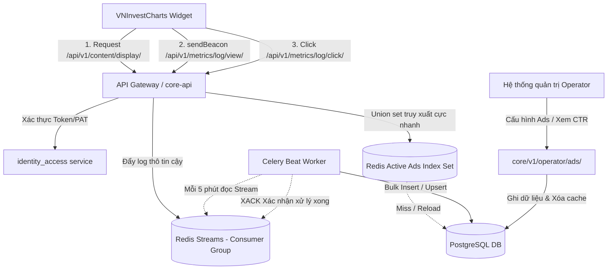

# KẾ HOẠCH THIẾT KẾ KỸ THUẬT: HỆ THỐNG AD SERVER (ADV-SERVER) TÍCH HỢP SAAS VNINVEST
*(Bản Kế Hoạch Đầy Đủ & Khả Thi Sau Thẩm Định Kỹ Thuật - 2026/06/14)*

Tài liệu này chi tiết hóa phương án thiết kế hệ thống **Ad Server (adv-server)** phía Backend để hỗ trợ và quản lý tính năng nhãn hiệu (Trademark) và quảng cáo (Ads) trên sản phẩm **VNInvestCharts Widget** (gói dịch vụ miễn phí hoặc chưa đăng nhập).

---

## 1. TỔNG QUAN & MỤC TIÊU THIẾT KẾ

Theo tài liệu định hướng [SAAS_FREE_TIER_ADS_TRADEMARK_PLAN.md](file:///C:/Mujoco%20Projects/vninvestcharts/docs/SAAS_FREE_TIER_ADS_TRADEMARK_PLAN.md) và phân tích thẩm định hệ thống, dịch vụ **adv-server** phía Backend được thiết kế nhằm đạt được các mục tiêu sau:

1. **Xác thực SaaS & Gated Features:** Đọc `tenantPat` (Personal Access Token) gửi lên từ client, truy vấn gói cước (`FREE`, `STARTER`, `PRO`, `ENTERPRISE`, `CUSTOM`) của Tenant để quyết định cờ bật/tắt quảng cáo (`showWidgetAds`) và nhãn hiệu (`hideTrademark`).
2. **Cung cấp API quảng cáo động:** Trả về biểu ngữ quảng cáo (banner) tương thích với kích thước yêu cầu (e.g. `300x50`, `468x60`), ngôn ngữ và lọc theo mã cổ phiếu đang xem.
3. **Hỗ trợ Đa độ phân giải (Retina & Vector):** Trả về ảnh có độ phân giải thường, độ phân giải cao (Retina 2x) và định dạng vector (SVG) để chống vỡ hình trên màn hình High-DPI.
4. **Hệ thống Ingest hiệu năng cao:** Ghi nhận và thống kê hàng triệu lượt hiển thị (Impression) và lượt bấm (Click) của người dùng cuối mà không gây nghẽn hoặc sập cơ sở dữ liệu chính (PostgreSQL).
5. **Bảo mật & Phòng Chống Gian Lận (Spam/Fraud):** Ngăn chặn spam Click/Impression từ bot hoặc bên thứ ba phá hoại qua chữ ký mã hóa ngắn hạn (HMAC Signature).
6. **Vượt qua Trình Chặn Quảng Cáo (Ad Blockers):** Đổi tên cấu trúc API và đường dẫn tĩnh để tránh bị chặn bởi uBlock Origin, AdGuard...
7. **Tương thích Iframe Sandbox & Chống dịch chuyển layout (CLS):** 
   * Widget dành sẵn chiều cao khung hiển thị quảng cáo (Reserved Layout Slot) để tránh thay đổi kích thước đột ngột khi tải xong ads.
   * Client tự quyết định điều hướng click bằng `window.open` thay vì nhận chuyển hướng HTTP 302 trực tiếp từ Backend để tránh bị trình duyệt chặn trong môi trường `iframe` sandbox của đối tác.
8. **Đo lường Impression Chuẩn IAB (Viewability):** Chỉ ghi nhận lượt xem khi ad hiển thị tối thiểu **50% diện tích** trong khung nhìn (Viewport) liên tục tối thiểu **1 giây** (theo dõi bằng Intersection Observer trên client).

---

## 2. THIẾT KẾ KIẾN TRÚC HỆ THỐNG

Hệ thống được thiết kế dưới dạng một Django app mới có tên `advertising` đặt tại thư mục `packages/core/backend/src/advertising/`.

### Sơ đồ tương tác dữ liệu (Data Flow)



---

## 3. MÔ HÌNH DỮ LIỆU (DATABASE SCHEMA)

Thiết kế các thực thể database trong file [packages/core/backend/src/advertising/models.py](file:///C:/Mujoco%20Projects/vninvest/packages/core/backend/src/advertising/models.py):

```python
import uuid
from django.db import models
from django.core.exceptions import ValidationError
from identity_access.models import CoreTenant

class AdCampaign(models.Model):
    class CampaignType(models.TextChoices):
        INTERNAL_PROMO = 'internal_promo', 'Internal Upgrade Promo'
        PARTNER_AD = 'partner_ad', 'Partner Advertisement'

    class Status(models.TextChoices):
        DRAFT = 'draft', 'Draft'
        ACTIVE = 'active', 'Active'
        PAUSED = 'paused', 'Paused'
        COMPLETED = 'completed', 'Completed'

    id = models.UUIDField(primary_key=True, default=uuid.uuid4, editable=False)
    name = models.CharField(max_length=120, verbose_name="Tên Chiến Dịch")
    campaign_type = models.CharField(
        max_length=24, 
        choices=CampaignType.choices, 
        default=CampaignType.INTERNAL_PROMO
    )
    status = models.CharField(
        max_length=16, 
        choices=Status.choices, 
        default=Status.DRAFT, 
        db_index=True
    )
    
    # Kích thước & Nội dung ad (Hỗ trợ đa độ phân giải - WebP & Vector)
    banner_url = models.URLField(max_length=500, verbose_name="Ảnh Banner 1x (WebP/PNG)")
    banner_url_retina = models.URLField(max_length=500, null=True, blank=True, verbose_name="Ảnh Banner 2x (Retina High-DPI)")
    banner_url_svg = models.URLField(max_length=500, null=True, blank=True, verbose_name="Ảnh Banner Vector (SVG)")
    banner_width = models.IntegerField(default=300, help_text="Chiều rộng banner (px)")
    banner_height = models.IntegerField(default=50, help_text="Chiều cao banner (px)")
    
    # Phân chia link đích thực tế và link tracking click
    destination_url = models.URLField(max_length=500, verbose_name="URL Đích (khi click thực tế)")
    
    # Trọng số & Thời hạn hiển thị
    weight = models.IntegerField(
        default=100, 
        help_text="Trọng số quay vòng quảng cáo (weight càng lớn tỷ lệ xuất hiện càng cao)"
    )
    start_date = models.DateTimeField(db_index=True, verbose_name="Ngày bắt đầu hiển thị")
    end_date = models.DateTimeField(db_index=True, verbose_name="Ngày kết thúc")
    
    # Khả năng tùy chỉnh quảng cáo riêng cho gói Enterprise của Tenant
    tenant = models.ForeignKey(
        CoreTenant,
        on_delete=models.CASCADE,
        null=True,
        blank=True,
        related_name='custom_ad_campaigns',
        help_text="Nếu set, quảng cáo này chỉ hiển thị riêng cho Widget của Tenant này (Tính năng Enterprise Custom Ads)"
    )
    
    # Luật phân loại đối tượng mục tiêu (Targeting Rules)
    targeting_rules = models.JSONField(
        default=dict, 
        blank=True, 
        help_text="Cấu hình luật hiển thị (Mã chứng khoán, Vùng miền, Tenant loại trừ)"
    )
    
    created_at = models.DateTimeField(auto_now_add=True)
    updated_at = models.DateTimeField(auto_now=True)

    class Meta:
        verbose_name = "Chiến dịch quảng cáo"
        verbose_name_plural = "Chiến dịch quảng cáo"
        ordering = ['-created_at']

    def __str__(self):
        return f"{self.name} ({self.get_campaign_type_display()} - {self.get_status_display()})"

    def clean(self):
        if self.start_date and self.end_date and self.start_date >= self.end_date:
            raise ValidationError("Ngày kết thúc phải lớn hơn ngày bắt đầu chiến dịch.")


class AdDailySummary(models.Model):
    """Bảng tổng hợp dữ liệu (Aggregated statistics) hàng ngày giúp truy vấn báo cáo cực nhanh."""
    campaign = models.ForeignKey(
        AdCampaign, 
        on_delete=models.CASCADE, 
        related_name='daily_summaries'
    )
    tenant = models.ForeignKey(
        CoreTenant, 
        on_delete=models.SET_NULL, 
        null=True, 
        blank=True
    )
    symbol = models.CharField(max_length=16, default='ALL', db_index=True)
    date = models.DateField(db_index=True)
    
    impressions_count = models.BigIntegerField(default=0)
    clicks_count = models.BigIntegerField(default=0)

    class Meta:
        verbose_name = "Thống kê quảng cáo ngày"
        verbose_name_plural = "Thống kê quảng cáo ngày"
        constraints = [
            # Tránh tuyệt đối Race Condition ghi nhận trùng lặp dữ liệu tổng hợp
            models.UniqueConstraint(
                fields=['campaign', 'tenant', 'symbol', 'date'],
                name='unique_ad_daily_summary_rule'
            )
        ]

    def __str__(self):
        return f"{self.campaign.name} - {self.date} (Cổ phiếu: {self.symbol})"


class AdImpressionLog(models.Model):
    """
    Log chi tiết lượt hiển thị để đối soát phòng chống gian lận.
    Bảng này được cấu hình PostgreSQL Table Partitioning theo tháng.
    """
    campaign = models.ForeignKey(AdCampaign, on_delete=models.CASCADE)
    tenant = models.ForeignKey(CoreTenant, on_delete=models.SET_NULL, null=True, blank=True)
    symbol = models.CharField(max_length=16, blank=True, default='')
    ip_address = models.GenericIPAddressField(null=True, blank=True)
    user_agent = models.TextField(blank=True, default='')
    created_at = models.DateTimeField(auto_now_add=True, db_index=True)


class AdClickLog(models.Model):
    """
    Log chi tiết lượt click.
    Bảng này được cấu hình PostgreSQL Table Partitioning theo tháng.
    """
    campaign = models.ForeignKey(AdCampaign, on_delete=models.CASCADE)
    tenant = models.ForeignKey(CoreTenant, on_delete=models.SET_NULL, null=True, blank=True)
    symbol = models.CharField(max_length=16, blank=True, default='')
    ip_address = models.GenericIPAddressField(null=True, blank=True)
    user_agent = models.TextField(blank=True, default='')
    created_at = models.DateTimeField(auto_now_add=True, db_index=True)
```

---

## 4. CHI TIẾT CÁC ĐƯỜNG DẪN API (REST ENDPOINTS)

### 4.1. Nhóm API Công cộng (Mở rộng cho Widget tích hợp)
Gắn kết dưới prefix trung lập để tránh Ad Blockers: `/api/v1/content/` và `/api/v1/metrics/` (Đăng ký tại `identity_access/api_urls.py`).

#### 1. Lấy Quảng cáo/Nội dung gợi ý (`GET /api/v1/content/display/`)
*   **Tham số Header:** `Authorization: Bearer <tenantPat>` (Không bắt buộc).
*   **Tham số Query String:**
    *   `slot_size` (Bắt buộc): Kích thước tốt nhất do Frontend tính toán dựa trên `ResizeObserver` (e.g. `300x50` hoặc `468x60`).
    *   `symbol` (Không bắt buộc): Mã cổ phiếu đang xem (ví dụ `SSI`).
*   **Rate Limiting bảo vệ:** Áp dụng DRF `AnonRateThrottle` và `UserRateThrottle` mặc định để giới hạn tần suất yêu cầu (ví dụ: Tối đa 60 requests/phút từ cùng một IP).
*   **Response (FREE/Invalid/Missing Token - Ads Active):**
    *   **Cấu hình Secret & Token bảo mật:** Hệ thống sử dụng khóa bí mật cấu hình từ biến môi trường `CORE_AD_SIGNING_SECRET` để tạo chữ ký mã hóa HMAC-SHA256 ngắn hạn có thời hạn 5 phút bảo vệ:
        `signature = HMAC_SHA256(CORE_AD_SIGNING_SECRET, campaign_id + tenant_id + client_ip + expires_at)`
    ```json
    {
      "show_ads": true,
      "hide_trademark": false,
      "ad": {
        "campaign_id": "9a3848b1-3829-41a9-b13c-d7e829384bb2",
        "image_source": {
          "default": "https://cdn.vninvest.vn/content/banners/9a3848b1-3829-41a9-b13c-d7e829384bb2/promo_30050.webp",
          "retina": "https://cdn.vninvest.vn/content/banners/9a3848b1-3829-41a9-b13c-d7e829384bb2/promo_30050_2x.webp",
          "svg": "https://cdn.vninvest.vn/content/banners/9a3848b1-3829-41a9-b13c-d7e829384bb2/promo_30050.svg"
        },
        "click_url": "https://vninvest.vn/upgrade?utm_source=widget_free",
        "click_tracking_url": "https://vninvest.vn/api/v1/metrics/log/click/9a3848b1-3829-41a9-b13c-d7e829384bb2/?symbol=SSI&tenant_id=tenant_uuid&expires_at=177892019&sig=abcd1234ef",
        "impression_tracking_url": "https://vninvest.vn/api/v1/metrics/log/view/?campaign_id=9a3848b1-3829-41a9-b13c-d7e829384bb2&symbol=SSI&tenant_id=tenant_uuid&expires_at=177892019&sig=abcd1234ef",
        "width": 300,
        "height": 50
      }
    }
    ```
*   **Response (PRO/ENTERPRISE Token - Ads Disabled):**
    ```json
    {
      "show_ads": false,
      "hide_trademark": true,
      "ad": null
    }
    ```

#### 2. Ghi nhận lượt hiển thị (`POST /api/v1/metrics/log/view/`)
*   **Dữ liệu yêu cầu (JSON Payload):**
    ```json
    {
      "campaign_id": "9a3848b1-3829-41a9-b13c-d7e829384bb2",
      "symbol": "SSI",
      "tenant_id": "tenant_uuid",
      "expires_at": 177892019,
      "sig": "abcd1234ef"
    }
    ```
*   **Logic xác thực:** Backend tính toán lại chữ ký HMAC dựa trên IP người gọi (`client_ip`) và thông số payload. Nếu chữ ký không khớp hoặc `expires_at` nhỏ hơn thời gian hiện tại, từ chối bản ghi (`HTTP 403 Forbidden`).
*   **IP Rate Limiting:** Tối đa 10 impressions/phút từ cùng một IP/User Agent.
*   **Chống phình bộ nhớ Redis (Stream Memory Protection):** Sử dụng tham số `MAXLEN` để khống chế kích thước tối đa của Redis Stream, tự động cắt tỉa (trim) các bản ghi quá cũ nếu Celery worker bị nghẽn:
    `XADD ads:impressions:stream MAXLEN ~ 50000 * campaign_id <id> symbol <symbol> ...`
    Việc này đảm bảo bộ nhớ RAM của Redis không bao giờ bị tràn (Memory Explosion).
*   **Frontend integration:** Sử dụng `navigator.sendBeacon` để đẩy ngầm dữ liệu tracking khi Intersection Observer xác định banner ads hiển thị ≥ 50% diện tích khung nhìn liên tục tối thiểu 1 giây.

#### 3. Ghi nhận lượt click bất đồng bộ (`POST /api/v1/metrics/log/click/<uuid:campaign_id>/`)
*   *Lưu ý:* API này không trả về chuyển hướng HTTP 302 trực tiếp để loại bỏ rủi ro bị chặn bởi các quy tắc chặn bảo mật của `iframe` sandboxed.
*   **Dữ liệu yêu cầu:** Tương tự API ghi nhận view.
*   **Logic:** Kiểm tra HMAC và IP rate limiting (Tối đa 1 click/giây). Ghi nhận vào Redis Stream `ads:clicks:stream` bằng lệnh `XADD` giới hạn `MAXLEN ~ 50000` và phản hồi:
    ```json
    {
      "status": "ok",
      "tracked": true
    }
    ```
*   **Frontend integration:** Khi người dùng click quảng cáo, client thực hiện `window.open(ad.click_url, '_blank')` để mở tab mới an toàn và đồng thời dùng `navigator.sendBeacon(ad.click_tracking_url)` để gửi sự kiện tracking ngầm về server.

---

### 4.2. Nhóm API Quản trị (Dành cho Operator - `/core/v1/operator/ads/`)
*   **Phân quyền tích hợp (Authorization):** Tích hợp trực tiếp lớp DRF permissions tiêu chuẩn `permissions.IsAdminUser` cùng cấu hình `authentication_classes = [CorePATAuthentication]` để bảo vệ endpoint, kiểm soát quyền truy cập chỉ cho phép nhân viên hệ thống (`is_staff`) hoặc quản trị viên cấp cao (`is_superuser`).

*   `GET /core/v1/operator/ads/campaigns/`: Lấy danh sách toàn bộ các chiến dịch kèm bộ lọc trạng thái.
*   `POST /core/v1/operator/ads/campaigns/`: Tạo mới một chiến dịch quảng cáo.
*   `PATCH /core/v1/operator/ads/campaigns/<uuid:id>/`: Thay đổi trạng thái hiển thị, chỉnh sửa cấu hình targeting hoặc cập nhật ảnh/link liên kết.
*   `GET /core/v1/operator/ads/analytics/`: Lấy báo cáo hiệu suất tỷ lệ bấm quảng cáo (CTR) tổng hợp theo khoảng thời gian và theo từng đối tác.

---

## 5. THIẾT KẾ ĐỆM CACHE & XỬ LÝ NỀN TIN CẬY (REDIS & CELERY)

### 5.1. Chỉ mục hóa Cache Chiến dịch (Redis Cache Pre-indexing)
*   **Lập chỉ mục trên Redis:**
   *   Quảng cáo phân phối đại trà:
       *   Lưu dạng Redis Set: `ads:active:all:<slot_size>` -> Thêm danh sách Campaign ID.
   *   Quảng cáo phân phối trúng đích mã cổ phiếu:
       *   Lưu dạng Redis Set: `ads:active:symbol:<symbol_code>:<slot_size>` -> Thêm danh sách Campaign ID tương thích.
   *   Quảng cáo tùy chỉnh riêng cho Tenant Enterprise:
       *   Lưu dạng Redis Set: `ads:active:tenant:<tenant_id>:<slot_size>` -> Thêm danh sách Campaign ID riêng.
*   **Cơ chế làm mới cache (Cache Refresh & Expiry Strategy):**
    *   **Django Signal Trigger (Tức thời):** Đăng ký Django signals `post_save` và `post_delete` trên model `AdCampaign`. Bất kỳ thay đổi nào từ phía Operator Dashboard sẽ kích hoạt tác vụ chạy nền khôi phục dữ liệu cache, đảm bảo không bị dữ liệu cũ (stale data).
    *   **Fallback Cron Task (Tuần kỳ):** Một Celery beat task (`rebuild_ads_cache_index`) chạy định kỳ mỗi **5 phút** để kiểm tra và cập nhật lại toàn bộ các index set trên Redis.
    *   **Khống chế TTL:** Thiết lập thời gian sống (TTL) là **24 giờ** cho các index set trên Redis để tự động giải phóng tài nguyên trong trường hợp chiến dịch kết thúc hoặc bị mồ côi (orphaned keys).

### 5.2. Chống mất dữ liệu qua Redis Streams & Celery Consumer Group
*   Sử dụng **Redis Streams** giúp tránh mất dữ liệu nếu worker bị sập giữa chừng:
    *   Hộp chứa Log Impression: `ads:impressions:stream`
    *   Hộp chứa Log Click: `ads:clicks:stream`
*   Celery Beat Task chạy định kỳ mỗi **5 phút** (`aggregate_ad_metrics`):
    1. Đọc dữ liệu stream dưới Consumer Group bằng lệnh `XREADGROUP` để xử lý theo lô (batches).
    2. Gom nhóm (Aggregate) dữ liệu đếm số lượng hiển thị và click theo từng bộ giá trị `(campaign_id, tenant_id, symbol, date)`.
    3. Thực hiện câu lệnh SQL Upsert duy nhất (`INSERT ... ON CONFLICT DO UPDATE`) để cập nhật vào bảng `AdDailySummary`.
    4. Ghi trực tiếp danh sách log thô vào bảng phân vùng `AdImpressionLog` và `AdClickLog` bằng cơ chế bulk insert (`bulk_create`).
    5. Sau khi lưu DB thành công, gọi lệnh `XACK` gửi tín hiệu lên Redis xác nhận đã xử lý xong.

---

## 6. THIẾT KẾ DỰ PHÒNG & GIỚI HẠN DỮ LIỆU (PARTITIONING & FALLBACK)

### 6.1. Phân vùng bảng (PostgreSQL Table Partitioning)
*   **Chính sách Phân vùng:** Cấu hình Partitioning theo RANGE trên trường `created_at` (Phân vùng theo tháng).
*   **Data Retention Policy (Xóa dữ liệu cũ):** Một Celery task chạy định kỳ hàng tuần sẽ quét và thực hiện lệnh `DROP TABLE` các phân vùng log thô (`AdImpressionLog_YYYY_MM` và `AdClickLog_YYYY_MM`) cũ hơn 30 ngày (hoặc 60 ngày tùy dung lượng đĩa) để giải phóng lưu trữ. Dữ liệu tổng hợp trong bảng `AdDailySummary` được giữ lại vĩnh viễn.

### 6.2. Cơ chế Dự phòng ở Client (Widget-side Fallback)
*   **Thiết kế:** Widget Frontend lưu trữ sẵn thông tin của 2 chiến dịch quảng cáo tĩnh mặc định (Offline fallback ads), trỏ về link giới thiệu sản phẩm VNInvest Pro.
*   **Thời gian chờ (Timeout):** Widget gọi API gợi ý nội dung phân phối `/api/v1/content/display/` với timeout tối đa là **1.5 giây**.
*   **Kích hoạt Dự phòng:** Nếu cuộc gọi API bị lỗi mạng, mã lỗi 5xx, hoặc hết thời gian timeout, Widget sẽ tự động tải ảnh tĩnh/base64 từ CDN hoặc bộ nhớ trong, hiển thị kèm nhãn thương hiệu và tự tạo luồng đăng ký gói cước Pro mà không gây gián đoạn trải nghiệm đồ thị của đối tác.

---

## 7. ĐIỀU KIỆN TIÊN QUYẾT TRIỂN KHAI & ĐỊNH CẤU HÌNH (PREREQUISITES & ENV)

Để hệ thống hoạt động ổn định trên môi trường Staging/Production:
1. **Biến môi trường mật khóa:**
   Cấu hình `CORE_AD_SIGNING_SECRET` trong tệp `compose.dev.env` và tệp mẫu `compose.prod.env.example` với giá trị chuỗi bảo mật ngẫu nhiên (độ dài tối thiểu 32 ký tự). Thiết lập chính sách xoay vòng định kỳ 90 ngày.
2. **CDN Infrastructure:**
   Tất cả tài nguyên ảnh quảng cáo được tải lên và phục vụ dưới cấu trúc CDN chống Ad Blocker:
   `https://cdn.vninvest.vn/content/banners/<campaign_id>/<file_name>.[webp|svg]`
3. **Phân vùng bộ nhớ Redis:**
   Đảm bảo instance Redis phục vụ lưu trữ đệm và Streams có bộ nhớ khả dụng tối thiểu **2GB**, được cấu hình eviction policy là `noeviction` để tránh bị xóa mất log thô của Streams khi bộ nhớ đầy.
4. **Celery Worker Dedicated Queue:**
   Định cấu hình hàng đợi riêng `ad_metrics` cho các tác vụ tổng hợp dữ liệu click/impression quảng cáo để không làm nghẽn các tác vụ nghiệp vụ tài chính quan trọng khác.

---

## 8. KẾ HOẠCH TRIỂN KHAI & PHÂN CÔNG (ROADMAP & TIMELINE)

### Sprint 1: Thiết lập cấu trúc dữ liệu & Thiết kế Database (Backend-focused)
*   **Nhiệm vụ:**
    *   Tạo Django app mới `advertising` trong `packages/core/backend/src/`.
    *   Cấu hình models cho `AdCampaign`, `AdDailySummary`, `AdImpressionLog`, `AdClickLog`.
    *   Tạo migration và thiết lập PostgreSQL table partitioning cho các bảng logs.
    *   Cấu hình biến môi trường `CORE_AD_SIGNING_SECRET`.
*   **Kết quả:** Cơ sở dữ liệu sẵn sàng, migrations chạy thành công trên dev/staging.

### Sprint 2: API Core, Ingestion Pipeline & Redis Cache (Backend-focused)
*   **Nhiệm vụ:**
    *   Xây dựng thuật toán chọn lọc và phân phối quảng cáo qua lệnh `SUNION` trên Redis.
    *   Xây dựng cơ chế Django signals và Cron Celery task để cập nhật và bảo vệ cache.
    *   Phát triển API phân phối `/api/v1/content/display/` cùng chữ ký bảo mật.
    *   Xây dựng API nhận tracking `/api/v1/metrics/log/view/` và `/api/v1/metrics/log/click/` ghi nhận vào Redis Streams có giới hạn `MAXLEN`.
    *   Viết Celery Beat task thực hiện đọc stream, bulk insert log thô và bulk upsert dữ liệu gom nhóm vào `AdDailySummary`.
*   **Kết quả:** API Backend hoạt động ổn định, Redis Stream và Celery hoàn thành tích hợp, test thành công việc ghi nhận CTR.

### Sprint 3: Phát triển Giao diện Quản trị & Tích hợp Widget (Frontend-focused & Coordination)
*   **Nhiệm vụ:**
    *   Xây dựng UI cho Operator để quản trị tạo lập chiến dịch, upload ảnh banner (1x, retina, SVG), đặt trọng số hiển thị và xem thống kê CTR.
    *   Đội ngũ Widget cập nhật layout với khung trống dành sẵn (Reserved Slot Layout) và ResizeObserver để tự tính kích thước container:
        *   Nếu container width < 468px: tự động yêu cầu slot `300x50`.
        *   Nếu container width >= 468px: tự động yêu cầu slot `468x60`.
    *   Cấu hình Intersection Observer trên widget để gửi sự kiện Impression theo tiêu chuẩn IAB (50% diện tích, duy trì 1s).
    *   Tích hợp `navigator.sendBeacon` để đẩy dữ liệu metrics view và click ngầm lên server.
    *   Thực hiện cơ chế mở tab mới độc lập qua `window.open` giải quyết iframe sandboxed.
*   **Kết quả:** Giao diện quản trị hoạt động mượt mà, Widget hiển thị quảng cáo động chuẩn xác, ghi nhận impression/click ổn định.

### Sprint 4: Kiểm thử tích hợp, UAT & Đóng gói triển khai (QA & Devops)
*   **Nhiệm vụ:**
    *   Chạy kiểm thử chống gian lận (spam click/impression) bảo vệ hệ thống.
    *   Chạy kiểm thử an toàn bản quyền Trademark (Anti-tampering) trên DOM.
    *   Kiểm tra cơ chế hoạt động của client-side fallback khi Backend ad server giả định bị sập hoặc quá tải.
    *   Thực hiện tối ưu hóa cấu hình Docker Compose và CI/CD để đẩy code lên môi trường Staging/Production.
*   **Kết quả:** Hoàn thành nghiệm thu UAT, hệ thống hoạt động ổn định trên môi trường sản xuất.

---

## 9. KHUYẾN NGHỊ MỞ RỘNG (PHASE 2 EXPANSION CHECKLIST)
Các hạng mục tối ưu hóa sau khi Sprint 1-4 hoàn tất thành công:
1. **A/B Testing Infrastructure:** Bổ sung trường `group_id` cho chiến dịch để chia phân nhóm người dùng ngẫu nhiên trên Client, so sánh trực quan hiệu suất CTR giữa các banner khác nhau.
2. **WebSocket Realtime Analytics:** Kết nối Django Channels để đẩy trực tiếp biến động CTR theo thời gian thực về màn hình giám sát của Operator.
3. **External Networks Integration:** Hỗ trợ cấu hình tích hợp phân phối SDK Google AdMob hoặc Facebook Audience Network như một luồng fallback cấp 2 khi VNInvest cạn nguồn chiến dịch tự doanh.
