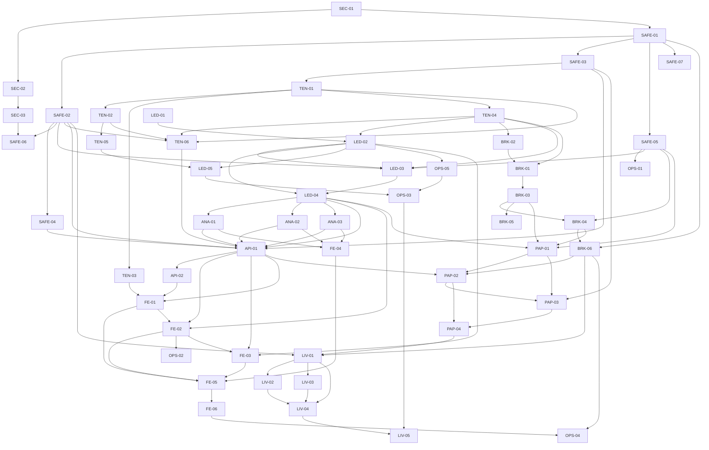

# IMPLEMENTATION PLAN — Portfolio Commercial Hardening (Danh mục / Broker Hub / Ledger)

**Trạng thái:** APPROVED FOR EXECUTION — quyền quyết định đã chốt trong tài liệu này.
**Ngày:** 2026-09-25
**Baseline:** branch `dev`, HEAD `8b479d24` (working tree có WIP AI Advisory — không được revert).
**Phiên bản:** Rev.2 (2026-09-25) — vá sau vòng review độc lập: đường dẫn test/lệnh gate, DAG không chu trình, phạm vi file, coverage, decision bổ sung.
**Quy mô:** 52 slice / 9 wave / ~192-251 engineer-days (ed) — xem §13.
**Audit nền:** `docs/AUDIT_PORTFOLIO_COMMERCIAL_REDESIGN_20260925.md` (Rev.1).
**Phản biện nền:** ledger Entry 224 (review) + Entry 225 (verification) + Entry 227 (bản vá Rev.2 này).
**Checklist bàn giao:** `docs/evidence/portfolio-commercial/HANDOFF_CHECKLIST.md`.

## 0. Quyền hạn và cách dùng

Tài liệu này là **hợp đồng thực thi**. Mọi quyết định sản phẩm/kỹ thuật còn mở đã được chốt ở §3 (Decision Log). Đội code **không cần hỏi lại** để bắt đầu Wave -1 và Wave 0.

Cách dùng:

1. Tech Lead đọc §0–§6 một lần.
2. Mỗi người nhận đúng một workstream, đọc §7 (slice của mình) + §11 (RACI) + `HANDOFF_CHECKLIST.md`.
3. Mỗi slice có: mục tiêu, file chạm, yêu cầu, AC đo được, test, evidence, rollback, gate.
4. Không đóng slice nếu thiếu evidence hoặc AC chưa xanh. Không mở slice sau nếu dependency chưa merge.
5. Mọi thay đổi phải cập nhật `docs/CODE_CHANGE_AUDIT_LEDGER.md` và evidence pack tương ứng.

Phạm vi tài liệu: **doc-only**. Tài liệu này không sửa runtime. Việc rotate secret, ký license và phê duyệt live-money là hành động của chủ repo sau khi nhận báo cáo.

---

## 1. Tóm tắt điều hành

### 1.1 Kết luận

| Hạng mục | Quyết định |
|---|---|
| Trạng thái hiện tại | **NO-GO live-money** |
| Release R0 (kế tiếp) | Security hotfix + safety stop, không thêm feature |
| Release R1 | Read-only portfolio (manual/CSV + nếu đã có license thì broker read-only) |
| Release R2 | Broker Hub read-only + paper trading |
| Release R3 | Live trading — **chỉ mở nếu** mọi Exit-5 gate xanh **và** commercial license của `vnbroker` đã ký bằng văn bản |
| Nếu license chưa ký | R3 không tồn tại. Sản phẩm ship manual/CSV portfolio; toàn bộ code path gọi vnbroker bị disable bằng feature flag |

### 1.2 Năm lý do chặn

1. **Secret incident (P0-SEC-01):** PAT dạng `github_pat_*`/`ghp_*` thật trong file tracked — `DOCKER_STARTUP_GUIDE.md:14,116`, `docker-start.ps1:8`, `set-docker-env.ps1:4`, `scratch/*.py`. File `compose.dev.env` (đang tracked, `.gitignore` không chặn) chứa `CORE_DJANGO_SECRET_KEY`, `CORE_PAT_PEPPER`, `CORE_AD_SIGNING_SECRET`, `DNSE_CREDENTIAL_FERNET_KEY`, `DNSE_API_KEY`, `DNSE_API_SECRET`, `GITHUB_CLIENT_SECRET`, `LEGACY_DATABASE_URL` (có password), `CORE_DB_PASSWORD`, `GRAFANA_ADMIN_PASSWORD`. `docker-compose.dev.yml` đặt default trong repo: `CORE_DB_PASSWORD:-devpassword` (`:22,79,125,212,260,289,318,350,388,419,456,486`), `CORE_PAT_PEPPER:-dev-pat-pepper-replace-in-production` (`:126,213,261,290,319,351,389,420,457,487`), `DNSE_CREDENTIAL_FERNET_KEY` ghim sẵn giá trị Fernet (`:82,127,421,458`) và để rỗng (`:352`). Phải revoke/rotate trước mọi việc khác.
2. **Order không fail-closed (P0-SAFETY-01):** `views_dnse.py:190` mặc định `dry_run=False`; `DNSEConnectionPanel.js:207-218` không gửi `dry_run`; live write gọi broker trực tiếp tại `:204-213`.
3. **Tenant không nhất quán (P0-ISO-01/02/03):** analytics chỉ lọc user (`portfolio_analytics_views.py:25-27`); hai tenant resolver khác nhau (`identity_access/middleware.py:212-237` vs `user_workspace/permissions.py:25-90`); broker config không có tenant (`models.py:452-540`); FE lưu tenant ở `localStorage` (`PortfolioContext.js:25-28,296-300`) nhưng transport đọc `sessionStorage` (`transport.js:169-177,335-338`).
4. **Ledger không đúng (P0-DATA-01):** transaction không validate tài chính (`models.py:82-98`); holdings clamp oversell, bỏ dividend, không trừ phí/thuế bán (`portfolio_analytics_views.py:30-61`).
5. **Vận hành chưa production-ready:** task chạy đồng bộ trong request (`views_dnse.py:111,140,169`); không có `broker` queue trong `queue_policy.py:6-22`; test bật `task_always_eager` (`settings.py:381-388`); kill-switch fail-open khi lỗi DB (`service_ops/broker_runtime.py:24-38`) và không có caller trong write path; job status không ownership check (`views_broker.py:182-200`); rate limit `get/set` không atomic (`:169-176`); migration `0008` query `TenantMember.is_active` không tồn tại (`0008_backfill_transaction_subaccount_tenant.py:73-75` vs `identity_access/models.py:578-647`); `TenantQuotaMiddleware` dùng `CoreTenant`/`logger` chưa import (`middleware.py:305-407`); prod thiếu `DNSE_CREDENTIAL_FERNET_KEY` trong khi route `identity_access/urls.py:68` vẫn bật; broker routes đăng ký trùng (`user_workspace/urls.py:81-86` và `:99-104`, 6 path giống hệt nhau); CI/entrypoint fail-open (`.github/workflows/web-ci.yml:39,50`, `core-api.yml:142-144`, `packages/core/backend/entrypoint.sh:21,24,52`).

### 1.3 Nguyên tắc bất di bất dịch

- Deny by default: thiếu capability/policy/tenant/secret/OTP/confirm → từ chối trước khi gọi broker.
- Server là nguồn sự thật của mode: client không được tự quyết định `live`.
- Mọi write tài chính có audit, idempotency và có thể replay an toàn.
- Mọi resource người dùng đều tenant-scoped; không có `first tenant`/`first portfolio` fallback.
- Không hiển thị số 0 giả; thiếu dữ liệu là `null` + lý do + nguồn + thời điểm.
- Không dùng dữ liệu tài chính thật của khách hàng trong test/sandbox.
- Không feature nào mở trước khi gate của nó xanh.

---

## 2. Phạm vi và ngoài phạm vi

### 2.1 Trong phạm vi

- Portfolio CRUD, SubAccount, Transaction, ledger, valuation, performance, allocation, risk.
- Broker Hub: DNSE/SSI/TCBS read-only, sync, reconciliation, capability matrix.
- Paper trading engine và order ticket chuẩn.
- Live trading pipeline **có code nhưng mặc định disabled**, chỉ mở sau Exit-5.
- Tenant isolation, RBAC/capability, audit, secret management, kill-switch.
- Queue/worker/DLQ, observability/SLO, CI gates, migration/rollback, SBOM/ASVS.
- FE: Portfolio workspace, Broker Hub, Sync Center, i18n VI/EN, a11y WCAG 2.2 AA.

### 2.2 Ngoài phạm vi (defer, có ghi backlog ID)

| ID | Hạng mục | Lý do defer | Backlog |
|---|---|---|---|
| OOS-01 | Multi-currency/FX | R1/R2 chỉ VND | BL-PORT-01 |
| OOS-02 | Shared household portfolio nhiều user sở hữu | R1 là personal-per-tenant | BL-PORT-02 |
| OOS-03 | Conditional orders (FCO/stop-limit/OCO) | Sau khi GTD live ổn định | BL-PORT-03 |
| OOS-04 | WebSocket streaming positions/P&L | R2 dùng sync + poll | BL-PORT-04 |
| OOS-05 | Chart trading / drag-to-modify | Sau R3 | BL-PORT-05 |
| OOS-06 | Leaderboard/monetization UI | Sau paper engine | BL-PORT-06 |
| OOS-07 | AI advisory integration vào performance | Đã có lane riác, chỉ đọc chung ledger | BL-PORT-07 |
| OOS-08 | FIFO cost method | R1 chốt weighted average | BL-PORT-08 |

### 2.3 Supersede tài liệu cũ

| Tài liệu cũ | Quan hệ với plan này |
|---|---|
| `docs/IMPLEMENTATION_PLAN_BROKER_MANAGEMENT_20260923.md` | **Superseded** cho phần kiến trúc/roadmap. Giữ làm lịch sử; các mục đã stale (tạo `BrokerCredential` mới, bump v1.1.0, route `/api/broker/*`) không được thực hiện |
| `docs/IMPLEMENTATION_PLAN_BROKER_CONFIG_20260923.md` | **Đã triển khai phần lớn** (Entry 154/158). Plan này chỉ giữ phần còn nợ: tenant scope, cutover store, capability matrix, SOC runtime enforcement |
| `docs/IMPLEMENTATION_PLAN_VNBROKER_V34_UPGRADE_20260923.md` | Requirements đã pin SHA `1ff04e60`; plan này chỉ giữ contract pin + license/SBOM gate |
| `docs/TICKET_PORTFOLIO_MANAGEMENT_UI.md` | User story CUD đã hiện thực một phần; plan này thay bằng IA đầy đủ + archive/export + confirm impact |
| `docs/AUDIT_PORTFOLIO_COMMERCIAL_REDESIGN_20260925.md` | Nguồn sự thật cho findings; plan này là kế hoạch thực thi |

---

## 3. Decision Log — các quyết định đã chốt (không cần hỏi lại)

| ID | Quyết định | Lý do | Bằng chứng |
|---|---|---|---|
| D-01 | R1 chỉ read-only; live order mặc định `paper`. | An toàn | `views_dnse.py:190` |
| D-02 | `X-Tenant-ID` (public_id) là nguồn tenant duy nhất; query `tenant`/`X-Tenant-Code` bị deprecate sau 1 release | Hai resolver gây lệch | `middleware.py:212-237`, `permissions.py:25-90` |
| D-03 | Mọi broker/ledger/job/audit table có `tenant_id NOT NULL` + index | Cross-tenant leak | `models.py:452-540` |
| D-04 | Portfolio thuộc `(tenant, user)`; R1 không có shared household | Đơn giản, khớp hiện trạng | `models.py:24-38` |
| D-05 | Base currency VND; FX/multi-currency defer | Broker VN | OOS-01 |
| D-06 | Cost method = **weighted average**; cổ tức là cash flow, **không** giảm cost basis; phí/thuế BUY vốn vào cost basis; phí/thuế SELL trừ khỏi realized P&L và cash | Khớp broker VN và hiện trạng `_compute_holdings` | `portfolio_analytics_views.py:47-57` |
| D-07 | Corporate actions R1: stock split + bonus; rights/IPO defer | Độ phức tạp | OOS-08 |
| D-08 | Broker-synced transaction là append-only; sửa = reversal entry; manual entry editable | Auditability | `models.py:93` đã có `external_id` |
| D-09 | API mới chỉ dưới `/core/v1/workspace/*`; `/api/*` legacy freeze, chỉ compatibility proxy | `/api/*` là catch-all legacy | `vninvest_core/legacy_proxy.py:56-77` |
| D-10 | Endpoint mới trả `{data, meta}`; endpoint cũ giữ shape 1 release; FE có normalizer dual-read | Tránh breaking change | `PortfoliosPage.tsx:40-42` đọc `res.results` |
| D-11 | Lỗi API dùng RFC 9457 `application/problem+json` với `type/title/status/detail/errors/request_id` | Chuẩn quốc tế | RFC 9457 |
| D-12 | `Idempotency-Key` bắt buộc cho mọi write tài chính; unique `(tenant_id, actor_id, scope, key)`; TTL 7 ngày cho order | Chống double order | `views_dnse.py:204-213` không có |
| D-13 | Queue mới `broker` + worker riêng; test phải chạy với `task_always_eager=False` + Redis thật | Prod hiện không có consumer | `queue_policy.py:6-22`, `settings.py:381-388` |
| D-14 | Kill-switch fail-closed: lỗi DB = deny write; phân cấp global/tenant/provider | An toàn | `broker_runtime.py:24-38` |
| D-15 | Secret: giữ Fernet tới R2 nhưng broker secret dùng `SecretStore` riêng với `secret_version` và key `BROKER_SECRET_KEY` **không derive từ `SECRET_KEY`**; bỏ default key trong repo | Rủi ro hiện hữu | `encryption.py:10-17`, `compose.dev.env:7,12` |
| D-16 | Capability matrix là **dữ liệu versioned**, không phải hằng `FULLY_SUPPORTED` | Status sai gây hiểu nhầm | `views_broker.py:31-32` |
| D-17 | Retention: ledger/order/audit ≥ 7 năm (policy nội bộ, có thể siết thêm sau legal review); cache/snapshot 90 ngày; job log 30 ngày | Truy vết tài chính | Chưa có hiện trạng |
| D-18 | SLO: read API p95 ≤ 500ms (warm), sync freshness p95 ≤ 30 phút trong giờ giao dịch, order duplicate = 0, audit completeness = 100%, isolation violations = 0 | Đo được | — |
| D-19 | Test gate phải deterministic: `npm run test:components` chạy 3 lần liên tiếp cùng commit, cả 3 xanh mới ký release | Tránh rerun xanh giả | Ledger Entry 224/225 |
| D-20 | Chuẩn bắt buộc: OWASP ASVS 5.0 L2 (R1/R2), L3 (R3); OWASP API Security Top 10 2023; RFC 9457; OpenAPI 3.1; WCAG 2.2 AA; CycloneDX SBOM ≥ 1.6; ISO/IEC 25010:2023 + 25012:2008; ISO/IEC 27001:2022 | Chuẩn quốc tế | §4 |
| D-21 | `vnbroker` license chưa ký ⇒ R3 không tồn tại; feature flag `BROKER_INTEGRATION_ENABLED=false` mặc định | Pháp lý | `C:\Mujoco Projects\vnbroker\LICENSE.md:9-21`; `pyproject.toml:13`; wheel metadata `License: Custom: Personal, research, non-commercial` |
| D-22 | Monetization: FREE = manual/CSV + paper; PRO = broker read-only; ENTERPRISE = read-only + API/PAT; live trade = approval riêng. **Đây là thay đổi có chủ ý so với plan cũ** (plan cũ để PRO = live trade tại `docs/IMPLEMENTATION_PLAN_BROKER_MANAGEMENT_20260923.md:181`) vì chủ động hạ live xuống approval riêng theo D-01 + Exit-5; PO ký tại review pre-R3 | Sản phẩm | — |
| D-23 | Kill-switch và audit write là **bắt buộc ở mọi lớp**: middleware, view, service, worker | Không được bỏ sót đường gọi | `views_dnse.py:204-213` gọi thẳng broker |
| D-24 | Migration chỉ theo expand → backfill → verify → cutover → contract. Reverse **chỉ revert row do chính migration đó backfill** (có marker `backfilled_by`), không set NULL hàng loạt | An toàn dữ liệu | `0008_backfill_transaction_subaccount_tenant.py:92-99` set toàn bộ NULL |
| D-25 | Không dùng real-money E2E; chỉ paper/sandbox/mocked broker trong CI; live chỉ canary thủ công có approval | Rủi ro | — |
| D-26 | Đội code phải dùng `defaultCoreApiAdapter as unknown as { ... }` cho method mới, giữ convention repo | Nhất quán | AGENTS.md |
| D-27 | **Benchmark**: VN30 chính, VN100 phụ. **Performance**: TWR là mặc định; MWR chỉ hiển thị khi ≥ 2 external cash flow; method ghi trong `meta.calculation_version` | Trả lời audit Q9 | `AUDIT…:§L Q9` |
| D-28 | **Freshness SLA theo provider** (giờ Việt Nam; phiên 09:00–11:30 và 13:00–14:45): DNSE ≤ 15 phút; SSI ≤ 30 phút; TCBS ≤ 30 phút; ngoài phiên ≤ 24h; quá ngưỡng ⇒ `stale=true` + alert | Trả lời audit Q10 | `AUDIT…:§L Q10` |
| D-29 | **Rotate secret = một sự kiện**: `CORE_DJANGO_SECRET_KEY`, `CORE_PAT_PEPPER`, `CORE_AD_SIGNING_SECRET`, `DNSE_CREDENTIAL_FERNET_KEY`, `DNSE_API_KEY`, `DNSE_API_SECRET`, `GITHUB_CLIENT_SECRET` đổi cùng lúc; **chấp nhận** session/PAT cũ bị vô hiệu và phải thông báo user trước; sau đó BRK-02 chuyển broker secret sang `BROKER_SECRET_KEY` có `secret_version` | Fernet hiện derive từ `SECRET_KEY` nên rotate = rotate secret key | `encryption.py:10-17`, `compose.dev.env` |
| D-30 | **Drop store DNSE legacy** chỉ khi: route `identity_access/urls.py:68` trả 410 + header `Deprecation`; metric `legacy_credential_usage` = 0 trong 30 ngày liên tục; sau 2 release; không drop nếu license chưa ký | `views_broker.py:68-81` đang mirror 2 store |

---

## 4. Chuẩn quốc tế áp dụng (đã tra cứu 2026-09-25)

| Chuẩn | Phiên bản dùng | Áp dụng cho | Nguồn chính thức | Gate |
|---|---|---|---|---|
| OWASP ASVS | v5.0.0 (stable 05/2025) | Verification requirements: V1 Architecture, V2 Auth, V3 Session, V4 Access Control, V5 Validation, V6 Stored Crypto, V7 Error/Logging, V8 Data Protection, V9 Communication, V10 Malicious Code, V11 Business Logic, V12 Files/Resources, V13 API, V14 Config | `https://owasp.org/projects/asvs`, `https://github.com/OWASP/ASVS` | ASVS-L2/L3 checklist |
| OWASP API Security Top 10 | 2023 | BOLA/BFLA/SSRF/unsafe consumption/config | `https://owasp.org/API-Security` | API-SEC matrix |
| RFC 9457 | 2023-07 | Error contract `application/problem+json` | `https://www.rfc-editor.org/rfc/rfc9457` | API-01 |
| OpenAPI | 3.1 | Contract-first, generate types | `https://spec.openapis.org/oas/v3.1.0` | API-01 |
| WCAG | 2.2 (W3C Rec 2024-12-12) + ARIA APG | A11y AA | `https://www.w3.org/TR/WCAG22`, `https://www.w3.org/WAI/ARIA/apg` | FE-05/FE-06 |
| ISO/IEC 25010 | **2023** (thay 25010:2011, đã withdrawn 03/2024) | Quality model 9 đặc tính: functional suitability, performance efficiency, compatibility, usability, reliability, security, maintainability, portability, safety | `https://www.iso.org/standard/78176.html`; bản 2011 đã withdrawn: `https://www.iso.org/standard/35733.html` | D-18, §8.2, OPS-01 |
| ISO/IEC 25012 | 2008 | Data quality: accuracy, completeness, consistency, timeliness, validity, traceability | `https://webstore.iec.ch/en/publication/11246` | LED/ANA gates |
| ISO/IEC 27001 | 2022 | ISMS: risk treatment, access control, change management | `https://www.iso.org/standard/27001` | OPS-04/05 |
| CycloneDX | ≥ 1.6 (1.7 hiện hành 10/2025) | SBOM | `https://cyclonedx.org/` | OPS-04 |
| Google SRE Workbook | — | SLO, error budget, alerting | `https://sre.google/workbook/` | OPS-01 |
| DORA | — | Delivery performance (change fail rate, MTTR) | `https://dora.dev/` | §12 metrics |

Áp dụng:
- **R1/R2:** ASVS L2, API Top 10 2023 đầy đủ 10 mục, RFC 9457, WCAG 2.2 AA.
- **R3 (live):** ASVS L3 + pen test độc lập + ASVS evidence đầy đủ.
- Mọi release: ISO 25010 quality budget, ISO 25012 data quality cho ledger, SBOM.

---

## 5. Kiến trúc target (tóm tắt — chi tiết ở audit §G)

### 5.1 Nguyên tắc kiến trúc

1. **Broker Hub là bounded context riêng**, không lẫn vào portfolio view.
2. **Ledger là nguồn sự thật**; analytics/performance/risk chỉ đọc ledger + snapshot.
3. **Write path**: `API → policy gate → durable job → worker → broker → reconciliation → audit`.
4. **Read path**: `snapshot/materialized view → API`, có `as_of/source/stale/calculation_version`.
5. **Tenant context** là bắt buộc ở mọi tầng (middleware, service, query, cache key, audit).

### 5.2 Thay đổi so với hiện trạng

| Hạng mục | Hiện trạng | Target |
|---|---|---|
| Tenant | Hai resolver; FE lệch storage | Một resolver `resolve_active_tenant`; FE SSOT `tenantIdStorage`; cache key tenant |
| Broker config | `UserBrokerConfig` không tenant | `+tenant_id`, unique theo tenant, backfill có ownership decision |
| Credential | Hai store DNSE + Fernet derive từ SECRET_KEY | Một store tenant-scoped + `secret_version` + abstraction |
| Sync | Task gọi đồng bộ trong request | `SyncRun` durable + queue `broker` + poll |
| Order | Gọi broker trực tiếp, `dry_run=False` default | `OrderJob` durable + paper default + live gates + idempotency |
| Audit | Generic access log | Domain events append-only + outbox + redaction |
| Ledger | `Transaction` đơn giản + `_compute_holdings` | `LedgerEntry` + `CashFlow` + `PositionSnapshot` + `ValuationSnapshot` |
| Kill-switch | Fail-open khi lỗi DB, không caller | Fail-closed + enforce ở 4 lớp + UI SOC |
| CI | `|| echo` / `|| true` | Fail-closed; coverage threshold cho module chạm |
| FE | Page list + DNSE form, hardcode VI | Workspace với overview/holdings/activity/allocation/performance/risk + Broker Hub + Sync Center, i18n đầy đủ |

### 5.3 Component inventory (file chạm theo slice)

Danh sách này là **allowlist mặc định**; file ngoài danh sách phải được Tech Lead duyệt trong PR.

**Backend core**
- `packages/core/backend/src/user_workspace/models.py`, `serializers.py`, `views.py`, `views_dnse.py`, `views_broker.py`, `urls.py`, `tasks.py`, `permissions.py`
- `packages/core/backend/src/user_workspace/portfolio_analytics_views.py` (giữ AI advisory hiện có; chỉ sửa phần portfolio analytics)
- `packages/core/backend/src/user_workspace/broker/{__init__,base,adapters,dnse,ssi,tcbs}.py`
- `packages/core/backend/src/user_workspace/dnse_adapter.py`, `vnbroker_dnse_compat.py`
- `packages/core/backend/src/identity_access/middleware.py`, `throttles.py`, `models.py`
- `packages/core/backend/src/ops_audit/{models,views,middleware,tasks}.py`
- `packages/core/backend/src/service_ops/{broker_runtime,urls}.py`, `service_ops/domain_configs/broker.py`, `service_ops/views/{base,vnbroker,broker}.py`
- `packages/core/backend/src/vninvest_core/{settings,queue_policy,urls,pagination,legacy_proxy}.py`
- `packages/core/backend/src/vninvest_core/utils/encryption.py`
- `packages/core/backend/requirements.txt`, `docker-compose*.yml`, `infra/backup/*`, `.github/workflows/*`

**Backend mới (NEW)**
- `packages/core/backend/src/user_workspace/ledger/{services,valuation,performance,allocation,risk}.py`
- `packages/core/backend/src/user_workspace/services/{idempotency,tenant_scope}.py`
- `packages/core/backend/src/user_workspace/paper/{engine,models}.py`
- `packages/core/backend/src/vninvest_core/utils/secret_store.py`
- `packages/core/backend/src/user_workspace/test_{order_safety,idempotency,tenant_matrix,broker_routes_unique,ledger_models,valuation_golden,ledger_migration,migration_rehearsal,analytics_performance,analytics_allocation,analytics_risk,sync_run,reconciliation,secret_store,broker_capability,broker_ssrf,credential_cutover,paper_engine,plan_gating,live_order_gates,order_lifecycle,risk_limits,import_api,openapi_contract,envelope_compat,capability_matrix}.py` (**FLAT, cùng thư mục — xem §5.4**)
- `packages/core/backend/src/user_workspace/test_golden/*.json`
- `packages/core/backend/src/service_ops/tests/test_kill_switch.py`, `test_soc_broker.py`
- `packages/core/backend/src/identity_access/tests/test_tenant_quota_middleware.py`
- `packages/core/backend/src/ops_audit/tests/test_domain_audit.py`

**Frontend**
- `packages/web/src/pages/PortfoliosPage.tsx`, `TransactionsPage.tsx`, `packages/web/src/pages/pageRegistry.js`, `packages/web/src/app/routeCatalog.js`, `packages/web/src/main.tsx`
- `packages/web/src/adapters/core/{workspace,broker}.js`, `adapters/coreApiAdapter.d.ts`, `adapters/core/transport.js`
- `packages/web/src/context/PortfolioContext.js`, `providers/QueryProvider.tsx`, `hooks/useCoreQuery.ts`
- `packages/web/src/components/DNSEConnectionPanel.js`, `components/soc/SocVnbrokerPanel.tsx`, `components/ShellPageTemplate.js`
- `packages/web/src/pages/workspace/ShellPortfoliosPage.tsx`
- `packages/web/src/i18n/vi.js`, `en.js`
- `packages/web/src/pages/PortfoliosPage.css`, `components/DNSEConnectionPanel.css`
- `packages/web/tests/visual/critical-pages.spec.ts`, `packages/web/playwright.config.ts`

**Frontend mới (NEW)**
- `packages/web/src/pages/portfolio/{PortfolioOverviewPage,PortfolioHoldingsPage,PortfolioActivityPage,PortfolioAnalyticsPage}.tsx`
- `packages/web/src/pages/broker/{BrokerHubPage,SyncCenterPage,PaperOrdersPage}.tsx`
- `packages/web/src/components/portfolio/{PortfolioSummary,HoldingsTable,StaleBanner,AllocationPanel,PerformancePanel,RiskPanel,ImportWizard}.tsx`
- `packages/web/src/components/broker/{OrderTicket,SyncRunTimeline,ProviderTile}.tsx`
- `packages/web/src/components/portfolio/*.module.css` (theo convention token hiện có)
- `packages/web/tests/visual/portfolio-journey.spec.ts` (**trong `tests/visual/` vì `playwright.config.ts:6` đặt `testDir: './tests/visual'`**)
- `packages/web/src/components/__tests__/portfolio-*.component.test.tsx`, `packages/web/src/adapters/core/__tests__/*`

**Infra/docs**
- `docs/PORTFOLIO_FINANCIAL_SEMANTICS.md`, `docs/BROKER_RUNBOOK_*.md`, `docs/evidence/portfolio-commercial/**`
- `.pre-commit-config.yaml`, `.gitleaks.toml`, `scripts/check_no_hardcoded_secrets.sh`, `scripts/verify_secret_rotation.py`, `scripts/paper_soak.py`
- `packages/core/backend/manage.py`, `packages/core/backend/entrypoint.sh`, `packages/core/backend/src/commercial/plan_catalog.py`

### 5.4 Convention test và lệnh (sai chỗ này sẽ làm hỏng repo)

| App | Convention | Dotted path đúng | Cấm |
|---|---|---|---|
| `user_workspace` | **Flat** `src/user_workspace/test_*.py` | `user_workspace.test_x` | **Cấm tạo `src/user_workspace/tests/`**: `src/user_workspace/tests.py` đã tồn tại (module `tests`); package `tests` sẽ che nó ⇒ mất bộ test isolation hiện có |
| `identity_access` | `src/identity_access/tests/test_*.py` | `identity_access.tests.test_x` | — |
| `service_ops` | `src/service_ops/tests/test_*.py` | `service_ops.tests.test_x` | — |
| `ops_audit` | `src/ops_audit/tests/test_*.py` | `ops_audit.tests.test_x` | — |

Lệnh `manage.py`:
- **Host** (cwd = `packages/core/backend`): `python manage.py …` — `packages/core/backend/manage.py` tồn tại; `src/manage.py` **không** tồn tại.
- **Container**: `python src/manage.py …` (`entrypoint.sh:18`; Dockerfile copy `manage.py` → `/app/src/manage.py`).
- Celery app: `vninvest_core` (`src/vninvest_core/celery.py:14`) ⇒ dùng `celery -A vninvest_core …`, **không** dùng `-A config`.

---

## 6. Dependency DAG và chiến lược chạy song song



Chiến lược:
- **Critical path (serial) tới R1:** SEC-01 → SEC-02 → SAFE-01 → SAFE-02 → SAFE-03 → TEN-01 → TEN-02/TEN-03 → TEN-06 → API-01 → API-02 → FE-01 → FE-02 → FE-05 → FE-06 ≈ **50–55 ed**.
- **Nhánh song song được phép mở ngay:** LED-01 (chỉ cần D-06..D-08); LED-02 (sau TEN-04); BRK-02 (sau TEN-04); OPS-01 (sau SAFE-05); ANA-01/02/03 (sau LED-04).
- **Cấm mở song song 2 người trên cùng file trọng yếu** (`models.py`, `urls.py`, `transport.js`, `PortfolioContext.js`, `queue_policy.py`, `views_dnse.py`) nếu không có PR trung gian đã merge.

---

## 7. Kế hoạch triển khai chi tiết theo wave/slice

Quy ước mỗi slice:

- **Owner** — vai trò (RACI ở §11).
- **Estimate** — engineer-days (ed), không phải ngày lịch.
- **Depends** — slice phải merge trước.
- **Files** — file chạm (allowlist §5.3).
- **Yêu cầu** — thay đổi bắt buộc.
- **AC** — acceptance criteria đo được (Given/When/Then hoặc số đo).
- **Test** — test bắt buộc gồm negative/adversarial.
- **Evidence** — artifact phải lưu.
- **Rollback** — cách hoàn tác.
- **Gate** — lệnh bắt buộc.

---

### Wave -1 — Security Incident Response (ưu tiên tuyệt đối)

> Không mở wave nào khác cho tới khi SEC-01..SEC-03 xong. Đây là tiền đề của mọi gate.

#### SEC-01 — Rotate/revoke secret đã lộ
- **Owner:** Security Lead + Repo Owner · **Estimate:** 1–2 ed · **Depends:** —
- **Files:** không sửa code; thao tác owner: GitHub PAT, Fernet keys trong `compose.dev.env:16`, `docker-compose.dev.yml:82,127`, `DOCKER_STARTUP_GUIDE.md:14,116`, `docker-start.ps1:8`, `set-docker-env.ps1:4`, `scratch/*.py`.
- **Yêu cầu:**
  1. Revoke toàn bộ PAT dạng `github_pat_*`/`ghp_*` tìm thấy; phát hành token mới qua secret store, **không** commit.
  2. Rotate Fernet key: tạo key mới, viết re-encrypt tool chạy một lần trên DB, giữ key cũ ở trạng thái read-only 7 ngày để rollback, sau đó thu hồi.
  3. Rà soát GitHub audit log/token activity từ thời điểm commit đầu tiên chứa token (`git log -S` cho thấy ≥ 8 commit liên quan).
  4. Quyết định purge history: nếu token còn hiệu lực bất cứ lúc nào ⇒ purge bắt buộc qua quy trình có kiểm soát (backup tag trước).
  5. Ghi `SEC-01-report.md` (không chứa giá trị secret): token nào, thời điểm revoke, ai duyệt, kết quả rà soát.
- **AC:**
  - Mọi token cũ trả `401/403` khi dùng (evidence: output đã redact).
  - `git grep -E 'github_pat_|ghp_[A-Za-z0-9]{20,}'` trên HEAD sau SEC-02 = 0 match thật (placeholder được allowlist).
  - Fernet re-encrypt: số record đọc được trước = số record đọc được sau; checksum khác trước/sau theo kế hoạch.
- **Test:** script `scripts/verify_secret_rotation.py` (NEW) — kiểm tra token mới hoạt động, token cũ bị từ chối, key cũ không còn ở runtime config.
- **Evidence:** `docs/evidence/portfolio-commercial/wave-1-security/` gồm report, command log, redaction.
- **Rollback:** revert re-encrypt bằng key cũ (giữ 7 ngày); token mới phải được cấp lại nếu cần.
- **Gate:** owner sign-off + Security Lead sign-off (không dùng code gate).

#### SEC-02 — Loại secret khỏi repo, chuyển sang secret store
- **Owner:** DevOps + Backend Lead · **Estimate:** 2 ed · **Depends:** SEC-01
- **Files:** `DOCKER_STARTUP_GUIDE.md`, `docker-start.ps1`, `set-docker-env.ps1`, `compose.dev.env`, `compose.dev.env.example`, `docker-compose.dev.yml:82,127`, `scratch/*.py`, `.gitignore`, `packages/core/backend/.env.example` (nếu có)
- **Yêu cầu:**
  1. Thay mọi secret literal bằng biến `${VAR:?message}` hoặc hướng dẫn đọc từ secret manager; file example chỉ chứa placeholder dạng `<REQUIRED>`.
  2. Xóa `scratch/*.py` hardcoded token khỏi HEAD (chuyển sang đọc `GH_TOKEN` env).
  3. `compose.dev.env` và file local chứa key thật phải được `.gitignore`; tạo `compose.dev.env.example` sạch.
  4. Không default Fernet key trong compose; thiếu key thì container fail-fast với message rõ.
  5. Cập nhật `AGENTS.md`/`README` về quy trình lấy secret (không ghi giá trị).
- **AC:** `docker compose config` fail với message yêu cầu `DNSE_CREDENTIAL_FERNET_KEY`/`VNBROKER_GITHUB_TOKEN` khi env thiếu; `git grep` = 0 secret thật; `git check-ignore compose.dev.env` = true.
- **Test:** `scripts/check_no_hardcoded_secrets.sh` (NEW) + CI job (SEC-03).
- **Evidence:** diff đã redact + output `docker compose config` với placeholder.
- **Rollback:** revert commit tài liệu/compose (không revert token).
- **Gate:** `npm run lint` (nếu chạm FE), `docker compose -f docker-compose.dev.yml config`, `bash scripts/check_no_hardcoded_secrets.sh`.

#### SEC-03 — Secret scanning fail-closed trong CI/pre-commit
- **Owner:** DevOps + Security · **Estimate:** 2 ed · **Depends:** SEC-02
- **Files:** `.github/workflows/*.yml`, `.pre-commit-config.yaml` (NEW), `.gitleaks.toml` (NEW), `package.json`, `scripts/*` (NEW)
- **Yêu cầu:**
  1. GitHub secret scanning + push protection bật.
  2. Gitleaks (hoặc tương đương) chạy ở PR và push, exit != 0 khi phát hiện; allowlist chỉ cho placeholder test.
  3. Bỏ pattern fail-open `.github/workflows/web-ci.yml:39,50` (`|| echo`) và `core-api.yml:142-144` (`|| true`) — chuyển sang `continue-on-error: false` có chủ đích.
  4. Dependency license/SBOM check (CycloneDX) chạy ở PR; block khi dependency không có license khả dụng.
- **AC:** tạo file test chứa token giả → workflow fail; xóa token → pass; SBOM artifact tồn tại.
- **Test:** CI self-test bằng fixture repo; `npm run build` không đổi.
- **Evidence:** workflow run URL/log, SBOM artifact.
- **Rollback:** tắt job (không được tắt trong code path khác).
- **Gate:** `git diff --check`; workflow run xanh trên PR dry-run.

---

### Wave 0 — Safety Stop (chặn live money)

#### SAFE-01 — Feature flags + kill-switch fail-closed
- **Owner:** Backend Lead + DevOps · **Estimate:** 3 ed · **Depends:** SEC-01
- **Files:** `service_ops/broker_runtime.py:18-49`, `service_ops/domain_configs/broker.py`, `core-api/settings.py`, `docker-compose*.yml`, `system/feature_flags` (NEW nếu chưa có)
- **Yêu cầu:**
  1. Flags: `BROKER_INTEGRATION_ENABLED` (global), `BROKER_LIVE_TRADING_ENABLED` (global), theo tenant/provider.
  2. `check_kill_switch()` fail-closed: lỗi DB/timeout → `BrokerWriteDisabled` (không fallback default an toàn).
  3. `check_kill_switch()` phải có caller bắt buộc trong `enqueue_write`/service order/sync; thêm middleware-level guard.
  4. Kill switch có scope `global | tenant | provider`; hiển thị trạng thái trong SOC.
  5. Mặc định `BROKER_LIVE_TRADING_ENABLED=false`; viết vào runbook.
- **AC:**
  - `kill_switch_write=true` ⇒ mọi order/sync write bị từ chối **trước** broker call.
  - DB unavailable ⇒ deny write (fail-closed), test bằng mock exception.
  - Flag `BROKER_LIVE_TRADING_ENABLED=false` ⇒ `POST place-order` trả 403 `live_disabled`.
- **Test:** `test_kill_switch.py` (NEW): on/off, DB error, tenant scope, provider scope, call-count spy = 0.
- **Evidence:** test log + config change audit (`ConfigChangeAudit`).
- **Rollback:** tắt flag (fail-safe), không revert schema.
- **Gate:** `python manage.py test service_ops.tests.test_kill_switch user_workspace.test_order_safety`.

#### SAFE-02 — Order fail-closed + tách paper/live route
- **Owner:** Backend Lead · **Estimate:** 4 ed · **Depends:** SAFE-01
- **Files:** `user_workspace/views_dnse.py:179-220`, `user_workspace/urls.py:90-96`, `user_workspace/dnse_adapter.py`, `user_workspace/models.py` (OrderJob NEW), `user_workspace/serializers.py`, `user_workspace/test_order_safety.py` (NEW)
- **Yêu cầu:**
  1. `dry_run` mặc định `True`; payload thiếu `dry_run`/`mode` không được gọi broker.
  2. Tách `POST /broker/{provider}/paper-orders` và `POST /broker/{provider}/live-orders`; route cũ `place-order` giữ 1 release nhưng chỉ trả `410/redirect` sang paper hoặc từ chối nếu live disabled.
  3. `OrderJob` durable: `tenant_id, user_id, provider, account_ref, mode, state, idempotency_key, request_hash, payload_redacted, broker_order_id, result, correlation_id, timestamps`.
  4. Validate server-side: symbol hợp lệ, side enum, price>0, quantity là bội số 100 (VN stock), lot/board rules, giá trị lệnh ≤ hạn mức.
  5. `Idempotency-Key` bắt buộc; duplicate trả 200 với job cũ, không tạo job mới.
  6. Live mode yêu cầu: capability `order.live`, plan, feature flag, `X-Confirm-Challenge` hợp lệ (thêm sau LIV-01), risk limit, audit.
  7. **Không leak exception**: `views_dnse.py:219-220` đang trả `f"Đặt lệnh DNSE thất bại: {exc}"` cho client ⇒ có thể lộ endpoint/credential/nội dung response của broker. Chỉ trả `code` + `request_id`; chi tiết chỉ ghi log đã redact + audit.
- **AC:** fake broker `post_order` count = 0 cho mọi case thiếu gate; duplicate key 10 request đồng thời → 1 `OrderJob`; `dry_run` thiếu → không gọi broker; route cũ không bypass live flag; response lỗi không chứa chuỗi exception gốc.
- **Test:** `test_order_safety.py` (NEW, ≥ 15 test): matrix mode×capability×flag×idempotency, validation, redaction, rate limit.
- **Evidence:** test log, request/response đã redact, broker call-count = 0.
- **Rollback:** route cũ trả 410; flag tắt live.
- **Gate:** `python manage.py test user_workspace.test_order_safety` + `check`.

#### SAFE-03 — Capability/RBAC matrix
- **Owner:** Backend + Identity · **Estimate:** 4 ed · **Depends:** SAFE-01
- **Files:** `identity_access/views/helpers.py:137-150`, `identity_access/models.py` (abilities), `user_workspace/permissions.py`, `packages/core/backend/src/commercial/plan_catalog.py` (tồn tại sẵn), `user_workspace/test_capability_matrix.py` (NEW)
- **Yêu cầu:**
  1. Capabilities: `portfolio.read`, `portfolio.manage`, `broker.connect`, `broker.sync`, `order.paper`, `order.live`, `soc.broker.read`, `soc.broker.kill`.
  2. Role matrix: `viewer` = read+export; `editor` = +manage+sync+paper; `admin` = +connect; `owner` = +live (nếu feature flag + license).
  3. Route `/portfolios` không còn khóa bằng `workspace.portfolios.manage` (hiện `routeCatalog.js:134`) mà tách read/manage.
  4. Backend enforce capability ở mọi view; FE chỉ ẩn UI (không phải kiểm soát).
  5. Plan gating đọc từ `CoreTenant.plan`; `order.live` yêu cầu plan ≥ PRO **và** approval flag.
- **AC:** test matrix role×capability×endpoint; viewer gọi PATCH portfolio → 403; editor gọi live order → 403 `order.live_missing`; owner plan FREE gọi live → 403 `plan_required`.
- **Test:** `test_capability_matrix.py` (NEW, ≥ 20 case) + FE route-catalog contract test.
- **Evidence:** test log + ma trận role→capability→endpoint (CSV/JSON).
- **Rollback:** giữ `manage` cũ làm read-only alias 1 release.
- **Gate:** `python manage.py test identity_access user_workspace.test_capability_matrix` + `npm test route-catalog`.

#### SAFE-04 — Domain audit + outbox
- **Owner:** Backend + Security · **Estimate:** 4 ed · **Depends:** SAFE-02
- **Files:** `packages/core/backend/src/ops_audit/models.py:12-43`, `ops_audit/views.py`, `ops_audit/tasks.py` (mở rộng `ops_audit.AuditEvent` bằng `action` mới **portfolio/ledger/broker/paper** — **KHÔNG tạo `UserAuditEvent`/bảng audit thứ hai**), `user_workspace/models.py` (chỉ `PortfolioOrderAudit` nếu thật sự cần truy vấn theo portfolio), `packages/core/backend/src/user_workspace/broker/security/redaction.py` (NEW)
- **Yêu cầu:**
  1. Domain events: `broker.config.saved/verified/revoked`, `broker.sync.started/completed/failed`, `order.submitted/accepted/filled/cancelled/rejected`, `portfolio.created/updated/archived`, `transaction.imported/corrected`, `secret.rotated`, `kill_switch.toggled`.
  2. Trường bắt buộc: `tenant_id, actor, role, resource_type, resource_id, action, before_hash, after_hash, reason, request_id, correlation_id, ip, metadata(redacted)`.
  3. Không lưu raw secret/token/OTP/passcode; dùng hash SHA-256 + 4 ký tự mask.
  4. Ghi **rejected** events (không chỉ success).
  5. Nếu audit DB lỗi: `order`/`live` bị từ chối (fail-closed) qua outbox durable; `read` được phép tiếp tục với cảnh báo.
  6. Export CSV staff-only, cap dòng, audit export.
- **AC:** mỗi order (kể cả bị từ chối) có ≥ 1 event; `grep` log/audit/response không chứa `client_secret|trading_token|passcode`; audit fail → order fail.
- **Test:** `test_domain_audit.py` (NEW) + redaction test với canary secrets; outbox drain test.
- **Evidence:** audit event sample (đã redact), export CSV, test log.
- **Rollback:** tắt event type mới qua flag (không xóa cột).
- **Gate:** `python manage.py test ops_audit user_workspace.test_domain_audit`.

#### SAFE-05 — Durable job + broker queue + DLQ
- **Owner:** Backend + DevOps · **Estimate:** 5 ed · **Depends:** SAFE-01
- **Files:** `queue_policy.py:6-22`, `settings.py:381-388`, `user_workspace/tasks.py`, `user_workspace/models.py` (SyncRun/Job NEW), `docker-compose.dev.yml`, `docker-compose.prod.yml` (đang comment worker), `docker-compose.ghcr.yml`, `ops/`
- **Yêu cầu:**
  1. Queue `broker` + worker `core-worker-broker` (mem riêng) + beat entry cho sync định kỳ.
  2. `SyncRun`/`Job` durable: `state(queued/running/succeeded/failed/cancelled/dead)`, `progress`, `attempts`, `last_error`, `started/finished`, `owner(user/tenant)`.
  3. View gọi `.delay()`; trả `202 + job_id`; client poll `GET /jobs/{id}` có ownership check (`views_broker.py:182-200` fix).
  4. Retry/backoff có giới hạn; DLQ; cancel; timeout theo provider.
  5. Test harness chạy Celery thật (`task_always_eager=False`) với Redis; CI có integration job.
  6. Network I/O **không** giữ `transaction.atomic()` mở (hiện `tasks.py:87`,`:208`).
- **AC:** request sync trả < 500ms; job chạy bởi worker broker; broker timeout → job failed + retry ≤ 3; process crash giữa chừng → job không mất; job của user khác → 404.
- **Test:** `test_sync_run_lifecycle.py` (NEW): enqueue/poll/retry/cancel/DLQ/ownership; integration test với Redis container.
- **Evidence:** worker log, queue depth trước/sau, test log, timing p95.
- **Rollback:** stop worker broker; job queued giữ nguyên; feature flag sync tắt.
- **Gate:** `python manage.py test user_workspace.test_sync_run_lifecycle` + `celery -A vninvest_core inspect active_queues`.

#### SAFE-06 — CI fail-closed
- **Owner:** DevOps · **Estimate:** 2 ed · **Depends:** SEC-03
- **Files:** `.github/workflows/web-ci.yml:38-50`, `.github/workflows/core-api.yml:129-152`
- **Yêu cầu:**
  1. Bỏ `|| echo`/`|| true` trong lint/tsc/coverage; dùng `continue-on-error` chỉ khi có owner + deadline ghi trong PR.
  2. Coverage threshold cho module chạm: `--cov=user_workspace --cov-fail-under=80` (R1), 85 (R2), 90 (R3) cho `ledger/order/broker` core.
  3. Gate bắt buộc merge: lint, tsc, build, unit, component (3 lần), BE tests, migrations check, secret scan, license check, OpenAPI diff.
  4. `npm run test:components` chạy 3 lần (D-19) — fail bất kỳ lần nào.
- **AC:** cố tình đưa lỗi vào nhánh test → workflow đỏ; xanh khi sửa; coverage gate chặn PR dưới ngưỡng.
- **Test:** workflow dry-run.
- **Evidence:** run URLs.
- **Rollback:** nới gate chỉ qua PR ký bởi Tech Lead + Security (có hạn 7 ngày).
- **Gate:** toàn bộ required checks xanh.

#### SAFE-07 — Container entrypoint + runtime config fail-closed
- **Owner:** DevOps + Backend · **Estimate:** 2 ed · **Depends:** SAFE-01
- **Files:** `packages/core/backend/entrypoint.sh:21,24,52`, `docker-compose.prod.yml` (thiếu `DNSE_CREDENTIAL_FERNET_KEY`), `docker-compose.ghcr.yml`, `packages/core/backend/manage.py` (NEW: `check --deploy` preflight)
- **Yêu cầu:**
  1. `entrypoint.sh:7` có `set -eu` nên `migrate` (`:18`) fail ⇒ container exit — nhưng `collectstatic` (`:21`) bị `|| true` và `repair_beat_schedule` (`:24` cho role api, `:52` cho role beat) bị `|| echo ... continuing` ⇒ lỗi bị nuốt. **Mọi lỗi phải làm container fail** (exit ≠ 0) sau khi log rõ.
  2. Preflight secrets bắt buộc trước khi serve: nếu `BROKER_INTEGRATION_ENABLED=true` mà thiếu `BROKER_SECRET_KEY`/`DNSE_CREDENTIAL_FERNET_KEY` → exit 1 với log đỏ (không fallback sang `SECRET_KEY`).
  3. Prod compose phải inject `DNSE_CREDENTIAL_FERNET_KEY` vì `identity_access/urls.py:68` vẫn bật route legacy; hoặc tắt route legacy và bỏ biến.
  4. `python manage.py check --deploy` chạy ở entrypoint khi `DJANGO_DEBUG=0`; fail ⇒ exit.
  5. Thêm `HEALTHCHECK`/`start_period` để container restart không tạo crash-loop âm thầm.
- **AC:** inject lỗi `collectstatic`/`repair_beat_schedule` ⇒ container exit ≠ 0 và log `ERROR`; `migrate` lỗi vẫn phải exit (giữ `set -eu`); thiếu `BROKER_SECRET_KEY` khi flag live ⇒ exit 1; prod compose có `DNSE_CREDENTIAL_FERNET_KEY` hoặc route legacy đã tắt; `check --deploy` pass trên prod settings.
- **Test:** `scripts/entrypoint_failclosed_test.sh` (NEW) — chạy entrypoint với `collectstatic`/`repair_beat_schedule` giả lỗi và assert exit code; CI job.
- **Evidence:** log container exit, output `check --deploy`, diff compose.
- **Rollback:** revert entrypoint commit (nhưng phải kèm owner + deadline; không được để fail-open lâu hơn 7 ngày).
- **Gate:** script fail-closed xanh + `docker compose config` không còn default secret.

---

### Wave 1 — Tenant isolation và migration safety

#### TEN-01 — Canonical tenant resolver
- **Owner:** Identity + Backend · **Estimate:** 4 ed · **Depends:** SAFE-03
- **Files:** `identity_access/middleware.py:212-237`, `user_workspace/permissions.py:14-90`, `user_workspace/views.py` (dùng chung helper), `identity_access/tests/test_tenant_resolution.py`
- **Yêu cầu:**
  1. `resolve_active_tenant(request, user)`: chỉ `X-Tenant-ID` (public_id); hỗ trợ `?tenant_id=` cho link share; **bỏ** `X-Tenant-Code`/`?tenant=` (log deprecation 1 release).
  2. Header `X-Tenant-ID` không thuộc user ⇒ 403 `tenant_forbidden` (không fallback).
  3. Không có header: dùng `user.core_profile.tenant`; sau đó `CoreTenant.owner_user`; sau đó `TenantMember` đầu tiên theo `tenant_id`; **log warning** khi fallback.
  4. Gắn `request.tenant`, `request.tenant_role`, `request.tenant_id`; mọi view dùng `request.tenant` bắt buộc.
  5. Staff switch: `X-Staff-Switch` ép `viewer` + audit.
- **AC:** test matrix header hợp lệ/không hợp lệ/code cũ/query; multi-tenant user chọn đúng tenant; request không có tenant → 403 (không first-member im lặng nếu user có ≥ 2 tenant).
- **Test:** `test_tenant_resolution.py` (NEW/extend, ≥ 20 case) + `test_tenant_resolution_middleware` bổ sung nhánh lỗi.
- **Evidence:** test log, request matrix.
- **Rollback:** flag `TENANT_RESOLVER_V2` tắt → dùng resolver cũ 1 release; phải kèm metric divergence.
- **Gate:** `python manage.py test identity_access user_workspace.test_tenant_matrix`.

#### TEN-02 — Fix middleware error branches
- **Owner:** Identity · **Estimate:** 2 ed · **Depends:** TEN-01
- **Files:** `identity_access/middleware.py:305-407` (thiếu import `CoreTenant`, `logger`), `identity_access/tests/`
- **Yêu cầu:**
  1. Import `logger` và `CoreTenant` đúng; thêm guard khi `tenant=None`.
  2. Bao phủ nhánh enterprise quota, PAT update, PAT audit enqueue; mỗi nhánh có test.
  3. Không để `NameError`/`AttributeError` trong middleware (fail-safe 500 thay vì crash).
- **AC:** test enterprise quota vượt hạn → header warning, không 500; PAT update lỗi → log, không 500; import check pass.
- **Test:** `test_tenant_quota_middleware.py` (NEW) — ≥ 8 case.
- **Evidence:** test log.
- **Rollback:** revert commit.
- **Gate:** `python manage.py test identity_access.tests.test_tenant_quota_middleware`.

#### TEN-03 — FE tenant SSOT + cache tenant-aware
- **Owner:** Frontend · **Estimate:** 3 ed · **Depends:** TEN-01
- **Files:** `context/PortfolioContext.js:25-40,296-300`, `adapters/core/transport.js:169-177,335-338,381-412`, `providers/QueryProvider.tsx:16-24`, `hooks/useCoreQuery.ts:3-24`
- **Yêu cầu:**
  1. `switchTenant()` gọi `tenantIdStorage.setTenantId(tenantId)` (sessionStorage) **và** `localStorage` mirror nếu cần; đọc ưu tiên sessionStorage.
  2. Query key tenant-scoped: `['tenant', tenantId, resource, id, ...]`; `useCoreQuery` nhận `tenantId` bắt buộc.
  3. `tenant-changed` invalidate **toàn bộ** query tenant/portfolio/broker, không chỉ tenant-admin.
  4. `inflightGetCache` của `transport.js:387-412` phải scope theo tenant (đóng gói cache key) để không trả response tenant cũ.
  5. Xóa state cũ khi đổi tenant (portfolios, transactions, broker jobs, orders).
- **AC:** test: đổi tenant trong khi request cũ đang inflight → không render dữ liệu tenant cũ; header `X-Tenant-ID` đúng sau switch; query cache không rò tenant.
- **Test:** `tenant-switch.component.test.tsx` (NEW) + `useCoreQuery.tenant.test.ts`.
- **Evidence:** test log, network HAR (đã redact) chứng minh header đúng.
- **Rollback:** flag `FE_TENANT_SSOT_V2` tắt.
- **Gate:** `npx tsc --noEmit` + `npm test tenant`.

#### TEN-04 — Broker config tenant FK + backfill
- **Owner:** Backend + DBA · **Estimate:** 4 ed · **Depends:** TEN-01
- **Files:** `packages/core/backend/src/user_workspace/models.py:452-540`, `migrations/00XX_user_broker_config_tenant.py` (NEW), `packages/core/backend/src/user_workspace/test_broker_config_migrate.py` (NEW), `migrations/0008` (chỉ nếu TEN-05 chưa merge — xem TEN-05)
- **Yêu cầu:**
  1. `UserBrokerConfig.tenant` FK NOT NULL, unique `(tenant, user, provider, label)`.
  2. Backfill: map `UserBrokerConfig.user` → tenant ưu tiên (portfolio.tenant đầu tiên, `core_profile.tenant`, `TenantMember` đầu tiên); **ambiguous** (user ≥ 2 tenant) → `QuarantinedRecord`, không đoán.
  3. `get_user_broker_config` / `set_user_broker_secrets` nhận `tenant` bắt buộc.
  4. Mọi view broker dùng `(tenant, user, provider, label)`.
  5. Idempotent migration; chạy 2 lần không duplicate.
- **AC:** 2 tenant cùng user có config riêng; cross-tenant GET/POST → 404; ambiguous backfill vào quarantine; test migrate trên DB có dữ liệu thật (fixture).
- **Test:** `test_broker_config_migrate.py` (NEW, ≥ 6) + `test_broker_config_tenant.py` (NEW).
- **Evidence:** count/checksum trước–sau, quarantine report, test log.
- **Rollback:** expand-only migration; cột nullable trước, backfill sau, contract sau canary.
- **Gate:** `python manage.py makemigrations --check` + `python manage.py test user_workspace.test_broker_config_migrate`.

#### TEN-05 — Migration 0008: sửa cho fresh build + forward migration cho DB đã apply
- **Owner:** Backend + DBA · **Estimate:** 4 ed · **Depends:** TEN-02
- **Files:** `packages/core/backend/src/user_workspace/migrations/0008_backfill_transaction_subaccount_tenant.py:73-75,92-99` (fix), `migrations/00XX_tenant_backfill_repair.py` (NEW forward), `packages/core/backend/src/user_workspace/test_migration_0008.py` (NEW), `packages/core/backend/src/user_workspace/test_migration_rehearsal.py` (NEW), CI job `migration-rehearsal` (NEW)
- **Yêu cầu:**
  1. **Không được chỉ sửa file 0008** — nếu 0008 đã chạy ở bất kỳ DB nào (`django_migrations` có bản ghi), sửa file sẽ tạo state lệch. Vì vậy làm **cả hai**:
     - Sửa 0008 cho **fresh build** (chưa ai chạy): bỏ query `TenantMember.is_active` (field không tồn tại tại `identity_access/models.py:578-647`), dùng field thật hoặc historical model an toàn.
     - Tạo **forward migration** `00XX_tenant_backfill_repair.py` cho DB đã apply: idempotent, chỉ xử lý row còn `tenant IS NULL`, không đụng row đã có tenant.
  2. Reverse migration của migration repair **không** set toàn bộ tenant NULL hàng loạt (hiện 0008 `:97-98`); chỉ revert row do chính migration đó backfill (marker `backfilled_by`) — khớp D-24.
  3. Harness: migrate từng release tag lên HEAD trên DB clone có seed dữ liệu; assert không mất row, không sai tenant.
  4. `makemigrations --check` chạy trên DB đã migrate đầy đủ, không chỉ DB rỗng.
  5. Ambiguous row (user thuộc ≥ 2 tenant) → `QuarantinedRecord`, không đoán (cùng rule TEN-04).
- **AC:** fresh DB `0007 → HEAD` pass; DB đã apply 0008 thì `migrate` chỉ chạy forward repair và pass; chạy 2 lần idempotent; row count không giảm; tenant sau backfill khớp ownership decision.
- **Test:** `test_migration_0008.py` (NEW) + `test_migration_rehearsal.py` (NEW) + CI job migration-rehearsal.
- **Evidence:** migration log, count/checksum, rehearsal log (fresh + already-applied).
- **Rollback:** revert migration repair trước khi deploy production; 0008 fix chỉ ship khi chưa có DB nào apply.
- **Gate:** `python manage.py migrate --plan` (host) + harness CI xanh trên cả 2 kịch bản.

#### TEN-06 — Tenant scope toàn bộ Portfolio endpoints
- **Owner:** Backend + QA · **Estimate:** 4 ed · **Depends:** TEN-01, TEN-02, TEN-04
- **Files:** `packages/core/backend/src/user_workspace/portfolio_analytics_views.py:25-27` (`_get_user_portfolio`) + call site portfolio (`:2126,2288,2402`), `views.py:44-198,336-458`, `views_broker.py:84-200`, `views_dnse.py:98-307`, `packages/core/backend/src/user_workspace/test_tenant_matrix.py` (NEW)
- **Yêu cầu:** mọi endpoint portfolio/broker/sync/order/job phải scope `(tenant, user, resource)`; analytics dùng `TenantScopePermission`; bỏ fallback `first()`; job status ownership check (`views_broker.py:182-200`).
- **AC:** test matrix 2 tenant × 3 user × 9 endpoint; mọi cross-tenant trả 404; không có `Portfolio.objects.filter(user_id=...).first()` trong write path; screener/schedule/AI-advisory cũng tenant-scoped.
- **Test:** `test_tenant_matrix.py` (NEW, ≥ 30 case) + fuzz header/query.
- **Evidence:** test log, coverage matrix.
- **Rollback:** feature flag per endpoint (không rollback từng dòng).
- **Gate:** `python manage.py test user_workspace.test_tenant_matrix`.

---

### Wave 2 — Ledger và tính đúng dữ liệu

#### LED-01 — Financial semantics spec + golden fixtures
- **Owner:** Backend + Finance/SME (product) · **Estimate:** 3 ed · **Depends:** —
- **Files:** `docs/PORTFOLIO_FINANCIAL_SEMANTICS.md` (NEW), `user_workspace/test_golden/*.json` (NEW)
- **Yêu cầu:** chốt D-06/D-07/D-08 thành spec: cost method, dividend, fee, tax, split, bonus, rights, rounding, Decimal precision, oversell, corporate action, reconciliation tolerance (mặc định 0.01 VND, NAV tolerance 1 bps).
- **AC:** spec có bảng ví dụ số cho ≥ 8 kịch bản; golden JSON ≥ 8 kịch bản; review sign-off.
- **Test:** không (spec); nhưng golden là input bắt buộc cho LED-04/05.
- **Evidence:** spec, review log.
- **Rollback:** n/a (doc).
- **Gate:** Tech Lead + Finance sign-off.

#### LED-02 — Ledger models + validators
- **Owner:** Backend · **Estimate:** 5 ed · **Depends:** LED-01, TEN-04
- **Files:** `user_workspace/models.py:56-109`, migrations (NEW), `user_workspace/serializers.py:24-38`
- **Yêu cầu:**
  1. `Transaction` thêm validators: `quantity>0` (BUY/SELL), `price>0`, `fee>=0`, `tax>=0`, `transaction_type` enum; `DIVIDEND` price=0, quantity=0.
  2. Model `LedgerEntry` (append-only): `entry_type(BUY/SELL/DIVIDEND/FEE/TAX/SPLIT/BONUS/CORRECTION)`, `quantity, price, cash_amount, occurred_at, source, external_id, reversal_of`.
  3. Model `CashFlow`: `amount, currency, kind, reference`.
  4. Unique `(tenant, account, external_id, entry_type)` cho broker entries; idempotent upsert.
  5. `Portfolio.archived_at` + soft delete; transaction FK cascade → restrict/archive.
- **AC:** invalid input → 400 với field error; broker duplicate không tạo row thứ hai; reversal giữ nguyên lịch sử.
- **Test:** `test_ledger_models.py` (NEW, ≥ 20 case).
- **Evidence:** test log, schema diff.
- **Rollback:** expand-only; không xóa `Transaction` cũ.
- **Gate:** `makemigrations --check` + test.

#### LED-03 — Durable idempotency store
- **Owner:** Backend · **Estimate:** 3 ed · **Depends:** SAFE-05, TEN-04
- **Files:** `user_workspace/models.py` (IdempotencyRecord NEW), `user_workspace/services/idempotency.py` (NEW), `user_workspace/test_idempotency.py` (NEW)
- **Yêu cầu:** unique `(tenant, actor, scope, key)`; store `request_hash`, `response_snapshot`, `state`, `expires_at` (7 ngày order / 24h sync); mismatch hash → 409 `idempotency_key_reuse`; concurrent insert → 1 winner.
- **AC:** 10 concurrent same-key → 1 job; different payload same key → 409; sau TTL có thể tái sử dụng.
- **Test:** `test_idempotency.py` (NEW, ≥ 10) + concurrency test thật.
- **Evidence:** test log, DB rows.
- **Rollback:** bật/tắt enforcement qua flag (không xóa record).
- **Gate:** test pass.

#### LED-04 — Valuation engine
- **Owner:** Backend + Quant/Finance · **Estimate:** 5 ed · **Depends:** LED-02, LED-03
- **Files:** `packages/core/backend/src/user_workspace/ledger/valuation.py` (NEW), `packages/core/backend/src/user_workspace/portfolio_analytics_views.py:30-61` (thay `_compute_holdings` bằng service) + 5 call site (`:71,106,150,185,239`), `packages/core/backend/src/user_workspace/test_golden/` (NEW)
- **Yêu cầu:** tính NAV = cash + stock_value − debt; cost basis weighted average theo D-06; realized/unrealized P&L; giá theo `SymbolSnapshot`/`DailyPrice` fallback avg cost; `as_of`, `source`, `stale`, `calculation_version`.
- **AC:** 8 kịch bản golden khớp trong tolerance; dividend + fee + tax + split cho NAV đúng; `stale=true` khi không có giá; concurrent sell không oversell.
- **Test:** `test_valuation_golden.py` (NEW) chạy JSON fixtures.
- **Evidence:** golden pass log, before/after NAV diff.
- **Rollback:** flag `LEDGER_V2` bật lại `_compute_holdings` cũ (read-only fallback, có cảnh báo).
- **Gate:** golden test + `portfolio_analytics_views` tests.

#### LED-05 — Migration ledger từ Transaction hiện có
- **Owner:** Backend + DBA · **Estimate:** 4 ed · **Depends:** LED-02
- **Files:** `migrations/00XX_ledger_backfill.py` (NEW), `user_workspace/test_ledger_migration.py` (NEW)
- **Yêu cầu:** backfill `Transaction` → `LedgerEntry` idempotent; ambiguous (thiếu account, external_id trùng) → `QuarantinedRecord`; checksum trước/sau; count khớp.
- **AC:** migrate 2 lần idempotent; mọi transaction hợp lệ có ≥ 1 ledger entry; ambiguous có report.
- **Test:** `test_ledger_migration.py` (NEW) + rehearsal.
- **Evidence:** count/checksum, quarantine.
- **Rollback:** xóa ledger entries backfill bằng marker (không xóa Transaction).
- **Gate:** rehearsal pass.

#### ANA-01 — Performance engine (TWR mặc định, MWR khi ≥ 2 external cash flow)
- **Owner:** Backend + Quant/Finance · **Estimate:** 4 ed · **Depends:** LED-04
- **Files:** `packages/core/backend/src/user_workspace/ledger/performance.py` (NEW), `portfolio_analytics_views.py` (endpoints performance), `packages/core/backend/src/user_workspace/test_analytics_performance.py` (NEW)
- **Yêu cầu:**
  1. TWR là mặc định (D-27); MWR chỉ trả về khi ≥ 2 external cash flow, ngược lại `null` + lý do.
  2. Benchmark: VN30 chính, VN100 phủ; trả cả `benchmark_return`, `excess_return`, `alpha`, `beta`, `tracking_error`, `max_drawdown`, `sharpe` (rf = 0, công bố rõ).
  3. Mọi số là `Decimal` → string theo API-01; `meta.calculation_version` + `as_of` + `period` bắt buộc.
  4. Chu kỳ: 1M/3M/6M/YTD/1Y/ALL; ngày nghỉ → dùng phiên giao dịch cuối cùng.
- **AC:** 6 kịch bản golden (có/không cash flow, gián đoạn dữ liệu, chỉ 1 phiên) khớp trong tolerance; MWR `null` khi < 2 cash flow; drawdown tính đúng trên chuỗi giá giảm liên tục.
- **Test:** `test_analytics_performance.py` (NEW, ≥ 12).
- **Evidence:** golden log, sample response có `calculation_version`.
- **Rollback:** flag `ANALYTICS_V2` tắt, trả 404 endpoint mới.
- **Gate:** test pass + review Quant.

#### ANA-02 — Allocation engine
- **Owner:** Backend + Quant/Finance · **Estimate:** 3 ed · **Depends:** LED-04
- **Files:** `packages/core/backend/src/user_workspace/ledger/allocation.py` (NEW), `portfolio_analytics_views.py:178` (`PortfolioAllocationView`), `packages/core/backend/src/user_workspace/test_analytics_allocation.py` (NEW)
- **Yêu cầu:** weight theo market value (không phải cost); theo symbol/sector/industry/market; tổng luôn 100% trong tolerance, phần dư là cash bucket; `as_of` + giá nguồn + `stale`; zero-holding symbol không xuất hiện.
- **AC:** 5 kịch bản golden (chỉ 1 mã, 100% cash, có nợ, giá stale, sector chưa gán) khớp; tổng weight = 100% ± 0.01%.
- **Test:** `test_analytics_allocation.py` (NEW, ≥ 10).
- **Evidence:** golden log, response mẫu.
- **Rollback:** flag `ANALYTICS_V2`.
- **Gate:** test pass.

#### ANA-03 — Risk engine
- **Owner:** Backend + Quant/Finance · **Estimate:** 3 ed · **Depends:** LED-04
- **Files:** `packages/core/backend/src/user_workspace/ledger/risk.py` (NEW), `packages/core/backend/src/user_workspace/test_analytics_risk.py` (NEW)
- **Yêu cầu:** volatility ( annualized 252 phiên), max drawdown, VaR 95% historical, concentration top-1/top-5, beta/alpha dùng chung input của ANA-01; nêu rõ giả định (252 phiên, rf = 0, giá điều chỉnh chưa có ⇒ ghi disclaimer).
- **AC:** 5 kịch bản golden khớp; thiếu ≥ 60 phiên ⇒ trả `null` + `insufficient_data` (không trả số bịa); concentration luôn ≤ 100%.
- **Test:** `test_analytics_risk.py` (NEW, ≥ 10).
- **Evidence:** golden log, disclaimer text.
- **Rollback:** flag `ANALYTICS_V2`.
- **Gate:** test pass + review Quant.

---

### Wave 3 — API contract + read-only product

#### API-01 — OpenAPI 3.1 + RFC 9457
- **Owner:** Backend + FE · **Estimate:** 4 ed · **Depends:** SAFE-02, SAFE-03, SAFE-04, TEN-06, LED-04, ANA-01, ANA-02, ANA-03
- **Files:** `user_workspace/urls.py`, serializers, `docs/openapi/portfolio.yaml` (NEW), `packages/web/src/adapters/coreApiAdapter.d.ts`
- **Yêu cầu:** khóa contract: path, method, query, Decimal serialization (string), null vs 0, cursor pagination `{next,previous,results,count?}`, `Idempotency-Key` header, lỗi `application/problem+json` RFC 9457, envelope `{data,meta}` cho endpoint mới.
- **AC:** OpenAPI validate pass; FE types sinh từ spec khớp implementation; mọi endpoint có `security`, `x-tenant-scope`, `x-capability`; example response khớp test.
- **Test:** `test_openapi_contract.py` (NEW) — spec ↔ view ↔ FE adapter.
- **Evidence:** spec file, diff, test log.
- **Rollback:** spec version bump, không đổi runtime.
- **Gate:** `python manage.py spectacular --validate` + test.

#### API-02 — Envelope + compatibility
- **Owner:** Backend + FE · **Estimate:** 3 ed · **Depends:** API-01
- **Files:** views, `packages/web/src/adapters/core/workspace.js`, normalizer (NEW)
- **Yêu cầu:** endpoint mới `{data,meta}`; endpoint cũ giữ shape 1 release; FE normalizer dual-read; deprecation header cho route legacy.
- **AC:** FE chạy được với cả shape; test contract 2 phiên bản; không route nào đổi shape mà không có `Deprecation`.
- **Test:** `test_envelope_compat.py` (NEW) + FE adapter test.
- **Evidence:** test log, sample response.
- **Rollback:** flag `API_ENVELOPE_V2`.
- **Gate:** test pass.

#### FE-01 — Portfolio workspace shell + IA
- **Owner:** Frontend · **Estimate:** 4 ed · **Depends:** API-01
- **Files:** `PortfoliosPage.tsx`, `pageRegistry.js`, `routeCatalog.js`, `ShellPortfoliosPage.tsx`, i18n
- **Yêu cầu:** route list `/portfolios` (read) và `/portfolios/:id` (overview); bỏ `DNSEConnectionPanel` khỏi overview; tạo nav con (Overview/Holdings/Activity/Analytics); giữ `workspace.portfolios.read` cho list, `manage` cho edit.
- **AC:** list page không còn form credential; route con có capability riêng; breadcrumb/active state đúng; không hardcode VI.
- **Test:** `portfolio-shell.component.test.tsx` + route contract.
- **Evidence:** screenshot authenticated (desktop) + test log.
- **Rollback:** feature flag `PORTFOLIO_V2_NAV`.
- **Gate:** `npx tsc --noEmit`, `npm test portfolio`.

#### FE-02 — Overview + holdings
- **Owner:** Frontend · **Estimate:** 5 ed · **Depends:** FE-01, LED-04
- **Files:** `components/portfolio/{PortfolioSummary,HoldingsTable,StaleBanner}.tsx` (NEW), CSS token files
- **Yêu cầu:** KPI NAV/cash/debt/P&L; holdings table quantity/cost/price/value/P&L/weight; stale banner; skeleton/empty/error; light/dark; dùng `useCoreQuery` tenant-scoped.
- **AC:** render đúng số từ fixture; `null` hiện `—` + tooltip; stale banner đúng; keyboard/focus OK; VI/EN.
- **Test:** `portfolio-overview.component.test.tsx`, `holdings.component.test.tsx` (≥ 10 test).
- **Evidence:** screenshots light/dark VI/EN, test log.
- **Rollback:** feature flag UI.
- **Gate:** `npm test portfolio`, `npm run check:shell`.

#### FE-03 — Activity + import wizard
- **Owner:** Frontend + Backend · **Estimate:** 5 ed · **Depends:** FE-02, LED-02
- **Files:** `TransactionsPage.tsx`, `components/portfolio/ImportWizard.tsx` (NEW), API import (NEW endpoint)
- **Yêu cầu:** activity list filter; import CSV/statement: upload → preview → validation → commit idempotent; mapping cột; duplicate policy; partial failure report; export CSV cap 5000.
- **AC:** import file hỏng → preview lỗi, không ghi; import lại cùng file → 0 row mới; export khớp count.
- **Test:** `import-wizard.component.test.tsx`, `test_import_api.py` (NEW).
- **Evidence:** test log, sample import/export (fake data).
- **Rollback:** tắt import endpoint; activity list vẫn chạy.
- **Gate:** test pass.

#### FE-04 — Allocation + performance + risk
- **Owner:** Frontend + Backend · **Estimate:** 5 ed · **Depends:** ANA-01, ANA-02, ANA-03
- **Files:** `components/portfolio/{Allocation,Performance,Risk}.tsx` (NEW), `user_workspace/portfolio_analytics_views.py` (bổ sung endpoints), `packages/web/src/pages/portfolio/PortfolioAnalyticsPage.tsx` (NEW), i18n
- **Yêu cầu:** allocation (symbol/sector/asset class), performance TWR/MWR theo window, drawdown, volatility, data coverage; chart dùng widget lazy-load; disclaimer.
- **AC:** số khớp golden; window đổi cập nhật; thiếu data → `—`; chart không crash khi rỗng.
- **Test:** `analytics.component.test.tsx` + `test_analytics_api.py` (NEW).
- **Evidence:** test log, screenshots.
- **Rollback:** ẩn tab qua capability/flag.
- **Gate:** test pass + `npm run build`.

#### FE-05 — i18n + a11y + tokens
- **Owner:** Frontend · **Estimate:** 3 ed · **Depends:** FE-02, FE-03, FE-04
- **Files:** `i18n/vi.js`, `en.js`, CSS, `ShellPageTemplate.js`
- **Yêu cầu:** 0 hardcode VI/EN trong file portfolio; key parity test; WCAG 2.2 AA (focus, contrast 4.5:1, label, keyboard); dùng design tokens, bỏ `:root` local/global `button` (hiện `PortfoliosPage.css:2-10,172-183`, `DNSEConnectionPanel.css:2-13`).
- **AC:** i18n parity test pass; axe/contrast pass; light+dark screenshots; VI/EN khác nhau đúng.
- **Test:** `portfolio-i18n-parity.component.test.ts`, axe test (NEW).
- **Evidence:** test log, screenshots 4 biến thể.
- **Rollback:** n/a (styling/i18n).
- **Gate:** `npm run i18n:scan` + parity + axe + `check:shell`.

#### FE-06 — FE test pyramid + E2E
- **Owner:** QA + Frontend · **Estimate:** 4 ed · **Depends:** FE-05
- **Files:** `packages/web/tests/visual/portfolio-journey.spec.ts` (NEW), `packages/web/tests/visual/critical-pages.spec.ts` (mở rộng), component tests
- **Yêu cầu:** unit (utils), component (panels), integration (adapter+MSW), E2E (auth → create → import → holdings → tenant switch), visual (desktop/tablet/mobile × light/dark × VI/EN); network/console sạch.
- **AC:** E2E xanh trên Chromium; visual snapshot có review; không có console error; tenant switch E2E chứng minh không rò dữ liệu.
- **Test:** chính là test.
- **Evidence:** `test-results.json`, trace/video, screenshots.
- **Rollback:** n/a.
- **Gate:** `npm test`, `npm run test:components` × 3, Playwright.

---

### Wave 4 — Broker Hub read-only

#### BRK-01 — Credential cutover
- **Owner:** Backend + DBA · **Estimate:** 4 ed · **Depends:** TEN-04, BRK-02 (order sau)
- **Files:** `user_workspace/models.py:393-442` (DNSECredential), `views_broker.py:68-81` (mirror), `tasks.py:59,131,189`, migrations
- **Yêu cầu:** một store `UserBrokerConfig` tenant-scoped là source of truth; `DNSECredential`/`UserDNSECredential` read-only 1 release; tasks đọc store mới; mirror tạm thời có metric sử dụng; drop store cũ sau 1 release nếu usage = 0.
- **AC:** task sync dùng store mới; secret/status nhất quán giữa 2 store trong giai đoạn dual-write; migration idempotent; drop-store checklist.
- **Test:** `test_credential_cutover.py` (NEW).
- **Evidence:** count/checksum, usage metric, runbook.
- **Rollback:** bật lại mirror; store cũ còn nguyên.
- **Gate:** test pass + migration rehearsal.

#### BRK-02 — Secret abstraction + version
- **Owner:** Backend + Security · **Estimate:** 4 ed · **Depends:** TEN-04
- **Files:** `encryption.py:10-34`, `models.py:516-540` (`get_secrets`), `broker/base.py:21-38`
- **Yêu cầu:** `SecretStore` interface; Fernet backend có `secret_version`; decrypt lỗi **không** trả `''` im lặng mà raise typed error + audit; rotation tool; preview mask giữ.
- **AC:** decrypt sai key → lỗi rõ + audit, không silent empty; secret_version tăng khi rotate; không secret trong log/response/DOM.
- **Test:** `test_secret_store.py` (NEW, ≥ 12) + redaction test.
- **Evidence:** test log, rotation report.
- **Rollback:** giữ key cũ dual-read 7 ngày.
- **Gate:** test pass.

#### BRK-03 — Capability matrix data + adapter auth
- **Owner:** Backend · **Estimate:** 4 ed · **Depends:** BRK-01
- **Files:** `packages/core/backend/src/user_workspace/broker/adapters.py:94-383`, `broker/{dnse,ssi,tcbs}.py`, `views_broker.py:31-32`, `service_ops/domain_configs/broker.py`
- **Yêu cầu:** `ProviderCapability{provider, version, features, auth_mode, sandbox_verified}` versioned; generic adapter `authenticate()` trước read; `connected` chỉ khi verify thật; DNSE positions unsupported phải trả `unsupported` (hiện `:182-184`).
- **AC:** provider matrix đúng; `get_positions` DNSE trả typed `unsupported`; test-connection stub không báo connected; status khớp matrix.
- **Test:** `test_broker_capability_matrix.py` (NEW) + `test_broker_adapters.py` mở rộng auth.
- **Evidence:** matrix snapshot, test log.
- **Rollback:** matrix version cũ.
- **Gate:** test pass.

#### BRK-04 — Async sync + reconciliation
- **Owner:** Backend + DevOps · **Estimate:** 5 ed · **Depends:** SAFE-05, BRK-03
- **Files:** `views_dnse.py:98-176`, `tasks.py:34-254`, `user_workspace/models.py` (SyncRun NEW), `portfolio_analytics_views.py:223-230`
- **Yêu cầu:** sync accounts/balances/positions/orders qua queue; `ReconciliationItem` diff local/broker; không overwrite im lặng; partial failure theo account; retry/backoff; `last_success_at`, `stale`.
- **AC:** request < 500ms; job thật chạy worker; diff sinh item; job lỗi không ghi data giả; `stale` đúng.
- **Test:** `test_sync_reconciliation.py` (NEW) + integration Redis.
- **Evidence:** worker log, reconciliation report.
- **Rollback:** tắt sync beat; job queued giữ.
- **Gate:** test + worker queue depth evidence.

#### BRK-05 — SSRF allowlist + egress
- **Owner:** Backend + DevOps + Security · **Estimate:** 3 ed · **Depends:** BRK-03
- **Files:** `broker/tcbs.py:47-55` (base_url), `broker/adapters.py:287-295`, egress policy (NEW)
- **Yêu cầu:** `base_url` chỉ nhận host trong allowlist (prod/sandbox theo env); chặn private/link-local/redirect cross-host; timeout/circuit breaker; log host đã normalize.
- **AC:** `base_url=http://169.254.169.254` bị từ chối trước network; allowlist host chạy; test redirect.
- **Test:** `test_broker_ssrf.py` (NEW, ≥ 8).
- **Evidence:** test log, egress policy.
- **Rollback:** tắt provider nếu lỗi.
- **Gate:** test pass.

#### BRK-06 — SOC Broker Ops
- **Owner:** DevOps + Backend · **Estimate:** 4 ed · **Depends:** BRK-04, SAFE-01
- **Files:** `SocVnbrokerPanel.tsx`, `service_ops/views/vnbroker.py`, `service_ops/urls.py`, `service_ops/models.py` (health/audit), i18n
- **Yêu cầu:** health theo provider (latency/error/circuit/queue), job list, credential expiry, kill-switch toggle + confirm, audit viewer + CSV, contract-test status.
- **AC:** staff-only (non-staff 403); toggle kill-switch bằng UI → order bị chặn (E2E); health card đúng số liệu queue thật.
- **Test:** `test_soc_broker.py` (NEW) + component test.
- **Evidence:** screenshots SOC, test log.
- **Rollback:** ẩn tab (kill-switch qua API vẫn chạy).
- **Gate:** test pass + `check:shell`.

---

### Wave 5 — Paper trading

#### PAP-01 — Paper engine
- **Owner:** Backend + Quant · **Estimate:** 6 ed · **Depends:** SAFE-05, LED-04, BRK-03
- **Files:** `user_workspace/paper/` (NEW), `OrderJob` reuse, golden fixtures
- **Yêu cầu:** paper order/fill/position/cash/P&L dùng **cùng contract** với live; không gọi broker write; lot 100; market/limit; fill theo rule định nghĩa; giới hạn tài khoản paper.
- **AC:** 10 kịch bản paper khớp golden; broker write spy = 0; reset paper account deterministic.
- **Test:** `test_paper_engine.py` (NEW, ≥ 15).
- **Evidence:** test log, golden.
- **Rollback:** tắt paper qua flag.
- **Gate:** test pass.

#### PAP-02 — Order ticket chuẩn
- **Owner:** Frontend · **Estimate:** 5 ed · **Depends:** PAP-01, API-01
- **Files:** `DNSEConnectionPanel.js` (thay bằng ticket mới), `components/broker/OrderTicket.tsx` (NEW), i18n
- **Yêu cầu:** chọn account → symbol (search) → side → loại lệnh → giá/KL (validate lot/board) → preview sức mua/phí → xác nhận 2 bước → job poll → sổ lệnh; mode paper mặc định; live ẩn nếu chưa mở.
- **AC:** không hardcode; validate lot 100; preview đúng; confirm 1 lần; token không lưu; VI/EN; a11y.
- **Test:** `order-ticket.component.test.tsx` (NEW, ≥ 12).
- **Evidence:** screenshots + test log.
- **Rollback:** ẩn ticket.
- **Gate:** test + `check:shell` + i18n parity.

#### PAP-03 — Plan gating
- **Owner:** Backend + Product · **Estimate:** 2 ed · **Depends:** SAFE-03, PAP-01
- **Files:** `packages/core/backend/src/commercial/plan_catalog.py` (tồn tại sẵn), `views_broker.py`, `UpgradePage.tsx` (nếu có)
- **Yêu cầu:** FREE = paper; PRO = broker read-only; ENTERPRISE = +API/PAT; live gated riêng. Server enforce; FE hiển thị CTA upgrade.
- **AC:** matrix plan×capability test; upgrade flow dẫn đúng.
- **Test:** `test_plan_gating.py` (NEW) + FE upgrade test.
- **Evidence:** test log.
- **Rollback:** bảng plan cũ.
- **Gate:** test pass.

#### PAP-04 — Canary + soak
- **Owner:** QA + SRE · **Estimate:** 3 ed · **Depends:** PAP-02, PAP-03
- **Files:** test scripts + runbook
- **Yêu cầu:** 3 ngày soak internal accounts; 0 order duplicate; P&L reproducible; queue không tích tụ; kill-switch drill.
- **AC:** 72h soak xanh; báo cáo đính kèm.
- **Test:** soak script.
- **Evidence:** soak report, dashboard snapshot.
- **Rollback:** tắt paper feature.
- **Gate:** sign-off QA + SRE.

---

### Wave 6 — Live trading (chỉ khi license + Exit-5)

#### LIV-01 — Live order gates
- **Owner:** Backend + Security · **Estimate:** 5 ed · **Depends:** SAFE-02, PAP-04, BRK-06
- **Files:** `views_dnse.py`, live order service (NEW), MFA/OTP (NEW)
- **Yêu cầu:** live yêu cầu: capability, plan, flag, `X-Confirm-Challenge` (MFA/reauth ≤ 5 phút), provider OTP/token, risk limit, idempotency, audit, kill-switch off.
- **AC:** thiếu bất kỳ gate nào → 403/409 trước broker call; broker write count = 0; audit rejected event ghi.
- **Test:** `test_live_order_gates.py` (NEW, ≥ 20).
- **Evidence:** test log, audit sample.
- **Rollback:** tắt `BROKER_LIVE_TRADING_ENABLED`.
- **Gate:** test + ASVS L3 evidence.

#### LIV-02 — Modify/cancel
- **Owner:** Backend + Frontend · **Estimate:** 4 ed · **Depends:** LIV-01
- **Files:** `packages/core/backend/src/user_workspace/views_dnse.py` (modify/cancel view), `packages/core/backend/src/user_workspace/tasks.py` (job modify/cancel), `packages/web/src/components/broker/OrderTicket.jsx` (NEW)
- **Yêu cầu:** sửa/hủy qua job; idempotent; đồng bộ trạng thái từ broker; không sửa order đã filled.
- **AC:** modify/cancel đúng state machine; test race modify vs fill.
- **Test:** `test_order_lifecycle.py` (NEW).
- **Evidence:** test log.
- **Rollback:** tắt modify/cancel.
- **Gate:** test pass.

#### LIV-03 — Risk limits
- **Owner:** Backend + Risk · **Estimate:** 4 ed · **Depends:** LIV-01
- **Files:** `packages/core/backend/src/user_workspace/services/risk_limits.py` (NEW), `packages/core/backend/src/user_workspace/models.py` (`RiskLimit` NEW), `packages/core/backend/src/user_workspace/test_risk_limits.py` (NEW)
- **Yêu cầu:** per-order value cap, per-day order count, per-symbol concentration, buying power check, price band; admin override có audit.
- **AC:** vượt limit → 422 trước broker; config động không restart.
- **Test:** `test_risk_limits.py` (NEW).
- **Evidence:** test log.
- **Rollback:** set limit 0 (chặn tất cả).
- **Gate:** test pass.

#### LIV-04 — Live canary
- **Owner:** SRE + Risk + Product · **Estimate:** 5 ed · **Depends:** LIV-01, LIV-03
- **Files:** `docs/BROKER_RUNBOOK_LIVE_CANARY.md` (NEW), `scripts/paper_soak.py` mở rộng sang account canary, `docs/evidence/portfolio-commercial/canary/**` (NEW)
- **Yêu cầu:** canary 1 internal account/provider; ≤ 5 lệnh/ngày; 7 ngày; auto rollback nếu duplicate > 0 hoặc lỗi > 2%.
- **AC:** 7 ngày không duplicate; reconciliation 100%; sign-off.
- **Test:** canary runbook.
- **Evidence:** canary report.
- **Rollback:** kill-switch.
- **Gate:** Exit-5.

#### LIV-05 — Kill-switch + DR drill
- **Owner:** SRE · **Estimate:** 3 ed · **Depends:** LIV-04
- **Files:** `packages/core/backend/src/service_ops/broker_runtime.py` (fail-closed), `docs/BROKER_RUNBOOK_KILL_SWITCH_DR.md` (NEW), `docs/evidence/portfolio-commercial/dr/**` (NEW)
- **Yêu cầu:** drill kill-switch on/off; restore DB từ backup; rollback image; reconcile order đã submit.
- **AC:** drill pass; RTO/RPO đạt SLO; không order mồ côi.
- **Test:** drill script.
- **Evidence:** drill report, timeline.
- **Rollback:** n/a.
- **Gate:** Exit-5 final.

---

### Wave 7 — Commercial hardening

#### OPS-01 — Observability + SLO
- **Owner:** SRE + Backend · **Estimate:** 4 ed · **Depends:** SAFE-05
- **Files:** `packages/core/backend/src/service_ops/views/broker.py`, `packages/core/backend/src/service_ops/domain_configs/broker.py`, dashboards SOC (NEW), `docs/evidence/portfolio-commercial/slo/**` (NEW)
- **Yêu cầu:** metrics: sync freshness, order latency/duplicate, NAV drift, auth expiry, queue depth, isolation violations, audit completeness; alerts theo SLO D-18; correlation ID xuyên request→job→broker.
- **AC:** dashboard có đủ metric; alert fire test; correlation ID truy được end-to-end.
- **Test:** alert fire test.
- **Evidence:** dashboard, alert test log.
- **Rollback:** tắt alert.
- **Gate:** SLO dashboard review.

#### OPS-02 — Load & capacity
- **Owner:** SRE + Backend · **Estimate:** 3 ed · **Depends:** FE-02
- **Files:** `scripts/portfolio_load_test.py` (NEW), `docs/evidence/portfolio-commercial/load/**` (NEW), `docker-compose.dev.yml` (profile load)
- **Yêu cầu:** load profile cố định (portfolio 50/user, 10k transaction, 500 symbols); p95/p99 đo; capacity plan worker.
- **AC:** p95 ≤ 500ms warm; không OOM; queue drain ≤ 15 phút.
- **Test:** k6/Locust (NEW).
- **Evidence:** load report.
- **Rollback:** scale config.
- **Gate:** load pass.

#### OPS-03 — DR + restore
- **Owner:** SRE + DBA · **Estimate:** 4 ed · **Depends:** LED-05, OPS-05
- **Files:** `infra/backup/*`, `docs/BROKER_RUNBOOK_DR.md` (NEW), `docs/evidence/portfolio-commercial/dr/**` (NEW)
- **Yêu cầu:** app-plane restore (không chỉ data-plane); migration rollback rehearsal; PITR; RPO ≤ 15 phút, RTO ≤ 60 phút.
- **AC:** restore thành công trên clone; không mất ledger/audit; rollback migration an toàn.
- **Test:** drill.
- **Evidence:** drill report.
- **Rollback:** n/a.
- **Gate:** DR pass.

#### OPS-04 — ASVS/SBOM/pen test
- **Owner:** Security + DevOps · **Estimate:** 5 ed · **Depends:** FE-06, BRK-06
- **Files:** `docs/evidence/portfolio-commercial/asvs/**` (NEW), `docs/evidence/portfolio-commercial/sbom/*.cdx.json` (NEW), `docs/evidence/portfolio-commercial/pentest/**` (NEW), `.github/workflows/core-api.yml`
- **Yêu cầu:** ASVS L2 (R1/R2) hoặc L3 (R3) evidence; SBOM CycloneDX; API Top 10 review; pen test độc lập; fix high/critical.
- **AC:** 0 critical/high mở; SBOM artifact; ASVS checklist ký.
- **Test:** scan + pen test.
- **Evidence:** reports, SBOM.
- **Rollback:** n/a.
- **Gate:** sign-off Security.

#### OPS-05 — Retention + runbooks
- **Owner:** Product + Legal + SRE · **Estimate:** 3 ed · **Depends:** LED-02
- **Files:** `docs/PORTFOLIO_RETENTION_POLICY.md` (NEW), `docs/BROKER_RUNBOOK_*.md` (NEW), `packages/core/backend/src/ops_audit/tasks.py` (retention job)
- **Yêu cầu:** retention policy (D-17); export/delete/DSAR; runbook broker (OTP/token TTL/quiet hours/kill switch/rollback); on-call + escalation.
- **AC:** runbook cover mọi alert; DSAR test trên tenant mẫu; retention job chạy.
- **Test:** DSAR test.
- **Evidence:** runbook, DSAR log.
- **Rollback:** tắt retention job (nếu lỗi, giữ dữ liệu an toàn).
- **Gate:** sign-off Product/Legal.

---

## 8. Test strategy và test catalog

### 8.1 Test catalog (bắt buộc)

| ID | Test | Loại | Assertion chính | Slices |
|---|---|---|---|---|
| T-01 | Order safety matrix | Unit/Integration | Thiếu gate ⇒ broker call = 0 | SAFE-02, LIV-01 |
| T-02 | Idempotency concurrency | Integration | 10 request same key ⇒ 1 job | SAFE-02, LED-03 |
| T-03 | Tenant matrix | Integration | 2 tenant × 3 user × N endpoint, cross-tenant 404 | TEN-06 |
| T-04 | Header/query conflict | Unit | Conflict ⇒ 403, không fallback | TEN-01 |
| T-05 | Financial golden | Unit | 8+ kịch bản khớp tolerance | LED-01, LED-04 |
| T-06 | Migration rehearsal | Integration | forward/idempotent/reverse, không mất row | TEN-05, LED-05, BRK-01 |
| T-07 | Queue thật | Integration | Redis + worker, retry/DLQ/cancel/ownership | SAFE-05, BRK-04 |
| T-08 | Broker contract | Contract | pin method/signature/auth lifecycle | BRK-03 |
| T-09 | API contract | Contract | OpenAPI ↔ view ↔ FE adapter | API-01, API-02 |
| T-10 | SSRF | Security | private/link-local/redirect bị chặn | BRK-05 |
| T-11 | Secret redaction | Security | secret không trong log/DOM/audit/response | SEC-03, BRK-02 |
| T-12 | Audit completeness | Integration | 100% mutation có event, kể cả rejected | SAFE-04 |
| T-13 | Kill-switch | Integration | on/off/DB-error/tenant scope | SAFE-01, LIV-05 |
| T-14 | Performance/load | Perf | p95/p99 theo profile | OPS-02 |
| T-15 | E2E journey | E2E | auth→create→import→holdings→tenant switch | FE-06 |
| T-16 | Visual/a11y | Visual/A11y | 3 viewport × 2 theme × 2 locale; axe pass | FE-05, FE-06 |
| T-17 | i18n parity | Unit | key-set VI=EN | FE-05 |
| T-18 | Paper engine | Unit | golden, broker write = 0 | PAP-01 |
| T-19 | Live gates | Integration | mọi gate + canary | LIV-01, LIV-04 |
| T-20 | DR/restore | Drill | RPO/RTO đạt | OPS-03 |
| T-21 | Entrypoint fail-closed | Integration | `migrate`/`collectstatic`/`repair` lỗi ⇒ container exit ≠ 0 | SAFE-07 |
| T-22 | Performance TWR/MWR | Unit | ≥ 6 golden; MWR `null` khi < 2 external cash flow | ANA-01 |
| T-23 | Allocation | Unit | ≥ 5 golden; tổng weight 100% ± 0.01% | ANA-02 |
| T-24 | Risk | Unit | ≥ 5 golden; thiếu dữ liệu ⇒ `null` + `insufficient_data` | ANA-03 |
| T-25 | Broker route uniqueness | Unit | mỗi path đăng ký đúng 1 lần (chống trùng `urls.py:81-86`/`:99-104`) | TEN-06, BRK-03 |
| T-26 | Secret store + rotation | Unit | `secret_version` tăng khi rotate; rotate fail-closed; không lộ secret | BRK-02, D-29 |

### 8.2 Coverage policy

| Phạm vi | R1 | R2 | R3 | Ghi chú |
|---|---|---|---|---|
| `user_workspace.ledger` (`valuation`, `performance`, `allocation`, `risk`) | ≥ 85% | ≥ 90% | ≥ 92% | line + branch |
| Order/safety/idempotency/risk-limit (`views_dnse`, `services`) | ≥ 85% | ≥ 90% | ≥ 92% | phải cover nhánh fail-closed |
| Broker core (`broker/base`, `broker/adapters`, `views_broker`) | ≥ 80% | ≥ 90% | ≥ 92% | SSRF + ownership: 100% nhánh |
| `portfolio_analytics_views` (phần portfolio, **không tính** AI advisory) | ≥ 85% | ≥ 85% | ≥ 85% | tách coverage scope khỏi AI |
| `service_ops` (kill-switch) | ≥ 90% | ≥ 90% | ≥ 90% | fail-closed là đường chính |
| FE component mới | ≥ 80% + 100% AC | ≥ 80% | ≥ 80% | mỗi AC 1 test |
| FE route/IA/visual journey | 1 smoke/route | + journey | + state live-disabled | Playwright trong `packages/web/tests/visual/` |

- CI enforce `--cov-fail-under` theo **cột R1** của bảng trên; nâng dần theo release.

### 8.3 Test data

- Synthetic fixtures có version trong `user_workspace/test_golden/*.json`.
- Không PII thật; tên mã giả có suffix `_TEST`.
- Sandbox broker: chỉ khi có contract chính thức; mock broker luôn chạy trong CI.

---

## 9. Evidence pack

Mỗi wave tạo `docs/evidence/portfolio-commercial/wave-N-<name>/` gồm:

```
manifest.json          # commit SHA, image digest, migration version, vnbroker SHA, env key names (không values), thời điểm
commands.log           # full stdout/stderr + exit code từng lệnh
tests/                 # test names + kết quả (không truncate)
migration/             # count/checksum trước–sau, quarantine
api/                   # request/response đã redact, status, request_id
ui/                    # screenshot authenticated VI/EN × theme × viewport, trace/video
ops/                   # queue depth, worker log, latency, reconciliation, kill-switch drill
security/              # secret-scan output (không giá trị), ASVS checklist, SBOM
rollback/              # kịch bản + kết quả drill
signoff.md             # người ký theo vai trò
```

Nguyên tắc: **không có raw secret, token, PII** trong evidence. Evidence thiếu ⇒ slice chưa đóng.

---

## 10. Release, canary, rollback

### 10.1 Release train

| Release | Wave | Nội dung (slices) | Gate tối thiểu |
|---|---|---|---|
| **R0 Security hotfix** | -1 + 0 (phần 1) | SEC-01..03, SAFE-01, SAFE-07 | Secret scan 0, T-13, T-21 xanh; rotation report |
| **R1 Safety+Tenant** | 0 (phần 2) + 1 + 2 | SAFE-02..06, TEN-01..06, LED-01..05, ANA-01..03 | T-01..T-07, T-12, T-13, T-21..T-25 xanh; migration rehearsal (fresh + already-applied); no live money |
| **R2 Read-only** | 3 + 4 | API-01, API-02, FE-01..06, BRK-01..06 (nếu license OK; nếu không thì manual/CSV) | T-09..T-17, T-25, T-26 xanh; ASVS L2; visual sign-off; SSRF allowlist test |
| **R3 Paper** | 5 | PAP-01..04 | T-18 xanh; 72h soak; plan gating |
| **R4 Live (optional)** | 6 + 7 | LIV-01..05, OPS-01..05 | T-19, T-20 xanh; ASVS L3; pen test; license; canary 7 ngày; DR drill |

Quy tắc: **không release wave nào khi wave trước chưa xanh gate**. R3 (paper) là trạng thái thương mại mặc định; R4 chỉ tồn tại khi license + Exit-5.

### 10.2 Canary

- Canary tenant: 1 internal tenant, 1 provider, feature flag riêng.
- Traffic: 100% internal trước; sau đó 1% → 10% → 100% nếu 24h không vi phạm SLO.
- Tiêu chí auto-rollback: duplicate order > 0; isolation violation > 0; NAV drift > tolerance; sync error > 5%; p95 > 2× SLO.

### 10.3 Rollback

1. Tắt feature flag (`BROKER_LIVE_TRADING_ENABLED=false` → kill-switch).
2. Drain/dừng queue broker; **không** retry mù job đang pending.
3. Reconcile order đã submit với broker (danh sách order không rõ trạng thái phải đánh dấu `unknown`, không xóa).
4. Rollback image (giữ image `core-api:pre-<release>`).
5. Rollback migration theo kịch bản expand/contract đã test (không dùng reverse destructive).
6. Giữ audit/ledger bằng outbox nếu audit DB lỗi.
7. Xác nhận: không job mồ côi, không order trùng, checksum tenant/ledger về baseline.
8. Ghi timeline MTTR (DORA).

**Lưu ý:** `entrypoint.sh` có thể chạy migrate khi khởi động ⇒ rollback image có thể kéo migration theo; phải deploy migration tương thích ngược trước (kiểm tra trong OPS-03).

---

## 11. RACI, môi trường, giao tiếp

### 11.1 RACI (vai trò, không phải tên)

| Vai trò | Trách nhiệm |
|---|---|
| Product Owner | Duyệt decision D-*, scope, go/no-go release |
| Tech Lead | Kiến trúc, review PR, gate kỹ thuật |
| Backend Lead | Tenant, ledger, broker, audit |
| Frontend Lead | FE workspace, i18n, a11y |
| QA Lead | Test catalog, evidence, sign-off |
| SRE/DevOps | Queue, deploy, observability, DR, CI |
| Security Lead | Secret incident, ASVS, pen test, kill-switch |
| Finance/SME (part-time) | Duyệt LED-01 semantics |
| Legal (part-time) | License, retention, privacy, broker terms |

### 11.2 Môi trường

- **Local:** `.venv` + host DB, `DJANGO_DEBUG=true`; mock broker.
- **Dev docker:** compose dev với worker broker; secret qua env file ngoài git.
- **Staging:** giống prod topology (Postgres + Redis + worker + beat), dữ liệu synthetic, broker sandbox.
- **Prod:** feature flag live=false mặc định; canary tenant.

### 11.3 Nhịp làm việc

- Daily 15′: blocker/dependency (Tech Lead + owner slice đang active).
- Mỗi wave: kickoff + demo evidence + go/no-go.
- Mỗi PR: phải kèm evidence cập nhật + AC checklist.
- Weekly: risk register review; DORA metrics.

---

## 12. Risk register

| ID | Rủi ro | Xác suất | Tác động | Giảm thiểu | Owner | Trigger |
|---|---|---|---|---|---|---|
| R-01 | Secret lộ tiếp trong history | Trung bình | Nghiêm trọng | SEC-01..03, purge history | Security | scanner hit |
| R-02 | Double order live | Thấp | Cực kỳ nghiêm trọng | SAFE-02, LED-03, LIV-01 | Backend | duplicate > 0 |
| R-03 | Cross-tenant leak | Trung bình | Cực kỳ nghiêm trọng | TEN-01..06 | Identity | 4xx→2xx hoặc test đỏ |
| R-04 | Migration mất/sai dữ liệu | Trung bình | Cao | TEN-05, LED-05, OPS-03 | DBA | rehearsal fail |
| R-05 | License chưa ký | Cao | Cao | D-21, feature flag; R4 không tồn tại | Legal | chưa có written license |
| R-06 | Broker API đổi contract | Trung bình | Cao | BRK-03 contract pin | Backend | contract test đỏ |
| R-07 | Queue tích tụ / worker thiếu | Trung bình | Cao | SAFE-05, worker broker, alert | SRE | queue depth tăng |
| R-08 | Kill-switch fail-open | Thấp | Cực kỳ nghiêm trọng | SAFE-01 fail-closed + test | Backend | test fail-closed đỏ |
| R-09 | NAV/P&L sai | Trung bình | Cao | LED-01..05 golden | Backend+Finance | golden mismatch |
| R-10 | Egress SSRF qua base_url | Thấp | Cao | BRK-05 allowlist | Security | test SSRF lọt |
| R-11 | Secret/OTP lộ qua log/UI | Trung bình | Cao | T-11 redaction, ticket không lưu token | Security+FE | grep hit |
| R-12 | Flaky test làm release giả xanh | Trung bình | Trung bình | D-19 3-run gate | QA | run khác nhau |
| R-13 | CI fail-open | Đang xảy ra | Cao | SAFE-06 | DevOps | `|| true` còn |
| R-14 | Scope creep (FCO/WS/chart) | Cao | Trung bình | OOS-01..08; change control | PO | ticket mới ngoài scope |
| R-15 | Prod topology lệch dev (worker comment) | Trung bình | Cao | OPS-03 xác minh manifest prod | SRE | worker không chạy prod |

---

## 13. Estimate & capacity

Ước lượng theo engineer-days (ed), đã gồm test + evidence + migration rehearsal + code review (không gồm chờ license/sandbox):

| Wave | Slices | ed ước tính |
|---|---|---|
| -1 Security | 3 | 4-6 |
| 0 Safety | 7 | 24-30 |
| 1 Tenant | 6 | 21-28 |
| 2 Ledger + Analytics | 8 | 30-38 |
| 3 API/FE | 8 | 33-42 |
| 4 Broker | 6 | 24-31 |
| 5 Paper | 4 | 16-22 |
| 6 Live (optional) | 5 | 21-28 |
| 7 Hardening | 5 | 19-26 |
| **Tổng** | **52** | **~192-251 ed** |

Cách đọc:
- Với 3 người (1 BE, 1 FE, 1 QA/SRE) và critical path ~50-55 ed ở §6 thì lịch tối thiểu ~3 tháng tới R2; thêm 2 người BE đẩy R3.
- Đây là **ed**, không phải cam kết ngày. Tech Lead re-estimate sau mỗi wave bằng velocity thực tế.
- R3 chỉ tính khi license xong; nếu không, chốt tại R2.

Conciliation với header: header ghi `~176-220 ed` là **con số của Rev.1 (48 slice)**. Số đã hiệu lực ở Rev.2 là **~192-251 ed / 52 slice** (bảng trên là con số chuẩn; nếu hai chỗ lệch, bảng này thắng).

---

## 14. Definition of Ready / Done, change control, sign-off

### 14.1 Definition of Ready (slice)

- [ ] Dependency đã merge + gate xanh.
- [ ] AC đã viết đo được (có số/threshold/state).
- [ ] File inventory đã duyệt.
- [ ] Test đã viết RED hoặc có kịch bản fail trước fix.
- [ ] Evidence path đã tạo.
- [ ] Owner + reviewer đã gán.

### 14.2 Definition of Done (slice)

- [ ] Code merge, không gate fail-open.
- [ ] Tất cả AC pass với bằng chứng.
- [ ] Unit + integration + negative tests pass.
- [ ] Migration (nếu có) chạy rehearsal forward/idempotent.
- [ ] Audit/redaction/tenant scope đúng.
- [ ] `check` + `tsc` + `build` + `test` + `i18n` + `check:shell` xanh (theo scope).
- [ ] Evidence pack đầy đủ, không secret.
- [ ] Ledger entry cập nhật.
- [ ] Reviewer + owner ký.

### 14.3 Change control

- Thêm feature ngoài OOS list ⇒ PO phê duyệt bằng decision mới (D-xx), cập nhật plan.
- Đổi AC sau khi code ⇒ mở lại slice, không merge kèm.
- Đổi schema sau expand ⇒ chỉ trong contract phase, cần rehearsal mới.
- Đổi secret/infra ⇒ bắt buộc chạy lại SEC + SAFE-06.

### 14.4 Sign-off matrix

| Mốc | Người ký bắt buộc |
|---|---|
| R0 | Security + Tech Lead + SRE |
| R1 | Backend + Frontend + QA + SRE |
| R2 | +Product |
| R3 (live) | +Security + Legal (license) + Risk/Finance + PO |

---

## 15. Handoff theo vai trò (tóm tắt)

- **Backend:** ưu tiên SEC → SAFE → TEN → LED. Không mở broker provider mới trước BRK-03. Mọi query có tenant.
- **Frontend:** chờ API-01 trước FE-01. Không hardcode i18n. Mọi write có loading/disabled/confirm.
- **QA:** dựng harness golden + tenant matrix + queue integration sớm (T-05/T-03/T-07) vì chúng chặn nhiều.
- **SRE/DevOps:** queue broker + worker + CI fail-closed + secret scan + DR là nền; làm sớm.
- **Security:** own SEC-01..03, SAFE-01/02/04, BRK-02/05, OPS-04.
- **Product/Legal:** chốt D-21 (license), D-17 (retention), D-22 (monetization) — đã chốt trong §3, chỉ cần ký.

---

## 16. Exit criteria (điều kiện ký release)

### Exit-0 (Safety)
- [ ] Secret scan 0, secret đã rotate.
- [ ] Live write bị chặn khi thiếu bất kỳ gate nào; broker call = 0.
- [ ] Kill-switch on/off/DB-error xanh; scope tenant/provider.
- [ ] Audit 100% mutation (kể cả rejected), không secret.
- [ ] Job durable qua queue broker; ownership check; DLQ.
- [ ] CI fail-closed.

### Exit-1 (Tenant + Ledger)
- [ ] Mọi resource có `tenant_id`; cross-tenant matrix xanh.
- [ ] Không còn first-tenant/first-portfolio fallback.
- [ ] Migration rehearsal (0007→HEAD) xanh; 0008 fix xong.
- [ ] Golden financial fixtures xanh; oversell bị chặn.
- [ ] FE cache tenant-aware; header đúng.

### Exit-2 (Read-only)
- [ ] OpenAPI khóa; envelope/compat xanh.
- [ ] Overview/holdings/activity/allocation/performance/risk chạy dữ liệu thật từ ledger.
- [ ] Không field UI giả; i18n parity; a11y pass; visual sign-off.
- [ ] Import/export idempotent.
- [ ] ASVS L2 + API Top 10 pass; p95 đạt.

### Exit-3 (Broker read-only)
- [ ] Capability matrix versioned; không "connected" giả.
- [ ] Mỗi provider có sandbox contract test pass.
- [ ] Sync qua queue thật; reconciliation không overwrite im lặng.
- [ ] Secret store cutover xong; legacy store usage = 0 sau 1 release.
- [ ] SOC Broker Ops + kill-switch drill xanh.

### Exit-4 (Paper)
- [ ] Paper engine golden xanh; broker write = 0.
- [ ] Order ticket chuẩn + 2-step + plan gating.
- [ ] 72h soak; 0 duplicate; P&L reproducible.

### Exit-5 (Live — chỉ khi đủ điều kiện)
- [ ] **Written commercial license của vnbroker** (không có ⇒ Exit-5 không mở).
- [ ] ASVS L3 + pen test độc lập; 0 critical/high.
- [ ] Live gates (MFA/OTP/confirm/risk/idempotency/audit) xanh.
- [ ] Canary 7 ngày, 0 duplicate, reconciliation 100%.
- [ ] Kill-switch + DR drill xanh; RTO/RPO đạt.
- [ ] Legal/Privacy/Retention ký.

---

## 17. Phụ lục

### 17.1 Lệnh gate chuẩn (copy-paste)

```bash
# FE
cd packages/web
npx tsc --noEmit
npm run lint
npm run build
npm test
npm run test:components   # chạy 3 lần liên tiếp (D-19)
npm run check:shell
npm run i18n:scan

# BE (env tối thiểu)
cd packages/core/backend
$env:DJANGO_DEBUG='true'
$env:DJANGO_ALLOWED_HOSTS='localhost,127.0.0.1'
$env:DJANGO_SECRET_KEY='local-audit-secret-key-2026'
$env:CORE_PAT_PEPPER='local-audit-pepper'
python manage.py check
python manage.py makemigrations --check --dry-run
python manage.py test user_workspace identity_access ops_audit service_ops --keepdb
python manage.py migrate --plan   # rehearsal trên clone

# Celery (app đúng là vninvest_core, KHÔNG phải config)
celery -A vninvest_core inspect active_queues
```

> **Lưu ý môi trường:** các lệnh trên chạy **trên host** với cwd = `packages/core/backend` (`manage.py` nằm ở đó, không phải `src/manage.py`).
> Trong container `core-api` mới dùng `python src/manage.py …` (`entrypoint.sh:18`). Xem §5.4.

### 17.2 Glossary

| Term | Nghĩa |
|---|---|
| NAV | Net Asset Value = cash + stock value − debt |
| TWR | Time-Weighted Return |
| MWR | Money-Weighted Return |
| AUM | Assets Under Management |
| Idempotency-Key | Khóa chống double-submit |
| DLQ | Dead Letter Queue |
| SBOM | Software Bill of Materials |
| ASVS | OWASP Application Security Verification Standard |
| BOLA/BFLA | Broken Object/Function Level Authorization |
| Canary | Phát hành thử cho nhóm nhỏ trước |

### 17.3 File inventory chuẩn (allowlist)

Xem §5.3. Ngoài danh sách ⇒ cần duyệt.

### 17.4 Nguồn chuẩn (đã tra cứu)

- ASVS: `https://owasp.org/projects/asvs` (stable 5.0.0, 05/2025)
- API Top 10 2023: `https://owasp.org/API-Security`
- RFC 9457: `https://www.rfc-editor.org/rfc/rfc9457`
- WCAG 2.2: `https://www.w3.org/TR/WCAG22`
- ARIA APG: `https://www.w3.org/WAI/ARIA/apg`
- ISO/IEC 25010 (superseded notice): `https://www.iso.org/standard/35733.html`
- ISO/IEC 25012: `https://webstore.iec.ch/en/publication/11246`
- CycloneDX: `https://cyclonedx.org/`
- SRE Workbook: `https://sre.google/workbook/`
- DORA: `https://dora.dev/`

### 17.5 Cross-reference audit findings

Bảng dưới map **toàn bộ 36 finding ID** đang tồn tại trong `docs/AUDIT_PORTFOLIO_COMMERCIAL_REDESIGN_20260925.md` sang slice. Không được thêm ID không có trong audit và không được để finding nào không có slice.

| Finding audit | Slice xử lý |
|---|---|
| P0-SAFETY-01 | SAFE-02, LIV-01 |
| P0-ISO-01 | TEN-01, TEN-06 |
| P0-ISO-02 | TEN-02, TEN-01 |
| P0-ISO-03 | TEN-03, TEN-04, BRK-02 |
| P0-DATA-01 | LED-01, LED-02, LED-04, ANA-01, ANA-02, ANA-03 |
| P0-DATA-02 | LED-02, TEN-06 |
| P0-DATA-03 | LED-04, ANA-02 |
| P0-MIG-01 | TEN-05, LED-05 |
| P0-SEC-01 | SEC-01, SEC-02, SEC-03, SAFE-07 |
| P0-LEGAL-01 | D-21, PAP-03, Exit-5 |
| P1-SYNC-01 | SAFE-05, BRK-04 |
| P1-SYNC-02 | BRK-01, BRK-04 |
| P1-AUTH-01 / P1-AUTH-02 | SAFE-03, BRK-03 |
| P1-AUDIT-01 | SAFE-04 |
| P1-RATE-01 | SAFE-03 (rate limit atomic), SAFE-05 |
| P1-JOB-01 | SAFE-05, TEN-06 |
| P1-IDEMP-01 | LED-03, SAFE-02 |
| P1-MID-01 | TEN-01, TEN-03 |
| P1-CRED-01 | BRK-02, D-29, D-30 |
| P1-LEGACY-01 | API-02, BRK-01, D-30 |
| P1-CONTRACT-00 | API-01 |
| P1-CONTRACT-01 | API-01, API-02 |
| P1-DATA-02 | LED-02, LED-04, FE-02 |
| P1-DATA-03 | LED-04, ANA-03 |
| P1-SEC-01 | BRK-05 (SSRF), SAFE-07 |
| P1-DNSE-01 | BRK-03, OPS-04 |
| P1-TENANT-01 | TEN-01, TEN-06 |
| P2-UX-01 … P2-UX-06 | FE-01 … FE-06, BRK-06, PAP-02 |
| P2-OPS-01 / P2-OPS-02 | SAFE-05, BRK-04, FE-03 |

Đối chiếu: 36/36 finding có ít nhất một slice. `P0-KILL-01` **không** phải ID của audit hiện tại (đã bỏ) — kill-switch được xử lý ở SAFE-01/SAFE-07/LIV-05.

---

## 18. Kết luận

Kế hoạch này **có thể giao cho đội code thực hiện ngay** với quyền quyết định đã chốt ở §3. Điều kiện để bắt đầu là Wave -1 (secret incident). Từ R2 trở đi, sản phẩm là portfolio workspace + broker read-only + paper trading đạt chuẩn thương mại. Live trading là release có điều kiện, không phải mặc định, và phụ thuộc license + ASVS L3 + canary.

**Không có câu hỏi mở nào chặn việc bắt đầu Wave -1 và Wave 0.**
