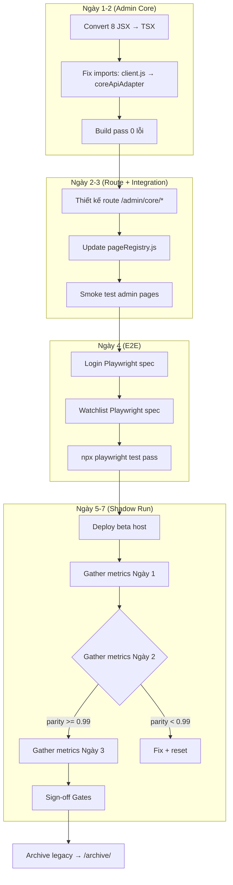

# Kế Hoạch Sprint Cuối: Legacy Frontend Migration — Phiên Bản Thi Hành

* **Ngày lập:** 2026-06-22  
* **Trạng thái:** Đã phê duyệt — sẵn sàng thi hành (Approved — Ready for Execution)  
* **Cơ sở:** LIVE AUDIT tại `LEGACY_FRONTEND_MIGRATION_IMPLEMENTATION_PLAN_20260622.md` + PHẢN BIỆN V3 tại `REVIEW_LEGACY_FRONTEND_MIGRATION_PLAN_V3_20260622.md`  
* **Tổng thời gian:** 5 ngày làm việc (không bao gồm Shadow Run soak — xem §4)

---

## Mục Lục

1. [Tóm Tắt Sprint](#1-tóm-tắt-sprint)
2. [Phạm Vi & Chống Scope Creep](#2-phạm-vi--chống-scope-creep)
3. [Sơ Đồ Phụ Thuộc & Luồng Song Song](#3-sơ-đồ-phụ-thuộc--luồng-song-song)
4. [Lộ Trình 7 Ngày Thực Tế (Điều Chỉnh)](#4-lộ-trình-7-ngày-thực-tế-điều-chỉnh)
5. [Ngày 1–2: Admin Core Migration](#5-ngày-12-admin-core-migration)
6. [Ngày 3: Route Integration + Kiểm Thử Hồi Quy](#6-ngày-3-route-integration--kiểm-thử-hồi-quy)
7. [Ngày 4: Playwright E2E Tests](#7-ngày-4-playwright-e2e-tests)
8. [Ngày 5–7: Shadow Run (Soak)](#8-ngày-57-shadow-run-soak)
9. [Hạng Mục Phụ: Bundle Splitting & i18n](#9-hạng-mục-phụ-bundle-splitting--i18n)
10. [Tiêu Chí Hoàn Thành (DoD)](#10-tiêu-chí-hoàn-thành-dod)
11. [Ma Trận Rủi Ro & Giảm Thiểu](#11-ma-trận-rủi-ro--giảm-thiểu)

---

## 1. Tóm Tắt Sprint

### 1.1 Mục tiêu

Đưa dự án di trú legacy frontend từ trạng thái **~90%** lên **100%** bằng cách giải quyết 4 hạng mục tồn đọng:

| # | Hạng mục | Mức độ | Trạng thái hiện tại |
|---|----------|--------|-------------------|
| 1 | 8 trang Admin Core (JSX → TSX) | Critical | ❌ Chưa convert |
| 2 | Route `/admin/core/*` + pageRegistry | Critical | ❌ Chưa thiết kế |
| 3 | Playwright E2E (Login + Watchlist) | High | ❌ Thiếu 2/4 luồng |
| 4 | Shadow Run + Parity Gate | High | ❌ Chưa bắt đầu |

### 1.2 Tổng Quan Lịch Trình

```
Tuần 1:
  Thứ 2-3: [P1] Admin Core convert + route integration
  Thứ 4:   [P2] Playwright tests + legacy archive prep
  Thứ 5-CN: [P3] Deploy beta, gather metrics

Tuần 2 (nếu cần):
  Thứ 2-3: [P3] Tiếp tục shadow run nếu chưa đạt parity >= 0.99
  Thứ 4:   [P4] Sign-off Gates + Archive legacy
```

### 1.3 Nhân Sự Phân Công

| Vai trò | Người | Tham gia | Trách nhiệm chính |
|---------|-------|----------|-------------------|
| Tech Lead | — | 100% | Phê duyệt kiến trúc route, sign-off Gates |
| Senior FE | — | 100% | Route pattern, code review Admin Core, Vite config, i18n scan |
| Mid FE | — | 100% | Convert 8 Admin Core JSX → TSX |
| DevOps | — | 50% | Deploy beta host, shadow run infra |
| QA | — | 50% | Playwright tests |

---

## 2. Phạm Vi & Chống Scope Creep

### 2.1 Trong phạm vi (In Scope)

- Convert 8 file Admin Core từ `frontend/src/pages/admin/*.jsx` sang `packages/web/src/pages/admin/*.tsx`
- Đăng ký routes `/admin/core/*` trong `pageRegistry.js`
- Viết Playwright spec: Login flow, Watchlist CRUD
- Triển khai beta host, chạy shadow run gather metrics
- Archive legacy vào `/archive/frontend-legacy/` sau khi đạt Gates

### 2.2 Ngoài phạm vi (Out of Scope — Sprint này KHÔNG làm)

- ❌ **Bundle splitting / manualChunks:** Không nằm trong sprint cuối. Chỉ cấu hình tăng `chunkSizeWarningLimit` lên 1MB nếu warning gây nhiễu CI. Tối ưu bundle là technical debt cho sprint sau.
  - *Lý do:* Dung lượng chunk hiện tại (WhaleBubbleChart 689KB raw / 226KB gzip, ShellStockDetailPage 909KB raw / 250KB gzip) không phải emergency. Gzip ~250KB đáp ứng FCP < 1.2s trên 4G.
- ❌ **Screener & Export Playwright test:** Xuống post-MVP.
  - *Lý do:* Screener cần dataset fixture phức tạp; không đủ thời gian trong 5 ngày.
- ❌ **ESLint / Husky / Pre-commit hooks:** Không cấu hình trong sprint này.
  - *Lý do:* Hiện tại `tsc --noEmit` pass 0 lỗi là đủ gate. ESLint rules nếu cần sẽ làm sau shadow run.
- ❌ **HMAC Pepper security audit:** Không nằm trong sprint.
  - *Lý do:* Là Gate F, không block archive. Có thể làm song song bởi Security Lead.
- ❌ **Chỉnh sửa component `WhaleBubbleChart`:** Nguồn bất biến (ràng buộc AGENTS.md §3 rule #4).
- ❌ **Xóa vĩnh viễn `frontend/`:** Archive, không delete.

### 2.3 Quy Tắc Ứng Xử Khi Gặp Khó Khăn

1. Nếu 1 Admin Core page không convert được trong **4 giờ** → bỏ qua page đó, ghi nhận lý do, chuyển sang page khác. Cuối ngày team họp quyết định: extend 1 ngày hay đánh dấu known limitation.
2. Nếu route `/admin/core/*` xung đột với shell routing hiện tại → ưu tiên giữ shell routing, dùng sub-path khác.
3. Nếu Playwright login spec gặp vấn đề auth fixture → chuyển sang mock API layer thay vì E2E thật.

---

## 3. Sơ Đồ Phụ Thuộc & Luồng Song Song



---

## 4. Lộ Trình 7 Ngày Thực Tế (Điều Chỉnh)

> ⚠️ **Khác biệt so với REVIEW V3:** Shadow Run không thể gói trong 1 ngày. Lộ trình dưới đây tách Shadow Run thành 3 ngày soak riêng.

| Ngày | Phase | Công việc | Người làm | Đầu ra |
|:----:|-------|-----------|-----------|--------|
| **1** | P1.1 | **Admin Core convert (4 pages đầu):** Overview, Tenants, ServiceAccounts, PATs | Mid FE | 4 file `.tsx` mới |
| **1** | P1.2 | **Thiết kế route pattern:** Xác định `/admin/core/` sub-routing, update `coreShellPageHelpers.js` nếu cần | Senior FE | Route spec + pageRegistry diff |
| **2** | P1.3 | **Admin Core convert (4 pages cuối):** Usage, Billing, Jobs, AuditTrace | Mid FE | 4 file `.tsx` mới |
| **2** | P1.4 | **Code review + build pass:** Review toàn bộ 8 file, chạy `tsc --noEmit` | Senior FE | Build pass 0 lỗi |
| **3** | P2.1 | **Route integration:** Update `pageRegistry.js`, test navigation, verify rendering trên dev stack | Senior FE | Admin routes khả dụng |
| **3** | P2.2 | **Chuẩn bị shadow run infra:** Deploy `packages/web` lên beta host, verify healthcheck | DevOps | Beta host online |
| **4** | P3.1 | **Playwright Login spec:** Đăng nhập → token storage → redirect dashboard | QA | `login.spec.ts` pass |
| **4** | P3.2 | **Playwright Watchlist spec:** CRUD danh sách, realtime price update | QA | `watchlist.spec.ts` pass |
| **5** | P4.1 | **Shadow Run — Ngày 1:** Gather parity metrics, log analysis | DevOps + Tech Lead | Parity score day 1 |
| **5** | P4.2 | **Archive legacy:** Tạo branch `archive/legacy-frontend-pre-cleanup`, copy vào `/archive/` | DevOps | Legacy an toàn |
| **6** | P4.3 | **Shadow Run — Ngày 2:** Tiếp tục gather, xử lý anomalies nếu có | DevOps | Parity score day 2 |
| **7** | P4.4 | **Shadow Run — Ngày 3:** Final parity check, sign-off Gates A-G nếu đạt | Tech Lead + PO | Migration complete |

---

## 5. Ngày 1–2: Admin Core Migration

### 5.1 Danh Sách File Cần Convert

| # | Legacy JSX (frontend/src/pages/admin/) | Dung lượng | Target TSX (packages/web/src/pages/admin/) | Ghi chú |
|---|----------------------------------------|-----------|-------------------------------------------|---------|
| 1 | `AdminCoreOverview.jsx` (+ test) | 13.4KB | `AdminCoreOverviewPage.tsx` | Dashboard admin tổng quan |
| 2 | `AdminCoreTenants.jsx` (+ test) | 21KB | `AdminCoreTenantsPage.tsx` | Quản lý tenant |
| 3 | `AdminCoreServiceAccounts.jsx` (+ test) | 27.9KB | `AdminCoreServiceAccountsPage.tsx` | Service accounts CRUD |
| 4 | `AdminCorePATs.jsx` (+ test) | 30.9KB | `AdminCorePATsPage.tsx` | Personal Access Tokens |
| 5 | `AdminCoreUsage.jsx` (+ test) | 20.1KB | `AdminCoreUsagePage.tsx` | Usage statistics |
| 6 | `AdminCoreBilling.jsx` (+ test) | 14.8KB | `AdminCoreBillingPage.tsx` | Billing management |
| 7 | `AdminCoreJobs.jsx` (+ test) | 26.2KB | `AdminCoreJobsPage.tsx` | Background jobs monitor |
| 8 | `AdminCoreAuditTrace.jsx` (+ test) | 30.8KB | `AdminCoreAuditTracePage.tsx` | Audit log viewer |

### 5.2 Quy Trình Convert Mỗi File

Bước 1 — **Đọc source:** `Read(AdminCore*.jsx)` — xác định:
- Import dependencies (components, hooks, API calls)
- Có import từ `frontend/src/client.js` không? → Đổi sang `coreApiAdapter`
- Có dùng `createElement` không? → Giữ nguyên (JSX optional, không ép)
- Có hardcode tiếng Việt không? → Giữ nguyên (không scan sprint này)

Bước 2 — **Tạo file `.tsx`:** Copy nội dung vào `packages/web/src/pages/admin/` với đuôi `.tsx`.

Bước 3 — **Fix imports:**
```typescript
// OLD (legacy):
import client from '../../client';

// NEW (SaaS):
import { coreApiAdapter } from '../../adapters/coreApiAdapter';

// OLD (relative component):
import Table from '../components/Table';

// NEW (alias):
import { Table } from '@components/Table';
```

Bước 4 — **Thêm types cơ bản:**
```typescript
interface PageProps {
  // Không cần props nếu page tự fetch data
}
```

Bước 5 — **Build check:** `npx tsc --noEmit` — fix lỗi type đến khi pass.

### 5.3 Common Pitfalls & Cách Xử Lý

| Vấn đề | Cách xử lý |
|--------|-----------|
| Legacy code dùng `class` component | Giữ nguyên, không refactor sang functional. TSX hỗ trợ class component. |
| Legacy code dùng `prop-types` | Bỏ qua. TS không cần runtime prop-types. |
| Legacy code gọi API trực tiếp bằng `fetch` | Giữ nguyên nếu URL tương thích core-api. Nếu không, đổi sang `coreApiAdapter`. |
| Legacy code dùng `window.__INITIAL_STATE__` | Giữ nguyên. Cơ chế này vẫn hoạt động trong Vite. |
| File `.test.jsx` đi kèm | Copy sang `.test.tsx` tương ứng. Fix các import. |

### 5.4 Route Pattern Cho `/admin/core/*`

```javascript
// pageRegistry.js — pattern đề xuất
const pages = {
  // ... existing routes

  // Admin Core group
  'admin-core-overview': {
    status: 'core',
    import: () => import('./admin/AdminCoreOverviewPage.tsx'),
    component: 'AdminCoreOverviewPage',
    route: '/admin/core/overview',
    surface: 'admin'
  },
  'admin-core-tenants': {
    status: 'core',
    import: () => import('./admin/AdminCoreTenantsPage.tsx'),
    component: 'AdminCoreTenantsPage',
    route: '/admin/core/tenants',
    surface: 'admin'
  },
  // ... tương tự cho 6 pages còn lại
};
```

> **Lưu ý:** Các Admin Core pages là `status: 'core'` (độc lập, không shell wrapper). Nếu cần shell layout, dùng `ShellPageChrome` component.

---

## 6. Ngày 3: Route Integration + Kiểm Thử Hồi Quy

### 6.1 Page Registry Update

Sau khi Admin Core convert xong ngày 2, ngày 3 tập trung:

1. **Đăng ký 8 routes mới** trong `pageRegistry.js` theo pattern §5.4.
2. **Cập nhật shell navigation** (nếu cần) để admin có đường dẫn đến các trang mới.
3. **Xác nhận không xung đột route** với shell routing hiện tại.

### 6.2 Smoke Test Checklist (Thủ Công)

| # | Test case | Expected | Ghi chú |
|---|-----------|----------|---------|
| 1 | Navigate đến `/admin/core/overview` | Page render không crash | Kiểm tra data fetch |
| 2 | Navigate đến `/admin/core/tenants` | Danh sách tenant hiển thị | Có thể cần mock data |
| 3 | Navigate đến `/admin/core/pats` | PAT list + create form | Kiểm tra form submit |
| 4 | Navigate đến `/admin/core/audit-trace` | Audit log grid render | Kiểm tra phân trang |
| 5 | Refresh F5 trên mỗi route | Không 404, không crash | SPA routing |
| 6 | Chạy `npm run build` | Build success 0 lỗi | — |

### 6.3 Beta Host Setup Checklist

> **Thông tin hạ tầng:**
> - Beta domain: `https://beta.edusuccess.vn` — deployed on production server `docker.edusuccess.vn`
> - Uses `docker-compose.beta.yml` overlay — defines `frontend-beta` service with `container_name: vninvest-frontend-beta`, `VIRTUAL_HOST: beta.edusuccess.vn`
> - **Không sửa đổi cấu hình production đang chạy.** `frontend-beta` chạy tách biệt, cùng project `vninvest`, cùng network `vninvest_network` để resolve `core-api` DNS.
> - Let's Encrypt via acme-companion auto-cấp cert cho `beta.edusuccess.vn`

| # | Task | Người làm |
|---|------|-----------|
| 1 | SSH vào production server `docker.edusuccess.vn` | DevOps |
| 2 | Pull latest code: `cd /opt/vninvest && git pull` | DevOps |
| 3 | Build image beta: `docker compose -f docker-compose.yml -f docker-compose.beta.yml build frontend-beta` | DevOps |
| 4 | Deploy beta: `docker compose -f docker-compose.yml -f docker-compose.beta.yml up -d frontend-beta` | DevOps |
| 5 | Verify healthcheck: `curl https://beta.edusuccess.vn` | DevOps |
| 6 | Verify core-api connectivity: `curl https://beta.edusuccess.vn/core/v1/health` | DevOps |
| 7 | Kiểm tra Let's Encrypt cert: `curl -vI https://beta.edusuccess.vn` | DevOps |
| 8 | Check logs: `docker logs vninvest-frontend-beta --tail 50` | DevOps |
| 9 | Thông báo URL beta cho team: `https://beta.edusuccess.vn` | DevOps |

> **Lưu ý:** `docker-compose.beta.yml` là overlay file. Phải dùng kèm `-f docker-compose.yml` để kế thừa network/volume definitions. Không deploy `frontend-beta` riêng lẻ nếu không có `docker-compose.yml` đi kèm.

---

## 7. Ngày 4: Playwright E2E Tests

### 7.1 Login Flow Spec (`login.spec.ts`)

```typescript
// Scope: smoke test — không cần coverage full authentication matrix
// Target: verify redirect + token persistence

test('user can log in and reach dashboard', async ({ page }) => {
  // 1. Navigate to /login
  // 2. Fill credentials (use test account from env)
  // 3. Click submit
  // 4. Assert redirect to /dashboard
  // 5. Assert localStorage has access_token
  // 6. Assert dashboard components render (heatmap placeholder)
});
```

**Fixture requirements:**
- Test account credentials sẵn có trên môi trường beta/staging
- Hoặc mock auth endpoint nếu không có test account

### 7.2 Watchlist CRUD Spec (`watchlist.spec.ts`)

```typescript
// Scope: CRUD operations — không cần WebSocket live price
// Target: verify add/remove symbol, list persistence

test('user can create and manage watchlist', async ({ page }) => {
  // 1. Navigate to /watchlist
  // 2. Click "Create new list"
  // 3. Enter list name
  // 4. Assert list appears in sidebar
  // 5. Click "Add symbol"
  // 6. Search for VNM
  // 7. Assert VNM appears in list
  // 8. Delete symbol
  // 9. Assert symbol removed
  // 10. Delete list
  // 11. Assert list removed
});
```

**Lưu ý:** Nếu Watchlist CRUD cần authenticated user, login spec phải chạy trước hoặc dùng `test.describe.serial`.

### 7.3 Cấu Hình Test Fixtures

> **Beta target:** Khi chạy shadow test E2E trên beta, dùng:
> ```
> PLAYWRIGHT_BASE_URL=https://beta.edusuccess.vn npx playwright test
> ```
> Lưu ý: Chạy local với `http://localhost:4173`, chạy shadow test với `https://beta.edusuccess.vn`.

Thêm vào `playwright.config.ts` (nếu chưa có):

```typescript
// playwright.config.ts
use: {
  baseURL: process.env.PLAYWRIGHT_BASE_URL || 'http://localhost:4173',
  storageState: 'tests/visual/storageState.json', // cho login session reuse
  // ...
};
```

> **⚠️ Không ép buộc:** Nếu auth fixture quá phức tạp, có thể dùng API call để login programmatically thay vì UI login flow.

---

## 8. Ngày 5–7: Shadow Run (Soak) — `beta.edusuccess.vn`

> **Hạ tầng Shadow Run:**
> - Beta domain: `https://beta.edusuccess.vn` (production server: `docker.edusuccess.vn`)
> - Production traffic được copy/an toàn; beta chỉ phục vụ internal QA + automated E2E
> - Core-api shadow endpoint: `https://beta.edusuccess.vn/core/v1/`

### 8.1 Quy Trình Shadow Run

```
Ngày 5 (Beta Day 1):
   08:00 — Deploy bản mới nhất lên docker.edusuccess.vn → beta.edusuccess.vn
           cd /opt/vninvest && git pull
           docker compose -f docker-compose.yml -f docker-compose.beta.yml build frontend-beta
           docker compose -f docker-compose.yml -f docker-compose.beta.yml up -d frontend-beta
   08:30 — Bật logging & metrics trên beta
           docker logs -f vninvest-frontend-beta
   09:00 — Chạy Playwright E2E suite nhắm https://beta.edusuccess.vn
           PLAYWRIGHT_BASE_URL=https://beta.edusuccess.vn npx playwright test
   09:30 — Bắt đầu gather: response time, error rate, WS connectivity
   17:00 — Tính parity score cuối ngày

Ngày 6 (Beta Day 2):
   08:00 — Review parity score từ ngày 1
   09:00 — Nếu < 0.99: xác định nguyên nhân, fix, reset đồng hồ
   09:00 — Nếu >= 0.99: tiếp tục gather

Ngày 7 (Beta Day 3):
   08:00 — Review parity score từ ngày 2
   09:00 — Nếu >= 0.99 cả 3 ngày: ký duyệt Cutover
   17:00 — Chuyển legacy vào /archive/
```

### 8.4 Beta Deploy Commands Reference

```bash
# Build beta image (from server's project root)
docker compose -f docker-compose.yml -f docker-compose.beta.yml build frontend-beta

# Start beta service (no effect on production)
docker compose -f docker-compose.yml -f docker-compose.beta.yml up -d frontend-beta

# View beta logs
docker logs -f vninvest-frontend-beta

# Check beta health
curl https://beta.edusuccess.vn

# Stop beta (production unaffected)
docker compose -f docker-compose.yml -f docker-compose.beta.yml down frontend-beta

# Remove beta image when done
docker rmi vninvest-frontend:beta-${APP_RELEASE:-dev}
```

> **⚠️ Quan trọng:** Không bao giờ deploy `frontend-beta` mà không có `-f docker-compose.yml`. Overlay file phụ thuộc network/volume từ base compose.

### 8.2 Parity Metrics

| Metric | Source | Target | Cách đo |
|--------|--------|--------|---------|
| HTTP error rate | Core API logs (beta) | < 0.1% | `docker logs core-api \| grep "HTTP/1.1\" 5"` trên `docker.edusuccess.vn` |
| Response time P95 | Nginx access log | < 2000ms | Phân tích access log tại `https://beta.edusuccess.vn` |
| WS connection rate | Realtime server | > 99% | Số connect thành công / total attempts |
| Page render rate | Sentry / console.error | 0 critical error | `Sentry.captureException` count |
| Bundle 404 rate | Nginx error log | 0 | File not found trong `dist/` |

### 8.3 Rollback Trigger

Shadow run bị hủy ngay lập tức nếu:
- HTTP 5xx rate > 1% trong sliding window 10 phút
- WS connection failure rate > 5%
- Phát hiện lỗi mất dữ liệu (data loss)

---

## 9. Hạng Mục Phụ: Bundle Splitting & i18n

### 9.1 Bundle Splitting (Post-Sprint)

Các bước thực hiện sau shadow run — ghi nhận technical debt:

1. Cài `rollup-plugin-visualizer` để phân tích bundle composition.
2. Xác định nguyên nhân `ShellStockDetailPage` 909KB raw (ECharts? KLine engine?).
3. Nếu là vendor lib: cấu hình `manualChunks` trong `vite.config.ts`.
4. Nếu là app code: áp dụng `React.lazy()` cho chart components.
5. Tăng `build.chunkSizeWarningLimit` lên `1000000` (1MB) tạm thời.

**Không làm trong sprint này trừ khi:** build warning gây fail CI/CD pipeline.

### 9.2 i18n Scan (Post-Sprint)

1. Tạo script scan đơn giản:

```bash
# scripts/check-hardcode-vietnamese.sh
grep -rn '[\x{00C0}-\x{1EF9}]' src/pages/*.tsx src/pages/**/*.tsx \
  --include='*.tsx' \
  --exclude-dir=node_modules \
  --exclude='*i18n*' \
  --exclude='*locale*' \
  > /dev/null && echo "FOUND HARDCODED VIETNAMESE TEXT" || echo "OK"
```

2. Hook vào CI (không phải pre-commit) để chạy auto.
3. Fix hardcode text khi scan fail.

---

## 10. Tiêu Chí Hoàn Thành (DoD)

### 10.1 DoD Cho Sprint Này

| # | Tiêu chí | Cách kiểm tra | Pass/Fail |
|---|----------|---------------|-----------|
| D1 | 8 file Admin Core TSX tồn tại trong `packages/web/src/pages/admin/` | `ls -la packages/web/src/pages/admin/*.tsx` | |
| D2 | `npx tsc --noEmit` pass 0 lỗi | `tsc --noEmit` | |
| D3 | `npm run build` thành công | Build log | |
| D4 | 8 routes `/admin/core/*` đăng ký trong `pageRegistry.js` | `grep 'admin-core-' packages/web/src/pages/pageRegistry.js` | |
| D5 | Smoke test 8 routes không crash | Manual test trên dev stack | |
| D6 | Playwright Login spec pass | `npx playwright test login` | |
| D7 | Playwright Watchlist spec pass | `npx playwright test watchlist` | |
| D8 | Beta host online, healthcheck pass | `curl https://beta.edusuccess.vn/health` | |
| D9 | Shadow run 3 ngày, parity score >= 0.99 | Log analysis | |
| D10 | Legacy frontend archived vào `/archive/` | Git branch + file system | |

### 10.2 DoD Bị Trì Hoãn (Post-Sprint)

| # | Tiêu chí | Lý do trì hoãn |
|---|----------|----------------|
| E1 | Bundle chunk < 500KB | Không critical; technical debt |
| E2 | i18n scanner CI pass | Không critical; technical debt |
| E3 | ESLint + pre-commit hooks | Không critical; có thể làm sau |
| E4 | Screener Playwright spec | Thiếu fixture; post-MVP |
| E5 | HMAC Pepper security audit | Gate F; không block archive |
| E6 | Lighthouse CI performance budget | Cần bundle split trước |

---

## 11. Ma Trận Rủi Ro & Giảm Thiểu

| Rủi ro | Xác suất | Tác động | Giảm thiểu |
|--------|---------|---------|------------|
| Admin Core page phụ thuộc API chưa migrate lên core-api | Cao | Ngăn chặn convert | Xác minh API endpoint trước. Nếu legacy-only, dùng proxy route tạm. |
| Route `/admin/core/*` xung đột với shell wildcard route | Trung bình | Page không render | Dùng route path cụ thể, ưu tiên shell routing. |
| Playwright login spec không có test account | Cao | Block E2E | Mock auth endpoint, hoặc dùng API login programmatic. |
| Shadow run phát hiện lỗi dữ liệu | Trung bình | Reset 2 ngày | Chấp nhận rủi ro timeline; 3 ngày soak là tối thiểu. |
| Build fail sau merge vì dependency thay đổi | Thấp | Block deploy | Chạy CI/CD pipeline trước mỗi merge. |

---

## Phụ Lục A: Các File Cần Sửa

| File | Hành động | Người |
|------|-----------|-------|
| `frontend/src/pages/admin/AdminCoreOverview.jsx` | Convert → `packages/web/src/pages/admin/AdminCoreOverviewPage.tsx` | Mid FE |
| `frontend/src/pages/admin/AdminCoreTenants.jsx` | Convert → `packages/web/src/pages/admin/AdminCoreTenantsPage.tsx` | Mid FE |
| `frontend/src/pages/admin/AdminCoreServiceAccounts.jsx` | Convert → `packages/web/src/pages/admin/AdminCoreServiceAccountsPage.tsx` | Mid FE |
| `frontend/src/pages/admin/AdminCorePATs.jsx` | Convert → `packages/web/src/pages/admin/AdminCorePATsPage.tsx` | Mid FE |
| `frontend/src/pages/admin/AdminCoreUsage.jsx` | Convert → `packages/web/src/pages/admin/AdminCoreUsagePage.tsx` | Mid FE |
| `frontend/src/pages/admin/AdminCoreBilling.jsx` | Convert → `packages/web/src/pages/admin/AdminCoreBillingPage.tsx` | Mid FE |
| `frontend/src/pages/admin/AdminCoreJobs.jsx` | Convert → `packages/web/src/pages/admin/AdminCoreJobsPage.tsx` | Mid FE |
| `frontend/src/pages/admin/AdminCoreAuditTrace.jsx` | Convert → `packages/web/src/pages/admin/AdminCoreAuditTracePage.tsx` | Mid FE |
| `packages/web/src/pages/pageRegistry.js` | Thêm 8 routes `admin-core-*` | Senior FE |
| `packages/web/tests/visual/login.spec.ts` | Tạo mới | QA |
| `packages/web/tests/visual/watchlist.spec.ts` | Tạo mới | QA |
| `packages/web/vite.config.ts` | Tăng `chunkSizeWarningLimit` (nếu cần) | Senior FE |

## Phụ Lục B: Template Cho Mỗi Admin Core Page

```tsx
// packages/web/src/pages/admin/AdminCoreXxxPage.tsx
import { useState, useEffect } from 'react';
import { coreApiAdapter } from '../../adapters/coreApiAdapter';
import { ShellPanel } from '@components/ShellPageTemplate';

export default function AdminCoreXxxPage() {
  const [data, setData] = useState<any[]>([]);
  const [loading, setLoading] = useState(true);
  const [error, setError] = useState<string | null>(null);

  useEffect(() => {
    coreApiAdapter.adminCoreXxx()
      .then(setData)
      .catch(err => setError(err.message))
      .finally(() => setLoading(false));
  }, []);

  if (loading) return <div>Loading...</div>;
  if (error) return <div>Error: {error}</div>;

  return (
    <ShellPanel title="Xxx Management">
      {/* ... nội dung từ legacy JSX ... */}
    </ShellPanel>
  );
}
```

---

*Tài liệu này thay thế các ước lượng tại `LEGACY_FRONTEND_MIGRATION_IMPLEMENTATION_PLAN_20260622.md` §4 (Timeline) và cụ thể hóa các giải pháp tại `REVIEW_LEGACY_FRONTEND_MIGRATION_PLAN_V3_20260622.md` §4 (5-Day Plan).*
