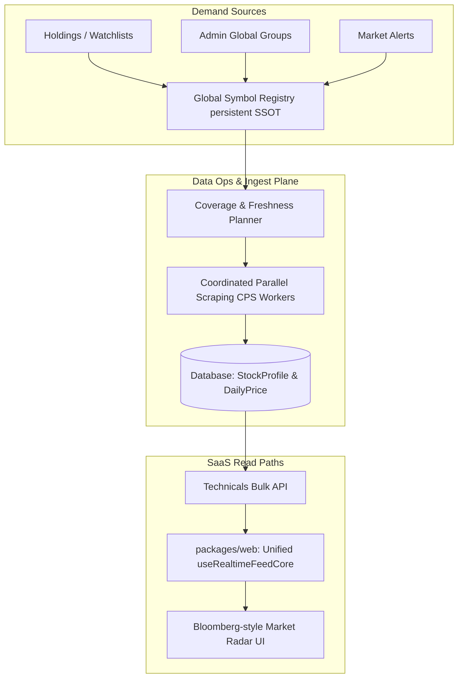

# Báo cáo Rà soát, Phân tích & Kế hoạch Nâng cấp Tính năng Radar thị trường (Market Radar) đạt chuẩn Thương mại
*(Bản hiệu chỉnh v2 - Cập nhật ngày 15/06/2026 sau phản biện codebase)*

Báo cáo này rà soát chi tiết hiện trạng mã nguồn của tính năng **Radar thị trường (Watchlist)** đang chạy tại `http://localhost/watchlist` cả ở tầng frontend (`packages/web`) và backend (`packages/core`). Đồng thời, báo cáo phân tích các khoảng cách (gap) so với các giải pháp thương mại phổ biến (FireAnt, TCBS, SSI iBoard, TradingView) và vạch ra lộ trình nâng cấp toàn diện để đưa tính năng này lên tiêu chuẩn thương mại.

---

## 1. Rà soát & Phân tích Hiện trạng Mã nguồn (Source Code Audit)

Dựa trên việc quét mã nguồn hệ thống, chúng tôi xác minh và bổ sung các nguyên nhân cốt lõi khiến Radar thị trường hoạt động kém hiệu quả:

### 1.1. Vi phạm Nguyên tắc DRY: Dữ liệu nhóm ngành hardcoded lặp lại 5 lần
Hệ thống hiện tại hiển thị rất ít mã cổ phiếu niêm yết do danh mục được lấy từ seed data mặc định giới hạn. Đặc biệt, mảng dữ liệu mặc định này bị nhân bản và lặp lại **5 lần** ở các file khác nhau:
1. [stock_mgmt_native_views.py:L62](file:///c:/Mujoco%20Projects/vninvest/packages/core/backend/src/market_data/stock_mgmt_native_views.py#L62) (`_STOCK_MANAGEMENT_DEFAULT_GROUPS`)
2. [legacy_views.py:L38 (market_data)](file:///c:/Mujoco%20Projects/vninvest/packages/core/backend/src/market_data/legacy_views.py#L38) (`_STOCK_MANAGEMENT_DEFAULT_GROUPS`)
3. [legacy_views.py:L38 (user_workspace)](file:///c:/Mujoco%20Projects/vninvest/packages/core/backend/src/user_workspace/legacy_views.py#L38) (`_STOCK_MANAGEMENT_DEFAULT_GROUPS`)
4. [legacy_views.py:L40 (market_serving)](file:///c:/Mujoco%20Projects/vninvest/packages/core/backend/src/market_serving/legacy_views.py#L40) (`_STOCK_MANAGEMENT_DEFAULT_GROUPS`)
5. [legacy_stubs.py:L37](file:///c:/Mujoco%20Projects/vninvest/packages/core/backend/src/vninvest_core/utils/legacy_stubs.py#L37) (`_STOCK_MANAGEMENT_DEFAULT_GROUPS`)

**Hệ quả:** Gây ra nợ kỹ thuật lớn, không có Single Source of Truth (SSOT). Việc thay đổi hoặc bổ sung nhóm ngành yêu cầu cập nhật thủ công cả 5 file, rất dễ gây không đồng nhất dữ liệu (data inconsistency).

### 1.2. Nút "Tự động lấy mã chứng khoán" bị Đóng băng do Endpoint Stub & Rủi ro Isolation
* **Hiện trạng**: Route API `/admin-sync/stockprofile/` đang được liên kết với lớp view stub `GenericEmptyStaffView` tại [api_urls.py](file:///c:/Mujoco%20Projects/vninvest/packages/core/backend/src/identity_access/api_urls.py#L54). 
* **Lọc Tenant**: Hiện tại stub này chỉ trả về danh sách rỗng hoặc JSON static `{"status": "accepted"}` được bảo vệ bởi quyền Admin. Nó không rò rỉ dữ liệu lập tức, nhưng việc thiếu scoping `request.tenant` là một rủi ro tiềm ẩn.
* **Hệ quả**: Nút bấm trên giao diện chỉ trả về thông báo giả lập thành công mà không thực sự đồng bộ các mã cổ phiếu mới từ hệ thống vnbroker. Khi chuyển đổi endpoint này sang logic thật, bắt buộc phải kế thừa `TenantScopePermission` để đảm bảo cô lập tenant tuyệt đối.

### 1.3. Phân mảnh Kiến trúc WebSocket (WebSocket Fragmentation)
* **Hiện trạng**: Trong khi dự án đã xây dựng hạ tầng realtime đồng bộ rất tốt thông qua hook [useRealtimeFeedCore.js](file:///c:/Mujoco%20Projects/vninvest/packages/web/src/hooks/useRealtimeFeedCore.js) (hơn 800 dòng code xử lý reconnect, token refresh, heartbeat), trang [WatchlistPage.js](file:///c:/Mujoco%20Projects/vninvest/packages/web/src/pages/WatchlistPage.js#L173-L280) lại tự viết lại logic kết nối WebSocket thô (100+ dòng).
* **Hệ quả**: Logic kết nối bị trùng lặp, bỏ qua cơ chế refresh token tự động và chỉ kích hoạt khi danh sách theo dõi cá nhân của user lớn hơn 0 (`items.length > 0`), khiến bảng Radar thị trường chung không cập nhật được realtime.

---

## 2. Nghiên cứu & So sánh với các Phần mềm Thương mại (Competitor Benchmarking)

| Tính năng | FireAnt / SSI iBoard | TCBS (TCInvest) | VNInvest Hiện tại | Đánh giá Khoảng cách (Gap) |
| :--- | :--- | :--- | :--- | :--- |
| **Độ phủ dữ liệu** | Toàn bộ ~1,600 mã (HOSE, HNX, UPCoM) | Toàn bộ ~1,600 mã | 60 mã (Seed fallback) | **Rất lớn**: Thiếu hụt 95% danh mục cổ phiếu niêm yết trên thị trường. |
| **Phân loại Ngành** | Chuẩn ICB (10 ngành cấp 1, 19 ngành cấp 2, 45 ngành cấp 3, 80+ phân ngành cấp 4) | Phân loại ngành thông minh riêng | Phân nhóm thủ công (7 nhóm ngành cơ bản) | **Trung bình**: Cần tích hợp phân ngành ICB tự động động bộ từ dữ liệu nguồn. |
| **Dòng tiền Cá mập (Whale Flow)** | Thống kê mua/bán chủ động, lệnh lớn gom/xả tĩnh | Thống kê lệnh lớn realtime | Có Whale Alerts, phân tích khối lượng mua/bán (CVD) | **Tốt**: VNInvest có thuật toán phân tích mạnh (CVD, Institutional Strength) nhưng chưa hiển thị trực quan trên Radar. |
| **Tốc độ Cập nhật** | Realtime (< 1s) qua WebSockets/SSE | Realtime (< 1s) qua WebSockets | Polling 5s hoặc Fallback Polling 30s | **Trung bình**: Hạ tầng realtime của dự án đã có nhưng watchlist page chưa được tích hợp đúng cách. |
| **Bộ lọc Nhanh (Screener)** | Top Gainer/Loser, đột biến Vol, Đỉnh/Đáy, nước ngoài mua ròng | Nhóm cổ phiếu đột biến, sức mạnh dòng tiền | Đã có logic thô ở backend, chưa expose lên giao diện Radar | **Lớn**: Thiếu giao diện lọc nhanh (Quick Screeners) trên bảng giá. |

---

## 3. Giải pháp Khắc phục & Lộ trình Nâng cấp Thương mại (SaaS-Native Architecture)

Giải pháp nâng cấp sẽ được thực hiện trực tiếp trên trang SaaS-native [WatchlistPage.js](file:///c:/Mujoco%20Projects/vninvest/packages/web/src/pages/WatchlistPage.js) (do trang này đã được bảo vệ hoàn toàn phía sau feature flag `watchlist_saas_native`, đảm bảo không ảnh hưởng đến người dùng hệ thống legacy cũ).

### 3.1. Đồng nhất Danh mục & Quy hoạch qua Global Symbol Registry (Backend)
* **Giải pháp**: 
  1. Loại bỏ dữ liệu hardcoded nhân bản ở 5 file. Chuyển sang lưu trữ động và tập trung danh sách ngành trong cơ sở dữ liệu `GlobalSymbolRegistry`.
  2. Thay thế view stub của `/admin-sync/stockprofile/` bằng endpoint thật kết nối tới `sync_market_groups` Celery task. Task này sẽ gọi `vnbroker_adapter.py` để lấy đầy đủ danh sách mã niêm yết động kèm phân loại ngành ICB, cập nhật vào bảng `StockProfile`.
  3. Áp dụng nghiêm ngặt `TenantScopePermission` trên endpoint đồng bộ mới này để đảm bảo cô lập dữ liệu tuyệt đối giữa các tenant.

### 3.2. Cập nhật Giá & Chỉ báo Kỹ thuật tự động qua CPS (Backend)
* **Giải pháp**: Tích hợp các mã trong Watchlist của người dùng vào hệ thống **Coordinated Parallel Scraping (CPS)**.
* **Chi tiết kỹ thuật**:
  1. Backend tự động quét các mã đang hoạt động (active demand) của toàn bộ watchlist và đưa chúng vào hàng đợi của scheduler cào giá song song theo tier ưu tiên (Dynamic Ingestion Queue).
  2. Expose các chỉ báo kỹ thuật gộp (`rsi_14`, `rvol`, `ma20_distance_pct`, định hướng `bias_label`) vào API gộp `/core/v1/market-data/technicals/bulk/` để frontend tải nhanh trong một request duy nhất.

### 3.3. Tái cấu trúc Kết nối Realtime WebSocket ở Frontend (Frontend Wiring)
* **Giải pháp**: Xóa bỏ hoàn toàn hơn 100 dòng code tự viết WebSocket thủ công trong `WatchlistPage.js`. 
* **Chi tiết kỹ thuật**:
  1. Kết nối bảng giá Radar trực tiếp với hook dùng chung `useRealtimeFeedFromManager` của dự án để lấy dữ liệu realtime từ context.
  2. Tận dụng cơ chế tự động hạ cấp (graceful fallback) sang HTTP Short-Polling gọi API gộp `/core/v1/market-data/technicals/bulk/?symbols=...` mỗi 30 giây khi WebSocket bị ngắt kết nối (Circuit Breaker mở sau 3 lần thử).

### 3.4. Nâng cấp Giao diện Đột phá (Bloomberg-Style Glassmorphism UI)
* **Thiết kế giao diện**: Thiết kế lại giao diện Radar theo chuẩn phần mềm tài chính chuyên nghiệp:
  * **Layout 2 cột**: Cột bên trái hiển thị danh sách nhóm ngành động (lấy từ phân loại ICB của database). Cột bên phải là bảng giá độ phân giải cao `SmartRadarTable`.
  * **Bảng dữ liệu mật độ cao (High-Density Grid)**: Hỗ trợ hai chế độ hiển thị **Compact** (tối ưu hóa màn hình nhỏ, hiển thị nhiều mã) và **Comfortable**.
  * **Trực quan hóa Dòng tiền Cá mập (Whale Flow Overlay)**:
    * Thêm cột hiển thị chỉ báo Whale Alert (Shark Icon) cho các mã xuất hiện lệnh lớn bất thường trong ngày.
    * Tích hợp đồ thị mini sparkline (đường xu hướng 20 nến gần nhất vẽ bằng SVG siêu nhẹ) trực tiếp trên mỗi dòng của bảng giá.
    * Đưa component `OrderFlowRadarPanel` (CVD, Sức mạnh tích lũy dòng tiền) xuống ngay dưới bảng Radar để người dùng theo dõi biến động dòng tiền lớn realtime.

---

## 4. Kế hoạch Triển khai & Kiểm định Chất lượng (Rollout & Validation Gates)

Quá trình di trú và nâng cấp được thực hiện theo 3 giai đoạn để đảm bảo tính ổn định và không làm gián đoạn hệ thống đang chạy:

### 4.1. Kế hoạch Triển khai 3 Giai đoạn
1. **Giai đoạn 1: Shadow Run (Chạy thử nghiệm ẩn)**:
   * Deploy API backend mới `/core/v1/workspace/watchlists/` và planner cào dữ liệu song song (CPS) lên môi trường staging.
   * Chạy tiến trình đối soát dữ liệu (parity check) liên tục trong 72 giờ để so sánh danh sách và chỉ báo kỹ thuật giữa cơ sở dữ liệu core mới và legacy cũ.
2. **Giai đoạn 2: Canary Gated (Canary 10%)**:
   * Kích hoạt cờ kiểm tra tính năng `watchlist_saas_native` trong bootstrap payload của 10% tổ chức/user (tenants) ngẫu nhiên.
   * Theo dõi sát hiệu năng trình duyệt (khung hình đạt $\ge 58$ FPS khi nhận WebSocket liên tục) và tải CPU của server.
3. **Giai đoạn 3: 100% Cutover & Decommission**:
   * Mở rộng tính năng cho toàn bộ người dùng trên môi trường production.
   * Sau 72 giờ hoạt động ổn định không phát sinh lỗi nghiêm trọng, tiến hành xóa bỏ hoàn toàn mã nguồn legacy cũ (bao gồm view stub `GenericEmptyStaffView` và các shim layer trong [legacy_views.py](file:///c:/Mujoco%20Projects/vninvest/packages/core/backend/src/market_data/legacy_views.py) và trang `Watchlist.jsx` cũ ở thư mục gốc).

### 4.2. Tiêu chí PASS/FAIL của Gate Nghiệm thu
* **Tốc độ phản hồi UI (PASS)**: Khung hình render của Radar thị trường duy trì ổn định $\ge 58$ FPS khi có hàng chục mã nhảy giá liên tục qua WebSocket.
* **Thời gian xử lý dữ liệu (PASS)**: Thời gian phân tách (parse) payload và cập nhật state trên giao diện $< 10$ ms.
* **Multi-Tenant Isolation (PASS)**: Chạy thành công 100% test case bảo mật trong suite `test_user_workspace_tenant_isolation.py`. Tuyệt đối không để rò rỉ watchlist/mã theo dõi giữa các tenant khác nhau.
