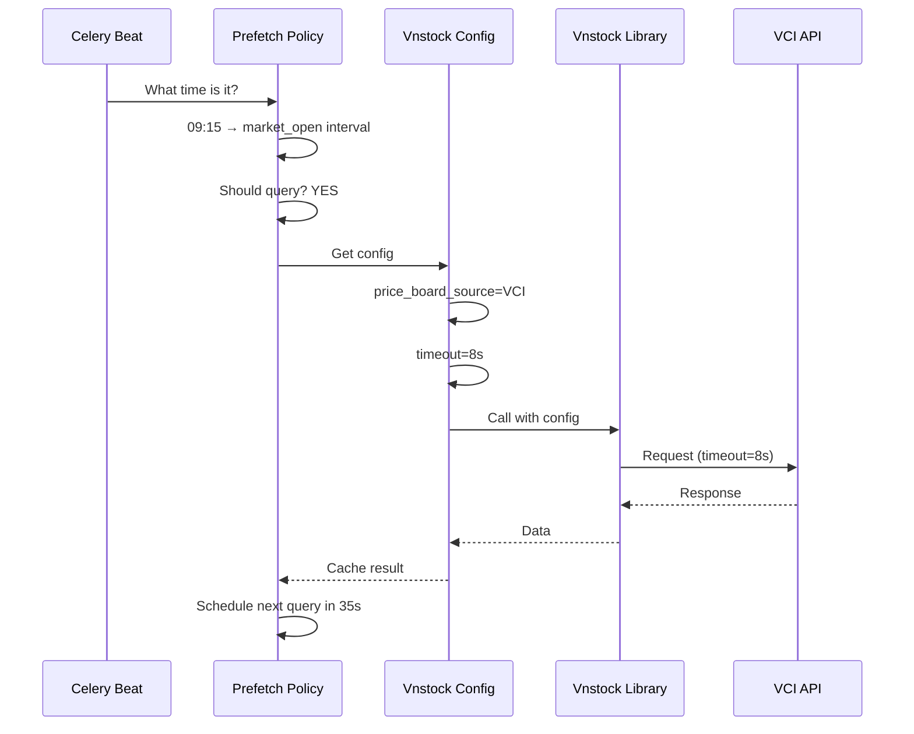

# 🔍 Phân Tích PREFETCH TIME POLICY vs Vnstock Configuration

**Kết Luận Nhanh:**
- ❌ **KHÔNG có tính năng trùng lặp**
- ❌ **KHÔNG có cấu hình Provider** (VCI, BKS, TCBS, AUTO...)
- ✅ **Hoàn toàn tách biệt** - Prefetch = TIMING, Vnstock = DATA SOURCE

---

## 1️⃣ PREFETCH TIME POLICY - Cấu Hình GÌ?

### 📋 Tất cả 19 Tính Năng Hiện Tại

| Nhóm | Tính Năng | Mục Đích | Loại |
|------|----------|---------|------|
| **Market Window** | `open_time: "09:00"` | Khi thị trường mở | String |
| | `close_time: "15:00"` | Khi thị trường đóng | String |
| | `pre_open_minutes: 30` | Trước giờ mở bao lâu | Int |
| | `post_close_minutes: 30` | Sau giờ đóng bao lâu | Int |
| **Lunch Break** | `lunch_enabled: true` | Có giờ nghỉ trưa không | Boolean |
| | `lunch_start: "11:30"` | Bắt đầu cơm trưa | String |
| | `lunch_end: "13:00"` | Kết thúc cơm trưa | String |
| **Weekend Mode** | `weekend_mode: 'offhours'` | Xử lý thế nào vào cuối tuần | Enum |
| **6 Time Profiles** | `pre_open_query_enabled: true` | Có query trước mở không | Boolean |
| | `pre_open_interval_seconds: 90` | Query cách mấy giây | Int |
| | `market_open_query_enabled: true` | Có query khi mở không | Boolean |
| | `market_open_interval_seconds: 35` | Query cách mấy giây | Int |
| | `lunch_break_query_enabled: true` | Có query giờ cơm không | Boolean |
| | `lunch_break_interval_seconds: 180` | Query cách mấy giây | Int |
| | `pre_close_query_enabled: true` | Có query trước đóng không | Boolean |
| | `pre_close_interval_seconds: 60` | Query cách mấy giây | Int |
| | `post_close_query_enabled: true` | Có query sau đóng không | Boolean |
| | `post_close_interval_seconds: 180` | Query cách mấy giây | Int |
| | `offhours_query_enabled: false` | Có query ngoài giờ không | Boolean |
| | `offhours_interval_seconds: 600` | Query cách mấy giây | Int |
| **Rate Limit Guard** | `jitter_percent: 15` | Thêm random % vào interval | Int |
| | `cooldown_multiplier_on_429: 2.0` | Khi 429, nhân interval lên bao nhiêu lần | Float |
| | `max_interval_seconds: 1800` | Interval tối đa không vượt quá | Int |
| **Metadata** | `timezone: "Asia/Ho_Chi_Minh"` | Timezone tính toán | String |

---

### 🎯 PREFETCH Policy Giải Quyết VẤN ĐỀ NÀO?

```
❓ VẤNĐỀ 1: Query quá thường xuyên → API rate limit → 429 errors
✅ GIẢI: Adjust interval_seconds theo time profile (35s at market open, 180s at lunch)

❓ VẤNĐỀ 2: Tra cứu tất cả symbols cùng lúc → Overload vnstock
✅ GIẢI: Per-profile batch_size + symbol_limit (e.g., 20 symbols/batch at market open)

❓ VẤNĐỀ 3: Gặp 429 thì phải restart hệ thống
✅ GIẢI: Tự động nhân interval lên 2x (cooldown_multiplier_on_429=2.0), max 30 phút

❓ VẤNĐỀ 4: Không cần query lúc ngoài giờ giao dịch
✅ GIẢI: offhours_query_enabled=false → Skip completely

❓ VẤNĐỀ 5: Lúc trưa không cần fast-update như lúc mở
✅ GIẢI: lunch_break_interval_seconds=180 vs market_open_interval_seconds=35
```

---

## 2️⃣ TẠI SAO PREFETCH KHÔNG CÓ PROVIDER CONFIG?

### 🏗️ KIẾN TRÚC PHÂN TÁCH TRÁCH NHIỆM

```
┌────────────────────────────────────────────────────────┐
│  VNSTOCK RUNTIME CONFIG (New)                          │
│  ↓                                                     │
│  CÓ CẤU HÌNH DATA SOURCE NÀO?                          │
│  - price_board_source: "VCI" | "stock_intraday_data"  │
│  - fallback_sources: ["stock_intraday_data"]          │
│  - Timeout per channel (price_board=8s, etc.)         │
│  - Concurrency limit, retry policy, rate limit        │
│  ═══════════════════════════════════════════════════  │
│  → QUẢN LÝ: QUERY ĐƯỢC GỌIGIỚI HẠN VỀ timeout        │
└────────────────────────────────────────────────────────┘
           ▲
           │ Calls vnstock adapter
           │ 
           ▼
┌────────────────────────────────────────────────────────┐
│  PREFETCH TIME POLICY                                 │
│  ↓                                                     │
│  CÓ CẤU HÌNH KHI NÀO QUERY?                           │
│  - market_open_interval_seconds: 35                  │
│  - lunch_break_interval_seconds: 180                 │
│  - offhours_query_enabled: false                     │
│  - cooldown_multiplier_on_429: 2.0                   │
│  ═══════════════════════════════════════════════════  │
│  → QUẢN LÝ: QUERY ĐƯỢC GỌI THEO TIMING & PATTERN    │
└────────────────────────────────────────────────────────┘
           ▲
           │ Triggers at intervals
           │
           ▼
┌────────────────────────────────────────────────────────┐
│  VNSTOCK LIBRARY (Library bên ngoài)                  │
│  → Available sources: price_board (VCI), intraday     │
│  → We choose which one to use via Vnstock config     │
│  → Prefetch policy doesn't care which source we use   │
└────────────────────────────────────────────────────────┘
```

### 💡 Tại Sao Tách Biệt?

| Góc Độ | Vnstock Config | Prefetch Policy | Tại Sao? |
|--------|---|---|---|
| **Mục Đích** | CÓ CALL SAO? (provider, timeout) | CALL KHI NÀO? (interval, guard) | Trách nhiệm khác nhau |
| **Ai Thay Đổi** | Ops/DevOps (data quality issue) | Ops/Analytics (market behavior) | Team khác |
| **Frequency** | Hiếm (deployment) | Thường (tuning) | Scope khác |
| **Performance Impact** | Trên từng request | Trên hệ thống tổng thể | Level khác |
| **Validation** | Per-request | Time-window based | Logic khác |

### Ví Dụ Thực Tế

```
Scenario: Giữa lunch break, price_board source bị 429

Vnstock Config:
  ✅ Switch to fallback_sources: ["stock_intraday_data"] (trong 2-3 requests)
  ✅ Dữ liệu vẫn được, chỉ từ source khác

Prefetch Policy:
  ✅ Vẫn ngủ (lunch_break_interval=180s)
  ✅ Lúc 13:00 mở cơm thì mới query lại
```

---

## 3️⃣ MÔI LIÊN HỆ GIỮA HAI FEATURE

### Luồng Thực Thi



### Điểm Khác Biệt Rõ Ràng

```
🕐 PREFETCH POLICY (TIMING LAYER)
   ├─ Câu hỏi: "HÃY QUERY KHI NÀO?"
   ├─ Trả lời: "09:00-15:00 mỗi 35s"
   ├─ Format: Time windows + intervals + guards
   └─ Scope: Market-aware, adaptive

📊 VNSTOCK CONFIG (SOURCE LAYER)
   ├─ Câu hỏi: "QUERY TỪ ĐẦU/SAO?"
   ├─ Trả lời: "VCI (VNStock), fallback BKS"
   ├─ Format: Provider choices + timeouts + concurrency
   └─ Scope: Data quality, resilience
```

---

## 4️⃣ KIỂM CHỨNG: KHÔNG CÓ DUPLICATE

### Prefetch Policy Fields (19 tính năng)
✅ Market window (open/close time, lunch)  
✅ Time profiles (6 cái: pre_open, market_open, lunch, pre_close, post_close, offhours)  
✅ Rate limit guard (jitter, cooldown_multiplier, max_interval)  
✅ Timezone  

### Vnstock Config Fields (18 tính năng)
✅ Concurrency (max_concurrency, BoundedSemaphore)  
✅ Retry (attempts, backoff)  
✅ Timeout per channel (price_board, intraday, financial_ratio, etc.)  
✅ Rate limit (cooldown_seconds, enable/disable)  
✅ Cache (enable/disable)  
✅ Price board source + fallbacks  

### Giao Điểm (0%)
❌ Không có (prefetch chỉ quản timing, vnstock quản data)  

---

## 5️⃣ DANH SÁCH FILE HIỆN TẠI

### Prefetch Time Policy
```
✅ backend/portfolio/tasks.py          → _resolve_prefetch_time_profile()
✅ backend/portfolio/views.py           → _default_prefetch_time_policy(), API
✅ backend/portfolio/admin.py           → AdminOps health snapshot
✅ frontend/src/pages/AdminOps.jsx      → Prefetch tab (runtime + policy)
✅ frontend/src/i18n/vi.json           → Vietnamese labels
✅ backend/portfolio/tests/...          → Test cases
✅ docs/PREFETCH_TIME_POLICY_UAT_...md  → UAT handover
```

### Vnstock Runtime Config (To-be)
```
🚀 backend/portfolio/models.py          → RuntimeVnstockConfig (NEW)
🚀 backend/portfolio/serializers.py     → Serializer (NEW)
🚀 backend/portfolio/views.py           → ViewSet API (NEW)
🚀 backend/portfolio/admin.py           → Admin UI (NEW)
🚀 backend/portfolio/adapters/...       → VnstockConfigManager (UPDATE)
🚀 frontend/src/components/.../VnstockConfigPanel.jsx (NEW)
```

---

## 6️⃣ ANSWER TO: "ĐƯỢC CẤU HÌNH PROVIDERS NÀ?"

### Thẳng Thắn: KHÔNG ✗

**Tại Sao Không?**

1. **Phạm Vi (Scope)**: Prefetch policy = TIMING, không phải DATA SELECTION
2. **Đơn Giản Hóa**: Mỗi layer quản 1 việc → dễ debug, test, maintain
3. **Thay Đổi Tần Suất**: Provider change hiếm (deployment), timing tuning thường
4. **Separation of Concerns**: Provider choice → Vnstock Config, Timing decision → Prefetch Policy

### Nếu Cần Provider Config, ĐÓ LÀ:
✅ **Vnstock Runtime Config** (feature mới tôi đề xuất)  
- `price_board_source: "VCI"` ✓  
- `fallback_sources: ["stock_intraday_data"]` ✓  
- Per-channel timeout ✓  

---

## 7️⃣ TÓMLỘC: KHÔNG CÓ TRÙNG, KHÔNG CÓ PROVIDER CONFIG

| Câu Hỏi | Trả Lời |
|--------|--------|
| Prefetch có tính năng nào trùng với vnstock config không? | ❌ KHÔNG - Hoàn toàn tách biệt |
| Prefetch có cấu hình providers (VCI, BKS, TCBS) không? | ❌ KHÔNG - Chỉ cấu hình TIMING |
| Mỗi feature quản lý cái gì? | **Prefetch**: WHEN to query |
| | **Vnstock**: FROM WHERE & HOW |
| Có conflict không? | ❌ KHÔNG - Bổ sung nhau |
| Nên giữ nguyên thiết kế không? | ✅ CÓ - Clean separation |

