# Sơ đồ Chức năng Hệ thống VNInvest

Chào mừng bạn đến với hệ thống **VNInvest** — Nền tảng theo dõi danh mục và Cố vấn đầu tư chứng khoán chuyên nghiệp. Tài liệu này cung cấp cái nhìn toàn diện về các chức năng của hệ thống để bạn có thể sử dụng thành thạo ngay lập tức.

---

## 1. Sơ đồ Tổng quan Chức năng (Functional Map)

```mermaid
graph TD
    User((Người dùng)) --> UI[Giao diện VNInvest]
    
    UI --> Dash[Dashboard & Danh mục]
    Dash --> NAV[Theo dõi NAV Realtime]
    Dash --> PL[Lợi nhuận P/L chưa chốt]
    Dash --> Hist[Biểu đồ Equity Curve]
    
    UI --> Anal[Phân tích Nâng cao]
    Anal --> Risk[Chỉ số Rủi ro: Sharpe, Sortino, MDD]
    Anal --> Perf[Hiệu suất TWR, Volatility]
    Anal --> Alloc[Phân bổ Tài sản theo Ngành/Mã]
    
    UI --> Whale[Radar Cá mập - Whale Alerts]
    Whale --> Live[Theo dõi Lệnh lớn Realtime]
    Whale --> Bubble[Whale Bubble Chart - Trực quan dòng tiền]
    Whale --> Dark[Phát hiện Dark Money - Dòng tiền ẩn]
    
    UI --> AI[Cố vấn Robo-Advisor AI]
    AI --> MultiTab[Tư vấn Đa chiều: Kỹ thuật/Cá mập/Rủi ro]
    AI --> Summary[Tổng hợp Chiến lược Executive Summary]
    AI --> Context[Tư vấn theo bối cảnh Biểu đồ]
    
    UI --> Watch[Watchlist & Cảnh báo]
    Watch --> Market[Nhóm thị trường: VN30, HOSE, HNX...]
    Watch --> Personal[Danh sách theo dõi cá nhân]
    Watch --> Alerts[Cảnh báo Giá & Biến động bat thường]
    
    UI --> Detail[Chi tiết Cổ phiếu]
    Detail --> Kline[Biểu đồ Kỹ thuật Realtime]
    Detail --> CVD[Dòng tiền chủ động CVD]
    Detail --> Sentiment[Tin tức & Sắc thái thị trường]
    
    UI --> Admin[Quản trị & Vận hành]
    Admin --> Health[Giám sát sức khỏe hệ thống]
    Admin --> Sync[Đồng bộ dữ liệu thị trường]
    Admin --> Cache[Quản lý Prefetch & Redis Cache]
```

---

## 2. Thuyết minh Chi tiết từng Chức năng

### 📊 Dashboard & Quản lý Danh mục (Portfolio Management)
Trung tâm điều hành tài sản của bạn, giúp bạn nắm bắt tình hình tài chính trong 3 giây.
*   **NAV Realtime**: Cập nhật giá trị tài sản ròng liên tục theo thời gian thực.
*   **P/L (Lời/Lỗ)**: Tính toán lợi nhuận chưa chốt, giá vốn bình quân (Cost Basis) chuẩn xác.
*   **Equity Curve**: Biểu đồ lịch sử tăng trưởng tài sản so sánh với Benchmark (VN-Index).
*   **Quản lý Tiểu khoản**: Hỗ trợ tách biệt tài khoản Thường và Margin, tính toán sức mua.

### 📉 Phân tích Hiệu suất & Rủi ro (Advanced Analytics)
Cung cấp các công cụ phân tích chuẩn mực quốc tế cho nhà đầu tư chuyên nghiệp.
*   **Chỉ số Sharpe/Sortino**: Đánh giá mức độ lợi nhuận thu được trên một đơn vị rủi ro.
*   **Max Drawdown (MDD)**: Đo lường mức sụt giảm tài sản lớn nhất, giúp quản trị rủi ro tối đa.
*   **TWR (Time-Weighted Return)**: Tính toán tỷ suất lợi nhuận loại bỏ ảnh hưởng của việc nạp/rút tiền.
*   **Asset Allocation**: Trực quan hóa tỷ trọng danh mục theo Mã chứng khoán hoặc theo Ngành nghề.

### 🦈 Radar Cá mập & Whale Analytics
Công cụ độc quyền giúp bạn "bơi cùng cá mập" bằng cách theo dõi các lệnh mua/bán khổng lồ.
*   **Whale/Shark Alerts**: Phát hiện các lệnh khớp lệnh có giá trị lớn (thường > 1 tỷ VNĐ) ngay lập tức.
*   **Whale Bubble Chart**: Trực quan hóa các lệnh lớn dưới dạng bong bóng trên trục thời gian và mức giá.
*   **Dark Money Flow**: Thuật toán phát hiện các dòng tiền ẩn, lệnh iceberg, hoặc các hành vi gom hàng/xả hàng tinh vi.

### 🤖 Cố vấn AI Robo-Advisor
Trợ lý ảo thông minh tổng hợp dữ liệu đa chiều để đưa ra khuyến nghị hành động.
*   **Multi-dimensional Analysis**: Phân tích đồng thời Kỹ thuật + Dòng tiền Cá mập + Rủi ro thị trường.
*   **Executive Summary**: Bản tóm tắt chiến lược ngắn gọn, giúp bạn đưa ra quyết định nhanh chóng.
*   **Context-Aware**: AI hiểu được bối cảnh biểu đồ bạn đang xem để đưa ra tư vấn sát thực tế nhất.

### 🔔 Watchlist & Alert Center
Hệ thống giám sát thị trường 24/7 thay cho bạn.
*   **Smart Watchlist**: Phân loại theo Nhóm thị trường (VN30, HNX...) hoặc Danh mục cá nhân.
*   **Unified Alert Center**: Panel tập trung hiển thị tất cả cảnh báo: Giá chạm ngưỡng, Cá mập xuất hiện, Dòng tiền biến động.
*   **Price Triggers**: Cài đặt thông báo tự động khi mã chứng khoán chạm mức giá mục tiêu hoặc cắt lỗ.

### 🔍 Chi tiết Cổ phiếu & Deep Dive
Cung cấp mọi thông tin cần thiết về một mã chứng khoán cụ thể.
*   **Realtime Quote**: Bảng giá khớp lệnh trực tiếp từ sàn HOSE/HNX/UPCOM.
*   **Order Flow CVD**: Biểu đồ Cumulative Volume Delta giúp nhận biết lực mua hay bán đang chiếm ưu thế.
*   **Company Profile**: Thông tin cơ bản, vốn hóa, ngành nghề và các chỉ số tài chính cốt yếu.
*   **News & Sentiment**: Tự động tổng hợp tin tức và đánh giá sắc thái thị trường (Tích cực/Tiêu cực).

### 🛠️ Quản trị & Vận hành (Admin Ops)
Dành cho người quản trị để đảm bảo hệ thống luôn hoạt động ổn định và chính xác.
*   **System Health**: Kiểm tra tình trạng kết nối Redis, Celery, và luồng WebSocket.
*   **Data Sync**: Công cụ đồng bộ hồ sơ cổ phiếu và dữ liệu lịch sử từ các nguồn uy tín (vnstock).
*   **Prefetch Control**: Quản lý bộ nhớ đệm (Cache) để tối ưu tốc độ truy xuất dữ liệu dưới 50ms.

---

## 3. Hướng dẫn Sử dụng Nhanh

1.  **Theo dõi danh mục**: Truy cập **Dashboard** để xem tổng tài sản và biến động P/L hàng ngày.
2.  **Tìm kiếm cơ hội**: Mở **Whale Alerts Hub** để tìm các mã đang có dòng tiền lớn đổ vào.
3.  **Tham khảo ý kiến**: Tại trang **Stock Detail**, nhấn vào **AI Advisory** để nhận phân tích chi tiết từ trợ lý ảo.
4.  **Đặt cảnh báo**: Thêm mã vào **Watchlist** và cài đặt **Price Alert** để không bỏ lỡ điểm mua/bán.

---
> **Lưu ý**: Hệ thống sử dụng dữ liệu thời gian thực. Hãy đảm bảo kết nối internet ổn định để nhận được các thông báo "Cá mập" nhanh nhất.
