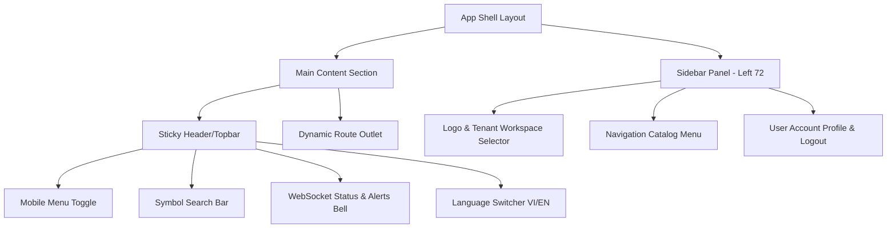

# Tài liệu Phân tích & Lộ trình Nâng cấp Giao diện VNInvest (SaaS Native)
## Chuyển đổi sang Tailwind Admin Dashboard Template

**Ngày lập:** 2026-06-21  
**Mã tài liệu:** `docs/TAILWIND_ADMIN_MIGRATION_ROADMAP_20260621.md`  
**Trạng thái:** Bản thảo phân tích kỹ thuật (Draft Spec)  

---

## 1. Hiện trạng & Kết quả Audit Codebase

Dựa trên các tài liệu nền tảng (`I18N_SSOT_MAPPING_20260621.md`, `SOC_CONFIG_UI_DECOMMISSION_RESULTS_20260621.md`, `WHALE_ADVISORY_PORT_PLAN_20260621.md`, `LEGACY_FRONTEND_ELIMINATION_PLAN_CRITIQUE_20260621.md`, và `LEGACY_FRONTEND_ELIMINATION_PLAN_20260621.md`), cấu trúc hiện tại có các đặc điểm và lỗ hổng kỹ thuật sau:

### 1.1 Khung giao diện chính (App Shell)
* **Hiện trạng:** Tệp [main.js](file:///c:/Mujoco%20Projects/vninvest/packages/web/src/main.js) sử dụng cấu trúc `layoutStyles` bằng đối tượng JavaScript thô sơ, định nghĩa các thuộc tính css inline. Nó không có tính năng responsive, không có thanh sidebar co giãn linh hoạt, không hỗ trợ giao diện điện thoại (mobile overlay) và không tận dụng được Tailwind utility classes có sẵn trong `packages/web`.
* **Vấn đề kết nối WebSocket:** Hệ thống realtime được quản lý bởi `RealtimeProvider` qua WebSocket kết nối đến `/ws/realtime/` phục vụ cho việc đẩy luồng giá trực tiếp, chỉ số thị trường và cảnh báo cá mập. Hiện tại cơ chế này chưa được cấu hình chuẩn các biến môi trường Vite (`VITE_WS_BASE_URL` và `VITE_DISABLE_REALTIME_WEBSOCKET`) trên môi trường sản xuất.

### 1.2 Trạng thái di trú các trang chức năng (SaaS Parity)
* **Đã hoàn thành di trú:** `ScreenerPage.jsx`, `UpgradePage.jsx`, `AdminCrawlControlPage.jsx`.
* **Chưa di trú / Đang dùng Shell hoặc Debug:**
  * `WhaleAdvisoryPage.jsx` (233 dòng ở legacy, cấu trúc 10-15 components con rất phức tạp).
  * `StockDetailPage` (đang dùng wrapper `StockDetailPageHost.jsx` ở legacy).
  * `tenant-admin/*` (8 trang quản lý partner/tenant đang chạy song song, chưa chuyển hoàn toàn).
  * `ShellOperationsCenterPage.js` (Trang SOC Operator mới dừng ở mức debug thô sơ).

### 1.3 Lỗi tích tụ (Residual Bugs)
* **Lỗi cú pháp:** Gọi `coreApiAdapter({ env })` không đúng cách trong 4 trang SaaS hiện tại (Portfolios, Transactions, UserSettings, WhaleAlerts) dẫn đến crash runtime khi tải trang.
* **Lỗi chính tả:** Lệnh reload dữ liệu bị viết sai chính tả thành `coreApiAeload()` tại `PortfoliosPage.js` dòng 73.
* **Quy định i18n:** Vi phạm quy tắc SSOT i18n tại một số trang mới tạo (ví dụ `UpgradePage.jsx` đang hardcode tiếng Việt không có bản dịch tiếng Anh tương ứng).

---

## 1.4 Quy trình Tải & Tích hợp Source Template (Dành cho Đội Code)

Để có mã nguồn template làm tài liệu đối chiếu trực tiếp, đội ngũ lập trình viên sẽ thực hiện quy trình sau:

### A. Phương thức lấy mã nguồn template
1. **Repository chính thức:** Clone kho lưu trữ template về thư mục tạm (scratch folder ngoài monorepo):
   ```bash
   git clone https://github.com/Tailwind-Admin/free-tailwind-admin-dashboard-template.git C:/temp/tailwind-admin-template
   ```
2. **Khảo sát cấu trúc giao diện mẫu:**
   * File layout tổng quan (Sidebar, Header, Main Wrapper) nằm ở các file HTML mẫu trong thư mục `src/` hoặc `dist/` của template đã tải.
   * File cấu hình Tailwind của template: Đối chiếu file `tailwind.config.js` của template để lấy các lớp mở rộng màu sắc (`colors`), font chữ (`fontFamily`), độ bóng (`boxShadow`), và lưới (`gridTemplateColumns`).

### B. Quy trình tích hợp vào Monorepo `packages/web`
1. **Cấu hình Tailwind (`packages/web/tailwind.config.js`):**
   * Đội code sẽ mở tệp [tailwind.config.js](file:///c:/Mujoco%20Projects/vninvest/packages/web/tailwind.config.js) và bổ sung các token màu sắc hoặc cấu hình layout mở rộng của template vào phần `extend`.
2. **Đồng bộ hóa Style nền (`packages/web/src/index.css`):**
   * Sao chép các định nghĩa CSS chung của template (như biến màu hệ thống, reset font, hiệu ứng chuyển động mịn màng) vào tệp [index.css](file:///c:/Mujoco%20Projects/vninvest/packages/web/src/index.css).
3. **Chuyển đổi sang React (Convention `createElement`):**
   * Vì `packages/web` sử dụng quy tắc viết React thuần bằng hàm `createElement` cho các file Page/Layout chính, đội code sẽ chuyển đổi cấu trúc HTML tĩnh của template thành các lệnh gọi hàm React `e("div", { className: "..." })` một cách chính xác.

---

## 2. Thiết kế Chi tiết & Phân rã Component theo Mẫu Tailwind Admin

Mẫu giao diện nâng cấp sẽ áp dụng cấu trúc lưới (grid) responsive của Tailwind, sử dụng bảng màu Dark Mode chuyên sâu và các khối bento trực quan.



### 2.1 Khung giao diện chính (App Shell Layout)
* **Sidebar Component (`w-72 bg-slate-900 border-r border-slate-800 flex flex-col h-screen sticky top-0`)**:
  * **Workspace Selector:** Sử dụng thẻ `<select>` được định kiểu bo góc và viền mờ `bg-slate-950 border border-slate-800 text-slate-200 text-xs rounded-lg p-2.5 focus:border-accent-cyan` để người dùng chuyển đổi không gian làm việc (tenants).
  * **Menu:** Duyệt danh sách liên kết từ `navigationCatalog.js`. Áp dụng hiệu ứng hover sáng nhẹ `text-slate-400 hover:bg-slate-800/30 hover:text-slate-200` và trạng thái Active viền cyan `bg-slate-800/60 text-accent-cyan border-l-2 border-accent-cyan font-semibold`.
  * **User Profile Block:** Đặt ở cuối Sidebar, hiển thị Username và Email, tích hợp nút đăng xuất màu hồng đỏ `bg-rose-500/10 hover:bg-rose-500/20 text-rose-400 border border-rose-500/20 py-2 rounded-lg font-medium transition`.
* **Topbar Header (`h-18 bg-slate-900/80 backdrop-blur-md border-b border-slate-800 sticky top-0 z-40 flex items-center justify-between px-6`)**:
  * **Trái:** Nút Hamburger điều khiển đóng/mở Sidebar trên điện thoại; Breadcrumb theo dấu vết URL.
  * **Giữa:** Thanh tìm kiếm nhanh mã cổ phiếu dạng Auto-complete, tự động điều hướng đến `/stocks/:symbol`.
  * **Phải:** Icon trạng thái kết nối WebSocket (Đỏ: Mất kết nối, Xanh: Đã kết nối), cờ chuyển đổi ngôn ngữ (VI/EN) và Chuông thông báo hiển thị các cảnh báo khẩn cấp (Whale/Dark-flow) vừa được đẩy về.

### 2.2 Dashboard sản xuất (`packages/web/src/pages/DashboardPage.js`)

Dựa trên việc đối chiếu và rà soát ảnh chụp thực tế giao diện hiện tại của VNInvest (Image 1 và Image 2), giao diện trang Dashboard mới trong Core App sẽ được nâng cấp và đặc tả thiết kế chi tiết như sau:

#### A. Khối chỉ số thị trường (Sticky Stats Strip)
* **Vị trí:** Ngay dưới thanh điều hướng chính, cố định khi cuộn màn hình (`sticky top-0 z-30 bg-[#070e1e]/90 backdrop-blur border-b border-slate-800/80 px-6 py-3`).
* **Các chỉ số hiển thị từ trái sang phải:**
  1. **TỔNG GIÁ TRỊ THỊ TRƯỜNG:** Nhãn chữ màu xám nhạt (`text-[10px] text-slate-500 uppercase tracking-widest mb-1`), giá trị số lớn màu trắng (`text-base font-black text-slate-100` - VD: `0`).
  2. **LÃI/LỖ CHƯA CHỐT:** Hiển thị giá trị tuyệt đối và tỷ lệ phần trăm đổi màu linh hoạt theo giá trị âm/dương (`text-emerald-400` cho lãi, `text-rose-500` cho lỗ - VD: `+0 0.00%`).
  3. **ĐỘ RỘNG DANH MỤC (Phía bên phải):** Một thanh tiến trình ngang (`progress bar`) biểu diễn tỷ lệ số mã Tăng / Không đổi / Giảm trong danh mục (VD: `0/13/0`).
  4. **Nút refresh dữ liệu:** Nút bấm tròn chứa biểu tượng xoay vòng `e("button", { className: "p-2 rounded bg-slate-800 hover:bg-slate-700" })`.
  5. **Chỉ báo trạng thái kết nối:** Dấu chấm tròn màu xanh lá cây phát sáng biểu thị trạng thái kết nối realtime WebSocket đang hoạt động.

#### B. Bố cục Lưới Triad Grid (Hàng trên - Upper Triad Panels)
Bố cục lưới được cấu trúc bằng CSS Grid: `grid grid-cols-1 xl:grid-cols-10 gap-6 my-6`.

1. **LÀN TRUNG TÂM CẢNH BÁO (Left Panel - Chiếm 3/10 cột):**
   * **Tiêu đề:** "TRUNG TÂM CẢNH BÁO" màu trắng đậm kèm dòng mô tả phụ: *"Danh sách hành động ưu tiên gộp whale, dark flow và biến động giá trong cùng một luồng."*
   * **Nút liên kết nhanh:** Chữ "Xem tất cả →" ở góc trên bên phải để chuyển sang `/alert-center`.
   * **Bảng chỉ số mức độ nghiêm trọng (Severity Counter Strip):** Gồm 4 ô hình chữ nhật bo góc với viền màu tương ứng để đếm số lượng cảnh báo hiện tại:
     * **Nghiêm trọng (Critical):** Số lượng lớn màu đỏ (viền `border-rose-500/20 bg-rose-500/5`).
     * **Cao (High):** Số lượng màu cam (viền `border-orange-500/20 bg-orange-500/5`).
     * **Trung bình (Medium):** Số lượng màu xanh dương (viền `border-blue-500/20 bg-blue-500/5`).
     * **Thấp (Low):** Số lượng màu xám (viền `border-slate-800 bg-slate-900/5`).
   * **Nút Tabs điều phối:** Hai nút "Tín hiệu nóng" (Active, màu viền sáng) và "Cấu hình" (để tùy chỉnh thông số lọc cảnh báo).
   * **Khu vực hiển thị danh sách (Alert Feed Container):**
     * Trạng thái trống (Empty State): Hiển thị biểu tượng ăng-ten vệ tinh mờ kèm văn bản: *"Chưa có cảnh báo nổi bật. Trung tâm sẽ tự gộp whale, dark flow và bất thường giá theo thời gian thực."*
     * Trạng thái có dữ liệu: Các dòng cảnh báo UnifiedAlert trượt vào từ trên xuống dưới.
   * **Chân panel (Pagination Footer):** Điều khiển phân trang gồm: *"Trang 1"*, dropdown lựa chọn số mục trên trang *"Mục/trang 5 [Dropdown]"*, và các phím mũi tên điều hướng (`|<`, `<`, `>`, `>|`).

2. **LÀN BIẾN ĐỘNG THEO DÕI (Center Panel - Chiếm 4/10 cột):**
   * **Tiêu đề:** "BIẾN ĐỘNG THEO DÕI • REALTIME FEED" kèm chấm tròn chỉ báo màu xanh dương.
   * **Badge trạng thái:** Huy hiệu "LIVE FEED" màu xám nền tối ở góc phải.
   * **Thanh điều khiển bộ lọc (Double Toggle Bars):**
     * Group 1 (Chế độ xem kích thước): Nút chuyển đổi giữa "Tỷ trọng" (Weight) và "Vốn hóa" (Market Cap - Active).
     * Group 2 (Loại biểu đồ): Nút chuyển đổi giữa "Treemap" (Active, hiển thị biểu tượng lưới) và "Sunburst" (biểu tượng vòng tròn đồng tâm).
   * **Bản đồ nhiệt ECharts Treemap:**
     * Hiển thị lưới hình chữ nhật cho từng mã trong danh mục theo dõi (VPB, VCB, TCB, MSB, MSN, TPB, MWG, FPT, ACB, VND, VIX...).
     * Phủ màu nền theo thay đổi giá trong phiên: Màu vàng/vàng cát nếu đứng giá (`0.00%`), màu hồng/đỏ nếu giảm (`-0.84%` cho VND), và màu xanh ngọc nếu tăng giá.
     * Mỗi ô hiển thị: Mã cổ phiếu (VD: `VPB`), Tỷ lệ tăng giảm (VD: `0.00%`), và Giá trị giao dịch gần nhất (VD: `26800.00 VND`).
     * **Chú giải ở đáy biểu đồ:** Thanh chú giải dạng pill tròn chứa hai trạng thái "TĂNG" (chấm xanh ngọc) và "GIẢM" (chấm hồng).

3. **LÀN TÍN HIỆU AI ADVISOR (Right Panel - Chiếm 3/10 cột):**
   * **Tiêu đề:** "Trung Tâm Tín Hiệu AI Advisor" kèm nút bấm "Làm mới" ở góc phải.
   * **Khu vực nội dung:**
     * Trạng thái trống: Chữ hiển thị chính giữa: *"Chưa ghi nhận tín hiệu cảnh báo AI nào trong phiên hiện tại."*
     * Trạng thái có dữ liệu: Hiển thị các block khuyến nghị dạng thẻ của AI Agent, có nút mở cấu hình prompt chi tiết.

---

#### C. Phân khu chức năng nâng cao (Hàng dưới - Lower Workspace Tabs)
Nằm ngay dưới hàng Triad Panels khi cuộn xuống (Image 2), cung cấp một bộ công cụ phân tích sâu cho từng mã cổ phiếu cụ thể.

```
+-----------------------------------------------------------------------------------+
|  Tab-bar: [ 📋 Tổng quan ]  [ 📊 Kỹ thuật ]  [ 🐋 Cá mập (Active) ]  [ 🤖 AI Bot ]   |
+-----------------------------------------------------------------------------------+
| Phạm vi mã: [ Theo dõi riêng (13) v ]   Mã: [ Tất cả mã v ]   13 mã trong phạm vi  |
+-----------------------------------------------------------------------------------+
| Phân tích mã: ACB (22.850 đ) | Khoảng thời gian: [ Cả phiên v ] | Sức mạnh TC: [0.0] |
|--------------------------------------------------+--------------------------------|
|                                                  | [ Tab-bar: Tổng quan | Tín hiệu] |
|  [ Biểu đồ bong bóng Whale Bubble Chart ]        |                                |
|  - Trục Y: Khối lượng khớp lệnh (Tỷ đồng)        | - Tổng lệnh lớn: 5             |
|  - Trục X: Trục thời gian thực trong ngày        | - Lệnh mua: 2 / Lệnh bán: 3    |
|  - Trục Y2 (phải): Thang giá (21.0 - 23.0)       | - Tham chiếu: 19.660 đ         |
|  - Slider tinh chỉnh tỷ lệ Log-Scale             | - Đỉnh/Đáy: 19.789 / 19.573    |
|                                                  |                                |
+--------------------------------------------------+--------------------------------+
```

1. **Thanh chuyển đổi Workspace Tabs:**
   * Gồm 4 tab chính có đính kèm icon đặc trưng:
     * **Tổng quan** (Icon tài liệu/báo cáo).
     * **Kỹ thuật** (Icon biểu đồ nến).
     * **Cá mập** (Active - Icon chú cá mập đại diện cho dòng tiền lớn).
     * **AI Bot** (Icon robot tự động).

2. **Thanh lọc phạm vi mã (Scope Filter Bar):**
   * Nền màu tối đồng nhất với app shell, chứa:
     * Bộ lọc "PHẠM VI MÃ": Dropdown lựa chọn danh sách (VD: "Theo dõi riêng (13)").
     * Bộ lọc "MÃ": Dropdown lựa chọn tất cả mã hoặc mã riêng biệt.
     * Dòng trạng thái ở góc phải: *"13 mã trong phạm vi hiện tại"*.

3. **Giao diện tab "Cá mập" (Whale Workspace Details):**
   * **Thanh thông tin mã đang phân tích:**
     * Hiển thị mã đang xem (VD: `ACB`) cùng giá hiện tại (VD: `22.850 đ`) và số lượng bong bóng lệnh lớn (`5 bubble đang hiển thị`).
     * Lựa chọn "KHOẢNG THỜI GIAN": Dropdown chứa các mốc xem (Cả phiên, Phiên sáng, Phiên chiều...).
     * Đo lường sức mạnh tổ chức: Tiến trình ngang "SỨC MẠNH TỔ CHỨC" hiển thị điểm số (VD: `0.0`).
   * **Cấu trúc 2 cột bên trong (Split Workspace Panel):**
     * **Cột trái - Biểu đồ bong bóng giao dịch lớn (Whale Bubble Chart Area):**
       * Trục Y bên trái: Khối lượng khớp lệnh quy đổi ra Tỷ đồng (từ 0 đến 30 tỷ đồng).
       * Trục Y bên phải: Thang giá giao dịch trong phiên (từ 21.000đ đến 23.000đ).
       * Trục X: Trục thời gian phiên giao dịch thực tế trong ngày.
       * Các hạt bong bóng tròn biểu diễn lệnh mua/bán của cá mập (Màu xanh ngọc: mua chủ động, Màu hồng/đỏ: bán chủ động).
       * **Thanh trượt điều khiển (Slider Log-scale):** Bộ trượt ngang "TINH CHỈNH LOG-SCALE" cho phép co giãn tỷ lệ hiển thị bong bóng trên chart để tránh đè lấp dữ liệu.
     * **Cột phải - Bảng số liệu thống kê lệnh lớn & Giá (Stats Side-card):**
       * Tab phụ trên cùng để đổi view: "Tổng quan" và "Tín hiệu" (Active).
       * Dưới tab "Tín hiệu" hiển thị: Tổng lệnh lớn (VD: `5`), Lệnh mua (VD: `2`), Lệnh bán (VD: `3`), Cỡ mẫu baseline (VD: `--`).
       * Dưới tab "Tổng quan" (khi được kích hoạt) hiển thị: Tham chiếu (VD: `19.660 đ`), Đỉnh phiên (VD: `19.789 đ`), Đáy phiên (VD: `19.573 đ`), Giá trần (`0 đ`), Giá sàn (`0 đ`).

### 2.3 Cảnh báo Cá mập (`packages/web/src/pages/WhaleAlertsPage.js`)
* **Bộ lọc:** Lọc theo mã cổ phiếu và ngày giao dịch được bố trí gọn gàng trên thanh điều hướng `flex items-center gap-4 bg-slate-900 border border-slate-800 rounded-lg px-4 py-2.5`.
* **Bảng cấp dữ liệu động:** Dòng dữ liệu hiển thị tức thời khi có thông báo WebSocket. Mỗi dòng có gắn badge phân loại mức độ nghiêm trọng:
  * *Critical (Khẩn cấp):* Màu đỏ nhấp nháy `bg-rose-500/10 text-rose-400 border border-rose-500/20 animate-pulse`.
  * *High (Cao):* Màu cam `bg-orange-500/10 text-orange-400 border border-orange-500/20`.
  * *Medium (Trung bình):* Màu vàng hổ phách `bg-amber-500/10 text-amber-400 border border-amber-500/20`.
  * *Low (Thấp):* Màu xanh dương `bg-sky-500/10 text-sky-400 border border-sky-500/20`.

### 2.4 AI Tư vấn (`packages/web/src/pages/signals/WhaleAdvisoryPage.jsx`)
* **Khung điều khiển (`WhaleAdvisoryCommandPanel`)**:
  * **Agentic Thought Stream:** Màn hình giả lập terminal `bg-slate-950 text-slate-300 font-mono rounded border border-slate-800 p-4` hiển thị chi tiết các bước lập luận, phân tích của mô hình AI Agent trước khi đưa ra khuyến nghị.
  * **Action Checklist:** Danh sách việc cần làm (Checklist hành động) để giảm thiểu rủi ro hoặc tối ưu lợi nhuận.
  * **Recommendation Explainability:** Thang đo minh bạch điểm số giải thích (Whale weight, Technical weight, News weight).
* **Hỗ trợ vận hành:** Panel bên phải hiển thị chỉ số đo lường niềm tin (`TrustTelemetryPanel`), lịch sử khuyến nghị rút gọn (`RecommendationHistoryMini`) và bộ điều chỉnh khẩu vị rủi ro (`RiskModeSelector`).

### 2.5 Radar Dòng tiền (`packages/web/src/components/OrderFlowRadarPanel.js`)
* **Biểu đồ CVD tích lũy:** Sử dụng Recharts `AreaChart` phủ màu gradient mờ để theo dõi chênh lệch khối lượng mua/bán chủ động trực tiếp trong ngày.
* **Số liệu dòng tiền ẩn (Dark Money):** Hiển thị điểm số sức mạnh của dòng tiền tổ chức, tỷ lệ phân bổ kích thước lệnh (Retail, Medium, Large, Institutional block) và bảng danh sách tín hiệu mua/bán gần nhất.

### 2.6 Chi tiết Cổ phiếu (`packages/web/src/pages/StockDetailPage.js`)
* **Workstation Layout V2 (Giao diện 2 cột chia đôi màn hình):**
  * **Cột trái (Chiếm 65% độ rộng):** Biểu đồ kỹ thuật nến Candlestick (`VNStockChartPanel` kết nối KlineCharts engine) xếp chồng lên biểu đồ Radar bong bóng cá mập (`WhaleBubbleChart` hiển thị phân bổ lệnh gom/xả theo giá và thời gian).
  * **Cột phải (Chiếm 35% độ rộng):** Bảng độ sâu sổ lệnh (`StockOrderBookWidget`) và luồng khớp lệnh trực tiếp (`StockExecutionLogWidget`).
* **Sub-tabs Panel (`StockDetailTabs`):** Chứa các thông tin bổ trợ như Tin tức, Tài chính doanh nghiệp, Hồ sơ doanh nghiệp và Nhật ký khuyến nghị lịch sử.

### 2.7 Quản trị Tenant & SOC System (`packages/web/src/pages/tenant-admin/` và `admin/`)
* **Tenant Admin:** Cấu hình chi tiết gói dịch vụ, danh sách thành viên workspace, lịch sử sử dụng tài nguyên (API usage) và quản lý khóa PATs.
* **Operations Center (SOC):** Giám sát trạng thái hoạt động của microservices. Người điều hành có thể chỉnh cấu hình trực tiếp trên UI, thực hiện reset cấu hình hoặc ép chạy kiểm tra sức khỏe hệ thống.
* **Crawl Control:** Điều khiển lịch trình thu thập dữ liệu, xem log crawler và xem tiến độ tải dữ liệu lịch sử (backfill progress bars).

---

## 3. Phân tích Ưu & Khuyết điểm (Pros & Cons)

### 3.1 Ưu điểm
1. **Tính thẩm mỹ đẳng cấp:** Đưa giao diện VNInvest về tiêu chuẩn chuyên nghiệp của các nền tảng SaaS hiện đại (giao diện tối sâu, hiệu ứng mờ kính glassmorphism, phân cấp bố cục bento).
2. **Responsive hoàn hảo:** Giải quyết triệt để vấn đề méo mó giao diện trên điện thoại và máy tính bảng nhờ lưới responsive của Tailwind.
3. **Mã nguồn chuẩn hóa:** Loại bỏ hàng trăm dòng code css inline phức tạp trong React, thay bằng các class Tailwind có cấu trúc rõ ràng.
4. **Đẩy nhanh tốc độ porting:** Khung component mẫu từ template giúp việc dựng lại các trang legacy phức tạp như `WhaleAdvisoryPage` nhanh hơn rất nhiều.

### 3.2 Khuyết điểm
1. **Phình to thuộc tính class:** Cú pháp class dài đặc trưng của Tailwind có thể làm mã nguồn khó đọc nếu không chia nhỏ component hợp lý.
2. **Xung đột khung hình biểu đồ:** Canvas của KlineCharts và ECharts có thể không tự co giãn chính xác khi Sidebar thu gọn/mở rộng, dễ dẫn đến hiện tượng vỡ hình tạm thời.

---

## 4. Bảng Vấn đề phát sinh & Hướng giải quyết

| # | Vấn đề phát sinh | Ảnh hưởng kỹ thuật | Hướng giải quyết |
|---|---|---|---|
| 1 | **Biểu đồ nến bị tràn khung** | Khi đóng/mở Sidebar, KlineCharts không tự thay đổi kích thước dẫn đến tràn viền hoặc co cụm. | Đặt thẻ bọc biểu đồ ở thuộc tính `relative w-full h-full`, cài đặt `ResizeObserver` để tự động kích hoạt hàm `.resize()` của thư viện biểu đồ khi kích thước phần tử bọc thay đổi. |
| 2 | **Lỗi sập trang do cú pháp Adapter** | Gọi sai hàm `coreApiAdapter({ env })` và sai chính tả hàm reload làm sập hệ thống. | Tiến hành sửa lỗi cú pháp ngay ở Phase 1. Đưa các hàm gọi API vào block `try/catch` có cơ chế hiển thị lỗi/fallback an toàn. |
| 3 | **Cảnh báo i18n trên trang Upgrade** | Các chuỗi tiếng Việt viết trực tiếp (hardcode) vi phạm Quality Gate. | Di chuyển toàn bộ chuỗi ký tự hiển thị vào một đối tượng dictionary nội bộ trong component, sử dụng hàm dịch `createTranslator` theo ngôn ngữ được cấu hình ở `LangContext`. |
| 4 | **Độ trễ khi build Docker** | Quá trình build KLine engine kéo dài làm chậm quy trình deploy sản xuất. | Cấu hình Docker buildkit chia sẻ cache thư mục `node_modules` và tách phần build engine ra một bước độc lập sử dụng tham số `STOCKCHART_REF`. |
| 5 | **Mất kết nối WebSocket đột ngột** | Luồng giá và luồng whale bị ngắt khi token hết hạn mà không tự kết nối lại. | Tận dụng cơ chế backoff và heartbeat sẵn có trong `useRealtimeFeedCore.js`. Tự động gia hạn token và gửi yêu cầu kết nối lại khi nhận mã lỗi 4401. |

---

## 5. Lộ trình Triển khai Chi tiết (8 Tuần)

Lộ trình được phân rã thành các giai đoạn cuốn chiếu rõ ràng, có tiêu chí Definition of Done (DoD) đi kèm để kiểm duyệt.

```
Tuần 1-2:   [Phase 1] Restructure App Shell + Fix Syntax Crash & Adapters
Tuần 3-4:   [Phase 2] Port Dashboard, Whale Alerts & Tenant Admin Pages (i18n check)
Tuần 5-6:   [Phase 3] Port Whale Advisory + Build KLine charts & Resize Observability
Tuần 7-8:   [Phase 4] Shadow run beta + Nginx Config rewrite + Decommission legacy
```

### Tuần 1 - 2: Xây dựng nền tảng App Shell & Sửa lỗi Adapter (Phase 1)
* **Nhiệm vụ:**
  * Thay thế các style inline trong `main.js` thành Sidebar và Header chuẩn Tailwind.
  * Đồng bộ cơ chế lưu trữ JWT token giữa Axios legacy và Fetch adapter mới.
  * Sửa lỗi cú pháp gọi `coreApiAdapter` và lỗi chính tả `coreApiAeload` tại trang Portfolios.
* **DoD:** 100% trang SaaS hiện tại hoạt động bình thường, không còn lỗi sập trang khi chuyển đổi route; Giao diện Shell mới hiển thị chính xác trên desktop và mobile.

### Tuần 3 - 4: Chuyển đổi các trang SaaS cốt lõi (Phase 2)
* **Nhiệm vụ:**
  * Viết lại giao diện `DashboardPage` và `WhaleAlertsPage` theo bố cục Tailwind grid.
  * Di chuyển toàn bộ 8 trang thuộc nhóm `tenant-admin/` sang SaaS native.
  * Thiết lập pre-commit hook chặn mọi chuỗi tiếng Việt viết thô không thông qua dịch.
* **DoD:** Các trang Dashboard, Alerts, Tenant Admin chạy hoàn hảo trên repo mới; Bảng dịch i18n đầy đủ cho các trang này.

### Tuần 5 - 6: Chuyển đổi các cấu phần phức tạp & Biểu đồ (Phase 3)
* **Nhiệm vụ:**
  * Port trang `WhaleAdvisoryPage.jsx` và các component con liên quan (Thought Stream, Telemetry).
  * Đóng gói phần tự build KLine charts vào `packages/web/Dockerfile` dùng tham số `STOCKCHART_REF`.
  * Viết hook `ResizeObserver` bọc ngoài các charts để tự động căn chỉnh lại kích thước khi Sidebar co giãn.
* **DoD:** Biểu đồ nến và Radar bong bóng hoạt động mượt mà, tự động vẽ lại chính xác khi tương tác giao diện; Khuyến nghị AI hiển thị đầy đủ lập luận.

### Tuần 7 - 8: Chạy thử nghiệm sản xuất & Dọn dẹp Legacy (Phase 4)
* **Nhiệm vụ:**
  * Triển khai shadow run tối thiểu 3 ngày trên subdomain `beta.vninvest.edusuccess.vn`.
  * Cập nhật tệp `packages/web/docker/nginx.conf` bổ sung cơ chế rate limiting và Docker DNS resolver.
  * Xóa bỏ hoàn toàn thư mục `frontend/` cũ khỏi Git repository.
* **DoD:** Parity gate vượt qua (tỷ lệ lỗi frontend = 0%, tốc độ tải trang tương đương hoặc nhanh hơn bản CRA cũ); Thư mục legacy frontend biến mất hoàn toàn khỏi cây thư mục.

---

## 6. Kịch bản Rollback khẩn cấp (SLA < 5 phút)

Vì hệ thống deploy trực tiếp bằng cách build trên server (tốn 10-15 phút), quy trình rollback **không thể dùng commit revert**. Bắt buộc tuân thủ quy trình gắn tag Docker pre-built:

1. **Trước khi deploy bản mới (Bước 6):**
   ```bash
   docker tag vninvest-frontend:latest vninvest-frontend:backup-pre-migration
   ```
2. **Khi phát hiện lỗi nghiêm trọng (Downtime / Lỗi nghiệp vụ > 1%):**
   * Sửa cấu hình `docker-compose.prod.yml` chuyển tag của service frontend về `backup-pre-migration`.
   * Chạy lệnh phục hồi tức thì:
     ```bash
     docker compose up -d frontend
     ```
   * Thời gian khôi phục dịch vụ thực tế: **< 30 giây**.
