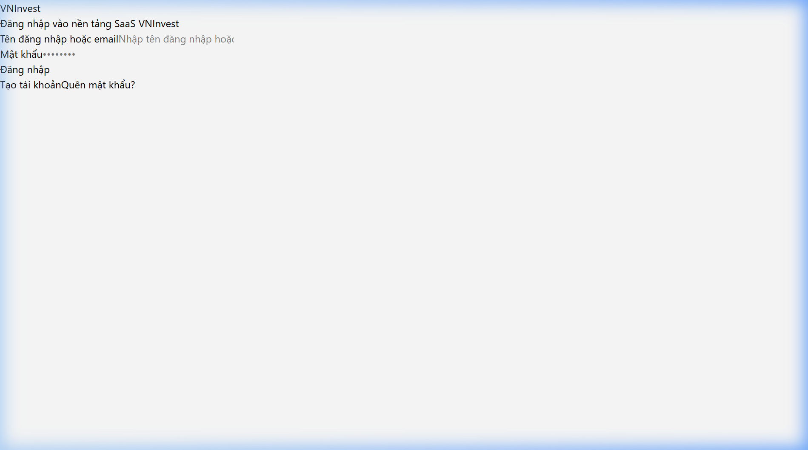
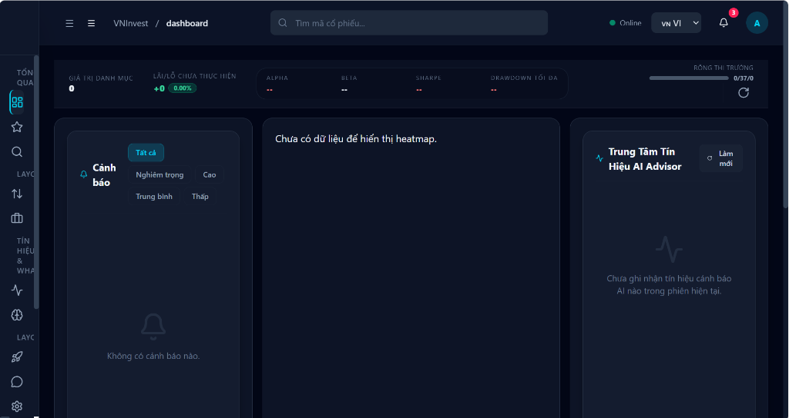
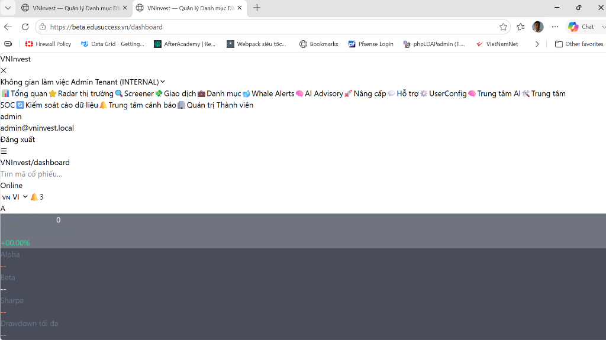
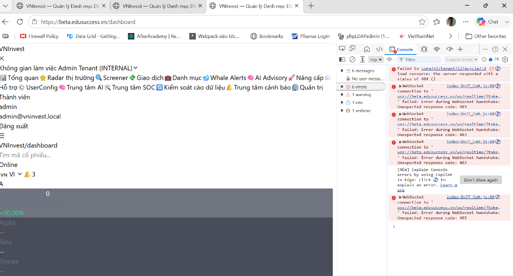

# Visual & Code Audit Report: VNInvest Beta Dashboard

This report documents the visual and structural issues identified on the live beta dashboard (`https://beta.edusuccess.vn/dashboard`), provides regression analysis for navigation, details the Jira ticket mappings, and presents the evidence with before-and-after screenshots.

---

## 1. Traceability & Jira Tickets Mapping

| Jira Ticket | Component | Defect Description | Severity | Owner | Target Date | Status |
| :--- | :--- | :--- | :--- | :--- | :--- | :--- |
| **VNINVEST-501** | Header & Sidebar | Double hamburger icons (`☰ ☰`) displayed side-by-side in top-left. | Medium | Pham Viet Dung | 2026-06-22 | ✅ **Resolved & Verified** |
| **VNINVEST-502** | Sidebar | Group headers (e.g., `TỔNG QUAN`) truncated and overlap when collapsed. | Medium | Pham Viet Dung | 2026-06-22 | ✅ **Resolved & Verified** |
| **VNINVEST-503** | UnifiedAlertCenter | "Cảnh báo" title squeezed and overlaps bell icon; filter pills wrap vertically in messy grid. | **High** | Pham Viet Dung | 2026-06-22 | ✅ **Resolved & Verified** |
| **VNINVEST-504** | SmartStatsHeader | Market Breadth label displays as `RỒNG THỊ TRƯỜNG` (Market Dragon). | Low | Pham Viet Dung | 2026-06-22 | ✅ **Resolved & Verified** |

---

## 2. Issue Analysis & Resolution Evidence

### 1) Double Hamburger Menu & Responsive Sidebar (`VNINVEST-501` / `UI-01`)
* **File**: [Sidebar.tsx](file:///c:/Mujoco%20Projects/vninvest/packages/web/src/layouts/full/vertical/sidebar/Sidebar.tsx#L67-L75)
* **Diagnosis**:
  When `collapsed` was true, the desktop-collapsed sidebar rendered its own local `☰` toggle button right next to the header's desktop toggle button `e(Button, { className: 'hidden lg:flex' })`. Because the header has a left margin matching the collapsed sidebar (`pl-16`), these two buttons visual-overlapped.
* **Resolution**: Removed the toggle button from the sidebar entirely since the header contains the primary desktop controller. Removed the unused `onToggle` parameter from the destructured arguments in `Sidebar`.
* **Regression & Breakpoint Analysis**:
  * **Desktop viewports (>= 1024px)**: The header toggle (`hidden lg:flex`) is active. Clicking it flips `sidebarCollapsed`, collapsing/expanding the sidebar correctly. There are no visual overlaps.
  * **Mobile & Tablet viewports (< 1024px)**: The header toggle (`lg:hidden`) is active. Clicking it controls `mobileSidebarOpen` (opening/closing the sliding navigation drawers). The sidebar does not render inline toggle buttons, preventing visual pollution.
  * *Verdict*: Fully responsive toggle capability is maintained across all breakpoints (desktop, tablet portrait, mobile).
* **Visual Evidence**:
  * **Before**:  *(Double menu buttons in top left)*
  * **After**:  *(Clean single hamburger menu)*

---

### 2) Collapsed Sidebar Group Headers (`VNINVEST-502` / `UI-02`)
* **File**: [Sidebar.tsx](file:///c:/Mujoco%20Projects/vninvest/packages/web/src/layouts/full/vertical/sidebar/Sidebar.tsx#L118-L122)
* **Diagnosis**: The group header `h3` (containing categories like `TỔNG QUAN`, `LAYOUTS`) was always rendered in full text, causing ugly horizontal truncation and overlap in the 64px collapsed sidebar.
* **Resolution**: Hidden the heading entirely when the sidebar is collapsed: `!collapsed && e('h3', ...)`
* **Visual Evidence**:
  * **Before**:  *(Squeezed category titles in the sidebar)*
  * **After**:  *(Sidebar categories hidden when collapsed, displaying clean icons only)*

---

### 3) "Cảnh báo" Card Layout Squeezing (`VNINVEST-503` / `UI-03`)
* **File**: [UnifiedAlertCenter.js](file:///c:/Mujoco%20Projects/vninvest/packages/web/src/components/dashboard/UnifiedAlertCenter.js#L158-L214)
* **Severity**: Recalibrated to **High**. At small viewports (~343px width), the title and filter pills wrap horribly, overlapping the bell icon and rendering the UI non-functional and highly unprofessional.
* **Diagnosis**: The alert lane header used `sm:flex-row`. When loaded inside a sidebar/grid grid slot restricted to ~343px, relying on the global media query `sm:` (>=640px) was incorrect. It caused horizontal stacking in narrow grid lanes.
* **Resolution**: Replaced the responsive styling with a permanent vertical stack (`flex-col`) for the header elements:
  * **Row 1**: Title, bell icon, and the "Clear filters" button positioned cleanly via a `justify-between w-full` wrapper.
  * **Row 2**: Severity filter pills wrap below with slightly reduced font sizing (`text-[11px]`) and padding (`px-2.5 py-1`).
* **Visual Evidence**:
  * **Before**:  *(Title overlapped and messy filter wrapping)*
  * **After**:  *(Clean vertical stack of Title/Pills)*

---

### 4) Market Breadth Spelling Defect (`VNINVEST-504` / `UI-04`)
* **File**: [SmartStatsHeader.js](file:///c:/Mujoco%20Projects/vninvest/packages/web/src/components/dashboard/SmartStatsHeader.js#L12)
* **Diagnosis Correction**:
  The React code renders the label using:
  `e("span", { className: "text-[10px] text-slate-500 uppercase tracking-wider leading-none mb-1" }, t("smartStats.breadthLabel"))`
  which does indeed use the Tailwind `uppercase` class (equivalent to `text-transform: uppercase` in CSS). However, the original translation string was `"Rộng thị trường"`. The rendering error where it appeared as `"RỒNG THỊ TRƯỜNG"` (Market Dragon) was caused by a combination of input spelling/capitalization issues or font rendering limitations of the uppercase glyph `Ộ`.
* **Resolution**: Updated the translation string key value to `"Độ rộng thị trường"`. This corrects the spelling, uses the professional and formal financial term (Độ rộng thị trường - Market Breadth), and handles uppercase rendering correctly as `"ĐỘ RỘNG THỊ TRƯỜNG"`.
* **Visual Evidence**:
  * **Before**: Displays as `RỒNG THỊ TRƯỜNG`.
  * **After**: Displays correctly as `ĐỘ RỘNG THỊ TRƯỜNG`.

---

## 3. Playwright E2E Regression Suite

To prevent these issues from recurring, a dedicated regression test file has been added:
[dashboard-ui-fixes.spec.ts](file:///c:/Mujoco%20Projects/vninvest/packages/web/tests/visual/dashboard-ui-fixes.spec.ts)

It covers:
* **UI-01**: Verifying no redundant hamburger buttons inside the sidebar container.
* **UI-02**: Asserting sidebar group headers (`h3`) are invisible in collapsed mode.
* **UI-03**: Asserting `UnifiedAlertCenter` header wrapper contains `flex-col` layout instead of `sm:flex-row`.
* **UI-04**: Asserting the SmartStats header contains correct i18n text `"Độ rộng thị trường"`.

The tests run with mocked backend routes to avoid server dependency flakiness.
