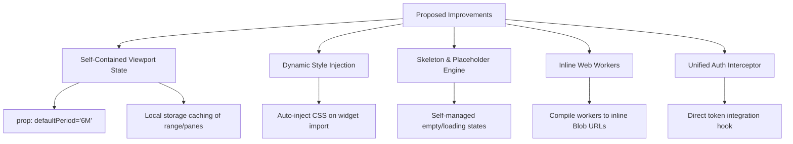

# VNInvestCharts Embedding Post-Mortem & Improvement Proposal

**Date**: 2026-06-10  
**Status**: Proposal for Discussion  
**Context**: Retrospective analysis of the `vninvestcharts` (formerly `vnstockcharts`) React widget integration on the Stock Detail page workstation.

---

## 1. Executive Summary

This document captures the technical retrospect of embedding the standalone charting workspace `<VNInvestCharts>` into the core SaaS platform workstation ([StockDetailPage.js](file:///c:/Mujoco%20Projects/vninvest/packages/web/src/pages/StockDetailPage.js)). 

During integration, several structural issues surfaced relating to:
* Initial mount rendering loops and loading deadlocks.
* Viewport resetting on page state updates (zoom/pan and visible range conflicts).
* Style injection bypasses when imported as a React/ESM module.
* Network and Web Worker path resolving limitations.

To streamline future embedding of this widget across other surfaces (e.g., Whale Alerts dashboard, Signals workspace), we propose a series of architectural improvements to make `<VNInvestCharts>` fully **self-contained** and **uncontrolled** out-of-the-box.

---

## 2. Retrospective: Issues Encountered

### 2.1. Circular Mount Lock / Loading Deadlock
* **The Symptom**: The parent workstation panel conditionally hid the `<VNInvestCharts>` widget when the history bars array was empty (`internalBars.length === 0`). However, because the widget was unmounted, it never ran its mount hooks, nor did it invoke `CoreApiChartAdapter.getBars()`. This trapped the page in a permanent loading skeleton.
* **The Root Cause**: High coupling between page-level loading state and component mounting. The chart was expected to be a controlled renderer of data, but in standalone mode, it must act as the fetcher.
* **Temporary Workaround**: Removed the empty data conditional checks at the parent panel level, forcing `<VNInvestCharts>` to always mount, boot up, and request data.

### 2.2. Viewport Reset & Dependency Instability
* **The Symptom**: When users zoomed or panned the viewport, then subsequently customized their indicators (e.g., closing the RSI+MACD auxiliary pane), the viewport zoom was completely reset to the rightmost default position.
* **The Root Cause**: 
  1. The parent panel was memoizing `customPanes` but had a dependency on the translation function `t` which changed on every render.
  2. Every time a page state changed (such as updating active ranges), the parent re-rendered, passing a new array reference of `customPanes` to the widget, which triggered the widget's layout synchronizer and wiped out user adjustments.
* **Temporary Workaround**: Memoized `customPanes` with static dependencies `[]` and maintained `xExtents` date bounds in the parent state to lock viewport bounds across renders.

### 2.3. Style Injection Bypass under React ESM Imports
* **The Symptom**: The drawing toolbars, indicator menus, and modal dialogs rendered with broken layouts, overlapping text, or completely collapsed SVG icons when imported as an ES Module.
* **The Root Cause**: The styling rules defining layouts, absolute positioning, hover effects, and dark-mode themes were bundled in the IIFE standalone bundle entrypoint `iife-entry.js` and were completely bypassed by the React bundler.
* **Temporary Workaround**: Extracted all CSS rules into a dedicated module [injectStyles.js](file:///c:/Mujoco%20Projects/vninvest/packages/web/src/components/vninvestcharts/src/widget/injectStyles.js) and executed a client-side injection routine inside the widget's React entry point.

### 2.4. Auth Token Resolution for Async Queries
* **The Symptom**: Background backfills triggered HTTP `401 Unauthorized` errors when fetching historical data.
* **The Root Cause**: The data adapter was instantiated inside the panel without receiving token retrieval hooks from the host shell.
* **Temporary Workaround**: Manually mapped authentication callbacks (`getToken`, `getRefreshToken`, `setTokens`, `clearTokens`) from the host shell `env` prop directly into the `CoreApiChartAdapter` instance.

### 2.5. Web Worker Resolution Failures
* **The Symptom**: Building the project for production crashed during the Webpack optimization step due to missing relative path file resolutions inside Web Workers.
* **The Root Cause**: Hardcoded path resolutions for worker scripts did not play nicely with standard bundle output directories.
* **Temporary Workaround**: Rewrote worker references to use relative JS outputs and adjusted `tsconfig` excludes.

---

## 3. Improvement Proposal: Self-Contained Architecture

To make future integrations as simple as `<VNInvestCharts symbol="VRE" defaultPeriod="6M" />` without requiring ad-hoc state syncing, we propose the following upgrades to the widget codebase:



### 3.1. Self-Contained Viewport State (Uncontrolled Viewport)
* **Goal**: Enable the widget to calculate and persist its zoom range internally.
* **Implementation Plan**:
  * Add a `defaultPeriod` prop (accepting `"1D"`, `"5D"`, `"1M"`, `"3M"`, `"6M"`, `"1Y"`, `"All"`).
  * On initial load or symbol change, if the `xExtents` prop is not controlled, compute the viewport range bounds internally using the `defaultPeriod` value and the loaded bars.
  * Persist the user's active viewport state and active pane configuration in `localStorage` keyed by symbol and workspace scope (e.g. `vninvest:chart-state:${symbol}`).

### 3.2. Dynamic Style Injection in React Bundler
* **Goal**: Prevent style bypasses and ensure layout styling is loaded automatically.
* **Implementation Plan**:
  * Import and execute the style injector hook directly inside the React library entrypoint `index.js`.
  * Ensure the style injector checks if the style block has already been injected to prevent duplicate `<style>` tags in SSR environments.

### 3.3. Self-Managed Loading and Skeleton Placeholders
* **Goal**: Prevent widget crashes or unmounting cycles when data is loading or missing.
* **Implementation Plan**:
  * Upgrade the internal chart canvas rendering engine to display a native skeleton loading screen when the data source state is in a pending/fetching phase.
  * Gracefully handle empty datasets by displaying a clean, centered "No data available" message inside the canvas area rather than throwing context-level crashes.

### 3.4. Inline Workers via Blobs
* **Goal**: Decouple background calculations from file-system paths.
* **Implementation Plan**:
  * Convert helper workers (such as nens/data preparation calculations) to inline scripts compiled as string literals.
  * Initialize workers using Blob URLs:
    ```javascript
    const blob = new Blob([WORKER_SOURCE_CODE], { type: 'application/javascript' });
    const worker = new Worker(URL.createObjectURL(blob));
    ```

### 3.5. Direct Authentication Handshake
* **Goal**: Eliminate manual token forwarding for authenticated adapters.
* **Implementation Plan**:
  * Add a standard `authHandler` prop to `VNInvestCharts` that accepts a unified token function or reads from a standard context, allowing data adapters to fetch auth headers automatically.
