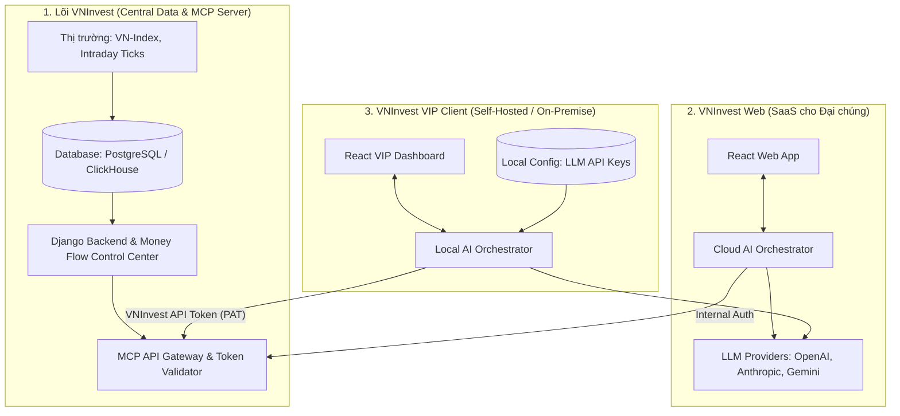

# KIẾN TRÚC TỔNG THỂ HỆ THỐNG VNINVEST 
**(Dựa trên mô hình Central MCP & Hybrid Clients)**

**Date:** 2026-05-01

Tài liệu này phác thảo kiến trúc tổng thể cấp cao (High-level Architecture) chia hệ thống thành 3 thực thể biệt lập: **Lõi MCP (Central Data Server)**, **VNInvest Web (Dành cho user phổ thông)**, và **VNInvest VIP Client (Dành cho user tự host)**.

---

## 1. Sơ đồ Kiến trúc (Architecture Diagram)

---

## 2. Diễn giải các Thành phần (Components Breakdown)

### Khối 1: Lõi VNInvest (Central MCP Server & Data)
**Vai trò:** Trái tim lưu trữ toàn bộ chất xám, công thức tính toán và dữ liệu độc quyền của dự án. Không trực tiếp chạy AI, chỉ "bán" dữ liệu.
*   **Database:** Lưu trữ Intraday Ticks, dữ liệu KLine, cấu hình người dùng.
*   **Core Django (Money Flow Control Center):** Nơi thực thi các logic độc quyền (`global_signal_universe_policy`) để tính toán CVD, Whale Strength, Heatmap.
*   **MCP Gateway:** Một cổng API đặc biệt làm nhiệm vụ:
    *   Nhận request từ các Clients (chuẩn MCP).
    *   Kiểm tra Token (Auth) và giới hạn số lần gọi (Rate Limiting) để chống cào dữ liệu.
    *   Gọi ngược vào Core Django để lấy data trả về JSON.

### Khối 2: VNInvest Web (Public SaaS)
**Vai trò:** Phiên bản Web phổ thông (vninvest.vn) cho khách hàng chuẩn. Mọi thứ được host trên server của VNInvest.
*   **React Web App:** Giao diện KLineChart, Order Flow bình thường.
*   **Cloud AI Orchestrator:** Chạy trên server của VNInvest. Với mô hình này, VNInvest sẽ phải trả tiền API Key cho OpenAI/Anthropic để chạy AI Advisory cho user web (Hoặc user phải mua gói Web Premium để được xài AI).

### Khối 3: VNInvest VIP Client (Hệ thống do VIP tự host)
**Vai trò:** Bản phần mềm đóng gói (Docker/Desktop App) giao cho khách VIP tải về máy tính cá nhân hoặc máy chủ của Quỹ đầu tư.
*   **React VIP Dashboard:** Một bản sao của giao diện Web nhưng chạy ở `localhost` của VIP.
*   **Local AI Orchestrator:** Bộ não Multi-Agent chạy ngay trên máy tính của VIP.
*   **BYOK (Bring Your Own Key):** VIP nhập API Key của OpenAI/Anthropic và VNInvest Token vào App này.
*   **Bảo mật tuyệt đối:** Các "Prompts" chiến lược giao dịch, hay lệnh Backtest của VIP chỉ gửi thẳng từ máy họ tới OpenAI. VNInvest Server KHÔNG BIẾT VIP đang tính toán gì, VNInvest chỉ nhận lệnh xin dữ liệu `get_whale_alerts(symbol="VHM")`.

---

## 3. Luồng Dữ liệu (Data Flow Example)

**Tình huống:** Khách VIP mở máy tính ở nhà, gõ lệnh: *"Tìm các mã có Whale Flow lớn hôm nay và phân tích kỹ thuật"*.

1. Lệnh text đi vào **VIP_Orchestrator** (Chạy trên máy VIP).
2. VIP_Orchestrator gọi tới **LLM_API (OpenAI)** (bằng tiền của VIP). OpenAI bảo: *"Tôi cần chạy Tool `screen_stocks` để tìm mã Whale Flow lớn"*.
3. VIP_Orchestrator cầm **VNInvest API Token** gọi một request qua mạng internet tới **MCP_Gateway** của VNInvest.
4. **MCP_Gateway** kiểm tra Token hợp lệ -> Chuyển vào **Core Django**.
5. **Core Django** quét Database, trả về JSON danh sách mã.
6. **MCP_Gateway** ném JSON đó về lại cho máy tính của VIP.
7. OpenAI trên máy VIP đọc JSON, tự nhận xét Kỹ thuật và hiển thị lên màn hình **VIP_UI**.

**Kết quả:**
- VNInvest Server không tốn 1 đồng chi phí AI nào.
- VIP bảo mật được bí mật giao dịch.
- Dữ liệu độc quyền của VNInvest không bị lộ ra ngoài mã nguồn (chỉ lộ JSON).
