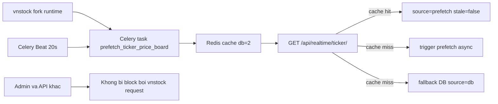

# VNStock Throughput Runtime Guide

## Muc tieu

Tai lieu nay mo ta cach du an VNInvest van hanh sau khi chuyen sang ban `vnstock` fork da duoc nang cap throughput, cach warm cache ticker, cach chay Celery/Redis, va cach xac minh du lieu realtime dang di theo fast path.

## Pham vi thay doi

- Runtime backend su dung `vnstock @ git+https://github.com/vietdung-edusuccess/vnstock.git@main`.
- Khong con duy tri monkey-patch bypass rate-limit trong Django settings.
- Throughput duoc dam bao bang kien truc cache-first + background prefetch, khong phu thuoc vao HTTP request handler.
- Bo sung dependency `asyncio-throttle>=1.0.2` do ban vnstock nang cap yeu cau.

## Kien truc runtime

```
Celery Beat (20s)
  -> portfolio.tasks.prefetch_ticker_price_board
      -> vnstock Trading.price_board(...)
      -> Django Redis cache db=2
          key: vninvest:1:ticker:<SYMBOL>

HTTP GET /api/realtime/ticker/<symbol>/
  -> doc cache ticker:<SYMBOL>
  -> neu co du lieu: tra ngay source=prefetch, stale=false
  -> neu cache miss: trigger prefetch async va fallback DB, khong block thread

Admin / API khac
  -> khong bi giu thread de cho vnstock
```

### So do Mermaid



## Thanh phan bat buoc

### 1. Backend ASGI

- Chay Django/Daphne phuc vu API va admin.
- Doc cache ticker tu Redis db=2.

### 2. Redis

- `redis://localhost:6379/0`: Celery broker/result backend.
- `redis://localhost:6379/1`: Redis Streams cho realtime pipeline.
- `redis://localhost:6379/2`: Django cache ticker/shared cache.

### 3. Celery Worker

- Xu ly task prefetch va cac realtime task.
- Nen chay `--pool=solo` tren Windows.

### 4. Celery Beat

- Ban lich task `prefetch-ticker-price-board` moi 20 giay.
- Day la thanh phan bat buoc neu muon ticker API di qua duong cache warm.

## Duong di du lieu ticker

### Fast path

Dieu kien:
- Redis dang chay.
- Celery worker dang chay.
- Celery beat dang chay.
- Symbol nam trong `TrackedSymbol`.

Ket qua:
- API `/api/realtime/ticker/<symbol>/` tra ve `source = prefetch`.
- `stale = false`.
- Latency o muc hang chuc ms.

### Fallback path

Neu cache miss hoac prefetch chua kip chay:
- View se `apply_async()` task prefetch o background.
- Response hien tai fallback ve DB, `source = db`.
- Van nhanh va khong giu thread cho request ngoai.

## Cach khoi dong local de dat throughput dung thiet ke

### Backend

```powershell
cd backend
.\.venv\Scripts\Activate.ps1
python -m daphne --bind 127.0.0.1 --port 8000 --threads 20 config.asgi:application
```

### Khoi dong nhanh ca stack tren Windows

```powershell
cd backend
.\start_stack.ps1
```

Script nay mo 3 cua so rieng cho backend, Celery worker va Celery beat.

### Celery worker

```powershell
cd backend
.\.venv\Scripts\Activate.ps1
python -m celery -A config worker -l info -P solo
```

### Celery beat

```powershell
cd backend
.\.venv\Scripts\Activate.ps1
python -m celery -A config beat -l info
```

## Cach xac minh he thong dang di qua fast path

### 1. Kiem tra Redis cache co key ticker

```powershell
cd backend
.\.venv\Scripts\Activate.ps1
python -c "import redis; r=redis.Redis.from_url('redis://localhost:6379/2'); print([k.decode('utf-8','ignore') for k in r.keys('*ticker*')[:10]])"
```

Ky vong:
- Xuat hien key dang `vninvest:1:ticker:HPG`, `vninvest:1:ticker:VCB`, ...

### 2. Chay prefetch tay neu can warm cache ngay

```powershell
cd backend
.\.venv\Scripts\Activate.ps1
python -c "import os, django; os.environ.setdefault('DJANGO_SETTINGS_MODULE','config.settings'); django.setup(); from portfolio.tasks import prefetch_ticker_price_board; print(prefetch_ticker_price_board.run())"
```

Ky vong:
- Tra ve `{'status': 'ok', 'symbols': N, 'cached': N}`.

### 3. Kiem tra API ticker

Ky vong JSON:

```json
{
  "symbol": "HPG",
  "source": "prefetch",
  "stale": false,
  "freshness_seconds": 0
}
```

Neu thay `source = db` thi nghia la he thong dang fallback, can kiem tra:
- Beat co thuc su gui task `prefetch-ticker-price-board` hay khong.
- Worker co consume task va ghi cache hay khong.
- Symbol co nam trong bang `TrackedSymbol` hay khong.

### 4. Kiem tra endpoint health cho prefetch

```powershell
curl http://127.0.0.1:8000/api/health/prefetch/
```

Ky vong:
- `healthy = true`
- `meta_present = true`
- `sample_cache_hits > 0`

### 5. Trigger warm cache thu cong tu admin/dashboard

```powershell
curl -X POST http://127.0.0.1:8000/api/admin-ops/prefetch/warm/ \
  -H "Authorization: Bearer <staff_jwt>"
```

Ky vong:
- Response `202 Accepted` voi `queued = true` khi chay async.
- Sau vai giay, `GET /api/health/prefetch/` se cap nhat metadata moi.

## Retry/backoff khi upstream tra 429

Task `prefetch_ticker_price_board` co co che rieng cho rate-limit tu upstream:

- Neu message loi chua `429` hoac `Too Many Requests`, task chuyen sang trang thai `retrying`.
- Metadata health ghi lai `retry_after_seconds`, `retry_count`, `max_retries`.
- Celery task tu retry theo exponential backoff.

Bien moi truong co the tuning:

- `TICKER_PREFETCH_RETRY_BASE_SECONDS` (mac dinh `15`)
- `TICKER_PREFETCH_RETRY_MAX_SECONDS` (mac dinh `180`)
- `TICKER_PREFETCH_MAX_RETRIES` (mac dinh `4`)

## Benchmark da xac minh

### Khi cache chua warm

- Ticker sequential p95: khoang 85-100ms.
- Admin van on dinh duoi 200ms.
- Response thuong co `source = db`.

### Khi cache da warm

Ket qua benchmark xac minh:
- Ticker sequential p95: 57.8ms.
- Ticker concurrent wall-clock (5 requests): 57.9ms.
- Admin standalone: 90.8ms.
- Admin under stress: 100.9ms.

Danh gia:
- Ticker p95 < 300ms: PASS.
- Admin < 500ms: PASS.
- Admin under stress < 500ms: PASS.

## Cac diem can luu y khi van hanh

### 1. `TrackedSymbol` quyet dinh pham vi prefetch

Task `prefetch_ticker_price_board` chi warm cache cho cac ma ton tai trong `TrackedSymbol`.

Neu benchmark symbol khong nam trong bang nay:
- API van hoat dong.
- Nhung se di theo fallback DB thay vi fast path.

### 2. Khong danh throughput bang patch app-level

He thong hien tai da chuyen sang huong:
- Tin vao ban vnstock fork moi.
- De van toc den tu background prefetch + shared cache.
- Khong de logic bypass tam thoi ton tai trong `config/settings.py`.

### 3. Redis cache phai la shared cache

Backend va worker phai cung dung Redis db=2 lam Django cache. Neu mot ben roi ve `LocMemCache` thi:
- Worker warm cache xong backend van khong doc duoc.
- API tiep tuc fallback DB.

## Checklist su co

Khi thay ticker khong ve `source = prefetch`, kiem tra theo thu tu:

1. `Redis` con song hay khong.
2. `settings.CACHES['default']` co dang la `django.core.cache.backends.redis.RedisCache` hay khong.
3. Celery beat co log `Sending due task prefetch-ticker-price-board` hay khong.
4. Celery worker co ghi nhan task prefetch thanh cong hay khong.
5. Redis db=2 co key `vninvest:1:ticker:*` hay khong.
6. Symbol co nam trong `TrackedSymbol` hay khong.

## Ket luan

Sau khi cap nhat runtime theo huong thu vien vnstock nang cap throughput:

- Du an khong con phu thuoc vao bypass rate-limit tam thoi trong app.
- Thread pool khong bi can kiet do HTTP request khong goi vnstock truc tiep tren fast path.
- Throughput on dinh hon, admin khong bi anh huong boi ticker traffic.
- Duong runtime dung de van hanh la: `vnstock fork -> Celery prefetch -> Redis cache -> API cache-first`.