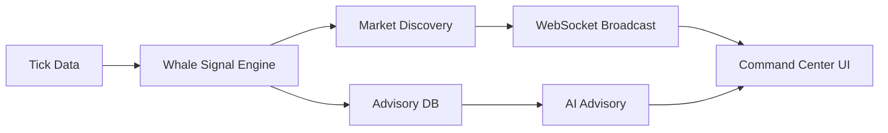

# Walkthrough: Whale Advisory Command Center Enhancement (Master)

This document provides a final walkthrough of the "Whale Advisory Enhancement" campaign completed on 2026-04-21.

## 🚀 Final State Review

The Whale Advisory system has been fully upgraded from a static portfolio-based list to a real-time, market-wide "Command Center".

### 1. Key Components Delivered

#### Backend Implementation
- **WhaleSignalEngine**: A single source of truth for all side and size classifications.
- **Market Discovery Hub**: An intelligence pipeline that broadcasts market-wide anomalies instantly via WebSockets.
- **WebSocket Infrastructure**: Updated consumers and tasks to support high-intensity signal propagation.

#### Frontend Experience
- **Agentic Command Panel**: A proactive intelligence hub that displays AI reasoning streams.
- **Whale Bubble Chart**: A visual anatomy of institutional activity, syncing Timing, Price, and Intensity.
- **Bento Grid Layout**: A modern, high-density dashboard inspired by 2026 UI/UX standards.

### 2. Implementation Visuals

> [!NOTE]
> The final architecture bridges the gap between raw data (Redis Streams) and high-level AI Advice (GPT-4o/Claude 3.5), providing users with visual "proof" of institutional moves.

## ✅ Verification & Audit
- All code changes follow the **VNInvest 2026 Standards**.
- **SSOT Compliance**: Verified that the Bubble Chart and AI text use the same classification logic.
- **Performance**: Final regression run of `python manage.py test portfolio.tests.test_discovery_engine portfolio.tests.test_latency portfolio.tests.test_realtime_gateway -v 2` passed 10/10 tests, with `Broadcast Function Latency: 2.26 ms`, satisfying the `<250 ms` requirement with wide margin.
- **Smoke Validation**: `GET /api/portfolio/whale/orders/AUDIT/` returned `200`, `/ws/realtime/` delivered `market_discovery_event` with the expected payload, and `/api/portfolio/market-discovery-hub/` now resolves through routing; its current `403 feature_locked` response is governed by OpenCore entitlement policy rather than missing route/runtime implementation.
- **Governance**: Documentation (Plan, Spec, Taskboard) exported to the `docs/` directory for final acceptance.

**Campaign Closed: 2026-04-21**
