# TECHNICAL SPECIFICATION: AI STOCK ADVISORY SSOT UPGRADE
**Kiến trúc:** SaaS Multi-Tenant & Multi-Agent Advisory  
**Đường dẫn tài liệu:** `docs/ai-ssot/TECH_SPEC_AI_STOCK_ADVISORY_SSOT_UPGRADE_20260529.md`

---

## 1. Kiến Trúc Luồng Hợp Nhất Cấu Hình (AI SSOT Context Merging)

Luồng xử lý yêu cầu tư vấn hoặc sinh tín hiệu cảnh báo AI tuân thủ nghiêm ngặt nguyên tắc Single Source of Truth (SSOT). Dưới đây là quy trình thu thập dữ liệu cấu hình, hợp nhất bối cảnh và điều phối tác nhân:

```mermaid
sequenceDiagram
    autonumber
    actor User as Client (packages/web/src)
    participant API as API Gateway (/core/v1/signals/*)
    participant View as AdvisoryRefreshView
    participant DB as Core PostgreSQL
    participant Sec as Security Engine (Fernet)
    participant Orch as AdvisoryOrchestrator
    participant Agent as Multi-Agent Core (Gemini/OpenAI)

    User->>API: Gửi yêu cầu tư vấn (symbol, session_date)
    API->>View: Điều phối đến View
    View->>DB: Lấy SystemAISettings active (Global SSOT)
    DB-->>View: Trả về Global Config (Model, Prompt Template, Temp)
    View->>DB: Lấy UserProfile của người dùng (Account SSOT)
    DB-->>View: Trả về User Config (Tenant, Preferences, BYOK Encrypted)
    
    rect rgb(25, 35, 55)
        Note over View, Sec: Giải mã bảo mật BYOK bằng Fernet
        View->>Sec: Gửi BYOK Encrypted (nếu tồn tại trong preferences)
        Sec->>Sec: Giải mã qua Fernet Key (env hoặc băm SECRET_KEY)
        Sec-->>View: Trả về Plaintext API Key (nếu hợp lệ, ném lỗi rõ ràng nếu giải mã thất bại)
    end

    rect rgb(30, 45, 70)
        Note over View: Hợp nhất bối cảnh (Effective AI Context)
        Note over View: Áp dụng Tenant Isolation dựa trên Profile.tenant_id
    end

    View->>Orch: Truyền Effective AI Context + Snapshot bối cảnh thị trường
    Orch->>Agent: Điều phối Technical, Flow, Sentiment Agents
    Agent-->>Orch: Trả về nội dung lập luận chuyên biệt
    Orch->>DB: Lưu AdvisorySession & AdvisoryComponent (TECHNICAL, WHALE, v.v.)
    Orch-->>View: Trả về kết quả hoàn chỉnh
    View-->>User: Phản hồi JSON chuẩn hợp đồng OpenAPI
```



---

## 2. Thiết Kế Backend (Backend Deep Dive)

### 2.1 Luồng Hợp Nhất & Mã Hóa BYOK Chuẩn Fernet
Hệ thống chuẩn hóa cơ chế bảo mật khóa API của người dùng (BYOK) theo **chuẩn mã hóa Fernet** (đồng bộ với cơ chế mã hóa DNSE credentials tại `identity_access/models.py:646`). 

Mã hóa Fernet đảm bảo tính an toàn cao (không lo về IV tĩnh), tự động xác thực chữ ký (authenticated cryptography) và ngăn chặn tấn công sửa đổi ciphertext. Dưới đây là thiết kế chi tiết nằm tại `packages/core/backend/src/identity_access/security.py`:

```python
import os
import base64
import hashlib
import logging
from cryptography.fernet import Fernet, InvalidToken
from django.conf import settings

logger = logging.getLogger(__name__)

def _get_fernet_key() -> bytes:
    """Trả về khóa Fernet từ biến môi trường hoặc băm url-safe base64 từ SECRET_KEY."""
    # Ưu tiên cấu hình khóa thông qua biến môi trường để đảm bảo an toàn vận hành
    key = os.environ.get('AI_CREDENTIAL_FERNET_KEY', '').strip()
    if key:
        return key.encode() if isinstance(key, str) else key
        
    # Dự phòng url-safe base64 key 32-bytes sinh tự động từ SECRET_KEY hệ thống
    h = hashlib.sha256(settings.SECRET_KEY.encode('utf-8')).digest()
    return base64.urlsafe_b64encode(h)

def encrypt_user_api_key(plain_key: str) -> str:
    """Mã hóa khóa người dùng bằng chuẩn Fernet trước khi lưu vào preferences JSON."""
    if not plain_key:
        raise ValueError('Khóa API người dùng không được để trống khi thực hiện mã hóa.')
        
    key = _get_fernet_key()
    fernet = Fernet(key)
    encrypted_bytes = fernet.encrypt(plain_key.encode('utf-8'))
    return encrypted_bytes.decode('utf-8')

def decrypt_user_api_key(encrypted_key: str) -> str:
    """Giải mã an toàn API Key phục vụ cho cuộc gọi LLM ở AdvisoryOrchestrator.
    
    Không nuốt lỗi ngầm (silent swallow) để dễ dàng phục vụ kiểm toán bảo mật.
    """
    if not encrypted_key:
        return ""
        
    key = _get_fernet_key()
    fernet = Fernet(key)
    try:
        decrypted_bytes = fernet.decrypt(encrypted_key.encode('utf-8'))
        return decrypted_bytes.decode('utf-8')
    except InvalidToken as e:
        logger.error("Giải mã API Key thất bại: Khóa giải mã hoặc chữ ký Fernet không hợp lệ.")
        raise RuntimeError("Khóa giải mã bảo mật không trùng khớp hoặc dữ liệu khóa đã bị sửa đổi.") from e
    except Exception as e:
        logger.error(f"Lỗi giải mã khóa hệ thống ngoài dự kiến: {str(e)}")
        raise RuntimeError(f"Lỗi bảo mật khi xử lý giải mã khóa: {str(e)}") from e
```

### 2.2 Tác Vụ Tự Động Reset Token Budget Định Kỳ (Rate Limiting)
Hệ thống sử dụng tác vụ Celery chạy ngầm định kỳ vào lúc **00:00 hàng ngày (múi giờ Việt Nam - UTC+7)** để đặt lại lượng token tiêu hao của **tất cả phiên và đăng ký giới hạn người dùng** trong ngày về `0`, thay vì lọc thiếu đối tượng.

Nằm tại `packages/core/backend/src/advisory/tasks.py`:

```python
from celery import shared_task
from django.utils import timezone
import logging
from advisory.models import AdvisorySession
from identity_access.models import UserProfile

logger = logging.getLogger(__name__)

@shared_task(name="advisory.reset_daily_token_budgets")
def reset_daily_token_budgets():
    """Tác vụ tự động reset lượng token tiêu hao hàng ngày về 0.
    
    Tác vụ quét qua toàn bộ các phiên hoạt động và đặt lại bộ đếm giới hạn để 
    ngăn ngừa tình trạng khóa nhầm định ngạch.
    """
    now = timezone.now()
    logger.info(f"Khởi động tác vụ đặt lại định mức tiêu hao token AI: {now}")
    
    # 1. Đặt lượng token_used của tất cả các AdvisorySession trong ngày về 0
    updated_sessions = AdvisorySession.objects.all().update(tokens_used=0)
    
    # 2. Reset các trường ghi nhận lượng tiêu hao token trong ngày của UserProfile (nếu có)
    # Ví dụ: reset trường preferences.daily_tokens_used nếu được lưu trực tiếp tại Profile
    profiles_to_reset = UserProfile.objects.filter(preferences__has_key='daily_tokens_used')
    updated_profiles = 0
    for profile in profiles_to_reset:
        profile.preferences['daily_tokens_used'] = 0
        profile.save(update_fields=['preferences'])
        updated_profiles += 1
    
    logger.info(
        f"Đặt lại định mức thành công cho {updated_sessions} phiên tư vấn "
        f"và {updated_profiles} tài khoản người dùng hoạt động."
    )
    return f"Reset {updated_sessions} sessions and {updated_profiles} profiles."
```

### 2.3 Áp Dụng Cách Ly Đa Thuê Bao (SaaS Tenant Isolation list views)
Mọi truy vấn dữ liệu cảnh báo và tín hiệu tư vấn **bắt buộc** phải áp dụng user-scoped delivery policy và tenant-aware filtering trong `packages/core/backend/src/signal_intelligence/views.py`. Trạng thái hiện tại: route + base view + test cross-tenant cho `/core/v1/signals/alert-center/feed` đã được triển khai.

```python
# Lớp AlertCenterFeedView và AIAlertsFeedView kế thừa từ lớp cha UserScopedAlertFeedBaseView
# để tái sử dụng user-scoped policy, cursor pagination và feed contract đồng bộ:

class AlertCenterFeedView(UserScopedAlertFeedBaseView):
    """API Endpoint lấy danh sách tín hiệu cảnh báo cách ly theo Tenant của người dùng.
    
    Kế thừa UserScopedAlertFeedBaseView để chuẩn hóa feed behavior.
    Tenant isolation được xác nhận qua policy + test cross-tenant bắt buộc ở gate kiểm thử.
    """
    pagination_class = AlertCenterFeedCursorPagination
```
*(Chi tiết định nghĩa lớp cha `UserScopedAlertFeedBaseView` xem trực tiếp tại `signal_intelligence/views.py`; không dùng claim line-number cố định để tránh lệch khi refactor.)*

---

## 3. Thiết Kế Frontend (Frontend Deep Dive)

Mọi tệp code frontend mới bắt buộc phải nằm hoàn toàn trong cấu trúc SaaS-native `packages/web/` thay vì thư mục `frontend/` cũ đã deprecated.

### 3.1 Cấu Phần Giao Diện Triad Glassmorphism (`AIAdvisorAlertPanel.js`)
Cấu phần hiển thị thông minh các tín hiệu AI trên Dashboard với viền đèn phát sáng neon màu thay đổi động (Neon Glow Alert Border) dựa trên mức độ cảnh báo kỹ thuật (như chỉ số RSI cực đoan) và các dòng tiền Whale Flow.

**Trạng thái hiện tại**: `AIAdvisorAlertPanel.js` đã hiện diện trong `packages/web/src/features/dashboard` và đã mount vào `packages/web/src/pages/DashboardPage.js`.
**Mục tiêu triển khai**: đoạn mã dưới đây mô tả thiết kế tham chiếu cho implementation runtime.

* **Đường dẫn tệp**: `packages/web/src/features/dashboard/AIAdvisorAlertPanel.js`

```javascript
import React from 'react';
import './AIAdvisorAlertPanel.css';

export function AIAdvisorAlertPanel({ alert, onClick }) {
  const { symbol, rsi, whale_flow_intensity, urgency_level } = alert;

  // Xác định màu sắc Neon động dựa trên chỉ số kỹ thuật RSI từ Server-side
  let glowClass = 'glow-normal';
  if (rsi <= 30) {
    glowClass = 'glow-oversold'; // Xanh ngọc lục bảo nhấp nháy (Oversold - Buy Strength)
  } else if (rsi >= 70) {
    glowClass = 'glow-overbought'; // Đỏ hồng cực đoan nhấp nháy (Overbought - Take Profit)
  }

  return (
    <article 
      className={`ai-alert-card ${glowClass}`} 
      onClick={() => onClick(symbol)}
      role="button"
      tabIndex={0}
    >
      <div className="ai-alert-card__header">
        <span className="ai-alert-card__badge">{urgency_level}</span>
        <strong className="ai-alert-card__symbol">{symbol}</strong>
      </div>
      
      <div className="ai-alert-card__body">
        <p className="ai-alert-card__desc">{alert.description_vi}</p>
        
        {/* Algo Breakdown: Hiển thị trực quan tham số thuật toán từ server */}
        <div className="algo-breakdown">
          <div className="algo-breakdown__metric">
            <span className="label">Chỉ số RSI:</span>
            <span className={`value ${rsi <= 30 ? 'text-green' : rsi >= 70 ? 'text-red' : ''}`}>{rsi}</span>
          </div>
          <div className="algo-breakdown__metric">
            <span className="label">Cường độ Whale Flow:</span>
            <span className="value">{whale_flow_intensity} triệu VNĐ</span>
          </div>
        </div>
      </div>
    </article>
  );
}
```

* **Đường dẫn tệp CSS**: `packages/web/src/features/dashboard/AIAdvisorAlertPanel.css`

```css
.ai-alert-card {
  background: rgba(15, 23, 42, 0.65);
  border: 1.5px solid rgba(255, 255, 255, 0.08);
  border-radius: 20px;
  padding: 18px;
  backdrop-filter: blur(16px);
  cursor: pointer;
  transition: all 0.3s cubic-bezier(0.4, 0, 0.2, 1);
}

/* Các lớp Neon Glow nhấp nháy cực kỳ premium */
.glow-oversold {
  border-color: rgba(34, 197, 94, 0.4);
  box-shadow: 0 0 15px rgba(34, 197, 94, 0.15);
  animation: pulse-emerald 2s infinite ease-in-out;
}

.glow-overbought {
  border-color: rgba(239, 68, 68, 0.4);
  box-shadow: 0 0 15px rgba(239, 68, 68, 0.15);
  animation: pulse-rose 2s infinite ease-in-out;
}

@keyframes pulse-emerald {
  0% { box-shadow: 0 0 8px rgba(34, 197, 94, 0.12); }
  50% { box-shadow: 0 0 20px rgba(34, 197, 94, 0.32); border-color: rgba(34, 197, 94, 0.6); }
  100% { box-shadow: 0 0 8px rgba(34, 197, 94, 0.12); }
}

@keyframes pulse-rose {
  0% { box-shadow: 0 0 8px rgba(239, 68, 68, 0.12); }
  50% { box-shadow: 0 0 20px rgba(239, 68, 68, 0.32); border-color: rgba(239, 68, 68, 0.6); }
  100% { box-shadow: 0 0 8px rgba(239, 68, 68, 0.12); }
}
```

### 3.2 Logic Tính Toán Icon Cá Mập 10% Trong Viewport
* **Đường dẫn hook**: `packages/web/src/features/stock-detail/hooks/useViewportWhaleMarkers.js`

**Trạng thái hiện tại**: hook và test đi kèm đã có trong codebase, đồng thời đã được wire vào runtime chart tại `packages/web/src/components/VNStockChartPanel.js`.

```javascript
import { useMemo } from 'react';

/**
 * Hook tùy biến tính toán các vị trí gán nhãn Icon Cá mập (Whale Marker)
 * chỉ áp dụng cho top 10% nến có lượng volume Whale lớn nhất ĐANG hiển thị trong khung nhìn.
 * 
 * @param {Array} allCandles - Toàn bộ chuỗi nến lịch sử tải về.
 * @param {number} startIndex - Chỉ số nến bắt đầu hiển thị trong viewport hiện tại.
 * @param {number} endIndex - Chỉ số nến kết thúc hiển thị trong viewport hiện tại.
 * @returns {Set<string>} Tập hợp các timestamp của nến được hiển thị Icon Cá mập.
 */
export function useViewportWhaleMarkers(allCandles, startIndex, endIndex) {
  return useMemo(() => {
    if (!allCandles || allCandles.length === 0) return new Set();

    // Bước 1: Trích xuất chính xác các nến đang hiển thị trong khung nhìn (Viewport)
    const start = Math.max(0, startIndex);
    const end = Math.min(allCandles.length - 1, endIndex);
    const visibleCandles = allCandles.slice(start, end + 1);

    if (visibleCandles.length === 0) return new Set();

    // Bước 2: Sắp xếp các nến đang hiển thị theo lượng volume Whale giảm dần
    const sortedByWhaleVolume = [...visibleCandles].sort(
      (a, b) => (b.whale_volume || 0) - (a.whale_volume || 0)
    );

    // Bước 3: Xác định ngưỡng 10% nến có volume lớn nhất
    const topTenPercentCount = Math.max(1, Math.ceil(visibleCandles.length * 0.1));
    const targetWhaleTimestamps = new Set(
      sortedByWhaleVolume.slice(0, topTenPercentCount).map((c) => c.timestamp)
    );

    return targetWhaleTimestamps;
  }, [allCandles, startIndex, endIndex]);
}
```
