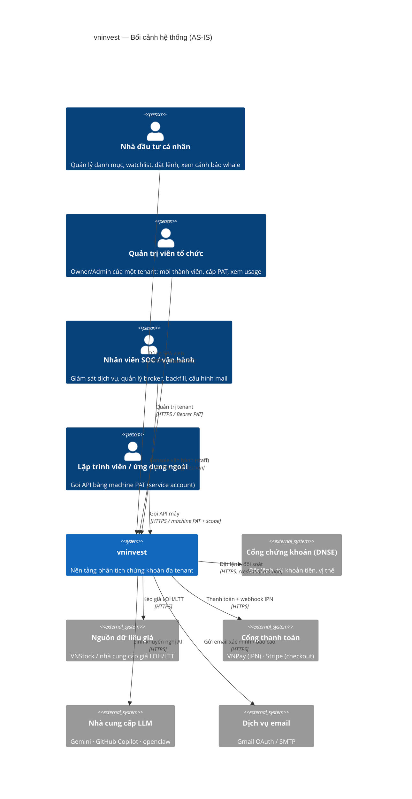
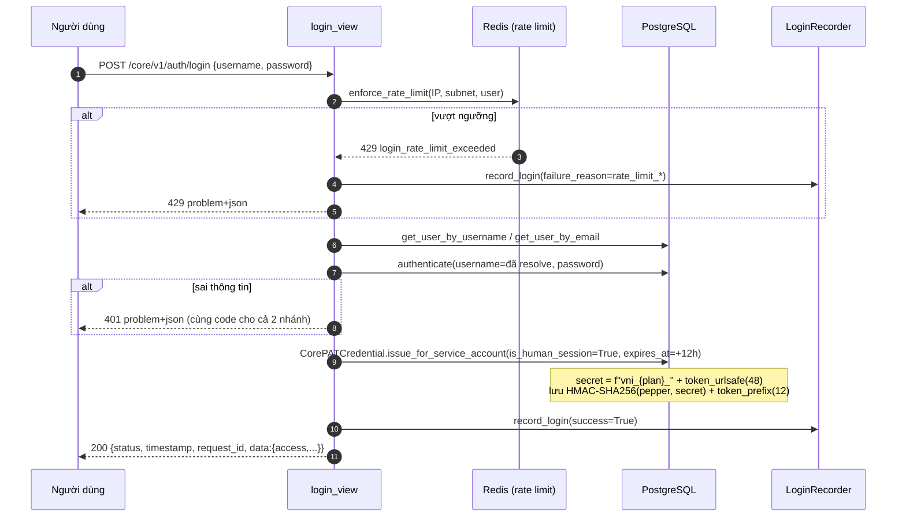
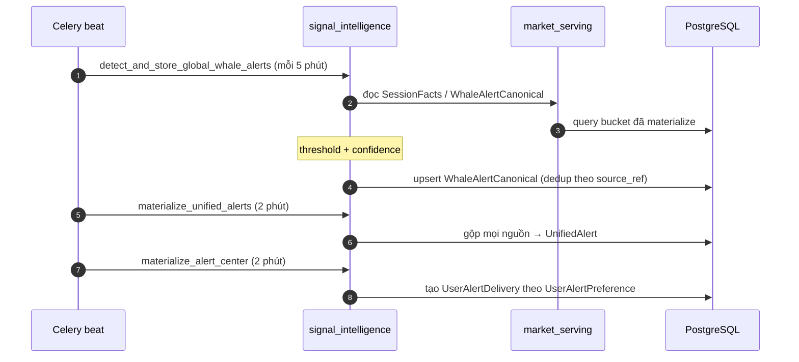
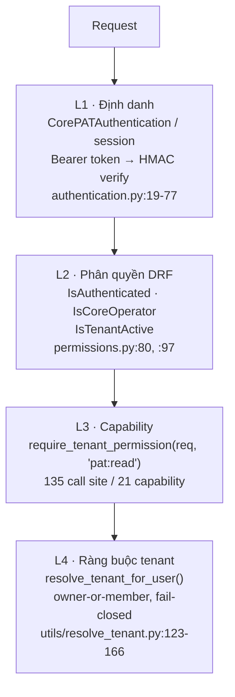

# D01 (AS-IS) — Bối cảnh hệ thống, Phân rã chức năng & Audit

> **Bản AS-IS.** Mô tả `vninvest` **đang chạy** như thế nào, đọc từ mã nguồn.
> Bản TO-BE (thiết kế port) nằm ở `docs/saas_design_pack/` — **đọc mục 0 của
> `docs/architecture/README.md` trước khi dùng.**
>
> Đo tại `0ee1b8b4b`, 2026-10-03. Mọi khẳng định có `path:line`.

---

# PHẦN 1 — TỔNG QUAN HỆ THỐNG

## 1.1 Mục tiêu và phạm vi

`vninvest` là **nền tảng SaaS phân tích chứng khoán Việt Nam**, tự phục vụ
(cả khách hàng và nội bộ vận hành), gồm ba miềng chức năng:

| Miền | Mô tả | App chủ trì (số model) |
|---|---|---|
| **Dữ liệu thị trường** | Thu thập giá, dựng snapshot/bucket session, phát hiện sự kiện (whale, order-flow, anomaly) | `market_data` (8), `market_serving` (3), `data_ingest` (2), `signal_intelligence` (7) |
| **Danh mục & vận hành giao dịch** | Portfolio, giao dịch, ledger, watchlist, cảnh báo giá, quản lý tài khoản, đặt lệnh qua broker | `user_workspace` (19) |
| **Đa tenant, định danh & thuê bao** | Tenant, PAT, thành viên, phân quyền, hạn mức, hoá đơn, vòng đời, AI | `identity_access` (24), `commercial` (6), `tenant_lifecycle` (1), `advisory` (6), `ai_analytics` (2), `ai_agents` (1), `support` (5), `advertising` (5), `ops_audit` (3), `service_ops` (15) |

**Kiến trúc thực tế: Modular Monolith** — một tiến trình Django duy nhất, 15 app
Django tách theo miền, một PostgreSQL duy nhất, một Redis duy nhất làm broker
Celery. Xem `D02` (Lượt 2) cho C4 container/component.

**Không phải** microservice: không có service nào được tách tiến trình. `service_ops`
(26.553 dòng, app lớn nhất) vẫn chạy trong cùng container với `identity_access`.

## 1.2 High-Level System Context (C4 — Mức C1)

**Bằng chứng actor trong code:**
- Machine PAT: `identity_access/views_tenant.py:49-51` (`PARTNER_SCOPE_MANAGE_TENANT` /
  `MANAGE_SERVICE_ACCOUNTS` / `MANAGE_PATS`), `identity_access/models.py:292`
  (`is_human_session` phân biệt người/máy).
- SOC: `identity_access/permissions.py:80` `IsCoreOperator`; mount tại
  `vninvest_core/urls.py:51` (`core/v1/operator/`), `:66` (`api/soc/`).
- Broker: `identity_access/models.py:961` `SystemBrokerCredential` (secret `BinaryField`),
  `user_workspace/models.py:519` `UserBrokerConfig`.
- Thanh toán: `commercial/models.py:118` `VNPayIPNLog`; Stripe ở
  `identity_access/models.py:100-104` (`stripe_customer_id`…).
- LLM: `advisory/models.py:233` `UserAICredential`.
- Email: `identity_access/models.py:1066` `SystemMailConfig`.

## 1.3 Bảng thuật ngữ & thực thể miền

| Thuật ngữ | Bảng / Model | Nghĩa | Vị trí |
|---|---|---|---|
| **Tenant** | `identity_access_coretenant` | Đơn vị cô lập dữ liệu; chủ sở hữu tiền mặt và dữ liệu | `identity_access/models.py:44` |
| **Service Account** | `identity_access_coreserviceaccount` | Máy/robot được tenant cấp `scopes` (JSON) | `identity_access/models.py:180` |
| **PAT** | `identity_access_corepatcredential` | Token cá nhân, HMAC-SHA256 + pepper, có thời hạn | `identity_access/models.py:254` |
| **Human session PAT** | cột `is_human_session` | PAT do đăng nhập web sinh; mặc định 12h | `models.py:292`; TTL `views/helpers.py:43-56` |
| **Tenant Member** | `identity_access_tenantmember` | Người dùng trong tenant, role `owner/admin/editor/viewer` | `models.py:596` |
| **Custom Role** | `identity_access_tenantcustomrole` | Bộ `permissions` (JSON) do tenant tự định nghĩa | `models.py:545` |
| **Capability** | *(không có bảng)* | Chuỗi `domain:action` kiểm quyền; **21 giá trị, 135 call site** | §2.3 |
| **Quota** | `commercial_quotarecord`, `commercial_quotahistory` | Hạn mức theo kỳ; `-1` = không giới hạn | `commercial/models.py:38,133` |
| **Plan** | *(không có bảng)* | Chuỗi `free`/`pro`…; entitlement nằm trong dict Python | `commercial/plan_catalog.py:62` |
| **Ledger** | `user_workspace_ledgerentry` + `user_workspace_cashflow` | Sổ cái append-only, tách khỏi `Transaction` | `user_workspace/models.py:1040,1211` |
| **Symbol Snapshot** | `market_serving_symbolsnapshot` | Ảnh chụp trạng thái mã tại thời điểm | `market_serving/models.py:12` |
| **Session Facts** | `market_serving_sessionfacts` | Sự kiện trong phiên giao dịch đã tổng hợp | `market_serving/models.py:69` |
| **Whale Alert** | `signal_intelligence_whalealertcanonical` | Cảnh báo biến động lớn (đã chuẩn hoá) | `signal_intelligence/models.py:76` |
| **Unified Alert** | `signal_intelligence_unifiedalert` | Cảnh báo hợp nhất từ mọi nguồn | `signal_intelligence/models.py:15` |
| **Outbox Event** | `core_outbox_event` + `core_processed_event` | Transactional outbox chống gửi trùng | `identity_access/models.py:1287,1316` |
| **SLA/P0 event** | `ops_audit_auditevent` | Nhật ký kiểm toán; `action` max **16 ký tự** | `ops_audit/models.py:25` |

> **Điểm đáng chú ý về mô hình dữ liệu:** `Plan` và `Capability` **không có bảng**.
> Chúng là dict trong Python (`commercial/plan_catalog.py:62`) và chuỗi rời rạc
> trong view. Hệ quả ở F-06.

---

# PHẦN 2 — NGHIỆP VỤ & PHÂN RÃ CHỨC NĂNG

## 2.1 Phân rã chức năng (FBD)

```mermaid
flowchart TD
    ROOT["vninvest — SaaS chứng khoán"]

    ROOT --> M1["1. Định danh & Đa tenant<br/>identity_access"]
    ROOT --> M2["2. Dữ liệu thị trường<br/>data_ingest · market_data · market_serving"]
    ROOT --> M3["3. Tín hiệu & Cảnh báo<br/>signal_intelligence · advisory"]
    ROOT --> M4["4. Danh mục & Giao dịch<br/>user_workspace"]
    ROOT --> M5["5. Thuê bao & Thanh toán<br/>commercial · tenant_lifecycle"]
    ROOT --> M6["6. Vận hành & Kiểm toán<br/>service_ops · ops_audit"]
    ROOT --> M7["7. Nền tảng chung<br/>vninvest_core"]

    M1 --> M11["1.1 PAT & Service Account"]
    M1 --> M12["1.2 Đăng nhập / refresh / logout"]
    M1 --> M13["1.3 Thành viên & Custom Role"]
    M1 --> M14["1.4 Mời thành viên (invite)"]
    M1 --> M15["1.5 Cấu hình tenant (settings/SSO/alerts)"]
    M1 --> M16["1.6 Credential broker & DNSE"]

    M2 --> M21["2.1 Thu thập giá (beat)"]
    M2 --> M22["2.2 Backfill lịch sử"]
    M2 --> M23["2.3 Materialize snapshot / bucket"]
    M2 --> M24["2.4 Đăng ký mã toàn cục"]

    M3 --> M31["3.1 Phát hiện whale / order-flow / anomaly"]
    M3 --> M32["3.2 Hợp nhất cảnh báo"]
    M3 --> M33["3.3 Gửi cảnh báo cho người dùng"]
    M3 --> M34["3.4 Khuyến nghị AI"]

    M4 --> M41["4.1 Portfolio & Giao dịch"]
    M4 --> M42["4.2 Ledger & Tiền mặt"]
    M4 --> M43["4.3 Watchlist & Cảnh báo giá"]
    M4 --> M44["4.4 Tài khoản con (subaccount)"]
    M4 --> M45["4.5 Kết nối broker & Đặt lệnh"]
    M4 --> M46["4.6 Bộ lọc cổ phiếu (screener)"]
    M4 --> M47["4.7 Định giá danh mục"]

    M5 --> M51["5.1 Gói & Hạn mức"]
    M5 --> M52["5.2 Hoá đơn & Thanh toán"]
    M5 --> M53["5.3 Vòng đời trial / suspend / deprovision"]

    M6 --> M61["6.1 Định nghĩa & health dịch vụ"]
    M6 --> M62["6.2 Ma trận scrape & backfill"]
    M6 --> M63["6.3 Nhật ký kiểm toán & rollup API"]
    M6 --> M64["6.4 Email cấu hình động"]

    M7 --> M71["7.1 Exception RFC 9457"]
    M7 --> M72["7.2 Envelope {data, meta}"]
    M7 --> M73["7.3 Celery & queue policy"]
    M7 --> M74["7.4 Health · metrics · logging"]
```

## 2.2 Các luồng nghiệp vụ phức tạp

### UC-01 — Đăng nhập và phát hành human-session PAT

- **Trigger:** `POST /core/v1/auth/login`
- **Pre:** `username` + `password` khác rỗng (`views/login.py:51-55`)
- **Post:** trả `success_response(...)` — F3 phẳng `{status, timestamp, request_id, data}`
  (`views/helpers.py:327-338`); client lưu `data.access`

| Bước | Xử lý | Fail-closed? | Vị trí |
|---|---|---|---|
| 1 | Chuẩn hoá input, nếu chứa `@` thì tra email → username | — | `login.py:62-66` |
| 2 | **3 tầng chống brute-force**: IP 5/phút · subnet 15/phút · user 3/phút | Có | `login.py:96-120`; ngưỡng `vninvest_core/settings.py:903-905` |
| 3 | `authenticate()` — truyền **username đã resolve**, không phải input thô | — | `login.py:134-138` |
| 4 | Phân biệt "sai mật khẩu" vs "tài khoản không tồn tại" | Có (cùng mã lỗi) | `login.py:139+` |
| 5 | Tạo PAT `is_human_session=True`, TTL 12h | — | `login.py:205-213`; TTL `views/helpers.py:43-56` |
| 6 | Ghi `LoginRecorder` | — | `login.py:205` |

**Ngoại lệ cần biết:**
| Trường hợp | HTTP | Vị trí |
|---|---|---|
| Thiếu username/password | 400 | `login.py:51-55` |
| Quá ngưỡng IP/subnet/user | 429 | `login.py:96-120` |
| Sai mật khẩu **hoặc** không tồn tại | 401 (giống nhau) | `login.py:139+` |
| `refresh` token không hợp lệ/hết hạn | 401 | `login.py:232-235` |

### UC-02 — Đối chiếu hạn mức (quota)

- **Trigger:** mọi request API có PAT
- **Bộ đếm:** `CoreTenant.api_calls_used` (mặc định `10000`) — `identity_access/models.py:107-108`
- **Kỳ hạn mức:** `commercial_quota_record` theo `(tenant, period_start, period_end)` —
  `unique_together` tại `commercial/models.py:55`
- **Lịch sử:** beat `flush-quota-counters` + `snapshot-quota-history` (`vninvest_core/settings.py:485-494`)

| Bước | Xử lý | Vị trí |
|---|---|---|
| 1 | Middleware tăng bộ đếm theo kỳ hiện tại | `commercial/quota_period.py` |
| 2 | Vượt `api_calls_limit` ⇒ `429` + trạng thái tenant | `tenant_lifecycle/tasks.py` `auto_suspend_quota_overflow` (`vninvest_core/settings.py:525-529`) |
| 3 | Lịch sử theo meter lưu `commercial_quotahistory` | `commercial/models.py:133-159` |
| 4 | Dự báo cạn kiệt | `views_forecast.py:20-95` (`_forecast_meter`) |

> **[CHƯA XÁC MINH]** Vị trí chính xác nơi tăng bộ đếm mỗi request: đã xác nhận có
> `commercial/quota_period.py` nhưng chưa truy hết call chain từ middleware tới
> `api_calls_used`. Sẽ khép lại ở Lượt 2.

### UC-03 — Phát hiện cảnh báo whale

- **Trigger:** beat `detect-whale-alerts-5m` (`vninvest_core/settings.py:768-772`)
- **Đầu ra:** `WhaleAlertCanonical` → `UnifiedAlert` → `UserAlertDelivery`

**Điểm cần biết:** beat chạy theo chu kỳ (**eventual consistency**), không phải
real-time. Độ trễ tối đa ≈ 5 phút cho phát hiện + 2 phút hợp nhất. Xem F-13.

### UC-04 — Đặt lệnh qua broker

- **Trigger:** `POST /core/v1/broker/dnse/...` (`user_workspace/views_dnse.py`)
- **Pre:** `UserBrokerConfig` + `DNSECredential` (Fernet) — `user_workspace/models.py:460,519`
- **Post:** ghi ledger + `ops_audit.AuditEvent` + `IdempotencyRecord`

| Bước | Xử lý | Vị trí |
|---|---|---|
| 1 | Giải mã credential (Fernet, `DNSE_CREDENTIAL_FERNET_KEY`) | `identity_access/models.py:961-980` |
| 2 | Kiểm tra idempotency | `user_workspace/models.py:1387` (`IdempotencyRecord`) |
| 3 | Gọi broker qua egress được kiểm soát | `service_ops/broker_runtime.py` |
| 4 | Ghi audit — **`action` chỉ 16 ký tự** | `ops_audit/models.py:25` |
| 5 | Cập nhật ledger append-only (trigger DB) | `user_workspace/migrations/0023_append_only_guards.py:41-45` |

> **Lỗi đã được vá — không phải bug sống.** `action = 'broker.place_order'` dài 18
> ký tự > `max_length=16` ⇒ `DataError`. Vá: đặt chuỗi vào `metadata['operation']`,
> `action` dùng giá trị hợp lệ. Ghi chú tại `user_workspace/views_dnse.py:210-213`.
> **Ràng buộc gốc vẫn còn** (`max_length=16`) và là điểm dễ tái phát — xem F-11.

## 2.3 Ma trận phân quyền (RBAC)

### 2.3.1 Ba lớp kiểm quyền (đúng thứ tự)

### 2.3.2 Ma trận role ↔ nhóm chức năng

`permissions.py` chỉ có **2** lớp DRF (`IsCoreOperator:80`, `IsTenantActive:97`);
phân quyền thật là capability gọi tay trong từng view. Role lấy từ
`TenantMember.RoleChoices` (`identity_access/models.py:625-630`):

| Role | PAT `manage_tenant` | `manage_service_accounts` | `manage_pats` | Hạn mức/usage | Ghi chú |
|---|---|---|---|---|---|
| `owner` | ✅ | ✅ | ✅ | ✅ | `resolve_tenant.py:157-158` |
| `admin` | theo custom role | theo custom role | theo custom role | theo custom role | `TenantCustomRole.permissions` JSON |
| `editor` | ❌ | ❌ | ❌ | ❌ | Không có credential broker |
| `viewer` | ❌ | ❌ | ❌ | chỉ đọc | |

### 2.3.3 Danh mục capability (21 giá trị, 135 call site)

| Capability | Số call site | Ví dụ vị trí |
|---|---|---|
| `billing:read` | 14 | `identity_access/commercial_partner_views.py:50` |
| `settings:write` | 14 | `identity_access/views_tenant.py:669` |
| `webhook:write` | 12 | `identity_access/views_webhooks.py:64` |
| `usage:read` | 10 | `identity_access/views_usage.py:48` |
| `report:write` / `report:read` | 8 / 6 | `views_reports.py:53` / `:43` |
| `pat:write` / `pat:read` | 8 / 5 | `views_tenant.py:255` / `:244` |
| `billing:write` | 6 | `commercial_partner_views.py:217` |
| `member:write` / `member:read` | 6 / 4 | `tenant_member_views.py:78` / `:54` |
| `webhook:read` | 6 | `views_webhooks.py:54` |
| `security:read` | 6 | `views_security.py:55` |
| `alert:write` | 4 | `views_alert_config.py:53` |
| `dashboard:read` | 4 | `views_dashboard.py:70` |
| `forecast:write` | 4 | `views_forecast.py:106` |
| `sa:read` / `sa:write` | 4 / 3 | `views_tenant.py:177` / `:183` |
| `sso:read` / `sso:write` | 4 / 4 | `views/sso.py:92` / `:102` |
| `tenant:write` | 3 | `views_tenant.py:166` |

**Và 3 scope riêng cho partner PAT** (biến, không phải capability):
`manage_tenant` / `manage_service_accounts` / `manage_pats` —
`views_tenant.py:49-51`.

### 2.3.4 Actor / Persona

| Persona | Cách định danh | Không gian | Bằng chứng |
|---|---|---|---|
| Chủ tenant | `owner_user` trên `CoreTenant` | `/core/v1/**` | `models.py:67-72` |
| Thành viên | `TenantMember.role` | `/core/v1/**` | `models.py:596` |
| Ứng dụng máy | `CoreServiceAccount` + PAT `is_human_session=False` | `/core/v1/partner/**` | `models.py:180,292` |
| Nhân viên SOC | `IsCoreOperator` (staff) | `/core/v1/operator/**`, `/api/soc/**` | `permissions.py:80` |
| Web tĩnh (không đăng nhập) | `AllowAny` | `/api/auth/**` | `views/auth.py` |

---

# PHẦN 6 — BÁO CÁO AUDIT & ĐÁNH GIÁ NỢ KỸ THUẬT

## 6.0 Tóm tắt điều hành

`vninvest` là một **modular monolith có chất lượng nghiệp vụ cao nhưng đồng nhất kiến trúc thấp**.
Điểm mạnh thật sự: cô lập tenant **fail-closed ở tầng resolver**
(`utils/resolve_tenant.py:123-166`) và hợp đồng lỗi chuẩn RFC 9457
(`exceptions.py:606-711`). Điểm yếu cấu trúc: **cô lập tenant không được ORM enforce**,
**246/1.029 route trùng**, **8 compose stack mâu thuẫn**, và **logging chạy ở mức WARNING**
nên mọi log INFO/DEBUG trong ứng dụng đang bị **vứt bỏ**.

**Bảng điểm nhanh** (đánh giá của agent, cần Owner phản biện):

| Hạng mục | Điểm /10 | Lý do |
|---|---|---|
| Mô hình miền & tách app | 7 | 15 app rõ ranh giới, nhưng `service_ops` 26.5k dòng |
| Cô lập tenant | **4** | Resolver đúng, nhưng 16 call site `if tenant:` ⇒ fail-open |
| An toàn thông tin | 6 | PAT pepper + rate limit 3 tầng tốt; health endpoint không probe |
| Hiệu năng | 4 | N+1 trong view, `DailyPrice` aggregate không lọc |
| Khả năng vận hành | **3** | 8 compose stack, CI tắt, log root=WARNING |
| Nhất quán tài liệu | 2 | Hai bộ tài liệu trái hướng, không index |

## 6.1 Điểm không chuẩn mực so với chuẩn công nghiệp

| # | Vấn đề | Bằng chứng | Ảnh hưởng |
|---|---|---|---|
| N-01 | **Cô lập tenant theo convention, không enforce ở tầng ORM** | Không tồn tại `ScopedManager`/`ScopedQuerySet` (grep toàn `src/` → 0 match); `db_router.py:15-36` chỉ route database, không route tenant | Một view quên filter là lộ dữ liệu chéo tenant |
| N-02 | **16 call site `if tenant:` ⇒ fail-open** | `user_workspace/views.py` **14 chỗ** (dòng 62, 74, 87, 102, 245, 276, 382, 397, 404, 426, 459, 509, 541, 564); `support/views.py:412-413` | Xem F-01/F-02 |
| N-03 | **246/1.029 route trùng (23,9 %)** | `vninvest_core/urls.py:46` mount `partner_urls` tại `core/v1/` **và** `identity_access/urls.py:78` mount lại tại `core/v1/partner/` ⇒ sinh `/core/v1/partner/partner/**` | Có cây URL ma, docs sai, `reverse()` mơ hồ |
| N-04 | `ops_audit.urls` mount **hai lần** cùng prefix | `vninvest_core/urls.py:50` **và** `identity_access/urls.py:87` | 3 route trùng tên `audit-log-list` |
| N-05 | **8 compose stack cho một codebase** | 5 file root + `packages/core/docker-compose.core.yml` + `packages/opencore/…` + `packages/vip-app/…` | Không biết stack nào là thật |
| N-06 | `core.yml` **mount source + `pip install` mỗi lần boot**, ngược `Dockerfile:4` ("No source mounts") | `packages/core/docker-compose.core.yml:22,25,41` | Phá vỡ bất biến production, chậm, không tái lập |
| N-07 | **Log root = WARNING** ⇒ mất toàn bộ INFO/DEBUG | `vninvest_core/settings.py:835-838` | Không chẩn đoán được sự cố dữ liệu |
| N-08 | `api_stub.py` mặc định **staff + superuser = True** | `vninvest_core/api_stub.py:33-34` | Nếu ai chạy nhầm console script → trả quyền admin |
| N-09 | `pyproject.toml` vẫn publish stub làm **console script chính thức** | `packages/core/pyproject.toml:20-23` | `pip install vninvest-core` cho worker/beat **no-op** |
| N-10 | Health endpoint **tĩnh**, không probe DB/Redis | `vninvest_core/views_health.py:12-17` (`status:'ok'` là hằng số) | Container "healthy" dù Postgres chết |
| N-11 | `capability_bootstrap` có `snapshot_version` hardcode | `views_health.py:24` (`'2026-05-03'`) | FE điều hướng theo snapshot cũ |
| N-12 | `plan` là CharField không FK; entitlement trong dict Python | `commercial/models.py:23`, `identity_access/models.py:80-85`, `commercial/plan_catalog.py:62` | Drift: đổi plan không được kiểm bởi DB. Repo **tự thừa nhận** còn 2 bảng quyền trùng: `plan_catalog.py:8-12` |
| N-12b | **`api_calls_limit` mặc định 10000, catalog nói `free` = 1.000** | `identity_access/models.py:107` vs `commercial/plan_catalog.py:64` | Tenant `free` mới được **10.000** lượt thay vì 1.000 ⇒ F-14 |
| N-13 | `ai_analytics` **không có cột tenant**, chỉ `user` | `ai_analytics/models.py:12,39` | Không quy usage theo tenant dù meter thì theo tenant |
| N-14 | `TenantInvite.expires_at` NOT NULL **không default** | `identity_access/models.py:725` | Code tạo invite thiếu field ⇒ `IntegrityError` |
| N-15 | Migration `9000_…` dùng `array_agg` của Postgres | `identity_access/migrations/9000_auth_user_email_ci_unique.py:40` | BE test **không chạy được trên SQLite** |
| N-16 | Migration `0011_enforce_tenant_not_null_real.py` **không enforce gì** | Toàn bộ là `AlterField` trên `SystemMailConfig` (`:13-77`) | Tên file gây hiểu nhầm là đã bảo vệ |
| N-17 | Beat entry `ingest-daily-prices-1705` bị `enabled: False` | `vninvest_core/settings.py:749-755` | Job chết âm thầm |
| N-18 | Hai `core-redis` khác persistence | `docker-compose.yml:42` (`appendonly yes`) vs `packages/core/docker-compose.core.yml:17` (`--save ""`) | Mất hàng đợi Celery khi restart |
| N-19 | **`frontend/` không track nhưng còn 56.208 file** trên đĩa | `git ls-files frontend` → 1 file | Nhầm lẫn khi người mới đọc repo |
| N-20 | ~30 script `.py` rải ở thư mục gốc | `audit_prod_data.py`, `debug_*.py`, `fix_*.py`, `test_*.py`… | Không biết script nào còn dùng |

## 6.2 Rủi ro bảo mật, hiệu năng, khả năng mở rộng

### 6.2.1 Bảo mật

| ID | Mức | Phát hiện | Bằng chứng | Khuyến nghị |
|---|---|---|---|---|
| **F-01** | **P0** | `support/views.py` lọc tenant **chỉ khi có** `request.tenant` | `support/views.py:405` (`IsAuthenticated, IsStaffUser`), `:411-413` `SupportTicket.objects.all()` → `if tenant: …filter` | Khi `tenant is None` ⇒ **trả ticket của mọi tenant**. Phạm vi: **staff**. Sửa: nếu `tenant is None` trả `qs.none()` (như `ops_audit/views.py:37-47` đã làm đúng) |
| **F-02** | **P0** | 14 chỗ `if tenant: … else: …` trong `user_workspace` | `views.py:62-65, 74-77, 87-88` (+11 chỗ) | Người dùng thuộc 2 tenant: `tenant is None` ⇒ đọc/ghi được **object của tenant khác** qua user scope. Sửa: bắt buộc tenant, hoặc `ScopedManager` |
| **F-03** | P1 | `ops_audit.tenant_id` là `CharField`, không FK | `ops_audit/models.py:24,52,75` | Mất referential integrity, còn orphan sau khi xoá tenant |
| **F-04** | P1 | `VNPayIPNLog` không FK tenant, `txn_ref` không unique | `commercial/models.py:118-124` | Không phát hiện replay IPN thanh toán |
| **F-05** | P1 | `SupportTicket.tenant` khai `null=False, blank=True` | `support/models.py:48-54` | Mâu thuẫn: form cho phép, DB từ chối |
| **F-06** | P1 | `Plan` không có bảng; entitlement trong dict | `commercial/plan_catalog.py:62` | Không có FK ⇒ không thể query "tenant nào đang ở plan X" bằng SQL |
| **F-07** | P1 | Health check không probe phụ thuộc | `views_health.py:12-17`; compose dùng `condition: service_healthy` (`docker-compose.dev.yml:106-111`) | Orchestrator tưởng sống khi DB đã chết |
| **F-08** | P1 | `api_stub` mặc định superuser | `api_stub.py:33-34` | Xoá console script khỏi `pyproject.toml:20-23` |
| **F-09** | P2 | `mark_rotating` khai **hai lần**, bản sau đè bản trước | `identity_access/models.py:385-391` và `:406-420` | Bản `:385` là code chết (tham số positional khác kiểu). Xoá bản `:385` |
| **F-10** | P2 | `TrackedSymbol.unique_together` bỏ qua `tenant` | `user_workspace/models.py:302` | User thuộc 2 tenant không track được cùng 1 mã lần 2 |
| **F-11** | P2 | `AuditEvent.action` `max_length=16` | `ops_audit/models.py:25` | **Đã có sự cố thật và đã vá** bằng cách chuyển sang `metadata['operation']` (`views_dnse.py:210-213`). Ràng buộc gốc **còn nguyên** ⇒ tái phát dễ. Sửa: nới `max_length` + thêm guard test |
| **F-12** | P2 | `ServiceRunLog.celery_task_id` không unique | `service_ops/models.py:199` | Retry sinh dòng trùng |
| **F-13** | **P1** | **`features_map` thiếu `custom` và `internal`** ⇒ tenant thương lượng bị coi là `free` | `identity_access/views_webhooks.py:240-245` chỉ có 4 plan (`free/starter/pro/enterprise`); `:247` `features_map.get(tenant.plan, features_map['free'])` | Tenant `custom`/`internal` (`plan_catalog.py:103-124` — UNLIMITED) nhận **bản xem trước nâng cấp tính bằng `free`**. Tính sai, hiển thị sai cho khách trả tiền. Sửa: dùng `get_plan_entitlement()` |
| **F-14** | **P1** | **`CoreTenant.api_calls_limit` mặc định 10000, catalog nói `free` = 1.000** | `identity_access/models.py:107` (`default=10000`) vs `commercial/plan_catalog.py:64` (`"free": {"api_calls": 1_000}`) | Tenant `free` mới tạo được **10.000** lượt thay vì 1.000 cho tới khi có job sync chạy. Sửa: `default` phải lấy từ catalog, hoặc thêm migration |
| **F-15** | P2 | Còn **2 bảng quyền trùng** bên cạnh catalog | `plan_catalog.py:8-12` **tự thừa nhận**; `views/helpers.py:137-143` `_paid_plans` (**nội dung hiện khớp** `PAID_PLAN_CODES` `plan_catalog.py:134`) và `views_webhooks.py:240` `features_map` (**lệch**) | Nợ đã được ghi nhận trong code nhưng chưa đóng. Ưu tiên `features_map` (F-13) |

**Điểm tốt cần ghi nhận (không nên phá khi refactor):**
- PAT lưu HMAC-SHA256 + pepper; `CORE_PAT_PEPPER` **bắt buộc** khi không DEBUG
  (`vninvest_core/settings.py:55-60`, `env_validation.py:116`).
- Rate limit đăng nhập 3 tầng IP/subnet/user (`vninvest_core/settings.py:903-905`) qua `get_client_ip()`
  chỉ tin `X-Forwarded-For` khi socket peer là proxy tin cậy.
- Lỗi trả **RFC 9457** `application/problem+json`, **không** bọc envelope
  (`exceptions.py:606-711`).

### 6.2.2 Hiệu năng

| ID | Vấn đề | Bằng chứng |
|---|---|---|
| **P-01** | **N+1 nặng nhất**: `GET /api/soc/dataops/inventory/` lặp 6 nhóm + mọi `CustomSymbolGroup`, mỗi vòng gọi provider + 3 aggregate trên `DailyPrice` | `service_ops/views/dataops_inventory.py:49-83`; aggregate không lọc `:25-28` |
| **P-02** | 4 view SSE chặn request bằng `time.sleep` | `service_ops/views/overview_stream.py:186`, `views/signals_stream.py:268`, `views/dataops_stream.py:135`, `signal_intelligence/views.py:885` |
| **P-03** | N+1 do thiếu `select_related` | `service_ops/views/overview.py:280`, `service_ops/ownership.py:161` (**quét cả bảng**) |
| **P-04** | `.iterator()` chỉ dùng ở **10** chỗ toàn repo | dùng đúng ở `service_ops/tasks.py:249`, `identity_access/tasks.py:522`… |
| **P-05** | Migration backfull-scan trong 1 transaction | `user_workspace/migrations/0022_backfill_transaction_to_ledger.py:58-159` — 1 dòng lỗi là `RuntimeError` ⇒ **abort toàn migration** |

### 6.2.3 Khả năng mở rộng & vận hành

| ID | Vấn đề | Bằng chứng |
|---|---|---|
| **S-01** | **CI tắt** — 1/9 workflow bật; 8 bị chuyển sang `workflows-disabled/` vì billing | `.github/workflows/secret-scan.yml`; thư mục `workflows-disabled` có 8 file |
| **S-02** | Check CI đỏ **không phải** do gate — job chạy 2 giây, `steps: []`, không log | Đo 2026-10-02: `scan` fail 2 s; "Copilot Code Review" fail 6 s; cả 3 gate trong workflow đều PASS chạy tay exit 0 |
| **S-03** | Prod có **3** worker nhưng khai **10** queue | `docker-compose.prod.yml:132,216,255`; `queue_policy.py:6-22`. Queue `analytics_heavy`, `enrichment_*`, `screener` không có worker riêng ở prod |
| **S-04** | Dev 9 worker · prod 3 · ghcr 2 · core.yml 6 · root 1 — **5 topology** cho một codebase | `docker-compose.dev.yml:119…462`; `prod.yml:132…`; `ghcr.yml:111,140`; `core.yml:50…186`; `docker-compose.yml:100` |
| **S-05** | `core-redis` dùng 3 DB index khác nhau | `vninvest_core/settings.py:423` (`/1`), `:861` (`/0`), `core.yml:33-34` (`/3`) |
| **S-06** | Không có OpenTelemetry/APM; chỉ Sentry **opt-in** | `vninvest_core/settings.py:843-854`; không collector nào trong 8 compose file |

## 6.3 Đề xuất tái cấu trúc theo thứ tự ưu tiên

### P0 — làm trước, không trì hoãn

| # | Việc | File liên quan | Ước lượng |
|---|---|---|---|
| **P0-1** | Vá fail-open `if tenant:` — `tenant is None` ⇒ `qs.none()` | `user_workspace/views.py` (14 chỗ), `support/views.py:412` | S |
| **P0-2** | Xác nhận & **purge secret khỏi git history**; rotate key | `compose.dev.env` (đã untrack ở `2db35ed85`, **history còn**) | S + downtime |
| **P0-3** | Nới `AuditEvent.action` + thêm guard test chặn trường >16 | `ops_audit/models.py:25` | S |
| **P0-4** | Xoá `api_stub` khỏi console script, hoặc đổi mặc định staff/superuser về `False` | `pyproject.toml:20-23`, `api_stub.py:33-34` | S |
| **P0-5** | `features_map` gọi `get_plan_entitlement()` (F-13) + đồng bộ `api_calls_limit` mặc định với catalog (F-14) | `views_webhooks.py:240-248`, `identity_access/models.py:107` | S |

### P1 — trong 1–2 sprint

| # | Việc | Ước lượng |
|---|---|---|
| **P1-1** | Dọn route trùng: bỏ mount `partner_urls` thứ hai, bỏ `ops_audit.urls` mount lần 2 | M |
| **P1-2** | Health endpoint thật: probe DB + Redis + Celery; tách `/livez` vs `/readyz` | M |
| **P1-3** | Log root → `INFO` khi `DEBUG`, `INFO` ở prod (kèm sampling); bật `django_prometheus` logs | S |
| **P1-4** | Bật lại CI khi hết hạn mức billing — trước hết bật `secret-scan` | S |
| **P1-5** | `ScopedManager` cho tenant — bắt đầu từ `user_workspace` + `ops_audit` | L |
| **P1-6** | Chuẩn hoá 8 compose stack: giữ **1 prod + 1 dev**, xoá phần trùng | M |

### P2 — backlog

| # | Việc | Ước lượng |
|---|---|---|
| **P2-1** | Tạo bảng `Plan` + `capability`, thay dict Python + chuỗi rời | L |
| **P2-2** | Bỏ `frontend/` khỏi đĩa; dọn ~30 script ở root vào `scripts/` hoặc xoá | S |
| **P2-3** | `DailyPrice` partition theo tháng + index phủ `symbol,date` | L |
| **P2-4** | Hợp nhất 3 tầng kiểm quyền về một decorator/middleware | L |
| **P2-5** | Bổ sung `entitlement`/mức phí vào `ai_analytics` (thiếu cột tenant) | M |

## 6.4 Xung đột quy trình cần Owner quyết

| # | Xung đột | Ảnh hưởng |
|---|---|---|
| **Q-01** | `AGENTS.md` yêu cầu **cập nhật `docs/CODE_CHANGE_AUDIT_LEDGER.md`** sau mỗi thay đổi, nhưng chính `AGENTS.md` §2 đặt file này vào **danh sách cấm commit** | Ledger sẽ mãi lệch; không ai sửa được |
| **Q-02** | Hai bộ tài liệu AS-IS / TO-BE **không phân biệt được bằng tên file** | Nguy cơ dev đọc nhầm — xem README §0 |
| **Q-03** | `saas_design_pack` **không có README/index** | 13 file 6.850 dòng, không có lối vào |
| **Q-04** | `/api/soc/*` có **135 route nhưng không consumer nào trong web**; web gọi `/core/v1/operator/soc/*` | Tồn tại 2 cây SOC song song |

---

## 6.5 CHƯA CHẠY / CHƯA XÁC MINH

Nêu rõ để không ai hiểu nhầm là đã kiểm:

| Hạng mục | Trạng thái |
|---|---|
| BE test suite | **CHƯA CHẠY** trong phiên tài liệu này (doc-only, không sửa code). Lần chạy gần nhất: 2.805 test · 83F + 8E (tại `0ee1b8b4b`, có 0 regression so với baseline) |
| FE test / lint / `tsc` | **CHƯA CHẠY** |
| Grafana dashboard | **CHƯA XÁC MINH** (chỉ thấy file provision datasource) |
| `request_id_var` (ContextVar) đúng dưới ASGI/daphne | **CHƯA XÁC MINH** — chưa trace end-to-end |
| Call chain đầy đủ của bộ đếm quota | **CHƯA XÁC MINH** (UC-02) |
| 246 route trùng | Đếm bằng walk `get_resolver()`; **chưa** đối chiếu `test client` cho từng cặp |

---

*Bản Lượt 1. Mục 3 (kiến trúc thành phần), 4 (ERD 107 model), 5 (API/UI), 7 (SOP coder)
nằm ở `D02` / `D03` — xem `docs/architecture/README.md` §0.2.*