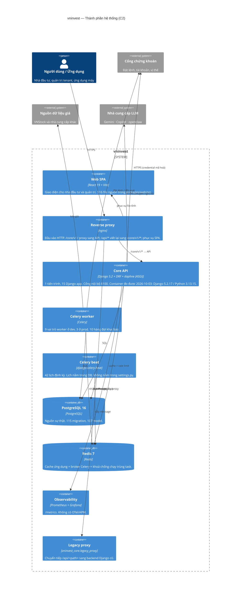
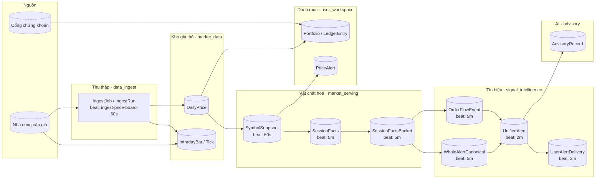
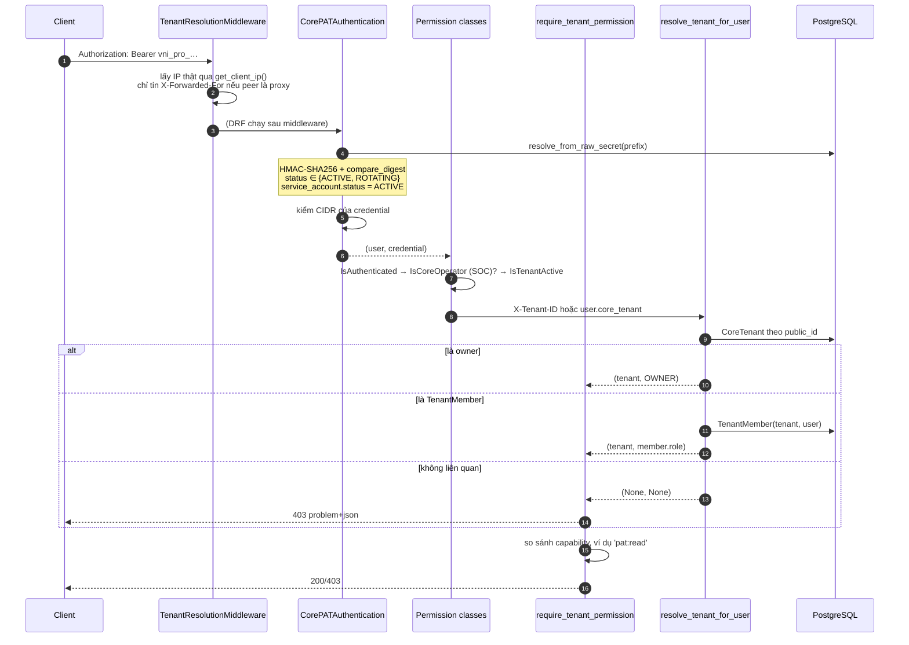
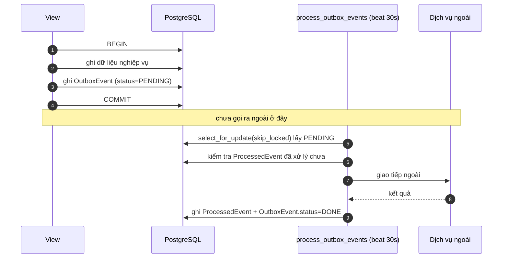

# D02 (AS-IS) — Kiến trúc thành phần, Luồng dữ liệu & Mô hình dữ liệu

> **Bản AS-IS.** Đọc `docs/architecture/README.md` §0 trước — repo có hai bộ tài
> liệu trái hướng nhau.
>
> **§4.1 và §4.2 được SINH TỰ ĐỘNG** từ `django.apps.get_models()` bằng
> `tools/gen_data_doc.py`. **Đừng sửa tay** — sửa tay sẽ lệch ngay lần chạy kế
> tiếp. Muốn đổi cách nhóm thì sửa `CLUSTERS` trong script đó.
>
> Đo tại `0ee1b8b4b`, 2026-10-03.

---

# PHẦN 3 — KIẾN TRÚC KỸ THUẬT

## 3.1 Sơ đồ thành phần (C4 — Mức C2)



### 3.1.1 Thành phần bên trong Core API (C4 — Mức C3)

15 Django app, phân theo miền. Mối quan hệ phụ thuộc được tóm tắt ở `D01` §1.1.

| App | Trách nhiệm | Model | Số dòng |
|---|---|---|---|
| `identity_access` | Tenant, PAT, thành viên, cấu hình | 24 | 22.630 |
| `service_ops` | Định nghĩa dịch vụ, health, scrape matrix, backfill | 15 | 26.553 |
| `user_workspace` | Portfolio, ledger, watchlist, broker, screener | 19 | 24.613 |
| `market_data` | Giá thô, đăng ký mã toàn cục | 8 | 14.860 |
| `signal_intelligence` | Whale, order-flow, anomaly, cảnh báo hợp nhất | 7 | 7.045 |
| `advisory` | Khuyến nghị AI, credential LLM | 6 | 3.353 |
| `commercial` | Gói, hạn mức, hoá đơn, thanh toán | 6 | 2.813 |
| `support` | Ticket hỗ trợ | 5 | 846 |
| `advertising` | Campaign, impression, click | 5 | 966 |
| `market_serving` | Snapshot, session facts, bucket | 3 | 4.685 |
| `ops_audit` | Nhật ký kiểm toán, rollup API call | 3 | 2.279 |
| `data_ingest` | Job & run thu thập dữ liệu | 2 | 5.642 |
| `ai_analytics` | Bản ghi dùng LLM | 2 | 357 |
| `ai_agents` | Registry agent | 1 | 274 |
| `tenant_lifecycle` | Trial, suspend, deprovision | 1 | 548 |
| **`vninvest_core`** | **Hạ tầng dùng chung** | — | 4.167 |

`vninvest_core` là **điểm neo** của kiến trúc — mọi app khác đều phụ thuộc:

| Module | Vai trò |
|---|---|
| `exceptions.py` (711 dòng) | RFC 9457 `problem+json` cho **mọi** lỗi |
| `api_envelope.py` (211) | Mô tả OpenAPI `{data, meta}` (chỉ schema, không đụng runtime) |
| `db_router.py` | Định tuyến database `core` vs `legacy_readonly` |
| `queue_policy.py` (228) | 10 hàng đợi + 9 domain định tuyến task |
| `client_ip.py` (241) | Lấy IP thật qua proxy tin cậy |
| `checks.py` (279) | Django system check, chặn cấu hình sai lúc khởi động |
| `env_validation.py` (192) | Bắt buộc biến môi trường ở production |
| `settings.py` (906) | Toàn bộ cấu hình |

## 3.2 Luồng dữ liệu (DFD)



**Đặc tính quan trọng — đây là kiến trúc dựa trên chu kỳ, không phải sự kiện:**

| Đặc tính | Hệ quả |
|---|---|
| Không có đường dẫn nào chạy **thời gian thực** từ nguồn ra UI | Độ trễ tối thiểu ≈ 60 s (giá) → 5 phút (sự kiện) |
| `AdvisoryRecord` đọc dữ liệu đã vật chất hoá, không tự kéo nguồn | AI chỉ thấy dữ liệu cũ nhất đã materialize |
| Cảnh báo người dùng đi qua 2 bước hợp nhất | Tổng trễ tối đa ≈ 7 phút |
| Không có message broker ngoài Redis | Không thể thêm nguồn theo sự kiện mà không đổi kiến trúc |

**Quản lý trạng thái:**

| Tầng | Cơ chế | Ghi chú |
|---|---|---|
| BE, trong request | `request.tenant`, `request.tenant_role` do `TenantResolutionMiddleware` gắn | `identity_access/middleware.py:127-128` |
| BE, giữa request | Redis cache (`RedisCache`) | `vninvest_core/settings.py:444-451` |
| BE, định kỳ | `django_celery_beat.PeriodicTask` **trong DB** | ⚠ sửa `settings.py` không tự áp dụng — cần `repair_beat_schedule` |
| BE, chống chạy trùng | `cache.add('scheduler:inflight:<key>')` | TTL 7.200 s, **mất khi flush cache** |
| FE | `PortfolioContext` + 11 file trong `packages/web/src/context` | Chi tiết ở `D03` §5.3 |

## 3.3 Tích hợp bên thứ ba

| Tích hợp | Cơ chế | Bằng chứng |
|---|---|---|
| **Cổng chứng khoán** | HTTPS, credential mã hoá Fernet trong DB | `identity_access/models.py:961` `SystemBrokerCredential`; `user_workspace/models.py:519` `UserBrokerConfig` |
| **Nguồn giá** | Beat kéo giá + backfill lịch sử | `settings.py:675-680` (`ingest-price-board-60s`), `:702-707` (`days=365`), `:724-729` (`days=1825`) |
| **Thanh toán VNPay** | IPN webhook + log chữ ký | `commercial/models.py:118` `VNPayIPNLog` (`is_valid_signature`, `processed`) |
| **Thanh toán Stripe** | Checkout + portal session | `identity_access/models.py:100-104`; `commercial_partner_views.py` |
| **LLM** | HTTPS, credential theo user | `advisory/models.py:233` `UserAICredential` |
| **Email** | Gmail OAuth hoặc SMTP, key mã hoá | `identity_access/models.py:1066` `SystemMailConfig` |
| **SSO / SAML** | SP-initiated | `identity_access/saml_service.py`, `TenantSSOConfig` (`identity_access/models.py:1212`) |

**Webhook đi ra (tenant tự đặt URL):**

| Bước | Xử lý | Vị trí |
|---|---|---|
| 1 | Tenant tạo config, sinh `secret` | `identity_access/models.py:1478-1481` |
| 2 | Hệ thống gửi payload + chữ ký | `views_webhooks.py` |
| 3 | Ghi lịch sử giao | `WebhookDelivery` (`identity_access/models.py:1484`) |
| 4 | Consumer | `ops_audit.RequestTrace` / `AuditEvent` |

> **[CHƯA XÁC MINH]** Thuật toán ký webhook và cơ chế retry không đọc tới dòng
> cụ thể. Khép lại ở Lượt 3.

## 3.4 Xác thực & phân quyền

### 3.4.1 Không dùng JWT

| Cơ chế | Chi tiết |
|---|---|
| Mang thông tin | **PAT** trong header `Authorization: Bearer <raw>` |
| Dạng raw secret | `f"vni_{plan}_" + secrets.token_urlsafe(48)` — `identity_access/models.py:28-31` |
| Lưu trữ | **KHÔNG** lưu raw. `token_prefix` = 12 ký tự đầu (để tra cứu) + `token_secret_hash` = `HMAC-SHA256(pepper, secret)` (`identity_access/models.py:33-42`) |
| Tra cứu | `resolve_from_raw_secret()` lọc theo `token_prefix`, băm lại rồi `hmac.compare_digest()` (`identity_access/models.py:335-347`) |
| Pepper | `CORE_PAT_PEPPER`; production **bắt buộc**, thiếu là `ImproperlyConfigured` lúc import (`vninvest_core/settings.py:55-60`) |
| TTL | Human session: `CORE_HUMAN_SESSION_PAT_HOURS`, mặc định **12 h** (`views/helpers.py:43-56`). Machine PAT: `expires_at` do người cấp quyết định |
| Xoay vòng | `mark_rotating()` đặt `expires_at = grace_until`; `grace=0` ⇒ thu hồi ngay (`identity_access/models.py:406-420`) |
| Phân biệt người/máy | `is_human_session` (`identity_access/models.py:292`); `require_human_session()` chặn PAT máy (`identity_access/permissions.py:34-37`) |

### 3.4.2 Luồng xác thực một request



**Ba điểm phải hiểu khi đọc code:**

1. **Tầng phân quyền chỉ có 2 lớp DRF** (`IsCoreOperator`, `IsTenantActive` —
   `identity_access/permissions.py:80,97`). Phần còn lại là `require_tenant_permission(request, 'cap')`
   gọi tay trong từng view: 21 capability, 135 call site (bảng ở `D01` §2.3.3).

2. **Resolver fail-closed, nhưng caller thì không.** `resolve_tenant_for_user()`
   trả `(None, None)` khi không có quan hệ (`utils/resolve_tenant.py:165-166`) —
   đúng. Nhưng 16 chỗ `if tenant:` ở caller lại **fail-open** (`D01` F-01/F-02).

3. **Có chỗ kiểm tra trùng.** `CorePATAuthentication` xác thực (`authentication.py:19-77`)
   rồi middleware *cũng* xác thực lại (`identity_access/middleware.py:183-247`). Cơ chế cache chung
   qua `request._pat_credential` + `compare_digest` nên không tốn truy vấn thứ hai,
   nhưng đây là **hai nơi phải sửa khi đổi luật xác thực** — xem F-16.

## 3.5 Trạng thái lỗi — RFC 9457

Mọi lỗi `>= 400` đi qua `core_api_exception_handler` (`exceptions.py:606-711`):

- Content-Type: **`application/problem+json`**
- Trường: `type`, `title`, `status`, `detail`, `code`, `request_id`, `timestamp`
  (+ `instance`, `errors[]`, `field_errors` tuỳ chọn) — `exceptions.py:166-187`
- Header `X-Request-ID` — `exceptions.py:208,230`
- Lỗi tầng Django (trước khi vào view) cũng theo RFC 9457, cố ý **không** dùng
  DRF `Response` — `exceptions.py:211-231`, lý do `:294-305`
- Đăng ký handler 400/403/404/500 tại `vninvest_core/urls.py:94-97`

> **Ranh giới phải nhớ:** envelope `{data, meta}` chỉ dành cho **success 2xx**.
> Bọc lỗi vào đó sẽ phá `test_problem_json.py`. Ngoại lệ: `market_serving` cố ý
> dùng hợp đồng riêng `contract_version` `2.0` — `data` là **sibling**, không phải
> envelope.

---

<!-- BEGIN GENERATED: data-model -->

<!-- Sinh boi docs/architecture/tools/gen_data_doc.py -
     KHONG sua tay. Chay lai: python
     docs/architecture/tools/gen_data_doc.py -->

## 4.0 Tổng quan

- **107** model được mô tả trong 12 cụm nghiệp vụ.
- Sinh từ `django.apps.get_models()` nên **luôn khớp code**.
- `PK` = primary key · `FK` = foreign key · `UK` = unique.

> **Bảng của framework không mô tả ở đây** (không thuộc repo, nhưng bạn vẫn phụ thuộc):

> - `admin.LogEntry` — audit log của Django admin.
> - `auth.Group` — không dùng — repo dùng `TenantMember.role` + `TenantCustomRole.permissions`.
> - `auth.Permission` — bảng quyền mặc định của Django.
> - `auth.User` — gốc của mọi hồ sơ người dùng — `CoreTenant.owner_user`, `TenantMember.user`, `PATAuditLog.pat`…
> - `contenttypes.ContentType` — khóa ngoại của Django contenttypes.
> - `django_celery_beat.ClockedSchedule` — lịch theo mốc thời gian tuyệt đối.
> - `django_celery_beat.CrontabSchedule` — lịch theo cron — ví dụ `daily-db-backup-2am`.
> - `django_celery_beat.IntervalSchedule` — lịch chạy theo số giây — nhiều entry trong `CELERY_BEAT_SCHEDULE` dùng loại này.
> - `django_celery_beat.PeriodicTask` — **nguồn sự thật của beat schedule**. Nó nằm trong DB, **không** nằm trong `settings.py` ⇒ sửa `settings.py` mà không `repair_beat_schedule` thì runtime **không đổi**.
> - `django_celery_beat.PeriodicTasks` — model **lịch sử** mà Django giữ lại để migrate. Không dùng — nếu thấy nó trong DB thì đừng đọc, hãy đọc `PeriodicTask`.
> - `django_celery_beat.SolarSchedule` — theo vị trí mặt trời — có vẻ không dùng.
> - `sessions.Session` — không dùng — xác thực bằng PAT, không dùng session Django. Có thể cân nhắc bỏ nếu không bật admin login.

---

## 4.1 ERD theo cụm nghiệp vụ

> ERD lược lọc: mỗi entity giữ PK/FK + tối đa 10 trường để đọc nổi.
> Trường đầy đủ nằm ở §4.2.

### C1 — Định danh & Tenant

*6 model · 76 trường*

```mermaid
erDiagram
    CoreTenant {
        int id PK
        char display_name
        json features
        datetime trial_ends_at
        datetime activated_at
        datetime suspended_at
        date billing_period_start
        date billing_period_end
        char stripe_subscription_id
    }
    TenantSettings {
        int id PK
        char logo_url
        char timezone
        char custom_domain
        datetime created_at
        datetime updated_at
    }
    UserProfile {
        int id PK
        fk tenant_id FK
        char display_name
        char avatar_url
        decimal whale_alert_threshold
        json preferences
        int legacy_user_id
        datetime created_at
        datetime updated_at
    }
    TenantCustomRole {
        int id PK
        fk tenant_id FK
        char name
        json permissions
        bool is_system
        datetime created_at
        datetime updated_at
    }
    TenantMember {
        int id PK
        fk tenant_id FK
        fk user_id FK
        fk custom_role_id FK
        fk invited_by_id FK
        datetime joined_at
        datetime updated_at
    }
    TenantInvite {
        int id PK
        fk tenant_id FK
        fk invited_user_id FK
        fk inviter_id FK
        fk custom_role_id FK
        char invited_email
        datetime expires_at
        datetime accepted_at
        datetime created_at
    }
    CoreTenant ||--o{ TenantSettings : "tenant_id"
    CoreTenant |o--o{ UserProfile : "tenant_id"
    CoreTenant ||--o{ TenantCustomRole : "tenant_id"
    CoreTenant ||--o{ TenantMember : "tenant_id"
    TenantCustomRole |o--o{ TenantMember : "custom_role_id"
    CoreTenant ||--o{ TenantInvite : "tenant_id"
    TenantCustomRole |o--o{ TenantInvite : "custom_role_id"
```

### C2 — Credential & Truy cập

*10 model · 105 trường*

```mermaid
erDiagram
    CoreServiceAccount {
        int id PK
        fk tenant_id FK
        char name
        json scopes
        json metadata
        json allowed_symbols
        json features
        datetime last_rotated_at
        datetime created_at
    }
    CorePATCredential {
        int id PK
        fk service_account_id FK
        fk issued_for_member_id FK
        char label
        char token_prefix
        json scopes
        bool is_human_session
        datetime expires_at
        datetime last_used_at
    }
    PATAuditLog {
        int id PK
        fk pat_id FK
        fk tenant_id FK
        ip ip_address
        char endpoint
        char method
        int status_code
        text user_agent
        int duration_ms
    }
    PasswordResetToken {
        int id PK
        char email
        datetime created_at
        datetime expires_at
        bool used
        datetime used_at
    }
    UserDNSECredential {
        int id PK
        binary api_key_encrypted
        binary api_secret_encrypted
        bool is_system_provider
        bool is_verified
        datetime last_verified_at
        datetime created_at
        datetime updated_at
    }
    SystemBrokerCredential {
        int id PK
        binary secrets_cipher
        json allowed_purposes
        bool is_verified
        datetime last_verified_at
        json last_check
        char updated_by
        datetime created_at
        datetime updated_at
    }
    TenantSSOConfig {
        int id PK
        bool is_enabled
        char idp_entity_id
        char idp_sso_url
        text idp_x509_cert
        char domain_hint
        char sp_entity_id
        char sp_acs_url
        datetime created_at
    }
    UsageAlertConfig {
        int id PK
        fk tenant_id FK
        int warning_pct
        int critical_pct
        bool enabled
        bool notify_email
        datetime created_at
        datetime updated_at
    }
    LoginAttempt {
        int id PK
        fk tenant_id FK
        fk user_id FK
        char username
        char email
        ip ip_address
        text user_agent
        bool success
        char failure_reason
    }
    EmailVerificationToken {
        int id PK
        fk user_id FK
        bool is_used
        int attempts
        datetime expires_at
        datetime created_at
    }
    CoreServiceAccount ||--o{ CorePATCredential : "service_account_id"
    CorePATCredential ||--o{ PATAuditLog : "pat_id"
```

### C3 — Nền tảng chung (outbox, mail, báo cáo, webhook)

*8 model · 89 trường*

```mermaid
erDiagram
    OutboxEvent {
        uuid event_id PK
        char event_type
        json payload
        int retry_count
        text last_error
        datetime created_at
        datetime processed_at
    }
    ProcessedEvent {
        uuid event_id PK
        datetime processed_at
    }
    SystemMailConfig {
        int id PK
        fk last_modified_by_id FK
        char name
        bool is_active
        char from_email
        char from_name
        char reply_to_email
        int timeout_seconds
        char smtp_host
    }
    MailConfigAuditLog {
        int id PK
        fk operator_user_id FK
        char action
        int target_config_id
        text description
        datetime timestamp
    }
    ScheduledReport {
        int id PK
        fk tenant_id FK
        char name
        json recipients
        bool is_active
        datetime last_sent_at
        int total_deliveries
        datetime created_at
        datetime updated_at
    }
    ReportDeliveryLog {
        int id PK
        fk report_id FK
        char recipient
        text error_message
        datetime sent_at
        datetime created_at
    }
    TenantWebhookConfig {
        int id PK
        fk tenant_id FK
        char name
        char url
        char secret
        json events
        bool is_active
        json headers
        int retry_count
    }
    WebhookDelivery {
        int id PK
        fk config_id FK
        char event_type
        char event_id
        json payload
        char status
        int response_code
        text response_body
        int attempts
    }
    ScheduledReport ||--o{ ReportDeliveryLog : "report_id"
    TenantWebhookConfig ||--o{ WebhookDelivery : "config_id"
```

### C4 — Thuê bao & Thanh toán

*7 model · 76 trường*

```mermaid
erDiagram
    Subscription {
        int id PK
        char plan
        date current_period_start
        date current_period_end
        bool cancel_at_period_end
        datetime created_at
        datetime updated_at
    }
    QuotaRecord {
        int id PK
        fk tenant_id FK
        date period_start
        date period_end
        int api_calls_used
        int api_calls_limit
        int symbols_used
        int symbols_limit
        int users_used
    }
    QuotaHistory {
        int id PK
        fk tenant_id FK
        date date
        char meter_code
        char meter_name
        char unit
        int consumed_amount
        int entitled_amount
        int remaining_amount
    }
    Invoice {
        int id PK
        fk tenant_id FK
        decimal amount_due
        char currency
        date period_start
        date period_end
        date due_date
        datetime paid_at
        json line_items
    }
    PaymentTransaction {
        int id PK
        fk invoice_id FK
        fk tenant_id FK
        char vnp_transaction_no
        decimal amount
        char plan
        text pay_url
        char error_code
        datetime created_at
    }
    VNPayIPNLog {
        int id PK
        char txn_ref
        text raw_query
        bool is_valid_signature
        bool processed
        text error_message
        datetime created_at
    }
    TenantLifecycleEvent {
        int id PK
        fk tenant_id FK
        fk actor_user_id FK
        char actor_type
        json old_value
        json new_value
        ip ip_address
        json metadata
        datetime created_at
    }
    Invoice ||--o{ PaymentTransaction : "invoice_id"
```

### C5 — Dữ liệu thị trường thô

*10 model · 117 trường*

```mermaid
erDiagram
    StockProfile {
        int id PK
        char company_name
        char industry
        int outstanding_shares
        json metadata
        char legacy_symbol
        datetime created_at
        datetime updated_at
    }
    DailyPrice {
        int id PK
        char symbol
        date date
        decimal open
        decimal high
        decimal low
        decimal close
        int volume
        int value
    }
    IntradayBar {
        int id PK
        char symbol
        datetime datetime
        char timeframe
        decimal open
        decimal high
        decimal low
        decimal close
        int volume
    }
    IntradayTick {
        int id PK
        char symbol
        datetime timestamp
        decimal price
        int volume
        char match_type
        char source
        datetime created_at
    }
    GlobalSymbolRegistry {
        int id PK
        bool is_active
        float priority_score
        int demand_source_count
        datetime last_demand_at
        datetime last_hydrated_at
        date latest_trade_date
        char freshness_state_summary
        char coverage_state_summary
    }
    GlobalSymbolDemandSource {
        int id PK
        fk registry_id FK
        fk tenant_id FK
        fk user_id FK
        char source_ref
        bool is_active
        datetime activated_at
        datetime deactivated_at
        float weight
    }
    GlobalSymbolCoverage {
        int id PK
        fk registry_id FK
        datetime latest_available_at
        datetime oldest_available_at
        date latest_complete_trade_date
        json missing_ranges
        datetime last_verified_at
        char next_recommended_action
        json detail
    }
    VnbrokerRuntimeConfig {
        int id PK
        bool is_active
        int max_workers
        int request_delay_ms
        int max_retries
        int batch_size
        json extra
        datetime created_at
        datetime updated_at
    }
    IngestJob {
        int id PK
        int schedule_seconds
        json config
        datetime created_at
        datetime updated_at
    }
    IngestRun {
        int id PK
        fk job_id FK
        int rows_upserted
        int rows_skipped
        text error_message
        datetime started_at
        datetime finished_at
        json meta
    }
    GlobalSymbolRegistry ||--o{ GlobalSymbolDemandSource : "registry_id"
    GlobalSymbolRegistry ||--o{ GlobalSymbolCoverage : "registry_id"
    IngestJob ||--o{ IngestRun : "job_id"
```

### C6 — Vật chất hoá thị trường (serving)

*3 model · 42 trường*

```mermaid
erDiagram
    SymbolSnapshot {
        int id PK
        char symbol
        date session_date
        decimal price
        decimal price_change
        decimal price_change_pct
        int volume
        decimal reference_price
        decimal ceiling
    }
    SessionFacts {
        int id PK
        char symbol
        date session_date
        float cvd_normalized
        float buy_strength
        float institutional_strength
        int whale_net_flow
        float dark_flow_score
        int total_buy_volume
    }
    SessionFactsBucket {
        int id PK
        fk session_facts_id FK
        char symbol
        date session_date
        char window
        int bucket_minutes
        datetime bucket_ts
        float cumulative_cvd
        float buy_strength
    }
    SessionFacts ||--o{ SessionFactsBucket : "session_facts_id"
```

### C7 — Tín hiệu & Cảnh báo

*7 model · 94 trường*

```mermaid
erDiagram
    UnifiedAlert {
        int id PK
        char symbol
        float confidence
        char freshness_state
        char title
        text body
        decimal value
        date session_date
        datetime triggered_at
    }
    WhaleAlertCanonical {
        onetoonefield alert_id PK
        char symbol
        date session_date
        decimal price
        int volume
        int matched_value
        bool is_dark_flow
        char order_id
        datetime executed_at
    }
    OrderFlowEvent {
        int id PK
        fk unified_alert_id FK
        char symbol
        date session_date
        float strength
        float whale_intensity
        float cvd_at_signal
        decimal price_at_signal
        int volume_at_signal
    }
    MarketAnomalyEvent {
        int id PK
        fk unified_alert_id FK
        char symbol
        date session_date
        float confidence
        decimal value
        char source_ref
        json evidence
        json metadata
    }
    AdvisorySignalEvent {
        int id PK
        fk unified_alert_id FK
        char symbol
        date session_date
        float confidence
        char title
        text body
        decimal value
        char source_ref
    }
    UserAlertDelivery {
        int id PK
        fk user_id FK
        fk alert_id FK
        datetime delivered_at
        datetime seen_at
        datetime acknowledged_at
        char suppression_reason
        json metadata
        datetime updated_at
    }
    UserAlertPreference {
        int id PK
        fk user_id FK
        char symbol
        char alert_family
        datetime mute_until
        int cooldown_seconds
        json channel_policy
        json metadata
        datetime created_at
    }
    UnifiedAlert ||--o{ WhaleAlertCanonical : "alert_id"
    UnifiedAlert |o--o{ OrderFlowEvent : "unified_alert_id"
    UnifiedAlert |o--o{ MarketAnomalyEvent : "unified_alert_id"
    UnifiedAlert |o--o{ AdvisorySignalEvent : "unified_alert_id"
    UnifiedAlert ||--o{ UserAlertDelivery : "alert_id"
```

### C8 — Danh mục, Ledger & Giao dịch

*14 model · 159 trường*

```mermaid
erDiagram
    Portfolio {
        int id PK
        fk user_id FK
        fk tenant_id FK
        char name
        text description
        bool is_default
        decimal opening_balance
        char opening_balance_source
        int legacy_portfolio_id
    }
    Transaction {
        int id PK
        fk portfolio_id FK
        fk tenant_id FK
        char symbol
        date date
        decimal price
        int quantity
        decimal fee
        decimal tax
    }
    Watchlist {
        int id PK
        fk user_id FK
        fk tenant_id FK
        char name
        text description
        bool is_default
        int legacy_group_id
        datetime created_at
    }
    WatchlistItem {
        int id PK
        fk watchlist_id FK
        char symbol
        char note
        datetime added_at
    }
    TrackedSymbol {
        int id PK
        fk user_id FK
        fk tenant_id FK
        fk source_watchlist_id FK
        char symbol
        decimal whale_alert_threshold_million
        bool is_active
        bool is_stale
        int legacy_tracked_symbol_id
    }
    PriceAlert {
        int id PK
        fk user_id FK
        fk tenant_id FK
        char symbol
        decimal price_threshold
        bool is_enabled
        int cooldown_seconds
        bool notify_email
        bool notify_sms
    }
    SubAccount {
        int id PK
        fk user_id FK
        fk tenant_id FK
        fk portfolio_id FK
        char broker
        char account_number
        char name
        char display_name
        bool is_active
    }
    AccountSnapshot {
        int id PK
        fk sub_account_id FK
        date date
        decimal net_equity
        decimal cash_balance
        decimal stock_value
        decimal debt
        datetime created_at
    }
    QuarantinedRecord {
        int id PK
        char model_name
        int original_id
        json data
        text reason
        datetime created_at
    }
    LedgerEntry {
        int id PK
        fk tenant_id FK
        fk portfolio_id FK
        fk reversal_of_id FK
        fk created_by_id FK
        char symbol
        date trade_date
        int quantity
        decimal price
    }
    CashFlow {
        int id PK
        fk entry_id FK
        fk tenant_id FK
        decimal amount
        char currency
        datetime created_at
    }
    PositionSnapshot {
        int id PK
        fk tenant_id FK
        fk portfolio_id FK
        char symbol
        date as_of_date
        decimal quantity
        decimal avg_cost
        decimal current_price
        decimal market_value
    }
    ValuationSnapshot {
        int id PK
        fk tenant_id FK
        fk portfolio_id FK
        date as_of_date
        decimal stock_value
        decimal cash
        decimal debt
        decimal nav
        char nav_reason
    }
    IdempotencyRecord {
        int id PK
        fk tenant_id FK
        fk actor_id FK
        char scope
        char key
        char request_hash
        positivesmallintegerfield response_code
        json response_body
        datetime created_at
    }
    Portfolio ||--o{ Transaction : "portfolio_id"
    Watchlist ||--o{ WatchlistItem : "watchlist_id"
    Watchlist |o--o{ TrackedSymbol : "source_watchlist_id"
    Portfolio |o--o{ SubAccount : "portfolio_id"
    SubAccount ||--o{ AccountSnapshot : "sub_account_id"
    Portfolio ||--o{ LedgerEntry : "portfolio_id"
    LedgerEntry |o--o{ LedgerEntry : "reversal_of_id"
    LedgerEntry ||--o{ CashFlow : "entry_id"
    Portfolio ||--o{ PositionSnapshot : "portfolio_id"
    Portfolio ||--o{ ValuationSnapshot : "portfolio_id"
```

### C9 — Broker & Bộ lọc

*5 model · 54 trường*

```mermaid
erDiagram
    DNSECredential {
        int id PK
        text client_id_cipher
        text client_secret_cipher
        bool is_active
        datetime last_sync_at
        datetime created_at
        datetime updated_at
    }
    UserBrokerConfig {
        int id PK
        fk user_id FK
        fk tenant_id FK
        char label
        text secrets_cipher
        positivesmallintegerfield secret_version
        json prefs
        datetime last_verified_at
        text last_error
    }
    ScreenerRule {
        int id PK
        fk user_id FK
        fk tenant_id FK
        char name
        json rules_json
        bool is_active
        bool is_public
        datetime created_at
        datetime updated_at
    }
    ScreenerRunHistory {
        int id PK
        fk user_id FK
        fk tenant_id FK
        fk rule_id FK
        char rule_name
        datetime run_at
        int matched_count
        int total_scanned
        int window_days
    }
    ScreenerSchedule {
        int id PK
        fk user_id FK
        fk tenant_id FK
        char name
        json rule_ids
        time run_time
        json weekdays
        bool is_active
        json notify_channels
    }
    ScreenerRule |o--o{ ScreenerRunHistory : "rule_id"
```

### C10 — AI & Advisory

*9 model · 103 trường*

```mermaid
erDiagram
    SystemAISettings {
        int id PK
        bool is_active
        int max_tokens
        float temperature
        text prompt_template
        json metadata
        datetime created_at
        datetime updated_at
    }
    AdvisoryRecord {
        int id PK
        fk user_id FK
        char symbol
        date session_date
        char ai_model
        text advisory_text
        json structured_output
        json context_snapshot
        int tokens_used
    }
    AdvisorySession {
        int id PK
        fk user_id FK
        char symbol
        date session_date
        char ai_model
        int tokens_used
        int token_budget
        json context_snapshot
        text error_message
    }
    AdvisoryComponent {
        int id PK
        fk session_id FK
        text content
        json metadata
        int order
        datetime created_at
    }
    UserAICredential {
        int id PK
        char ai_model
        text encrypted_api_key
        char custom_endpoint
        bool is_active
        int fallback_quota_used_today
        date fallback_quota_date
        float temperature
        int max_tokens_per_day
    }
    AIAuditLog {
        int id PK
        char actor
        text reason
        json before_json
        json after_json
        text diff_summary
        datetime created_at
    }
    AgentRegistry {
        int id PK
        fk created_by_id FK
        char name
        char provider
        char model
        json capabilities
        text system_prompt
        bool is_active
        datetime created_at
    }
    AIUsageRecord {
        int id PK
        fk user_id FK
        char provider
        char model
        int tokens_in
        int tokens_out
        decimal cost
        int latency_ms
        char status
    }
    AIUsageSummary {
        int id PK
        fk user_id FK
        date date
        char action
        int total_requests
        int total_tokens_in
        int total_tokens_out
        decimal total_cost
        float avg_latency_ms
    }
    AdvisorySession ||--o{ AdvisoryComponent : "session_id"
```

### C11 — Vận hành & Kiểm toán

*18 model · 191 trường*

```mermaid
erDiagram
    ServiceDefinition {
        int id PK
        char name
        text description
        char owner_team
        json tags
        bool is_active
        bool is_deprecated
        text deprecation_note
        datetime created_at
    }
    ServiceConfig {
        int id PK
        fk service_id FK
        char config_schema_version
        json config_payload
        char applied_by
        datetime applied_at
        text change_reason
        bool is_current
    }
    ServiceHealth {
        int id PK
        datetime last_check_at
        datetime last_success_at
        int consecutive_failures
        float avg_response_ms
        float slo_target
        float uptime_30d
        float burn_rate_1h
        float error_budget_remaining
    }
    ServiceHealthCheckLog {
        int id PK
        fk service_id FK
        float response_ms
        datetime checked_at
    }
    ServiceRunLog {
        int id PK
        fk service_id FK
        char celery_task_id
        datetime started_at
        datetime finished_at
        float duration_seconds
        json input_summary
        json output_summary
        text error_detail
    }
    OwnershipRecord {
        int id PK
        char owner_team
        char write_surface
        json locked_fields
        json compatibility_domains
        text deprecation_notes
        datetime updated_at
    }
    ConfigChangeAudit {
        int id PK
        fk service_id FK
        char actor
        ip actor_ip
        json before_snapshot
        json after_snapshot
        text change_summary
        datetime timestamp
        char request_id
    }
    ScrapeMatrix {
        int id PK
        json providers
        datetime started_at
        datetime completed_at
        int total_rows
        int done_rows
        int failed_rows
    }
    ScrapeMatrixCell {
        int id PK
        fk matrix_id FK
        char symbol_group_id
        char provider
        char worker_id
        datetime claimed_at
        datetime done_at
        int symbols_processed
        text error_detail
    }
    CustomSymbolGroup {
        int id PK
        char name
        text description
        json symbols
        bool is_active
        char created_by
        datetime created_at
        datetime updated_at
    }
    CachedSymbolGroup {
        int id PK
        char group_code
        char category
        text description
        char source_provider
        int symbol_count
        char group_type
        char color
        int display_order
    }
    CachedSymbolGroupMember {
        int id PK
        fk group_id FK
        char symbol
        int display_order
    }
    BackfillExecutionRun {
        int id PK
        char job_key
        int requested_days
        int planned_symbols_count
        int completed_symbols_count
        int failed_symbols_count
        int inserted_rows
        int updated_rows
        int skipped_existing_rows
    }
    BackfillExecutionBatch {
        int id PK
        fk run_id FK
        char provider
        int batch_index
        char current_symbol
        int symbols_count
        int completed_symbols_count
        int inserted_rows
        int updated_rows
    }
    MarketDataParitySnapshot {
        int id PK
        fk service_id FK
        fk run_log_id FK
        char scheduler_task_id
        int window_hours
        int sample_size
        int evaluated_symbols
        int strict_fresh_count
        int fresh_or_warm_count
    }
    AuditEvent {
        int id PK
        int actor_user_id
        char actor_label
        char tenant_id
        char resource_type
        char resource_id
        char request_id
        char pat_id
        ip ip_address
    }
    RequestTrace {
        int id PK
        char method
        char path
        int status_code
        int actor_user_id
        char tenant_id
        int duration_ms
        datetime traced_at
    }
    ApiCallRollup {
        int id PK
        char tenant_id
        date date
        int hour
        char ip_address
        char endpoint_group
        char status_group
        int call_count
        int error_count
    }
    ServiceDefinition ||--o{ ServiceConfig : "service_id"
    ServiceDefinition ||--o{ ServiceHealth : "service_id"
    ServiceDefinition ||--o{ ServiceHealthCheckLog : "service_id"
    ServiceDefinition ||--o{ ServiceRunLog : "service_id"
    ServiceDefinition ||--o{ ConfigChangeAudit : "service_id"
    ScrapeMatrix ||--o{ ScrapeMatrixCell : "matrix_id"
    CachedSymbolGroup ||--o{ CachedSymbolGroupMember : "group_id"
    ServiceRunLog |o--o{ BackfillExecutionRun : "service_run_log_id"
    BackfillExecutionRun ||--o{ BackfillExecutionBatch : "run_id"
    ServiceDefinition ||--o{ MarketDataParitySnapshot : "service_id"
    ServiceRunLog |o--o{ MarketDataParitySnapshot : "run_log_id"
```

### C12 — Hỗ trợ & Quảng cáo

*10 model · 84 trường*

```mermaid
erDiagram
    SupportTicket {
        uuid id PK
        fk tenant_id FK
        fk requester_id FK
        fk assignee_id FK
        char subject
        datetime first_response_at
        datetime resolved_at
        datetime closed_at
        datetime last_message_at
    }
    TicketMessage {
        uuid id PK
        fk ticket_id FK
        fk sender_id FK
        text body
        datetime created_at
    }
    TicketAttachment {
        uuid id PK
        fk message_id FK
        filefield file
        char original_name
        char mime_type
        int size_bytes
        char sha256
        bool is_safe
        datetime created_at
    }
    TicketAuditLog {
        int id PK
        fk ticket_id FK
        fk actor_id FK
        char action
        json old_value
        json new_value
        datetime created_at
    }
    SupportTicketCounter {
        int id PK
        int last_number
    }
    TrademarkConfig {
        int id PK
        bool enabled
        int activation_ts
        char version
        datetime updated_at
    }
    AdCampaign {
        uuid id PK
        fk tenant_id FK
        char name
        char banner_url
        char banner_url_retina
        char banner_url_svg
        int banner_width
        int banner_height
        char destination_url
    }
    AdDailySummary {
        int id PK
        fk campaign_id FK
        fk tenant_id FK
        char symbol
        date date
        int impressions_count
        int clicks_count
    }
    AdImpressionLog {
        int id PK
        fk campaign_id FK
        fk tenant_id FK
        char symbol
        ip ip_address
        text user_agent
        datetime created_at
    }
    AdClickLog {
        int id PK
        fk campaign_id FK
        fk tenant_id FK
        char symbol
        ip ip_address
        text user_agent
        datetime created_at
    }
    SupportTicket ||--o{ TicketMessage : "ticket_id"
    TicketMessage ||--o{ TicketAttachment : "message_id"
    SupportTicket ||--o{ TicketAuditLog : "ticket_id"
    AdCampaign ||--o{ AdDailySummary : "campaign_id"
    AdCampaign ||--o{ AdImpressionLog : "campaign_id"
    AdCampaign ||--o{ AdClickLog : "campaign_id"
```

---

## 4.2 Từ điển dữ liệu (Data Dictionary)

### C1 — Định danh & Tenant

#### `identity_access_coretenant` — CoreTenant

- Model: `identity_access.CoreTenant` · `Core Tenant`
- PK: `id`
- `Meta.indexes`: `identity_ac_status_f451c4_idx`

| Trường | Cột | Kiểu | Null | Mặc định | Khoá | Ghi chú |
|---|---|---|---|---|---|---|
| `id` | `id` | `BigAutoField` | — | — | PK |  |
| `public_id` | `public_id` | `CharField(36)` | — | — | UK | index |
| `owner_user_id` | `owner_user_id` | `OneToOneField` | — | — | UK | index; on_delete=CASCADE; → `auth.User` |
| `tenant_code` | `tenant_code` | `CharField(96)` | — | — | UK | index |
| `display_name` | `display_name` | `CharField(120)` | — | — | — |  |
| `plan` | `plan` | `CharField(32)` | — | `free` | — | index; 6 choices |
| `status` | `status` | `CharField(32)` | — | `active` | — | index; 5 choices |
| `features` | `features` | `JSONField` | — | `list()` | — | **blank nhưng NOT NULL** |
| `trial_ends_at` | `trial_ends_at` | `DateTimeField` | ✓ | — | — |  |
| `activated_at` | `activated_at` | `DateTimeField` | ✓ | — | — |  |
| `suspended_at` | `suspended_at` | `DateTimeField` | ✓ | — | — |  |
| `billing_period_start` | `billing_period_start` | `DateField` | ✓ | — | — |  |
| `billing_period_end` | `billing_period_end` | `DateField` | ✓ | — | — |  |
| `stripe_customer_id` | `stripe_customer_id` | `CharField(128)` | ✓ | — | UK | index |
| `stripe_subscription_id` | `stripe_subscription_id` | `CharField(128)` | ✓ | — | — | index |
| `stripe_price_id` | `stripe_price_id` | `CharField(128)` | ✓ | — | — |  |
| `stripe_current_period_end` | `stripe_current_period_end` | `DateTimeField` | ✓ | — | — |  |
| `stripe_cancel_at_period_end` | `stripe_cancel_at_period_end` | `BooleanField` | — | `False` | — |  |
| `api_calls_limit` | `api_calls_limit` | `IntegerField` | — | `10000` | — |  |
| `api_calls_used` | `api_calls_used` | `IntegerField` | — | `0` | — |  |
| `max_active_pats` | `max_active_pats` | `IntegerField` | — | `-1` | — |  |
| `gateway_rate_tier_override` | `gateway_rate_tier_override` | `JSONField` | ✓ | — | — |  |
| `created_at` | `created_at` | `DateTimeField` | — | — | — |  |
| `updated_at` | `updated_at` | `DateTimeField` | — | — | — |  |

#### `identity_access_tenantsettings` — TenantSettings

- Model: `identity_access.TenantSettings` · `Tenant Settings`
- PK: `id`

| Trường | Cột | Kiểu | Null | Mặc định | Khoá | Ghi chú |
|---|---|---|---|---|---|---|
| `id` | `id` | `BigAutoField` | — | — | PK |  |
| `tenant_id` | `tenant_id` | `OneToOneField` | — | — | UK | index; on_delete=CASCADE; → `identity_access.CoreTenant` |
| `logo_url` | `logo_url` | `CharField(200)` | ✓ | — | — |  |
| `timezone` | `timezone` | `CharField(64)` | — | `Asia/Ho_Chi_Minh` | — |  |
| `locale` | `locale` | `CharField(10)` | — | `vi` | — | 2 choices |
| `theme` | `theme` | `CharField(20)` | — | `dark` | — | 2 choices |
| `custom_domain` | `custom_domain` | `CharField(255)` | ✓ | — | — |  |
| `created_at` | `created_at` | `DateTimeField` | — | — | — |  |
| `updated_at` | `updated_at` | `DateTimeField` | — | — | — |  |

#### `identity_access_userprofile` — UserProfile

- Model: `identity_access.UserProfile` · `User Profile`
- PK: `id`

| Trường | Cột | Kiểu | Null | Mặc định | Khoá | Ghi chú |
|---|---|---|---|---|---|---|
| `id` | `id` | `BigAutoField` | — | — | PK |  |
| `user_id` | `user_id` | `OneToOneField` | — | — | UK | index; on_delete=CASCADE; → `auth.User` |
| `tenant_id` | `tenant_id` | `ForeignKey` | ✓ | — | FK | on_delete=SET_NULL; → `identity_access.CoreTenant` |
| `display_name` | `display_name` | `CharField(120)` | — | — | — | **blank nhưng NOT NULL** |
| `avatar_url` | `avatar_url` | `CharField(500)` | — | `""` | — | **blank nhưng NOT NULL** |
| `language` | `language` | `CharField(8)` | — | `vi` | — | 2 choices |
| `theme` | `theme` | `CharField(10)` | — | `dark` | — | 2 choices |
| `whale_alert_threshold` | `whale_alert_threshold` | `DecimalField(12,0)` | — | `500` | — |  |
| `preferences` | `preferences` | `JSONField` | — | `dict()` | — | **blank nhưng NOT NULL** |
| `legacy_user_id` | `legacy_user_id` | `IntegerField` | ✓ | — | — | index |
| `created_at` | `created_at` | `DateTimeField` | — | — | — |  |
| `updated_at` | `updated_at` | `DateTimeField` | — | — | — |  |

#### `identity_access_tenantcustomrole` — TenantCustomRole

- Model: `identity_access.TenantCustomRole` · `Tenant Custom Role`
- PK: `id`
- `unique_together`: `('tenant', 'name')`
- `Meta.indexes`: `identity_ac_tenant__08d7d1_idx`

| Trường | Cột | Kiểu | Null | Mặc định | Khoá | Ghi chú |
|---|---|---|---|---|---|---|
| `id` | `id` | `BigAutoField` | — | — | PK |  |
| `public_id` | `public_id` | `CharField(36)` | — | — | UK | index |
| `tenant_id` | `tenant_id` | `ForeignKey` | — | — | FK | on_delete=CASCADE; → `identity_access.CoreTenant` |
| `name` | `name` | `CharField(64)` | — | — | — |  |
| `permissions` | `permissions` | `JSONField` | — | `list()` | — | **blank nhưng NOT NULL** |
| `is_system` | `is_system` | `BooleanField` | — | `False` | — |  |
| `created_at` | `created_at` | `DateTimeField` | — | — | — |  |
| `updated_at` | `updated_at` | `DateTimeField` | — | — | — |  |

#### `identity_access_tenantmember` — TenantMember

- Model: `identity_access.TenantMember` · `Tenant Member`
- PK: `id`
- `unique_together`: `('tenant', 'user')`
- `Meta.indexes`: `identity_ac_tenant__fad414_idx`, `identity_ac_user_id_aa841c_idx`

| Trường | Cột | Kiểu | Null | Mặc định | Khoá | Ghi chú |
|---|---|---|---|---|---|---|
| `id` | `id` | `BigAutoField` | — | — | PK |  |
| `public_id` | `public_id` | `CharField(36)` | — | — | UK | index |
| `tenant_id` | `tenant_id` | `ForeignKey` | — | — | FK | on_delete=CASCADE; → `identity_access.CoreTenant` |
| `user_id` | `user_id` | `ForeignKey` | — | — | FK | on_delete=CASCADE; → `auth.User` |
| `role` | `role` | `CharField(32)` | — | `viewer` | — | index; 4 choices |
| `custom_role_id` | `custom_role_id` | `ForeignKey` | ✓ | — | FK | on_delete=SET_NULL; → `identity_access.TenantCustomRole` |
| `invited_by_id` | `invited_by_id` | `ForeignKey` | ✓ | — | FK | on_delete=SET_NULL; → `auth.User` |
| `joined_at` | `joined_at` | `DateTimeField` | — | — | — |  |
| `updated_at` | `updated_at` | `DateTimeField` | — | — | — |  |

#### `identity_access_tenantinvite` — TenantInvite

- Model: `identity_access.TenantInvite` · `Tenant Invite`
- PK: `id`
- `Meta.indexes`: `identity_ac_tenant__dad8bf_idx`, `identity_ac_invited_9d3b19_idx`

| Trường | Cột | Kiểu | Null | Mặc định | Khoá | Ghi chú |
|---|---|---|---|---|---|---|
| `id` | `id` | `BigAutoField` | — | — | PK |  |
| `public_id` | `public_id` | `CharField(36)` | — | — | UK | index |
| `tenant_id` | `tenant_id` | `ForeignKey` | — | — | FK | on_delete=CASCADE; → `identity_access.CoreTenant` |
| `invited_email` | `invited_email` | `CharField(254)` | — | — | — |  |
| `invited_user_id` | `invited_user_id` | `ForeignKey` | ✓ | — | FK | on_delete=CASCADE; → `auth.User` |
| `inviter_id` | `inviter_id` | `ForeignKey` | — | — | FK | on_delete=CASCADE; → `auth.User` |
| `token` | `token` | `CharField(64)` | — | — | UK | index |
| `role` | `role` | `CharField(32)` | — | `viewer` | — | 4 choices |
| `custom_role_id` | `custom_role_id` | `ForeignKey` | ✓ | — | FK | on_delete=SET_NULL; → `identity_access.TenantCustomRole` |
| `status` | `status` | `CharField(32)` | — | `pending` | — | index; 4 choices |
| `expires_at` | `expires_at` | `DateTimeField` | — | — | — |  |
| `accepted_at` | `accepted_at` | `DateTimeField` | ✓ | — | — |  |
| `created_at` | `created_at` | `DateTimeField` | — | — | — |  |
| `updated_at` | `updated_at` | `DateTimeField` | — | — | — |  |

### C2 — Credential & Truy cập

#### `identity_access_coreserviceaccount` — CoreServiceAccount

- Model: `identity_access.CoreServiceAccount` · `Core Service Account`
- PK: `id`
- `Meta.constraints`: `uniq_core_service_account_tenant_name`
- `Meta.indexes`: `identity_ac_tenant__f7046b_idx`

| Trường | Cột | Kiểu | Null | Mặc định | Khoá | Ghi chú |
|---|---|---|---|---|---|---|
| `id` | `id` | `BigAutoField` | — | — | PK |  |
| `public_id` | `public_id` | `CharField(36)` | — | — | UK | index |
| `tenant_id` | `tenant_id` | `ForeignKey` | — | — | FK | on_delete=CASCADE; → `identity_access.CoreTenant` |
| `name` | `name` | `CharField(120)` | — | — | — |  |
| `status` | `status` | `CharField(24)` | — | `active` | — | index; 2 choices |
| `scopes` | `scopes` | `JSONField` | — | `list()` | — | **blank nhưng NOT NULL** |
| `metadata` | `metadata` | `JSONField` | — | `dict()` | — | **blank nhưng NOT NULL** |
| `allowed_symbols` | `allowed_symbols` | `JSONField` | — | `list()` | — | **blank nhưng NOT NULL** |
| `features` | `features` | `JSONField` | — | `dict()` | — | **blank nhưng NOT NULL** |
| `last_rotated_at` | `last_rotated_at` | `DateTimeField` | ✓ | — | — |  |
| `created_at` | `created_at` | `DateTimeField` | — | — | — |  |
| `updated_at` | `updated_at` | `DateTimeField` | — | — | — |  |

#### `identity_access_corepatcredential` — CorePATCredential

- Model: `identity_access.CorePATCredential` · `Core PAT Credential`
- PK: `id`
- `Meta.indexes`: `identity_ac_service_8863e6_idx`, `identity_ac_token_p_2c95e5_idx`, `identity_ac_is_huma_0c021e_idx`

| Trường | Cột | Kiểu | Null | Mặc định | Khoá | Ghi chú |
|---|---|---|---|---|---|---|
| `id` | `id` | `BigAutoField` | — | — | PK |  |
| `public_id` | `public_id` | `CharField(36)` | — | — | UK | index |
| `service_account_id` | `service_account_id` | `ForeignKey` | — | — | FK | on_delete=CASCADE; → `identity_access.CoreServiceAccount` |
| `issued_for_member_id` | `issued_for_member_id` | `ForeignKey` | ✓ | — | FK | on_delete=SET_NULL; → `identity_access.TenantMember` |
| `label` | `label` | `CharField(120)` | — | `""` | — | **blank nhưng NOT NULL** |
| `token_prefix` | `token_prefix` | `CharField(12)` | — | — | — | index |
| `token_secret_hash` | `token_secret_hash` | `CharField(64)` | — | — | UK | index |
| `scopes` | `scopes` | `JSONField` | — | `list()` | — | **blank nhưng NOT NULL** |
| `status` | `status` | `CharField(24)` | — | `active` | — | index; 4 choices |
| `is_human_session` | `is_human_session` | `BooleanField` | — | `False` | — | index |
| `expires_at` | `expires_at` | `DateTimeField` | ✓ | — | — | index |
| `last_used_at` | `last_used_at` | `DateTimeField` | ✓ | — | — |  |
| `revoked_at` | `revoked_at` | `DateTimeField` | ✓ | — | — |  |
| `revoked_reason` | `revoked_reason` | `TextField` | — | `""` | — | **blank nhưng NOT NULL** |
| `grace_until` | `grace_until` | `DateTimeField` | ✓ | — | — |  |
| `audit_reason` | `audit_reason` | `TextField` | — | `""` | — | **blank nhưng NOT NULL** |
| `allowed_cidr_blocks` | `allowed_cidr_blocks` | `JSONField` | — | `list()` | — | **blank nhưng NOT NULL** |
| `created_at` | `created_at` | `DateTimeField` | — | — | — |  |
| `updated_at` | `updated_at` | `DateTimeField` | — | — | — |  |

#### `identity_access_pat_audit_log` — PATAuditLog

- Model: `identity_access.PATAuditLog` · `PAT Audit Log`
- PK: `id`
- `Meta.indexes`: `idx_pataudit_pat_occurred`, `idx_pataudit_tenant_occ`, `idx_pataudit_ip`

| Trường | Cột | Kiểu | Null | Mặc định | Khoá | Ghi chú |
|---|---|---|---|---|---|---|
| `id` | `id` | `BigAutoField` | — | — | PK |  |
| `pat_id` | `pat_id` | `ForeignKey` | — | — | FK | on_delete=CASCADE; → `identity_access.CorePATCredential` |
| `tenant_id` | `tenant_id` | `ForeignKey` | — | — | FK | on_delete=CASCADE; → `identity_access.CoreTenant` |
| `ip_address` | `ip_address` | `GenericIPAddressField(39)` | ✓ | — | — |  |
| `endpoint` | `endpoint` | `CharField(256)` | — | — | — |  |
| `method` | `method` | `CharField(8)` | — | — | — |  |
| `status_code` | `status_code` | `SmallIntegerField` | — | — | — |  |
| `user_agent` | `user_agent` | `TextField` | — | `""` | — | **blank nhưng NOT NULL** |
| `duration_ms` | `duration_ms` | `IntegerField` | — | `0` | — |  |
| `auth_source` | `auth_source` | `CharField(16)` | — | `pat` | — | 2 choices |
| `occurred_at` | `occurred_at` | `DateTimeField` | — | — | — | index |

#### `identity_access_passwordresettoken` — PasswordResetToken

- Model: `identity_access.PasswordResetToken` · `Password Reset Token`
- PK: `id`
- `Meta.indexes`: `identity_ac_email_f0e2d1_idx`

| Trường | Cột | Kiểu | Null | Mặc định | Khoá | Ghi chú |
|---|---|---|---|---|---|---|
| `id` | `id` | `BigAutoField` | — | — | PK |  |
| `email` | `email` | `CharField(254)` | — | — | — | index |
| `token_hash` | `token_hash` | `CharField(64)` | — | — | UK | index |
| `created_at` | `created_at` | `DateTimeField` | — | — | — | index |
| `expires_at` | `expires_at` | `DateTimeField` | — | — | — | index |
| `used` | `used` | `BooleanField` | — | `False` | — | index |
| `used_at` | `used_at` | `DateTimeField` | ✓ | — | — |  |

#### `identity_access_userdnsecredential` — UserDNSECredential

- Model: `identity_access.UserDNSECredential` · `User DNSE Credential`
- PK: `id`
- `Meta.constraints`: `unique_active_system_provider`

| Trường | Cột | Kiểu | Null | Mặc định | Khoá | Ghi chú |
|---|---|---|---|---|---|---|
| `id` | `id` | `BigAutoField` | — | — | PK |  |
| `user_id` | `user_id` | `OneToOneField` | — | — | UK | index; on_delete=CASCADE; → `auth.User` |
| `api_key_encrypted` | `api_key_encrypted` | `BinaryField` | — | — | — |  |
| `api_secret_encrypted` | `api_secret_encrypted` | `BinaryField` | — | — | — |  |
| `is_system_provider` | `is_system_provider` | `BooleanField` | — | `False` | — | index |
| `is_verified` | `is_verified` | `BooleanField` | — | `False` | — |  |
| `last_verified_at` | `last_verified_at` | `DateTimeField` | ✓ | — | — |  |
| `created_at` | `created_at` | `DateTimeField` | — | — | — |  |
| `updated_at` | `updated_at` | `DateTimeField` | — | — | — |  |

#### `identity_access_systembrokercredential` — SystemBrokerCredential

- Model: `identity_access.SystemBrokerCredential` · `System Broker Credential`
- PK: `id`

| Trường | Cột | Kiểu | Null | Mặc định | Khoá | Ghi chú |
|---|---|---|---|---|---|---|
| `id` | `id` | `BigAutoField` | — | — | PK |  |
| `provider` | `provider` | `CharField(16)` | — | — | UK | index; 3 choices |
| `secrets_cipher` | `secrets_cipher` | `BinaryField` | — | — | — |  |
| `allowed_purposes` | `allowed_purposes` | `JSONField` | — | `list()` | — | **blank nhưng NOT NULL** |
| `is_verified` | `is_verified` | `BooleanField` | — | `False` | — |  |
| `last_verified_at` | `last_verified_at` | `DateTimeField` | ✓ | — | — |  |
| `last_check` | `last_check` | `JSONField` | — | `dict()` | — | **blank nhưng NOT NULL** |
| `updated_by` | `updated_by` | `CharField(150)` | — | `""` | — | **blank nhưng NOT NULL** |
| `created_at` | `created_at` | `DateTimeField` | — | — | — |  |
| `updated_at` | `updated_at` | `DateTimeField` | — | — | — |  |

#### `identity_access_tenantssoconfig` — TenantSSOConfig

- Model: `identity_access.TenantSSOConfig` · `Tenant SSO Configuration`
- PK: `id`

| Trường | Cột | Kiểu | Null | Mặc định | Khoá | Ghi chú |
|---|---|---|---|---|---|---|
| `id` | `id` | `BigAutoField` | — | — | PK |  |
| `tenant_id` | `tenant_id` | `OneToOneField` | — | — | UK | index; on_delete=CASCADE; → `identity_access.CoreTenant` |
| `is_enabled` | `is_enabled` | `BooleanField` | — | `False` | — |  |
| `idp_entity_id` | `idp_entity_id` | `CharField(255)` | — | `""` | — | **blank nhưng NOT NULL** |
| `idp_sso_url` | `idp_sso_url` | `CharField(500)` | — | `""` | — | **blank nhưng NOT NULL** |
| `idp_x509_cert` | `idp_x509_cert` | `TextField` | — | `""` | — | **blank nhưng NOT NULL** |
| `domain_hint` | `domain_hint` | `CharField(255)` | — | `""` | — | **blank nhưng NOT NULL** |
| `sp_entity_id` | `sp_entity_id` | `CharField(255)` | — | `""` | — | **blank nhưng NOT NULL** |
| `sp_acs_url` | `sp_acs_url` | `CharField(500)` | — | `""` | — | **blank nhưng NOT NULL** |
| `created_at` | `created_at` | `DateTimeField` | — | — | — |  |
| `updated_at` | `updated_at` | `DateTimeField` | — | — | — |  |

#### `identity_access_usagealertconfig` — UsageAlertConfig

- Model: `identity_access.UsageAlertConfig` · `Usage Alert Configuration`
- PK: `id`
- `unique_together`: `('tenant', 'meter_code')`
- `Meta.indexes`: `identity_ac_tenant__53f941_idx`

| Trường | Cột | Kiểu | Null | Mặc định | Khoá | Ghi chú |
|---|---|---|---|---|---|---|
| `id` | `id` | `BigAutoField` | — | — | PK |  |
| `tenant_id` | `tenant_id` | `ForeignKey` | — | — | FK | on_delete=CASCADE; → `identity_access.CoreTenant` |
| `meter_code` | `meter_code` | `CharField(64)` | — | — | — | index; 4 choices |
| `warning_pct` | `warning_pct` | `IntegerField` | — | `80` | — |  |
| `critical_pct` | `critical_pct` | `IntegerField` | — | `95` | — |  |
| `enabled` | `enabled` | `BooleanField` | — | `True` | — |  |
| `notify_email` | `notify_email` | `BooleanField` | — | `True` | — |  |
| `created_at` | `created_at` | `DateTimeField` | — | — | — |  |
| `updated_at` | `updated_at` | `DateTimeField` | — | — | — |  |

#### `core_login_attempt` — LoginAttempt

- Model: `identity_access.LoginAttempt` · `Login Attempt`
- PK: `id`
- `Meta.indexes`: `core_login__tenant__0e42d1_idx`, `core_login__tenant__a976db_idx`

| Trường | Cột | Kiểu | Null | Mặc định | Khoá | Ghi chú |
|---|---|---|---|---|---|---|
| `id` | `id` | `BigAutoField` | — | — | PK |  |
| `tenant_id` | `tenant_id` | `ForeignKey` | ✓ | — | FK | on_delete=CASCADE; → `identity_access.CoreTenant` |
| `user_id` | `user_id` | `ForeignKey` | ✓ | — | FK | on_delete=SET_NULL; → `auth.User` |
| `username` | `username` | `CharField(150)` | — | — | — | index |
| `email` | `email` | `CharField(254)` | — | `""` | — | **blank nhưng NOT NULL** |
| `ip_address` | `ip_address` | `GenericIPAddressField(39)` | — | — | — | index |
| `user_agent` | `user_agent` | `TextField` | — | — | — | **blank nhưng NOT NULL** |
| `success` | `success` | `BooleanField` | — | — | — | index |
| `failure_reason` | `failure_reason` | `CharField(64)` | — | `""` | — | **blank nhưng NOT NULL** |
| `created_at` | `created_at` | `DateTimeField` | — | — | — | index |

#### `core_email_verification_token` — EmailVerificationToken

- Model: `identity_access.EmailVerificationToken` · `Email Verification Token`
- PK: `id`

| Trường | Cột | Kiểu | Null | Mặc định | Khoá | Ghi chú |
|---|---|---|---|---|---|---|
| `id` | `id` | `BigAutoField` | — | — | PK |  |
| `user_id` | `user_id` | `ForeignKey` | — | — | FK | on_delete=CASCADE; → `auth.User` |
| `token_hash` | `token_hash` | `CharField(64)` | — | — | UK | index |
| `is_used` | `is_used` | `BooleanField` | — | `False` | — |  |
| `attempts` | `attempts` | `IntegerField` | — | `0` | — |  |
| `expires_at` | `expires_at` | `DateTimeField` | — | — | — |  |
| `created_at` | `created_at` | `DateTimeField` | — | — | — |  |

### C3 — Nền tảng chung (outbox, mail, báo cáo, webhook)

#### `core_outbox_event` — OutboxEvent

- Model: `identity_access.OutboxEvent` · `Outbox Event`
- PK: `event_id`

| Trường | Cột | Kiểu | Null | Mặc định | Khoá | Ghi chú |
|---|---|---|---|---|---|---|
| `event_id` | `event_id` | `UUIDField(32)` | — | `uuid4()` | PK |  |
| `event_type` | `event_type` | `CharField(100)` | — | — | — | index |
| `payload` | `payload` | `JSONField` | — | — | — |  |
| `status` | `status` | `CharField(24)` | — | `pending` | — | index; 3 choices |
| `retry_count` | `retry_count` | `IntegerField` | — | `0` | — |  |
| `last_error` | `last_error` | `TextField` | ✓ | — | — |  |
| `created_at` | `created_at` | `DateTimeField` | — | — | — | index |
| `processed_at` | `processed_at` | `DateTimeField` | ✓ | — | — |  |

#### `core_processed_event` — ProcessedEvent

- Model: `identity_access.ProcessedEvent` · `Processed Event`
- PK: `event_id`

| Trường | Cột | Kiểu | Null | Mặc định | Khoá | Ghi chú |
|---|---|---|---|---|---|---|
| `event_id` | `event_id` | `UUIDField(32)` | — | — | PK |  |
| `processed_at` | `processed_at` | `DateTimeField` | — | — | — |  |

#### `core_system_mail_config` — SystemMailConfig

- Model: `identity_access.SystemMailConfig` · `System Mail Configuration`
- PK: `id`
- `Meta.constraints`: `unique_active_system_mail_config`

| Trường | Cột | Kiểu | Null | Mặc định | Khoá | Ghi chú |
|---|---|---|---|---|---|---|
| `id` | `id` | `BigAutoField` | — | — | PK |  |
| `name` | `name` | `CharField(120)` | — | `""` | — | **blank nhưng NOT NULL** |
| `provider` | `provider` | `CharField(24)` | — | `smtp` | — | 2 choices |
| `is_active` | `is_active` | `BooleanField` | — | `False` | — | index |
| `from_email` | `from_email` | `CharField(255)` | — | — | — |  |
| `from_name` | `from_name` | `CharField(255)` | — | `""` | — | **blank nhưng NOT NULL** |
| `reply_to_email` | `reply_to_email` | `CharField(255)` | — | `""` | — | **blank nhưng NOT NULL** |
| `timeout_seconds` | `timeout_seconds` | `IntegerField` | — | `20` | — |  |
| `smtp_host` | `smtp_host` | `CharField(255)` | ✓ | — | — |  |
| `smtp_port` | `smtp_port` | `IntegerField` | ✓ | `587` | — |  |
| `smtp_username` | `smtp_username` | `CharField(255)` | ✓ | — | — |  |
| `smtp_password_encrypted` | `smtp_password_encrypted` | `BinaryField` | ✓ | — | — |  |
| `smtp_use_tls` | `smtp_use_tls` | `BooleanField` | — | `True` | — |  |
| `smtp_use_ssl` | `smtp_use_ssl` | `BooleanField` | — | `False` | — |  |
| `google_service_account_json_encrypted` | `google_service_account_json_encrypted` | `BinaryField` | ✓ | — | — |  |
| `google_delegated_user_email` | `google_delegated_user_email` | `CharField(255)` | ✓ | — | — |  |
| `google_client_id` | `google_client_id` | `CharField(255)` | — | `""` | — | **blank nhưng NOT NULL** |
| `google_client_secret_encrypted` | `google_client_secret_encrypted` | `BinaryField` | ✓ | — | — |  |
| `google_refresh_token_encrypted` | `google_refresh_token_encrypted` | `BinaryField` | ✓ | — | — |  |
| `google_account_email` | `google_account_email` | `CharField(255)` | — | `""` | — | **blank nhưng NOT NULL** |
| `google_token_scope` | `google_token_scope` | `TextField` | — | `""` | — | **blank nhưng NOT NULL** |
| `oauth_connected_at` | `oauth_connected_at` | `DateTimeField` | ✓ | — | — |  |
| `token_last_refreshed_at` | `token_last_refreshed_at` | `DateTimeField` | ✓ | — | — |  |
| `token_last_error` | `token_last_error` | `TextField` | — | `""` | — | **blank nhưng NOT NULL** |
| `last_tested_at` | `last_tested_at` | `DateTimeField` | ✓ | — | — |  |
| `last_test_status` | `last_test_status` | `CharField(20)` | — | `never` | — | 3 choices |
| `last_test_message` | `last_test_message` | `TextField` | — | `""` | — | **blank nhưng NOT NULL** |
| `last_modified_by_id` | `last_modified_by_id` | `ForeignKey` | ✓ | — | FK | on_delete=SET_NULL; → `auth.User` |
| `created_at` | `created_at` | `DateTimeField` | — | — | — |  |
| `updated_at` | `updated_at` | `DateTimeField` | — | — | — |  |

#### `core_mail_config_audit_log` — MailConfigAuditLog

- Model: `identity_access.MailConfigAuditLog` · `Mail Config Audit Log`
- PK: `id`

| Trường | Cột | Kiểu | Null | Mặc định | Khoá | Ghi chú |
|---|---|---|---|---|---|---|
| `id` | `id` | `BigAutoField` | — | — | PK |  |
| `operator_user_id` | `operator_user_id` | `ForeignKey` | — | — | FK | on_delete=CASCADE; → `auth.User` |
| `action` | `action` | `CharField(50)` | — | — | — |  |
| `target_config_id` | `target_config_id` | `IntegerField` | — | — | — |  |
| `description` | `description` | `TextField` | — | — | — |  |
| `timestamp` | `timestamp` | `DateTimeField` | — | — | — |  |

#### `core_scheduled_report` — ScheduledReport

- Model: `identity_access.ScheduledReport` · `Scheduled Report`
- PK: `id`

| Trường | Cột | Kiểu | Null | Mặc định | Khoá | Ghi chú |
|---|---|---|---|---|---|---|
| `id` | `id` | `BigAutoField` | — | — | PK |  |
| `tenant_id` | `tenant_id` | `ForeignKey` | — | — | FK | on_delete=CASCADE; → `identity_access.CoreTenant` |
| `name` | `name` | `CharField(128)` | — | — | — |  |
| `report_type` | `report_type` | `CharField(32)` | — | — | — | 4 choices |
| `schedule` | `schedule` | `CharField(16)` | — | — | — | 5 choices |
| `recipients` | `recipients` | `JSONField` | — | `list()` | — |  |
| `format` | `format` | `CharField(8)` | — | `html` | — | 2 choices |
| `is_active` | `is_active` | `BooleanField` | — | `True` | — |  |
| `last_sent_at` | `last_sent_at` | `DateTimeField` | ✓ | — | — |  |
| `total_deliveries` | `total_deliveries` | `IntegerField` | — | `0` | — |  |
| `created_at` | `created_at` | `DateTimeField` | — | — | — |  |
| `updated_at` | `updated_at` | `DateTimeField` | — | — | — |  |

#### `core_report_delivery_log` — ReportDeliveryLog

- Model: `identity_access.ReportDeliveryLog` · `Report Delivery Log`
- PK: `id`

| Trường | Cột | Kiểu | Null | Mặc định | Khoá | Ghi chú |
|---|---|---|---|---|---|---|
| `id` | `id` | `BigAutoField` | — | — | PK |  |
| `report_id` | `report_id` | `ForeignKey` | — | — | FK | on_delete=CASCADE; → `identity_access.ScheduledReport` |
| `status` | `status` | `CharField(16)` | — | `pending` | — | 3 choices |
| `recipient` | `recipient` | `CharField(254)` | — | — | — |  |
| `error_message` | `error_message` | `TextField` | ✓ | — | — |  |
| `sent_at` | `sent_at` | `DateTimeField` | ✓ | — | — |  |
| `created_at` | `created_at` | `DateTimeField` | — | — | — |  |

#### `core_tenant_webhook_config` — TenantWebhookConfig

- Model: `identity_access.TenantWebhookConfig` · `Tenant Webhook Config`
- PK: `id`

| Trường | Cột | Kiểu | Null | Mặc định | Khoá | Ghi chú |
|---|---|---|---|---|---|---|
| `id` | `id` | `BigAutoField` | — | — | PK |  |
| `tenant_id` | `tenant_id` | `ForeignKey` | — | — | FK | on_delete=CASCADE; → `identity_access.CoreTenant` |
| `name` | `name` | `CharField(128)` | — | `Default` | — |  |
| `url` | `url` | `CharField(512)` | — | — | — |  |
| `secret` | `secret` | `CharField(64)` | — | `""` | — | **blank nhưng NOT NULL** |
| `events` | `events` | `JSONField` | — | `list()` | — |  |
| `is_active` | `is_active` | `BooleanField` | — | `True` | — |  |
| `headers` | `headers` | `JSONField` | — | `dict()` | — | **blank nhưng NOT NULL** |
| `retry_count` | `retry_count` | `IntegerField` | — | `3` | — |  |
| `timeout_seconds` | `timeout_seconds` | `IntegerField` | — | `10` | — |  |
| `created_at` | `created_at` | `DateTimeField` | — | — | — |  |
| `updated_at` | `updated_at` | `DateTimeField` | — | — | — |  |

#### `core_webhook_delivery` — WebhookDelivery

- Model: `identity_access.WebhookDelivery` · `Webhook Delivery`
- PK: `id`
- `Meta.indexes`: `core_webhoo_config__590904_idx`, `core_webhoo_status_b79c2e_idx`

| Trường | Cột | Kiểu | Null | Mặc định | Khoá | Ghi chú |
|---|---|---|---|---|---|---|
| `id` | `id` | `BigAutoField` | — | — | PK |  |
| `config_id` | `config_id` | `ForeignKey` | — | — | FK | on_delete=CASCADE; → `identity_access.TenantWebhookConfig` |
| `event_type` | `event_type` | `CharField(64)` | — | — | — |  |
| `event_id` | `event_id` | `CharField(64)` | — | — | — | index |
| `payload` | `payload` | `JSONField` | — | — | — |  |
| `status` | `status` | `CharField(16)` | — | `pending` | — |  |
| `response_code` | `response_code` | `IntegerField` | ✓ | — | — |  |
| `response_body` | `response_body` | `TextField` | — | `""` | — | **blank nhưng NOT NULL** |
| `attempts` | `attempts` | `IntegerField` | — | `0` | — |  |
| `next_retry_at` | `next_retry_at` | `DateTimeField` | ✓ | — | — |  |
| `duration_ms` | `duration_ms` | `IntegerField` | ✓ | — | — |  |
| `created_at` | `created_at` | `DateTimeField` | — | — | — |  |

### C4 — Thuê bao & Thanh toán

#### `commercial_subscription` — Subscription

- Model: `commercial.Subscription` · `Subscription`
- PK: `id`

| Trường | Cột | Kiểu | Null | Mặc định | Khoá | Ghi chú |
|---|---|---|---|---|---|---|
| `id` | `id` | `BigAutoField` | — | — | PK |  |
| `tenant_id` | `tenant_id` | `OneToOneField` | — | — | UK | index; on_delete=CASCADE; → `identity_access.CoreTenant` |
| `plan` | `plan` | `CharField(32)` | — | — | — |  |
| `status` | `status` | `CharField(16)` | — | `active` | — | index; 4 choices |
| `current_period_start` | `current_period_start` | `DateField` | — | — | — |  |
| `current_period_end` | `current_period_end` | `DateField` | — | — | — |  |
| `cancel_at_period_end` | `cancel_at_period_end` | `BooleanField` | — | `False` | — |  |
| `created_at` | `created_at` | `DateTimeField` | — | — | — |  |
| `updated_at` | `updated_at` | `DateTimeField` | — | — | — |  |

#### `commercial_quotarecord` — QuotaRecord

- Model: `commercial.QuotaRecord` · `Quota Record`
- PK: `id`
- `unique_together`: `('tenant', 'period_start', 'period_end')`

| Trường | Cột | Kiểu | Null | Mặc định | Khoá | Ghi chú |
|---|---|---|---|---|---|---|
| `id` | `id` | `BigAutoField` | — | — | PK |  |
| `tenant_id` | `tenant_id` | `ForeignKey` | — | — | FK | on_delete=CASCADE; → `identity_access.CoreTenant` |
| `period_start` | `period_start` | `DateField` | — | — | — |  |
| `period_end` | `period_end` | `DateField` | — | — | — |  |
| `api_calls_used` | `api_calls_used` | `BigIntegerField` | — | `0` | — |  |
| `api_calls_limit` | `api_calls_limit` | `BigIntegerField` | — | `-1` | — |  |
| `symbols_used` | `symbols_used` | `IntegerField` | — | `0` | — |  |
| `symbols_limit` | `symbols_limit` | `IntegerField` | — | `-1` | — |  |
| `users_used` | `users_used` | `IntegerField` | — | `0` | — |  |
| `users_limit` | `users_limit` | `IntegerField` | — | `-1` | — |  |
| `storage_mb_used` | `storage_mb_used` | `IntegerField` | — | `0` | — |  |
| `storage_mb_limit` | `storage_mb_limit` | `IntegerField` | — | `-1` | — |  |
| `updated_at` | `updated_at` | `DateTimeField` | — | — | — |  |

#### `commercial_quotahistory` — QuotaHistory

- Model: `commercial.QuotaHistory` · `Quota History`
- PK: `id`
- `unique_together`: `('tenant', 'date', 'meter_code')`
- `Meta.indexes`: `commercial__tenant__6de162_idx`, `commercial__tenant__406310_idx`

| Trường | Cột | Kiểu | Null | Mặc định | Khoá | Ghi chú |
|---|---|---|---|---|---|---|
| `id` | `id` | `BigAutoField` | — | — | PK |  |
| `tenant_id` | `tenant_id` | `ForeignKey` | — | — | FK | on_delete=CASCADE; → `identity_access.CoreTenant` |
| `date` | `date` | `DateField` | — | — | — | index |
| `meter_code` | `meter_code` | `CharField(64)` | — | — | — | index |
| `meter_name` | `meter_name` | `CharField(128)` | — | — | — |  |
| `unit` | `unit` | `CharField(32)` | — | — | — |  |
| `consumed_amount` | `consumed_amount` | `BigIntegerField` | — | `0` | — |  |
| `entitled_amount` | `entitled_amount` | `BigIntegerField` | — | `-1` | — |  |
| `remaining_amount` | `remaining_amount` | `BigIntegerField` | — | `0` | — |  |
| `risk_state` | `risk_state` | `CharField(16)` | — | `normal` | — | 3 choices |
| `hard_stop` | `hard_stop` | `BooleanField` | — | `False` | — |  |
| `created_at` | `created_at` | `DateTimeField` | — | — | — |  |

#### `commercial_invoice` — Invoice

- Model: `commercial.Invoice` · `Invoice`
- PK: `id`

| Trường | Cột | Kiểu | Null | Mặc định | Khoá | Ghi chú |
|---|---|---|---|---|---|---|
| `id` | `id` | `BigAutoField` | — | — | PK |  |
| `tenant_id` | `tenant_id` | `ForeignKey` | — | — | FK | on_delete=CASCADE; → `identity_access.CoreTenant` |
| `invoice_number` | `invoice_number` | `CharField(64)` | — | — | UK | index |
| `status` | `status` | `CharField(16)` | — | `draft` | — | index; 6 choices |
| `amount_due` | `amount_due` | `DecimalField(18,2)` | — | — | — |  |
| `currency` | `currency` | `CharField(3)` | — | `VND` | — |  |
| `period_start` | `period_start` | `DateField` | — | — | — |  |
| `period_end` | `period_end` | `DateField` | — | — | — |  |
| `due_date` | `due_date` | `DateField` | ✓ | — | — |  |
| `paid_at` | `paid_at` | `DateTimeField` | ✓ | — | — |  |
| `line_items` | `line_items` | `JSONField` | — | `dict()` | — | **blank nhưng NOT NULL** |
| `created_at` | `created_at` | `DateTimeField` | — | — | — |  |
| `updated_at` | `updated_at` | `DateTimeField` | — | — | — |  |

#### `commercial_paymenttransaction` — PaymentTransaction

- Model: `commercial.PaymentTransaction` · `Payment Transaction`
- PK: `id`

| Trường | Cột | Kiểu | Null | Mặc định | Khoá | Ghi chú |
|---|---|---|---|---|---|---|
| `id` | `id` | `BigAutoField` | — | — | PK |  |
| `invoice_id` | `invoice_id` | `ForeignKey` | — | — | FK | on_delete=CASCADE; → `commercial.Invoice` |
| `tenant_id` | `tenant_id` | `ForeignKey` | — | — | FK | on_delete=CASCADE; → `identity_access.CoreTenant` |
| `txn_ref` | `txn_ref` | `CharField(64)` | — | — | UK | index |
| `vnp_transaction_no` | `vnp_transaction_no` | `CharField(64)` | ✓ | — | — |  |
| `amount` | `amount` | `DecimalField(18,2)` | — | — | — |  |
| `plan` | `plan` | `CharField(32)` | ✓ | — | — | index |
| `status` | `status` | `CharField(16)` | — | `pending` | — | index; 4 choices |
| `pay_url` | `pay_url` | `TextField` | ✓ | — | — |  |
| `error_code` | `error_code` | `CharField(16)` | ✓ | — | — |  |
| `created_at` | `created_at` | `DateTimeField` | — | — | — |  |
| `updated_at` | `updated_at` | `DateTimeField` | — | — | — |  |

#### `commercial_vnpayipnlog` — VNPayIPNLog

- Model: `commercial.VNPayIPNLog` · `VNPay IPN Log`
- PK: `id`

| Trường | Cột | Kiểu | Null | Mặc định | Khoá | Ghi chú |
|---|---|---|---|---|---|---|
| `id` | `id` | `BigAutoField` | — | — | PK |  |
| `txn_ref` | `txn_ref` | `CharField(64)` | — | — | — | index |
| `raw_query` | `raw_query` | `TextField` | — | — | — |  |
| `is_valid_signature` | `is_valid_signature` | `BooleanField` | — | `False` | — |  |
| `processed` | `processed` | `BooleanField` | — | `False` | — |  |
| `error_message` | `error_message` | `TextField` | ✓ | — | — |  |
| `created_at` | `created_at` | `DateTimeField` | — | — | — |  |

#### `tenant_lifecycle_event` — TenantLifecycleEvent

- Model: `tenant_lifecycle.TenantLifecycleEvent` · `tenant lifecycle event`
- PK: `id`
- `Meta.indexes`: `tenant_life_tenant__725d5b_idx`, `tenant_life_tenant__071a4e_idx`

| Trường | Cột | Kiểu | Null | Mặc định | Khoá | Ghi chú |
|---|---|---|---|---|---|---|
| `id` | `id` | `BigAutoField` | — | — | PK |  |
| `tenant_id` | `tenant_id` | `ForeignKey` | — | — | FK | on_delete=CASCADE; → `identity_access.CoreTenant` |
| `event_type` | `event_type` | `CharField(64)` | — | — | — | index; 14 choices |
| `actor_type` | `actor_type` | `CharField(32)` | — | `system` | — |  |
| `actor_user_id` | `actor_user_id` | `ForeignKey` | ✓ | — | FK | on_delete=SET_NULL; → `auth.User` |
| `old_value` | `old_value` | `JSONField` | ✓ | — | — |  |
| `new_value` | `new_value` | `JSONField` | ✓ | — | — |  |
| `ip_address` | `ip_address` | `GenericIPAddressField(39)` | ✓ | — | — |  |
| `metadata` | `metadata` | `JSONField` | — | `dict()` | — | **blank nhưng NOT NULL** |
| `created_at` | `created_at` | `DateTimeField` | — | — | — | index |

### C5 — Dữ liệu thị trường thô

#### `market_data_stockprofile` — StockProfile

- Model: `market_data.StockProfile` · `Hồ sơ cổ phiếu`
- PK: `id`

| Trường | Cột | Kiểu | Null | Mặc định | Khoá | Ghi chú |
|---|---|---|---|---|---|---|
| `id` | `id` | `BigAutoField` | — | — | PK |  |
| `symbol` | `symbol` | `CharField(32)` | — | — | UK | index |
| `company_name` | `company_name` | `CharField(255)` | — | `""` | — | **blank nhưng NOT NULL** |
| `exchange` | `exchange` | `CharField(16)` | — | `HOSE` | — | index; 4 choices |
| `industry` | `industry` | `CharField(128)` | — | `""` | — | **blank nhưng NOT NULL** |
| `status` | `status` | `CharField(16)` | — | `active` | — | index; 3 choices |
| `outstanding_shares` | `outstanding_shares` | `BigIntegerField` | ✓ | — | — |  |
| `metadata` | `metadata` | `JSONField` | — | `dict()` | — | **blank nhưng NOT NULL** |
| `legacy_symbol` | `legacy_symbol` | `CharField(32)` | — | `""` | — | index; **blank nhưng NOT NULL** |
| `created_at` | `created_at` | `DateTimeField` | — | — | — |  |
| `updated_at` | `updated_at` | `DateTimeField` | — | — | — |  |

#### `market_data_dailyprice` — DailyPrice

- Model: `market_data.DailyPrice` · `Giá ngày`
- PK: `id`
- `unique_together`: `('symbol', 'date')`
- `Meta.indexes`: `market_data_symbol_b7c3dd_idx`

| Trường | Cột | Kiểu | Null | Mặc định | Khoá | Ghi chú |
|---|---|---|---|---|---|---|
| `id` | `id` | `BigAutoField` | — | — | PK |  |
| `symbol` | `symbol` | `CharField(32)` | — | — | — | index |
| `date` | `date` | `DateField` | — | — | — | index |
| `open` | `open` | `DecimalField(18,2)` | — | — | — |  |
| `high` | `high` | `DecimalField(18,2)` | — | — | — |  |
| `low` | `low` | `DecimalField(18,2)` | — | — | — |  |
| `close` | `close` | `DecimalField(18,2)` | — | — | — |  |
| `volume` | `volume` | `BigIntegerField` | — | — | — |  |
| `value` | `value` | `BigIntegerField` | ✓ | — | — |  |
| `change_pct` | `change_pct` | `DecimalField(8,4)` | ✓ | — | — |  |
| `source` | `source` | `CharField(32)` | — | `vnbroker` | — |  |
| `is_adjusted` | `is_adjusted` | `BooleanField` | — | `False` | — |  |
| `created_at` | `created_at` | `DateTimeField` | — | — | — |  |

#### `market_data_intraday_bar` — IntradayBar

- Model: `market_data.IntradayBar` · `Nến intraday`
- PK: `id`
- `unique_together`: `('symbol', 'datetime', 'timeframe')`
- `Meta.indexes`: `market_data_symbol_3d6f28_idx`, `market_data_symbol_c2c79e_idx`

| Trường | Cột | Kiểu | Null | Mặc định | Khoá | Ghi chú |
|---|---|---|---|---|---|---|
| `id` | `id` | `BigAutoField` | — | — | PK |  |
| `symbol` | `symbol` | `CharField(10)` | — | — | — | index |
| `datetime` | `datetime` | `DateTimeField` | — | — | — | index |
| `timeframe` | `timeframe` | `CharField(5)` | — | `1H` | — |  |
| `open` | `open` | `DecimalField(18,2)` | — | — | — |  |
| `high` | `high` | `DecimalField(18,2)` | — | — | — |  |
| `low` | `low` | `DecimalField(18,2)` | — | — | — |  |
| `close` | `close` | `DecimalField(18,2)` | — | — | — |  |
| `volume` | `volume` | `BigIntegerField` | — | `0` | — |  |
| `source` | `source` | `CharField(50)` | — | `vnbroker` | — |  |
| `updated_at` | `updated_at` | `DateTimeField` | — | — | — |  |

#### `market_data_intraday_tick` — IntradayTick

- Model: `market_data.IntradayTick` · `Tick lệnh intraday`
- PK: `id`
- `Meta.indexes`: `market_data_symbol_a06b16_idx`, `market_data_created_f410da_idx`

| Trường | Cột | Kiểu | Null | Mặc định | Khoá | Ghi chú |
|---|---|---|---|---|---|---|
| `id` | `id` | `BigAutoField` | — | — | PK |  |
| `symbol` | `symbol` | `CharField(10)` | — | — | — | index |
| `timestamp` | `timestamp` | `DateTimeField` | — | — | — | index |
| `price` | `price` | `DecimalField(18,2)` | — | — | — |  |
| `volume` | `volume` | `BigIntegerField` | — | — | — |  |
| `side` | `side` | `CharField(10)` | — | — | — | 3 choices |
| `match_type` | `match_type` | `CharField(50)` | — | `""` | — | **blank nhưng NOT NULL** |
| `source` | `source` | `CharField(50)` | — | `vnbroker` | — |  |
| `created_at` | `created_at` | `DateTimeField` | — | — | — | index |

#### `market_data_globalsymbolregistry` — GlobalSymbolRegistry

- Model: `market_data.GlobalSymbolRegistry` · `Global symbol registry`
- PK: `id`
- `Meta.indexes`: `mktdata_gsr_active_tier_idx`, `mktdata_gsr_fresh_cov_idx`

| Trường | Cột | Kiểu | Null | Mặc định | Khoá | Ghi chú |
|---|---|---|---|---|---|---|
| `id` | `id` | `BigAutoField` | — | — | PK |  |
| `symbol` | `symbol` | `CharField(32)` | — | — | UK | index |
| `is_active` | `is_active` | `BooleanField` | — | `True` | — | index |
| `current_priority_tier` | `current_priority_tier` | `CharField(16)` | — | `cold` | — | index; 4 choices |
| `priority_score` | `priority_score` | `FloatField` | — | `0.0` | — |  |
| `demand_source_count` | `demand_source_count` | `PositiveIntegerField` | — | `0` | — |  |
| `last_demand_at` | `last_demand_at` | `DateTimeField` | ✓ | — | — | index |
| `last_hydrated_at` | `last_hydrated_at` | `DateTimeField` | ✓ | — | — | index |
| `latest_trade_date` | `latest_trade_date` | `DateField` | ✓ | — | — | index |
| `freshness_state_summary` | `freshness_state_summary` | `CharField(16)` | — | `unknown` | — | index |
| `coverage_state_summary` | `coverage_state_summary` | `CharField(16)` | — | `unknown` | — | index |
| `decay_after_at` | `decay_after_at` | `DateTimeField` | ✓ | — | — | index |
| `metadata` | `metadata` | `JSONField` | — | `dict()` | — | **blank nhưng NOT NULL** |
| `created_at` | `created_at` | `DateTimeField` | — | — | — |  |
| `updated_at` | `updated_at` | `DateTimeField` | — | — | — |  |

#### `market_data_globalsymboldemandsource` — GlobalSymbolDemandSource

- Model: `market_data.GlobalSymbolDemandSource` · `Global symbol demand source`
- PK: `id`
- `Meta.constraints`: `mktdata_gsd_unique_source`
- `Meta.indexes`: `mktdata_gsd_source_active_idx`, `mktdata_gsd_tenant_source_idx`, `mktdata_gsd_user_source_idx`

| Trường | Cột | Kiểu | Null | Mặc định | Khoá | Ghi chú |
|---|---|---|---|---|---|---|
| `id` | `id` | `BigAutoField` | — | — | PK |  |
| `registry_id` | `registry_id` | `ForeignKey` | — | — | FK | on_delete=CASCADE; → `market_data.GlobalSymbolRegistry` |
| `source_type` | `source_type` | `CharField(32)` | — | — | — | index; 6 choices |
| `source_ref` | `source_ref` | `CharField(128)` | — | — | — | index |
| `tenant_id` | `tenant_id` | `ForeignKey` | ✓ | — | FK | on_delete=SET_NULL; → `identity_access.CoreTenant` |
| `user_id` | `user_id` | `ForeignKey` | ✓ | — | FK | on_delete=SET_NULL; → `auth.User` |
| `is_active` | `is_active` | `BooleanField` | — | `True` | — | index |
| `activated_at` | `activated_at` | `DateTimeField` | — | `now()` | — |  |
| `deactivated_at` | `deactivated_at` | `DateTimeField` | ✓ | — | — |  |
| `weight` | `weight` | `FloatField` | — | `1.0` | — |  |
| `metadata` | `metadata` | `JSONField` | — | `dict()` | — | **blank nhưng NOT NULL** |
| `created_at` | `created_at` | `DateTimeField` | — | — | — |  |
| `updated_at` | `updated_at` | `DateTimeField` | — | — | — |  |

#### `market_data_globalsymbolcoverage` — GlobalSymbolCoverage

- Model: `market_data.GlobalSymbolCoverage` · `Global symbol coverage`
- PK: `id`
- `Meta.constraints`: `mktdata_gsc_unique_dataset`
- `Meta.indexes`: `mktdata_gsc_dataset_state_idx`, `mktdata_gsc_reg_dataset_idx`, `mktdata_gsc_gap_score_idx`, `mktdata_gsc_demand_gap_idx`

| Trường | Cột | Kiểu | Null | Mặc định | Khoá | Ghi chú |
|---|---|---|---|---|---|---|
| `id` | `id` | `BigAutoField` | — | — | PK |  |
| `registry_id` | `registry_id` | `ForeignKey` | — | — | FK | on_delete=CASCADE; → `market_data.GlobalSymbolRegistry` |
| `dataset` | `dataset` | `CharField(32)` | — | — | — | index; 5 choices |
| `latest_available_at` | `latest_available_at` | `DateTimeField` | ✓ | — | — |  |
| `oldest_available_at` | `oldest_available_at` | `DateTimeField` | ✓ | — | — |  |
| `latest_complete_trade_date` | `latest_complete_trade_date` | `DateField` | ✓ | — | — |  |
| `freshness_state` | `freshness_state` | `CharField(16)` | — | `unknown` | — | index; 6 choices |
| `missing_ranges` | `missing_ranges` | `JSONField` | — | `list()` | — | **blank nhưng NOT NULL** |
| `last_verified_at` | `last_verified_at` | `DateTimeField` | ✓ | — | — |  |
| `next_recommended_action` | `next_recommended_action` | `CharField(64)` | — | `""` | — | **blank nhưng NOT NULL** |
| `detail` | `detail` | `JSONField` | — | `dict()` | — | **blank nhưng NOT NULL** |
| `gap_score` | `gap_score` | `FloatField` | — | `0.0` | — | index |
| `priority_reason` | `priority_reason` | `CharField(200)` | — | `""` | — | **blank nhưng NOT NULL** |
| `demand_source` | `demand_source` | `CharField(40)` | — | `""` | — | index; **blank nhưng NOT NULL** |
| `gap_days` | `gap_days` | `IntegerField` | — | `0` | — |  |
| `created_at` | `created_at` | `DateTimeField` | — | — | — |  |
| `updated_at` | `updated_at` | `DateTimeField` | — | — | — |  |

#### `market_data_vnstockruntimeconfig` — VnbrokerRuntimeConfig

- Model: `market_data.VnbrokerRuntimeConfig` · `Cấu hình vnbroker runtime`
- PK: `id`

| Trường | Cột | Kiểu | Null | Mặc định | Khoá | Ghi chú |
|---|---|---|---|---|---|---|
| `id` | `id` | `BigAutoField` | — | — | PK |  |
| `name` | `name` | `CharField(64)` | — | — | UK |  |
| `is_active` | `is_active` | `BooleanField` | — | `False` | — | index |
| `data_source` | `data_source` | `CharField(16)` | — | `VCI` | — | 5 choices |
| `max_workers` | `max_workers` | `IntegerField` | — | `4` | — |  |
| `request_delay_ms` | `request_delay_ms` | `IntegerField` | — | `200` | — |  |
| `max_retries` | `max_retries` | `IntegerField` | — | `3` | — |  |
| `batch_size` | `batch_size` | `IntegerField` | — | `50` | — |  |
| `extra` | `extra` | `JSONField` | — | `dict()` | — | **blank nhưng NOT NULL** |
| `created_at` | `created_at` | `DateTimeField` | — | — | — |  |
| `updated_at` | `updated_at` | `DateTimeField` | — | — | — |  |

#### `data_ingest_ingestjob` — IngestJob

- Model: `data_ingest.IngestJob` · `Ingest Job`
- PK: `id`

| Trường | Cột | Kiểu | Null | Mặc định | Khoá | Ghi chú |
|---|---|---|---|---|---|---|
| `id` | `id` | `BigAutoField` | — | — | PK |  |
| `name` | `name` | `CharField(64)` | — | — | UK |  |
| `source` | `source` | `CharField(32)` | — | — | — | 4 choices |
| `status` | `status` | `CharField(16)` | — | `active` | — | 3 choices |
| `schedule_seconds` | `schedule_seconds` | `PositiveIntegerField` | — | `60` | — |  |
| `config` | `config` | `JSONField` | — | `dict()` | — | **blank nhưng NOT NULL** |
| `created_at` | `created_at` | `DateTimeField` | — | — | — |  |
| `updated_at` | `updated_at` | `DateTimeField` | — | — | — |  |

#### `data_ingest_ingestrun` — IngestRun

- Model: `data_ingest.IngestRun` · `Ingest Run`
- PK: `id`
- `Meta.indexes`: `data_ingest_job_id_4d6b96_idx`, `data_ingest_state_7843fe_idx`

| Trường | Cột | Kiểu | Null | Mặc định | Khoá | Ghi chú |
|---|---|---|---|---|---|---|
| `id` | `id` | `BigAutoField` | — | — | PK |  |
| `job_id` | `job_id` | `ForeignKey` | — | — | FK | on_delete=CASCADE; → `data_ingest.IngestJob` |
| `state` | `state` | `CharField(16)` | — | `running` | — | 4 choices |
| `rows_upserted` | `rows_upserted` | `PositiveIntegerField` | — | `0` | — |  |
| `rows_skipped` | `rows_skipped` | `PositiveIntegerField` | — | `0` | — |  |
| `error_message` | `error_message` | `TextField` | — | `""` | — | **blank nhưng NOT NULL** |
| `started_at` | `started_at` | `DateTimeField` | — | `now()` | — |  |
| `finished_at` | `finished_at` | `DateTimeField` | ✓ | — | — |  |
| `meta` | `meta` | `JSONField` | — | `dict()` | — | **blank nhưng NOT NULL** |

### C6 — Vật chất hoá thị trường (serving)

#### `market_serving_symbolsnapshot` — SymbolSnapshot

- Model: `market_serving.SymbolSnapshot` · `Symbol Snapshot`
- PK: `id`
- `unique_together`: `('symbol', 'session_date')`
- `Meta.indexes`: `market_serv_symbol_727818_idx`

| Trường | Cột | Kiểu | Null | Mặc định | Khoá | Ghi chú |
|---|---|---|---|---|---|---|
| `id` | `id` | `BigAutoField` | — | — | PK |  |
| `symbol` | `symbol` | `CharField(32)` | — | — | — | index |
| `session_date` | `session_date` | `DateField` | — | — | — | index |
| `price` | `price` | `DecimalField(18,2)` | — | — | — |  |
| `price_change` | `price_change` | `DecimalField(18,2)` | — | `0` | — |  |
| `price_change_pct` | `price_change_pct` | `DecimalField(10,4)` | — | `0` | — |  |
| `volume` | `volume` | `BigIntegerField` | — | `0` | — |  |
| `reference_price` | `reference_price` | `DecimalField(18,2)` | ✓ | — | — |  |
| `ceiling` | `ceiling` | `DecimalField(18,2)` | ✓ | — | — |  |
| `floor` | `floor` | `DecimalField(18,2)` | ✓ | — | — |  |
| `open` | `open` | `DecimalField(18,2)` | ✓ | — | — |  |
| `high` | `high` | `DecimalField(18,2)` | ✓ | — | — |  |
| `low` | `low` | `DecimalField(18,2)` | ✓ | — | — |  |
| `market_status` | `market_status` | `CharField(16)` | — | `closed` | — | 6 choices |
| `source` | `source` | `CharField(16)` | — | `cache` | — | 5 choices |
| `stale` | `stale` | `BooleanField` | — | `False` | — | index |
| `fetched_at` | `fetched_at` | `DateTimeField` | — | — | — |  |

#### `market_serving_sessionfacts` — SessionFacts

- Model: `market_serving.SessionFacts` · `Session Facts`
- PK: `id`
- `unique_together`: `('symbol', 'session_date')`
- `Meta.indexes`: `market_serv_symbol_53ac19_idx`

| Trường | Cột | Kiểu | Null | Mặc định | Khoá | Ghi chú |
|---|---|---|---|---|---|---|
| `id` | `id` | `BigAutoField` | — | — | PK |  |
| `symbol` | `symbol` | `CharField(32)` | — | — | — | index |
| `session_date` | `session_date` | `DateField` | — | — | — | index |
| `cvd_normalized` | `cvd_normalized` | `FloatField` | — | `0.0` | — |  |
| `buy_strength` | `buy_strength` | `FloatField` | — | `0.0` | — |  |
| `institutional_strength` | `institutional_strength` | `FloatField` | — | `0.0` | — |  |
| `whale_net_flow` | `whale_net_flow` | `BigIntegerField` | — | `0` | — |  |
| `dark_flow_score` | `dark_flow_score` | `FloatField` | — | `0.0` | — |  |
| `total_buy_volume` | `total_buy_volume` | `BigIntegerField` | — | `0` | — |  |
| `total_sell_volume` | `total_sell_volume` | `BigIntegerField` | — | `0` | — |  |
| `source` | `source` | `CharField(16)` | — | `cache` | — | 4 choices |
| `stale` | `stale` | `BooleanField` | — | `False` | — | index |
| `computed_at` | `computed_at` | `DateTimeField` | — | — | — |  |

#### `market_serving_sessionfactsbucket` — SessionFactsBucket

- Model: `market_serving.SessionFactsBucket` · `Session Facts Bucket`
- PK: `id`
- `unique_together`: `('session_facts', 'window', 'bucket_ts')`
- `Meta.indexes`: `market_serv_symbol_7d2ec1_idx`, `market_serv_session_8a5b74_idx`

| Trường | Cột | Kiểu | Null | Mặc định | Khoá | Ghi chú |
|---|---|---|---|---|---|---|
| `id` | `id` | `BigAutoField` | — | — | PK |  |
| `session_facts_id` | `session_facts_id` | `ForeignKey` | — | — | FK | on_delete=CASCADE; → `market_serving.SessionFacts` |
| `symbol` | `symbol` | `CharField(32)` | — | — | — | index |
| `session_date` | `session_date` | `DateField` | — | — | — | index |
| `window` | `window` | `CharField(8)` | — | — | — | index |
| `bucket_minutes` | `bucket_minutes` | `PositiveIntegerField` | — | — | — |  |
| `bucket_ts` | `bucket_ts` | `DateTimeField` | — | — | — | index |
| `cumulative_cvd` | `cumulative_cvd` | `FloatField` | — | `0.0` | — |  |
| `buy_strength` | `buy_strength` | `FloatField` | — | `0.0` | — |  |
| `institutional_strength` | `institutional_strength` | `FloatField` | — | `0.0` | — |  |
| `buy_volume` | `buy_volume` | `BigIntegerField` | — | `0` | — |  |
| `sell_volume` | `sell_volume` | `BigIntegerField` | — | `0` | — |  |

### C7 — Tín hiệu & Cảnh báo

#### `signal_intelligence_unifiedalert` — UnifiedAlert

- Model: `signal_intelligence.UnifiedAlert` · `Unified Alert`
- PK: `id`
- `Meta.constraints`: `uq_unified_alert_source_ref_nonempty`
- `Meta.indexes`: `signal_inte_symbol_cfac7b_idx`, `signal_inte_severit_b1d6a7_idx`

| Trường | Cột | Kiểu | Null | Mặc định | Khoá | Ghi chú |
|---|---|---|---|---|---|---|
| `id` | `id` | `BigAutoField` | — | — | PK |  |
| `alert_id` | `alert_id` | `UUIDField(32)` | — | `uuid4()` | UK | index |
| `alert_type` | `alert_type` | `CharField(16)` | — | — | — | index; 6 choices |
| `symbol` | `symbol` | `CharField(32)` | — | — | — | index |
| `severity` | `severity` | `CharField(16)` | — | `medium` | — | index; 4 choices |
| `confidence` | `confidence` | `FloatField` | — | `0.0` | — | index |
| `freshness_state` | `freshness_state` | `CharField(16)` | — | `fresh` | — | index |
| `title` | `title` | `CharField(255)` | — | — | — |  |
| `body` | `body` | `TextField` | — | `""` | — | **blank nhưng NOT NULL** |
| `value` | `value` | `DecimalField(24,2)` | ✓ | — | — |  |
| `direction` | `direction` | `CharField(8)` | ✓ | — | — | 3 choices |
| `session_date` | `session_date` | `DateField` | — | — | — | index |
| `triggered_at` | `triggered_at` | `DateTimeField` | — | — | — | index |
| `source_ref` | `source_ref` | `CharField(255)` | — | `""` | — | **blank nhưng NOT NULL** |
| `metadata` | `metadata` | `JSONField` | — | `dict()` | — | **blank nhưng NOT NULL** |
| `evidence` | `evidence` | `JSONField` | — | `dict()` | — | **blank nhưng NOT NULL** |

#### `signal_intelligence_whalealertcanonical` — WhaleAlertCanonical

- Model: `signal_intelligence.WhaleAlertCanonical` · `Whale Alert Canonical`
- PK: `alert`
- `Meta.indexes`: `signal_inte_symbol_4508b1_idx`, `signal_inte_is_dark_9966ed_idx`

| Trường | Cột | Kiểu | Null | Mặc định | Khoá | Ghi chú |
|---|---|---|---|---|---|---|
| `alert_id` | `alert_id` | `OneToOneField` | — | — | PK | index; on_delete=CASCADE; → `signal_intelligence.UnifiedAlert` |
| `symbol` | `symbol` | `CharField(32)` | — | — | — | index |
| `session_date` | `session_date` | `DateField` | — | — | — | index |
| `side` | `side` | `CharField(4)` | — | — | — | index; 2 choices |
| `price` | `price` | `DecimalField(18,2)` | — | — | — |  |
| `volume` | `volume` | `BigIntegerField` | — | — | — |  |
| `matched_value` | `matched_value` | `BigIntegerField` | — | — | — |  |
| `is_dark_flow` | `is_dark_flow` | `BooleanField` | — | `False` | — | index |
| `order_id` | `order_id` | `CharField(64)` | — | `""` | — | **blank nhưng NOT NULL** |
| `executed_at` | `executed_at` | `DateTimeField` | — | — | — |  |

#### `signal_intelligence_orderflowevent` — OrderFlowEvent

- Model: `signal_intelligence.OrderFlowEvent` · `Order Flow Event`
- PK: `id`
- `Meta.indexes`: `signal_inte_symbol_7930b2_idx`, `signal_inte_side_746e0b_idx`

| Trường | Cột | Kiểu | Null | Mặc định | Khoá | Ghi chú |
|---|---|---|---|---|---|---|
| `id` | `id` | `BigAutoField` | — | — | PK |  |
| `event_id` | `event_id` | `UUIDField(32)` | — | `uuid4()` | UK | index |
| `symbol` | `symbol` | `CharField(32)` | — | — | — | index |
| `session_date` | `session_date` | `DateField` | — | — | — | index |
| `signal_type` | `signal_type` | `CharField(32)` | — | — | — | index; 6 choices |
| `side` | `side` | `CharField(8)` | — | `neutral` | — | index; 3 choices |
| `strength` | `strength` | `FloatField` | — | `0.0` | — |  |
| `whale_intensity` | `whale_intensity` | `FloatField` | — | `0.0` | — |  |
| `cvd_at_signal` | `cvd_at_signal` | `FloatField` | ✓ | — | — |  |
| `price_at_signal` | `price_at_signal` | `DecimalField(18,2)` | ✓ | — | — |  |
| `volume_at_signal` | `volume_at_signal` | `BigIntegerField` | ✓ | — | — |  |
| `source_ref` | `source_ref` | `CharField(255)` | — | `""` | — | index; **blank nhưng NOT NULL** |
| `unified_alert_id` | `unified_alert_id` | `ForeignKey` | ✓ | — | FK | on_delete=SET_NULL; → `signal_intelligence.UnifiedAlert` |
| `metadata` | `metadata` | `JSONField` | — | `dict()` | — | **blank nhưng NOT NULL** |
| `triggered_at` | `triggered_at` | `DateTimeField` | — | — | — | index |
| `created_at` | `created_at` | `DateTimeField` | — | — | — |  |

#### `signal_intelligence_marketanomalyevent` — MarketAnomalyEvent

- Model: `signal_intelligence.MarketAnomalyEvent` · `Market Anomaly Event`
- PK: `id`
- `Meta.constraints`: `uq_market_anomaly_event_source_ref_nonempty`
- `Meta.indexes`: `signal_inte_symbol_08c789_idx`, `signal_inte_severit_e801c1_idx`

| Trường | Cột | Kiểu | Null | Mặc định | Khoá | Ghi chú |
|---|---|---|---|---|---|---|
| `id` | `id` | `BigAutoField` | — | — | PK |  |
| `event_id` | `event_id` | `UUIDField(32)` | — | `uuid4()` | UK | index |
| `symbol` | `symbol` | `CharField(32)` | — | — | — | index |
| `session_date` | `session_date` | `DateField` | — | — | — | index |
| `event_type` | `event_type` | `CharField(16)` | — | — | — | index; 2 choices |
| `severity` | `severity` | `CharField(16)` | — | — | — | index; 4 choices |
| `confidence` | `confidence` | `FloatField` | — | `0.0` | — | index |
| `direction` | `direction` | `CharField(8)` | — | `neutral` | — | index; 3 choices |
| `value` | `value` | `DecimalField(24,2)` | ✓ | — | — |  |
| `source_ref` | `source_ref` | `CharField(255)` | — | `""` | — | index; **blank nhưng NOT NULL** |
| `evidence` | `evidence` | `JSONField` | — | `dict()` | — | **blank nhưng NOT NULL** |
| `metadata` | `metadata` | `JSONField` | — | `dict()` | — | **blank nhưng NOT NULL** |
| `triggered_at` | `triggered_at` | `DateTimeField` | — | — | — | index |
| `unified_alert_id` | `unified_alert_id` | `ForeignKey` | ✓ | — | FK | on_delete=SET_NULL; → `signal_intelligence.UnifiedAlert` |
| `created_at` | `created_at` | `DateTimeField` | — | — | — |  |

#### `signal_intelligence_advisorysignalevent` — AdvisorySignalEvent

- Model: `signal_intelligence.AdvisorySignalEvent` · `Advisory Signal Event`
- PK: `id`
- `Meta.constraints`: `uq_advisory_signal_event_source_ref_nonempty`
- `Meta.indexes`: `signal_inte_symbol_4c1597_idx`, `signal_inte_severit_092272_idx`

| Trường | Cột | Kiểu | Null | Mặc định | Khoá | Ghi chú |
|---|---|---|---|---|---|---|
| `id` | `id` | `BigAutoField` | — | — | PK |  |
| `event_id` | `event_id` | `UUIDField(32)` | — | `uuid4()` | UK | index |
| `symbol` | `symbol` | `CharField(32)` | — | — | — | index |
| `session_date` | `session_date` | `DateField` | — | — | — | index |
| `signal_type` | `signal_type` | `CharField(16)` | — | — | — | index; 2 choices |
| `severity` | `severity` | `CharField(16)` | — | — | — | index; 4 choices |
| `confidence` | `confidence` | `FloatField` | — | `0.0` | — | index |
| `title` | `title` | `CharField(255)` | — | — | — |  |
| `body` | `body` | `TextField` | — | `""` | — | **blank nhưng NOT NULL** |
| `value` | `value` | `DecimalField(24,2)` | ✓ | — | — |  |
| `source_ref` | `source_ref` | `CharField(255)` | — | `""` | — | index; **blank nhưng NOT NULL** |
| `evidence` | `evidence` | `JSONField` | — | `dict()` | — | **blank nhưng NOT NULL** |
| `metadata` | `metadata` | `JSONField` | — | `dict()` | — | **blank nhưng NOT NULL** |
| `triggered_at` | `triggered_at` | `DateTimeField` | — | — | — | index |
| `unified_alert_id` | `unified_alert_id` | `ForeignKey` | ✓ | — | FK | on_delete=SET_NULL; → `signal_intelligence.UnifiedAlert` |
| `created_at` | `created_at` | `DateTimeField` | — | — | — |  |

#### `signal_intelligence_useralertdelivery` — UserAlertDelivery

- Model: `signal_intelligence.UserAlertDelivery` · `User Alert Delivery`
- PK: `id`
- `Meta.constraints`: `uq_user_alert_delivery_user_alert`
- `Meta.indexes`: `signal_inte_user_id_294988_idx`, `signal_inte_alert_i_630966_idx`

| Trường | Cột | Kiểu | Null | Mặc định | Khoá | Ghi chú |
|---|---|---|---|---|---|---|
| `id` | `id` | `BigAutoField` | — | — | PK |  |
| `delivery_id` | `delivery_id` | `UUIDField(32)` | — | `uuid4()` | UK | index |
| `user_id` | `user_id` | `ForeignKey` | — | — | FK | on_delete=CASCADE; → `auth.User` |
| `alert_id` | `alert_id` | `ForeignKey` | — | — | FK | on_delete=CASCADE; → `signal_intelligence.UnifiedAlert` |
| `delivery_state` | `delivery_state` | `CharField(16)` | — | `new` | — | index; 5 choices |
| `delivered_at` | `delivered_at` | `DateTimeField` | — | — | — | index |
| `seen_at` | `seen_at` | `DateTimeField` | ✓ | — | — |  |
| `acknowledged_at` | `acknowledged_at` | `DateTimeField` | ✓ | — | — |  |
| `suppression_reason` | `suppression_reason` | `CharField(255)` | — | `""` | — | **blank nhưng NOT NULL** |
| `metadata` | `metadata` | `JSONField` | — | `dict()` | — | **blank nhưng NOT NULL** |
| `updated_at` | `updated_at` | `DateTimeField` | — | — | — |  |

#### `signal_intelligence_useralertpreference` — UserAlertPreference

- Model: `signal_intelligence.UserAlertPreference` · `User Alert Preference`
- PK: `id`
- `Meta.constraints`: `uq_user_alert_preference_scope`
- `Meta.indexes`: `signal_inte_user_id_f84696_idx`, `signal_inte_mute_un_dfc739_idx`

| Trường | Cột | Kiểu | Null | Mặc định | Khoá | Ghi chú |
|---|---|---|---|---|---|---|
| `id` | `id` | `BigAutoField` | — | — | PK |  |
| `user_id` | `user_id` | `ForeignKey` | — | — | FK | on_delete=CASCADE; → `auth.User` |
| `symbol` | `symbol` | `CharField(32)` | — | — | — | index |
| `alert_family` | `alert_family` | `CharField(32)` | — | — | — | index |
| `mute_until` | `mute_until` | `DateTimeField` | ✓ | — | — |  |
| `cooldown_seconds` | `cooldown_seconds` | `PositiveIntegerField` | — | `0` | — |  |
| `channel_policy` | `channel_policy` | `JSONField` | — | `dict()` | — | **blank nhưng NOT NULL** |
| `metadata` | `metadata` | `JSONField` | — | `dict()` | — | **blank nhưng NOT NULL** |
| `created_at` | `created_at` | `DateTimeField` | — | — | — |  |
| `updated_at` | `updated_at` | `DateTimeField` | — | — | — |  |

### C8 — Danh mục, Ledger & Giao dịch

#### `user_workspace_portfolio` — Portfolio

- Model: `user_workspace.Portfolio` · `Danh mục đầu tư`
- PK: `id`

| Trường | Cột | Kiểu | Null | Mặc định | Khoá | Ghi chú |
|---|---|---|---|---|---|---|
| `id` | `id` | `BigAutoField` | — | — | PK |  |
| `user_id` | `user_id` | `ForeignKey` | — | — | FK | on_delete=CASCADE; → `auth.User` |
| `tenant_id` | `tenant_id` | `ForeignKey` | — | — | FK | on_delete=CASCADE; → `identity_access.CoreTenant`; **blank nhưng NOT NULL** |
| `name` | `name` | `CharField(100)` | — | — | — |  |
| `description` | `description` | `TextField` | — | `""` | — | **blank nhưng NOT NULL** |
| `is_default` | `is_default` | `BooleanField` | — | `False` | — |  |
| `opening_balance` | `opening_balance` | `DecimalField(20,2)` | ✓ | — | — |  |
| `opening_balance_source` | `opening_balance_source` | `CharField(32)` | — | `""` | — | **blank nhưng NOT NULL** |
| `legacy_portfolio_id` | `legacy_portfolio_id` | `IntegerField` | ✓ | — | — | index |
| `created_at` | `created_at` | `DateTimeField` | — | — | — |  |
| `updated_at` | `updated_at` | `DateTimeField` | — | — | — |  |

#### `user_workspace_transaction` — Transaction

- Model: `user_workspace.Transaction` · `Giao dịch`
- PK: `id`
- `Meta.indexes`: `user_worksp_portfol_91e2b1_idx`

| Trường | Cột | Kiểu | Null | Mặc định | Khoá | Ghi chú |
|---|---|---|---|---|---|---|
| `id` | `id` | `BigAutoField` | — | — | PK |  |
| `portfolio_id` | `portfolio_id` | `ForeignKey` | — | — | FK | on_delete=CASCADE; → `user_workspace.Portfolio` |
| `tenant_id` | `tenant_id` | `ForeignKey` | — | — | FK | on_delete=CASCADE; → `identity_access.CoreTenant`; **blank nhưng NOT NULL** |
| `symbol` | `symbol` | `CharField(32)` | — | — | — | index |
| `transaction_type` | `transaction_type` | `CharField(10)` | — | — | — | 3 choices |
| `date` | `date` | `DateField` | — | — | — | index |
| `price` | `price` | `DecimalField(18,2)` | — | — | — |  |
| `quantity` | `quantity` | `BigIntegerField` | — | — | — |  |
| `fee` | `fee` | `DecimalField(18,2)` | — | `0` | — |  |
| `tax` | `tax` | `DecimalField(18,2)` | — | `0` | — |  |
| `external_id` | `external_id` | `CharField(100)` | — | `""` | — | index; **blank nhưng NOT NULL** |
| `note` | `note` | `TextField` | — | `""` | — | **blank nhưng NOT NULL** |
| `legacy_transaction_id` | `legacy_transaction_id` | `IntegerField` | ✓ | — | — | index |
| `created_at` | `created_at` | `DateTimeField` | — | — | — |  |
| `updated_at` | `updated_at` | `DateTimeField` | — | — | — |  |

#### `user_workspace_watchlist` — Watchlist

- Model: `user_workspace.Watchlist` · `Danh sách theo dõi`
- PK: `id`

| Trường | Cột | Kiểu | Null | Mặc định | Khoá | Ghi chú |
|---|---|---|---|---|---|---|
| `id` | `id` | `BigAutoField` | — | — | PK |  |
| `user_id` | `user_id` | `ForeignKey` | — | — | FK | on_delete=CASCADE; → `auth.User` |
| `tenant_id` | `tenant_id` | `ForeignKey` | — | — | FK | on_delete=CASCADE; → `identity_access.CoreTenant`; **blank nhưng NOT NULL** |
| `name` | `name` | `CharField(100)` | — | — | — |  |
| `description` | `description` | `TextField` | — | `""` | — | **blank nhưng NOT NULL** |
| `is_default` | `is_default` | `BooleanField` | — | `False` | — |  |
| `legacy_group_id` | `legacy_group_id` | `IntegerField` | ✓ | — | — | index |
| `created_at` | `created_at` | `DateTimeField` | — | — | — |  |

#### `user_workspace_watchlistitem` — WatchlistItem

- Model: `user_workspace.WatchlistItem` · `Mã theo dõi`
- PK: `id`
- `unique_together`: `('watchlist', 'symbol')`

| Trường | Cột | Kiểu | Null | Mặc định | Khoá | Ghi chú |
|---|---|---|---|---|---|---|
| `id` | `id` | `BigAutoField` | — | — | PK |  |
| `watchlist_id` | `watchlist_id` | `ForeignKey` | — | — | FK | on_delete=CASCADE; → `user_workspace.Watchlist` |
| `symbol` | `symbol` | `CharField(32)` | — | — | — | index |
| `note` | `note` | `CharField(255)` | — | `""` | — | **blank nhưng NOT NULL** |
| `added_at` | `added_at` | `DateTimeField` | — | — | — |  |

#### `user_workspace_trackedsymbol` — TrackedSymbol

- Model: `user_workspace.TrackedSymbol` · `Mã theo dõi`
- PK: `id`
- `unique_together`: `('user', 'symbol')`
- `Meta.indexes`: `user_worksp_tenant__ca586b_idx`, `user_worksp_user_id_acbe06_idx`

| Trường | Cột | Kiểu | Null | Mặc định | Khoá | Ghi chú |
|---|---|---|---|---|---|---|
| `id` | `id` | `BigAutoField` | — | — | PK |  |
| `user_id` | `user_id` | `ForeignKey` | — | — | FK | on_delete=CASCADE; → `auth.User` |
| `tenant_id` | `tenant_id` | `ForeignKey` | — | — | FK | on_delete=CASCADE; → `identity_access.CoreTenant`; **blank nhưng NOT NULL** |
| `symbol` | `symbol` | `CharField(32)` | — | — | — | index |
| `source_watchlist_id` | `source_watchlist_id` | `ForeignKey` | ✓ | — | FK | on_delete=SET_NULL; → `user_workspace.Watchlist` |
| `whale_alert_threshold_million` | `whale_alert_threshold_million` | `DecimalField(10,2)` | ✓ | — | — |  |
| `is_active` | `is_active` | `BooleanField` | — | `True` | — | index |
| `is_stale` | `is_stale` | `BooleanField` | — | `False` | — |  |
| `legacy_tracked_symbol_id` | `legacy_tracked_symbol_id` | `IntegerField` | ✓ | — | — | index |
| `added_at` | `added_at` | `DateTimeField` | — | — | — |  |
| `updated_at` | `updated_at` | `DateTimeField` | — | — | — |  |

#### `user_workspace_pricealert` — PriceAlert

- Model: `user_workspace.PriceAlert` · `Cảnh báo giá`
- PK: `id`
- `Meta.indexes`: `user_worksp_user_id_b6df9f_idx`, `user_worksp_tenant__67540d_idx`

| Trường | Cột | Kiểu | Null | Mặc định | Khoá | Ghi chú |
|---|---|---|---|---|---|---|
| `id` | `id` | `BigAutoField` | — | — | PK |  |
| `user_id` | `user_id` | `ForeignKey` | — | — | FK | on_delete=CASCADE; → `auth.User` |
| `tenant_id` | `tenant_id` | `ForeignKey` | — | — | FK | on_delete=CASCADE; → `identity_access.CoreTenant`; **blank nhưng NOT NULL** |
| `symbol` | `symbol` | `CharField(32)` | — | — | — | index |
| `alert_type` | `alert_type` | `CharField(10)` | — | `ABOVE` | — | 3 choices |
| `price_threshold` | `price_threshold` | `DecimalField(18,2)` | — | — | — |  |
| `status` | `status` | `CharField(10)` | — | `ACTIVE` | — | index; 4 choices |
| `is_enabled` | `is_enabled` | `BooleanField` | — | `True` | — | index |
| `cooldown_seconds` | `cooldown_seconds` | `PositiveIntegerField` | — | `300` | — |  |
| `notify_email` | `notify_email` | `BooleanField` | — | `True` | — |  |
| `notify_sms` | `notify_sms` | `BooleanField` | — | `False` | — |  |
| `notify_push` | `notify_push` | `BooleanField` | — | `False` | — |  |
| `last_triggered_at` | `last_triggered_at` | `DateTimeField` | ✓ | — | — |  |
| `legacy_rule_id` | `legacy_rule_id` | `IntegerField` | ✓ | — | — | index |
| `created_at` | `created_at` | `DateTimeField` | — | — | — |  |
| `updated_at` | `updated_at` | `DateTimeField` | — | — | — |  |

#### `user_workspace_subaccount` — SubAccount

- Model: `user_workspace.SubAccount` · `Tiểu khoản`
- PK: `id`

| Trường | Cột | Kiểu | Null | Mặc định | Khoá | Ghi chú |
|---|---|---|---|---|---|---|
| `id` | `id` | `BigAutoField` | — | — | PK |  |
| `user_id` | `user_id` | `ForeignKey` | — | — | FK | on_delete=CASCADE; → `auth.User` |
| `tenant_id` | `tenant_id` | `ForeignKey` | — | — | FK | on_delete=CASCADE; → `identity_access.CoreTenant`; **blank nhưng NOT NULL** |
| `portfolio_id` | `portfolio_id` | `ForeignKey` | ✓ | — | FK | on_delete=CASCADE; → `user_workspace.Portfolio` |
| `broker` | `broker` | `CharField(50)` | — | — | — |  |
| `account_number` | `account_number` | `CharField(64)` | — | `""` | — | **blank nhưng NOT NULL** |
| `name` | `name` | `CharField(100)` | — | `""` | — | **blank nhưng NOT NULL** |
| `display_name` | `display_name` | `CharField(100)` | — | — | — |  |
| `type` | `type` | `CharField(10)` | — | `1` | — | 3 choices |
| `is_active` | `is_active` | `BooleanField` | — | `True` | — |  |
| `external_id` | `external_id` | `CharField(100)` | — | `""` | — | index; **blank nhưng NOT NULL** |
| `broker_source` | `broker_source` | `CharField(50)` | — | `""` | — | **blank nhưng NOT NULL** |
| `sync_status` | `sync_status` | `JSONField` | — | `dict()` | — | **blank nhưng NOT NULL** |
| `legacy_sub_account_id` | `legacy_sub_account_id` | `IntegerField` | ✓ | — | — | index |
| `created_at` | `created_at` | `DateTimeField` | — | — | — |  |
| `updated_at` | `updated_at` | `DateTimeField` | — | — | — |  |

#### `user_workspace_accountsnapshot` — AccountSnapshot

- Model: `user_workspace.AccountSnapshot` · `Account Snapshot`
- PK: `id`
- `unique_together`: `('sub_account', 'date')`

| Trường | Cột | Kiểu | Null | Mặc định | Khoá | Ghi chú |
|---|---|---|---|---|---|---|
| `id` | `id` | `BigAutoField` | — | — | PK |  |
| `sub_account_id` | `sub_account_id` | `ForeignKey` | — | — | FK | on_delete=CASCADE; → `user_workspace.SubAccount` |
| `date` | `date` | `DateField` | — | — | — | index |
| `net_equity` | `net_equity` | `DecimalField(20,2)` | — | `0` | — |  |
| `cash_balance` | `cash_balance` | `DecimalField(20,2)` | — | `0` | — |  |
| `stock_value` | `stock_value` | `DecimalField(20,2)` | — | `0` | — |  |
| `debt` | `debt` | `DecimalField(20,2)` | — | `0` | — |  |
| `created_at` | `created_at` | `DateTimeField` | — | — | — |  |

#### `user_workspace_quarantinedrecord` — QuarantinedRecord

- Model: `user_workspace.QuarantinedRecord` · `Bản ghi cô lập`
- PK: `id`

| Trường | Cột | Kiểu | Null | Mặc định | Khoá | Ghi chú |
|---|---|---|---|---|---|---|
| `id` | `id` | `BigAutoField` | — | — | PK |  |
| `model_name` | `model_name` | `CharField(100)` | — | — | — | index |
| `original_id` | `original_id` | `IntegerField` | — | — | — | index |
| `data` | `data` | `JSONField` | — | — | — |  |
| `reason` | `reason` | `TextField` | — | — | — |  |
| `created_at` | `created_at` | `DateTimeField` | — | — | — |  |

#### `user_workspace_ledgerentry` — LedgerEntry

- Model: `user_workspace.LedgerEntry` · `Dòng sổ cái`
- PK: `id`
- `Meta.constraints`: `uniq_ledger_entry_tenant_external_id`, `uniq_ledger_entry_single_reversal`
- `Meta.indexes`: `user_worksp_portfol_d68755_idx`, `user_worksp_tenant__5cd6bf_idx`

| Trường | Cột | Kiểu | Null | Mặc định | Khoá | Ghi chú |
|---|---|---|---|---|---|---|
| `id` | `id` | `BigAutoField` | — | — | PK |  |
| `tenant_id` | `tenant_id` | `ForeignKey` | — | — | FK | on_delete=CASCADE; → `identity_access.CoreTenant` |
| `portfolio_id` | `portfolio_id` | `ForeignKey` | — | — | FK | on_delete=CASCADE; → `user_workspace.Portfolio` |
| `entry_type` | `entry_type` | `CharField(12)` | — | — | — | index; 8 choices |
| `symbol` | `symbol` | `CharField(32)` | — | — | — | index |
| `trade_date` | `trade_date` | `DateField` | — | — | — | index |
| `quantity` | `quantity` | `BigIntegerField` | — | — | — |  |
| `price` | `price` | `DecimalField(18,2)` | — | — | — |  |
| `fee` | `fee` | `DecimalField(18,2)` | — | `0` | — |  |
| `tax` | `tax` | `DecimalField(18,2)` | — | `0` | — |  |
| `market` | `market` | `CharField(10)` | — | `UNKNOWN` | — | index; 5 choices |
| `source` | `source` | `CharField(12)` | — | `manual` | — | index; 4 choices |
| `external_id` | `external_id` | `CharField(100)` | — | `""` | — | index; **blank nhưng NOT NULL** |
| `reversal_of_id` | `reversal_of_id` | `ForeignKey` | ✓ | — | FK | on_delete=PROTECT; → `user_workspace.LedgerEntry` |
| `created_by_id` | `created_by_id` | `ForeignKey` | ✓ | — | FK | on_delete=SET_NULL; → `auth.User` |
| `backfilled_by` | `backfilled_by` | `CharField(64)` | — | `""` | — | index; **blank nhưng NOT NULL** |
| `created_at` | `created_at` | `DateTimeField` | — | — | — |  |

#### `user_workspace_cashflow` — CashFlow

- Model: `user_workspace.CashFlow` · `Dòng tiền`
- PK: `id`
- `Meta.indexes`: `user_worksp_tenant__fb94a7_idx`

| Trường | Cột | Kiểu | Null | Mặc định | Khoá | Ghi chú |
|---|---|---|---|---|---|---|
| `id` | `id` | `BigAutoField` | — | — | PK |  |
| `entry_id` | `entry_id` | `ForeignKey` | — | — | FK | on_delete=CASCADE; → `user_workspace.LedgerEntry` |
| `tenant_id` | `tenant_id` | `ForeignKey` | — | — | FK | on_delete=CASCADE; → `identity_access.CoreTenant` |
| `flow_type` | `flow_type` | `CharField(12)` | — | — | — | index; 8 choices |
| `amount` | `amount` | `DecimalField(20,2)` | — | — | — |  |
| `currency` | `currency` | `CharField(3)` | — | `VND` | — |  |
| `created_at` | `created_at` | `DateTimeField` | — | — | — |  |

#### `user_workspace_positionsnapshot` — PositionSnapshot

- Model: `user_workspace.PositionSnapshot` · `Ảnh chụp vị thế`
- PK: `id`
- `Meta.constraints`: `uniq_position_snapshot_portfolio_symbol_date`

| Trường | Cột | Kiểu | Null | Mặc định | Khoá | Ghi chú |
|---|---|---|---|---|---|---|
| `id` | `id` | `BigAutoField` | — | — | PK |  |
| `tenant_id` | `tenant_id` | `ForeignKey` | — | — | FK | on_delete=CASCADE; → `identity_access.CoreTenant` |
| `portfolio_id` | `portfolio_id` | `ForeignKey` | — | — | FK | on_delete=CASCADE; → `user_workspace.Portfolio` |
| `symbol` | `symbol` | `CharField(32)` | — | — | — | index |
| `as_of_date` | `as_of_date` | `DateField` | — | — | — | index |
| `quantity` | `quantity` | `DecimalField(20,4)` | — | `0` | — |  |
| `avg_cost` | `avg_cost` | `DecimalField(20,2)` | — | `0` | — |  |
| `current_price` | `current_price` | `DecimalField(20,2)` | ✓ | — | — |  |
| `market_value` | `market_value` | `DecimalField(20,2)` | ✓ | — | — |  |
| `unrealized_pnl` | `unrealized_pnl` | `DecimalField(20,2)` | ✓ | — | — |  |
| `realized_pnl_cum` | `realized_pnl_cum` | `DecimalField(20,2)` | — | `0` | — |  |
| `weight` | `weight` | `DecimalField(9,6)` | ✓ | — | — |  |
| `calculation_version` | `calculation_version` | `CharField(32)` | — | — | — |  |
| `source` | `source` | `CharField(16)` | — | `computed` | — |  |
| `created_at` | `created_at` | `DateTimeField` | — | — | — |  |

#### `user_workspace_valuationsnapshot` — ValuationSnapshot

- Model: `user_workspace.ValuationSnapshot` · `Ảnh chụp định giá`
- PK: `id`
- `Meta.constraints`: `uniq_valuation_snapshot_portfolio_date`

| Trường | Cột | Kiểu | Null | Mặc định | Khoá | Ghi chú |
|---|---|---|---|---|---|---|
| `id` | `id` | `BigAutoField` | — | — | PK |  |
| `tenant_id` | `tenant_id` | `ForeignKey` | — | — | FK | on_delete=CASCADE; → `identity_access.CoreTenant` |
| `portfolio_id` | `portfolio_id` | `ForeignKey` | — | — | FK | on_delete=CASCADE; → `user_workspace.Portfolio` |
| `as_of_date` | `as_of_date` | `DateField` | — | — | — | index |
| `stock_value` | `stock_value` | `DecimalField(20,2)` | ✓ | — | — |  |
| `cash` | `cash` | `DecimalField(20,2)` | ✓ | — | — |  |
| `debt` | `debt` | `DecimalField(20,2)` | ✓ | `0` | — |  |
| `nav` | `nav` | `DecimalField(20,2)` | ✓ | — | — |  |
| `nav_reason` | `nav_reason` | `CharField(64)` | — | `""` | — | **blank nhưng NOT NULL** |
| `opening_balance` | `opening_balance` | `DecimalField(20,2)` | ✓ | — | — |  |
| `currency` | `currency` | `CharField(3)` | — | `VND` | — |  |
| `calculation_version` | `calculation_version` | `CharField(32)` | — | — | — |  |
| `source` | `source` | `CharField(16)` | — | `computed` | — |  |
| `created_at` | `created_at` | `DateTimeField` | — | — | — |  |

#### `user_workspace_idempotencyrecord` — IdempotencyRecord

- Model: `user_workspace.IdempotencyRecord` · `Bản ghi idempotency`
- PK: `id`
- `Meta.constraints`: `uniq_idempotency_tenant_actor_scope_key`

| Trường | Cột | Kiểu | Null | Mặc định | Khoá | Ghi chú |
|---|---|---|---|---|---|---|
| `id` | `id` | `BigAutoField` | — | — | PK |  |
| `tenant_id` | `tenant_id` | `ForeignKey` | — | — | FK | on_delete=CASCADE; → `identity_access.CoreTenant` |
| `actor_id` | `actor_id` | `ForeignKey` | — | — | FK | on_delete=CASCADE; → `auth.User` |
| `scope` | `scope` | `CharField(64)` | — | — | — |  |
| `key` | `key` | `CharField(255)` | — | — | — |  |
| `request_hash` | `request_hash` | `CharField(64)` | — | — | — |  |
| `response_code` | `response_code` | `PositiveSmallIntegerField` | ✓ | — | — |  |
| `response_body` | `response_body` | `JSONField` | ✓ | — | — |  |
| `created_at` | `created_at` | `DateTimeField` | — | — | — | index |
| `expires_at` | `expires_at` | `DateTimeField` | — | — | — | index |

### C9 — Broker & Bộ lọc

#### `user_workspace_dnsecredential` — DNSECredential

- Model: `user_workspace.DNSECredential` · `DNSE LightSpeed Credential`
- PK: `id`

| Trường | Cột | Kiểu | Null | Mặc định | Khoá | Ghi chú |
|---|---|---|---|---|---|---|
| `id` | `id` | `BigAutoField` | — | — | PK |  |
| `user_id` | `user_id` | `OneToOneField` | — | — | UK | index; on_delete=CASCADE; → `auth.User` |
| `client_id_cipher` | `client_id_cipher` | `TextField` | — | `""` | — | **blank nhưng NOT NULL** |
| `client_secret_cipher` | `client_secret_cipher` | `TextField` | — | `""` | — | **blank nhưng NOT NULL** |
| `is_active` | `is_active` | `BooleanField` | — | `True` | — |  |
| `last_sync_at` | `last_sync_at` | `DateTimeField` | ✓ | — | — |  |
| `created_at` | `created_at` | `DateTimeField` | — | — | — |  |
| `updated_at` | `updated_at` | `DateTimeField` | — | — | — |  |

#### `user_workspace_userbrokerconfig` — UserBrokerConfig

- Model: `user_workspace.UserBrokerConfig` · `Cấu hình Broker người dùng`
- PK: `id`
- `Meta.constraints`: `uniq_broker_config_tenant_user_provider_label`, `uniq_broker_config_legacy_no_tenant`

| Trường | Cột | Kiểu | Null | Mặc định | Khoá | Ghi chú |
|---|---|---|---|---|---|---|
| `id` | `id` | `BigAutoField` | — | — | PK |  |
| `user_id` | `user_id` | `ForeignKey` | — | — | FK | on_delete=CASCADE; → `auth.User` |
| `tenant_id` | `tenant_id` | `ForeignKey` | ✓ | — | FK | on_delete=CASCADE; → `identity_access.CoreTenant` |
| `provider` | `provider` | `CharField(16)` | — | — | — | index; 3 choices |
| `label` | `label` | `CharField(100)` | — | `Mặc định` | — |  |
| `secrets_cipher` | `secrets_cipher` | `TextField` | — | `""` | — | **blank nhưng NOT NULL** |
| `secret_version` | `secret_version` | `PositiveSmallIntegerField` | — | `1` | — | index |
| `prefs` | `prefs` | `JSONField` | — | `dict()` | — | **blank nhưng NOT NULL** |
| `status` | `status` | `CharField(20)` | — | `never_connected` | — | index; 5 choices |
| `last_verified_at` | `last_verified_at` | `DateTimeField` | ✓ | — | — |  |
| `last_error` | `last_error` | `TextField` | — | `""` | — | **blank nhưng NOT NULL** |
| `created_at` | `created_at` | `DateTimeField` | — | — | — |  |
| `updated_at` | `updated_at` | `DateTimeField` | — | — | — |  |

#### `user_workspace_screenerrule` — ScreenerRule

- Model: `user_workspace.ScreenerRule` · `Bộ lọc động`
- PK: `id`

| Trường | Cột | Kiểu | Null | Mặc định | Khoá | Ghi chú |
|---|---|---|---|---|---|---|
| `id` | `id` | `BigAutoField` | — | — | PK |  |
| `user_id` | `user_id` | `ForeignKey` | — | — | FK | on_delete=CASCADE; → `auth.User` |
| `tenant_id` | `tenant_id` | `ForeignKey` | — | — | FK | on_delete=CASCADE; → `identity_access.CoreTenant`; **blank nhưng NOT NULL** |
| `name` | `name` | `CharField(100)` | — | — | — |  |
| `rules_json` | `rules_json` | `JSONField` | — | — | — |  |
| `is_active` | `is_active` | `BooleanField` | — | `True` | — |  |
| `is_public` | `is_public` | `BooleanField` | — | `False` | — | index |
| `created_at` | `created_at` | `DateTimeField` | — | — | — |  |
| `updated_at` | `updated_at` | `DateTimeField` | — | — | — |  |

#### `user_workspace_screenerrunhistory` — ScreenerRunHistory

- Model: `user_workspace.ScreenerRunHistory` · `Lịch sử chạy screener`
- PK: `id`
- `Meta.indexes`: `user_worksp_user_id_da38b4_idx`, `user_worksp_rule_id_0a94b3_idx`

| Trường | Cột | Kiểu | Null | Mặc định | Khoá | Ghi chú |
|---|---|---|---|---|---|---|
| `id` | `id` | `BigAutoField` | — | — | PK |  |
| `user_id` | `user_id` | `ForeignKey` | — | — | FK | on_delete=CASCADE; → `auth.User` |
| `tenant_id` | `tenant_id` | `ForeignKey` | — | — | FK | on_delete=CASCADE; → `identity_access.CoreTenant`; **blank nhưng NOT NULL** |
| `rule_id` | `rule_id` | `ForeignKey` | ✓ | — | FK | on_delete=SET_NULL; → `user_workspace.ScreenerRule` |
| `rule_name` | `rule_name` | `CharField(100)` | — | — | — |  |
| `run_at` | `run_at` | `DateTimeField` | — | — | — | index |
| `matched_count` | `matched_count` | `IntegerField` | — | — | — |  |
| `total_scanned` | `total_scanned` | `IntegerField` | — | — | — |  |
| `window_days` | `window_days` | `IntegerField` | ✓ | — | — |  |
| `session_date` | `session_date` | `DateField` | ✓ | — | — |  |
| `matched` | `matched` | `JSONField` | — | `list()` | — |  |
| `params` | `params` | `JSONField` | — | `dict()` | — |  |

#### `user_workspace_screenerschedule` — ScreenerSchedule

- Model: `user_workspace.ScreenerSchedule` · `Lịch quét screener`
- PK: `id`
- `Meta.indexes`: `user_worksp_user_id_d6eb12_idx`, `user_worksp_is_acti_ea3fe1_idx`

| Trường | Cột | Kiểu | Null | Mặc định | Khoá | Ghi chú |
|---|---|---|---|---|---|---|
| `id` | `id` | `BigAutoField` | — | — | PK |  |
| `user_id` | `user_id` | `ForeignKey` | — | — | FK | on_delete=CASCADE; → `auth.User` |
| `tenant_id` | `tenant_id` | `ForeignKey` | — | — | FK | on_delete=CASCADE; → `identity_access.CoreTenant`; **blank nhưng NOT NULL** |
| `name` | `name` | `CharField(100)` | — | — | — |  |
| `rule_ids` | `rule_ids` | `JSONField` | — | `list()` | — |  |
| `run_time` | `run_time` | `TimeField` | — | — | — |  |
| `weekdays` | `weekdays` | `JSONField` | — | `list()` | — |  |
| `is_active` | `is_active` | `BooleanField` | — | `True` | — | index |
| `notify_channels` | `notify_channels` | `JSONField` | — | `list()` | — |  |
| `last_run_at` | `last_run_at` | `DateTimeField` | ✓ | — | — |  |
| `next_run_at` | `next_run_at` | `DateTimeField` | ✓ | — | — | index |
| `created_at` | `created_at` | `DateTimeField` | — | — | — |  |

### C10 — AI & Advisory

#### `advisory_systemaisettings` — SystemAISettings

- Model: `advisory.SystemAISettings` · `Cấu hình AI`
- PK: `id`

| Trường | Cột | Kiểu | Null | Mặc định | Khoá | Ghi chú |
|---|---|---|---|---|---|---|
| `id` | `id` | `BigAutoField` | — | — | PK |  |
| `name` | `name` | `CharField(64)` | — | — | UK |  |
| `is_active` | `is_active` | `BooleanField` | — | `False` | — | index |
| `ai_model` | `ai_model` | `CharField(64)` | — | `gpt-4o-mini` | — | 8 choices |
| `max_tokens` | `max_tokens` | `IntegerField` | — | `1000` | — |  |
| `temperature` | `temperature` | `FloatField` | — | `0.3` | — |  |
| `prompt_template` | `prompt_template` | `TextField` | — | `""` | — | **blank nhưng NOT NULL** |
| `metadata` | `metadata` | `JSONField` | — | `dict()` | — | **blank nhưng NOT NULL** |
| `created_at` | `created_at` | `DateTimeField` | — | — | — |  |
| `updated_at` | `updated_at` | `DateTimeField` | — | — | — |  |

#### `advisory_advisoryrecord` — AdvisoryRecord

- Model: `advisory.AdvisoryRecord` · `Advisory Record`
- PK: `id`
- `Meta.indexes`: `advisory_ad_symbol_99ade1_idx`, `advisory_ad_user_id_3dd2f5_idx`

| Trường | Cột | Kiểu | Null | Mặc định | Khoá | Ghi chú |
|---|---|---|---|---|---|---|
| `id` | `id` | `BigAutoField` | — | — | PK |  |
| `advisory_id` | `advisory_id` | `UUIDField(32)` | — | `uuid4()` | UK | index |
| `symbol` | `symbol` | `CharField(32)` | — | — | — | index |
| `session_date` | `session_date` | `DateField` | — | — | — | index |
| `user_id` | `user_id` | `ForeignKey` | ✓ | — | FK | on_delete=SET_NULL; → `auth.User` |
| `status` | `status` | `CharField(16)` | — | `pending` | — | index; 4 choices |
| `ai_model` | `ai_model` | `CharField(64)` | — | `""` | — | **blank nhưng NOT NULL** |
| `advisory_text` | `advisory_text` | `TextField` | — | `""` | — | **blank nhưng NOT NULL** |
| `structured_output` | `structured_output` | `JSONField` | — | `dict()` | — | **blank nhưng NOT NULL** |
| `context_snapshot` | `context_snapshot` | `JSONField` | — | `dict()` | — | **blank nhưng NOT NULL** |
| `tokens_used` | `tokens_used` | `IntegerField` | — | `0` | — |  |
| `error_message` | `error_message` | `TextField` | — | `""` | — | **blank nhưng NOT NULL** |
| `legacy_advisory_id` | `legacy_advisory_id` | `IntegerField` | ✓ | — | — | index |
| `generated_at` | `generated_at` | `DateTimeField` | ✓ | — | — | index |
| `created_at` | `created_at` | `DateTimeField` | — | — | — |  |
| `updated_at` | `updated_at` | `DateTimeField` | — | — | — |  |

#### `advisory_advisorysession` — AdvisorySession

- Model: `advisory.AdvisorySession` · `Phiên Advisory`
- PK: `id`
- `Meta.indexes`: `advisory_ad_user_id_b29610_idx`, `advisory_ad_status_2d6f60_idx`

| Trường | Cột | Kiểu | Null | Mặc định | Khoá | Ghi chú |
|---|---|---|---|---|---|---|
| `id` | `id` | `BigAutoField` | — | — | PK |  |
| `public_id` | `public_id` | `UUIDField(32)` | — | `uuid4()` | UK | index |
| `user_id` | `user_id` | `ForeignKey` | — | — | FK | on_delete=CASCADE; → `auth.User` |
| `symbol` | `symbol` | `CharField(32)` | — | — | — | index |
| `session_date` | `session_date` | `DateField` | — | — | — | index |
| `status` | `status` | `CharField(12)` | — | `pending` | — | index; 4 choices |
| `ai_model` | `ai_model` | `CharField(64)` | — | `gpt-4o-mini` | — |  |
| `tokens_used` | `tokens_used` | `IntegerField` | — | `0` | — |  |
| `token_budget` | `token_budget` | `IntegerField` | — | `2000` | — |  |
| `context_snapshot` | `context_snapshot` | `JSONField` | — | `dict()` | — | **blank nhưng NOT NULL** |
| `error_message` | `error_message` | `TextField` | — | `""` | — | **blank nhưng NOT NULL** |
| `created_at` | `created_at` | `DateTimeField` | — | — | — |  |
| `updated_at` | `updated_at` | `DateTimeField` | — | — | — |  |

#### `advisory_advisorycomponent` — AdvisoryComponent

- Model: `advisory.AdvisoryComponent` · `Advisory Component`
- PK: `id`

| Trường | Cột | Kiểu | Null | Mặc định | Khoá | Ghi chú |
|---|---|---|---|---|---|---|
| `id` | `id` | `BigAutoField` | — | — | PK |  |
| `session_id` | `session_id` | `ForeignKey` | — | — | FK | on_delete=CASCADE; → `advisory.AdvisorySession` |
| `component_type` | `component_type` | `CharField(20)` | — | — | — | 5 choices |
| `content` | `content` | `TextField` | — | `""` | — | **blank nhưng NOT NULL** |
| `metadata` | `metadata` | `JSONField` | — | `dict()` | — | **blank nhưng NOT NULL** |
| `order` | `order` | `SmallIntegerField` | — | `0` | — |  |
| `created_at` | `created_at` | `DateTimeField` | — | — | — |  |

#### `advisory_useraicredential` — UserAICredential

- Model: `advisory.UserAICredential` · `AI Credential`
- PK: `id`

| Trường | Cột | Kiểu | Null | Mặc định | Khoá | Ghi chú |
|---|---|---|---|---|---|---|
| `id` | `id` | `BigAutoField` | — | — | PK |  |
| `user_id` | `user_id` | `OneToOneField` | — | — | UK | index; on_delete=CASCADE; → `auth.User` |
| `ai_provider` | `ai_provider` | `CharField(32)` | — | `openai` | — | 5 choices |
| `ai_model` | `ai_model` | `CharField(64)` | — | `""` | — | **blank nhưng NOT NULL** |
| `encrypted_api_key` | `encrypted_api_key` | `TextField` | — | `""` | — | **blank nhưng NOT NULL** |
| `custom_endpoint` | `custom_endpoint` | `CharField(255)` | — | `""` | — | **blank nhưng NOT NULL** |
| `is_active` | `is_active` | `BooleanField` | — | `True` | — |  |
| `fallback_quota_used_today` | `fallback_quota_used_today` | `IntegerField` | — | `0` | — |  |
| `fallback_quota_date` | `fallback_quota_date` | `DateField` | ✓ | — | — |  |
| `temperature` | `temperature` | `FloatField` | ✓ | — | — |  |
| `max_tokens_per_day` | `max_tokens_per_day` | `IntegerField` | ✓ | — | — |  |
| `refresh_interval_hours` | `refresh_interval_hours` | `IntegerField` | ✓ | — | — |  |
| `max_auto_refreshes_per_day` | `max_auto_refreshes_per_day` | `IntegerField` | ✓ | — | — |  |
| `prompt_config` | `prompt_config` | `JSONField` | — | `dict()` | — | **blank nhưng NOT NULL** |
| `prompt_config_history` | `prompt_config_history` | `JSONField` | — | `list()` | — | **blank nhưng NOT NULL** |
| `created_at` | `created_at` | `DateTimeField` | — | — | — |  |
| `updated_at` | `updated_at` | `DateTimeField` | — | — | — |  |

#### `advisory_aiauditlog` — AIAuditLog

- Model: `advisory.AIAuditLog` · `AI Audit Log`
- PK: `id`

| Trường | Cột | Kiểu | Null | Mặc định | Khoá | Ghi chú |
|---|---|---|---|---|---|---|
| `id` | `id` | `BigAutoField` | — | — | PK |  |
| `action` | `action` | `CharField(32)` | — | — | — | index; 3 choices |
| `actor` | `actor` | `CharField(128)` | — | `""` | — | **blank nhưng NOT NULL** |
| `reason` | `reason` | `TextField` | — | `""` | — | **blank nhưng NOT NULL** |
| `before_json` | `before_json` | `JSONField` | — | `dict()` | — | **blank nhưng NOT NULL** |
| `after_json` | `after_json` | `JSONField` | — | `dict()` | — | **blank nhưng NOT NULL** |
| `diff_summary` | `diff_summary` | `TextField` | — | `""` | — | **blank nhưng NOT NULL** |
| `created_at` | `created_at` | `DateTimeField` | — | — | — | index |

#### `ai_agents_agentregistry` — AgentRegistry

- Model: `ai_agents.AgentRegistry` · `Agent AI`
- PK: `id`
- `Meta.constraints`: `unique_agent_name_per_creator`

| Trường | Cột | Kiểu | Null | Mặc định | Khoá | Ghi chú |
|---|---|---|---|---|---|---|
| `id` | `id` | `BigAutoField` | — | — | PK |  |
| `name` | `name` | `CharField(64)` | — | — | — |  |
| `agent_type` | `agent_type` | `CharField(32)` | — | `advisory` | — | 6 choices |
| `provider` | `provider` | `CharField(32)` | — | `openai` | — |  |
| `model` | `model` | `CharField(64)` | — | `gpt-4o-mini` | — |  |
| `capabilities` | `capabilities` | `JSONField` | — | `list()` | — | **blank nhưng NOT NULL** |
| `system_prompt` | `system_prompt` | `TextField` | — | `""` | — | **blank nhưng NOT NULL** |
| `is_active` | `is_active` | `BooleanField` | — | `True` | — | index |
| `created_by_id` | `created_by_id` | `ForeignKey` | ✓ | — | FK | on_delete=SET_NULL; → `auth.User` |
| `created_at` | `created_at` | `DateTimeField` | — | — | — |  |
| `updated_at` | `updated_at` | `DateTimeField` | — | — | — |  |

#### `ai_analytics_aiusagerecord` — AIUsageRecord

- Model: `ai_analytics.AIUsageRecord` · `AI Usage Record`
- PK: `id`

| Trường | Cột | Kiểu | Null | Mặc định | Khoá | Ghi chú |
|---|---|---|---|---|---|---|
| `id` | `id` | `BigAutoField` | — | — | PK |  |
| `user_id` | `user_id` | `ForeignKey` | ✓ | — | FK | on_delete=SET_NULL; → `auth.User` |
| `action` | `action` | `CharField(32)` | — | — | — | index; 4 choices |
| `provider` | `provider` | `CharField(32)` | — | `""` | — |  |
| `model` | `model` | `CharField(64)` | — | `""` | — |  |
| `tokens_in` | `tokens_in` | `IntegerField` | — | `0` | — |  |
| `tokens_out` | `tokens_out` | `IntegerField` | — | `0` | — |  |
| `cost` | `cost` | `DecimalField(12,6)` | — | `0` | — |  |
| `latency_ms` | `latency_ms` | `IntegerField` | — | `0` | — |  |
| `status` | `status` | `CharField(16)` | — | `success` | — |  |
| `created_at` | `created_at` | `DateTimeField` | — | — | — | index |

#### `ai_analytics_aiusagesummary` — AIUsageSummary

- Model: `ai_analytics.AIUsageSummary` · `AI Usage Summary`
- PK: `id`
- `unique_together`: `('date', 'user', 'action')`

| Trường | Cột | Kiểu | Null | Mặc định | Khoá | Ghi chú |
|---|---|---|---|---|---|---|
| `id` | `id` | `BigAutoField` | — | — | PK |  |
| `date` | `date` | `DateField` | — | — | — | index |
| `user_id` | `user_id` | `ForeignKey` | ✓ | — | FK | on_delete=SET_NULL; → `auth.User` |
| `action` | `action` | `CharField(32)` | — | — | — | index |
| `total_requests` | `total_requests` | `IntegerField` | — | `0` | — |  |
| `total_tokens_in` | `total_tokens_in` | `IntegerField` | — | `0` | — |  |
| `total_tokens_out` | `total_tokens_out` | `IntegerField` | — | `0` | — |  |
| `total_cost` | `total_cost` | `DecimalField(14,6)` | — | `0` | — |  |
| `avg_latency_ms` | `avg_latency_ms` | `FloatField` | — | `0` | — |  |
| `created_at` | `created_at` | `DateTimeField` | — | — | — |  |

### C11 — Vận hành & Kiểm toán

#### `service_ops_servicedefinition` — ServiceDefinition

- Model: `service_ops.ServiceDefinition` · `Service Definition`
- PK: `id`
- `Meta.indexes`: `service_ops_domain_3532f4_idx`

| Trường | Cột | Kiểu | Null | Mặc định | Khoá | Ghi chú |
|---|---|---|---|---|---|---|
| `id` | `id` | `BigAutoField` | — | — | PK |  |
| `service_key` | `service_key` | `CharField(80)` | — | — | UK |  |
| `name` | `name` | `CharField(120)` | — | — | — |  |
| `domain` | `domain` | `CharField(40)` | — | — | — | 7 choices |
| `description` | `description` | `TextField` | — | — | — | **blank nhưng NOT NULL** |
| `owner_team` | `owner_team` | `CharField(80)` | — | `core` | — |  |
| `tags` | `tags` | `JSONField` | — | `list()` | — |  |
| `is_active` | `is_active` | `BooleanField` | — | `True` | — |  |
| `is_deprecated` | `is_deprecated` | `BooleanField` | — | `False` | — |  |
| `deprecation_note` | `deprecation_note` | `TextField` | — | — | — | **blank nhưng NOT NULL** |
| `created_at` | `created_at` | `DateTimeField` | — | — | — |  |
| `updated_at` | `updated_at` | `DateTimeField` | — | — | — |  |

#### `service_ops_serviceconfig` — ServiceConfig

- Model: `service_ops.ServiceConfig` · `Service Config`
- PK: `id`
- `Meta.indexes`: `service_ops_service_062c57_idx`

| Trường | Cột | Kiểu | Null | Mặc định | Khoá | Ghi chú |
|---|---|---|---|---|---|---|
| `id` | `id` | `BigAutoField` | — | — | PK |  |
| `service_id` | `service_id` | `ForeignKey` | — | — | FK | on_delete=CASCADE; → `service_ops.ServiceDefinition` |
| `config_schema_version` | `config_schema_version` | `CharField(20)` | — | `1.0` | — |  |
| `config_payload` | `config_payload` | `JSONField` | — | — | — |  |
| `applied_by` | `applied_by` | `CharField(120)` | — | — | — | **blank nhưng NOT NULL** |
| `applied_at` | `applied_at` | `DateTimeField` | — | — | — |  |
| `change_reason` | `change_reason` | `TextField` | — | — | — | **blank nhưng NOT NULL** |
| `is_current` | `is_current` | `BooleanField` | — | `True` | — | index |

#### `service_ops_servicehealth` — ServiceHealth

- Model: `service_ops.ServiceHealth` · `Service Health`
- PK: `id`
- `Meta.indexes`: `service_ops_status_9e3b65_idx`, `service_ops_uptime__e7db39_idx`

| Trường | Cột | Kiểu | Null | Mặc định | Khoá | Ghi chú |
|---|---|---|---|---|---|---|
| `id` | `id` | `BigAutoField` | — | — | PK |  |
| `service_id` | `service_id` | `OneToOneField` | — | — | UK | index; on_delete=CASCADE; → `service_ops.ServiceDefinition` |
| `status` | `status` | `CharField(20)` | — | `unknown` | — | 5 choices |
| `last_check_at` | `last_check_at` | `DateTimeField` | — | — | — |  |
| `last_success_at` | `last_success_at` | `DateTimeField` | ✓ | — | — |  |
| `consecutive_failures` | `consecutive_failures` | `IntegerField` | — | `0` | — |  |
| `avg_response_ms` | `avg_response_ms` | `FloatField` | ✓ | — | — |  |
| `slo_target` | `slo_target` | `FloatField` | — | `0.999` | — |  |
| `uptime_30d` | `uptime_30d` | `FloatField` | ✓ | — | — |  |
| `burn_rate_1h` | `burn_rate_1h` | `FloatField` | ✓ | — | — |  |
| `error_budget_remaining` | `error_budget_remaining` | `FloatField` | ✓ | — | — |  |
| `detail` | `detail` | `JSONField` | — | `dict()` | — |  |

#### `service_ops_servicehealthchecklog` — ServiceHealthCheckLog

- Model: `service_ops.ServiceHealthCheckLog` · `Service Health Check Log`
- PK: `id`
- `Meta.indexes`: `service_ops_service_58827f_idx`, `service_ops_service_be9aab_idx`

| Trường | Cột | Kiểu | Null | Mặc định | Khoá | Ghi chú |
|---|---|---|---|---|---|---|
| `id` | `id` | `BigAutoField` | — | — | PK |  |
| `service_id` | `service_id` | `ForeignKey` | — | — | FK | on_delete=CASCADE; → `service_ops.ServiceDefinition` |
| `status` | `status` | `CharField(20)` | — | `unknown` | — | 5 choices |
| `response_ms` | `response_ms` | `FloatField` | ✓ | — | — |  |
| `checked_at` | `checked_at` | `DateTimeField` | — | — | — | index |

#### `service_ops_servicerunlog` — ServiceRunLog

- Model: `service_ops.ServiceRunLog` · `Service Run Log`
- PK: `id`
- `Meta.indexes`: `service_ops_service_e6db9d_idx`, `service_ops_service_0a8f46_idx`

| Trường | Cột | Kiểu | Null | Mặc định | Khoá | Ghi chú |
|---|---|---|---|---|---|---|
| `id` | `id` | `BigAutoField` | — | — | PK |  |
| `service_id` | `service_id` | `ForeignKey` | — | — | FK | on_delete=CASCADE; → `service_ops.ServiceDefinition` |
| `celery_task_id` | `celery_task_id` | `CharField(200)` | — | — | — | index; **blank nhưng NOT NULL** |
| `status` | `status` | `CharField(20)` | — | `queued` | — | 6 choices |
| `started_at` | `started_at` | `DateTimeField` | — | — | — |  |
| `finished_at` | `finished_at` | `DateTimeField` | ✓ | — | — |  |
| `duration_seconds` | `duration_seconds` | `FloatField` | ✓ | — | — |  |
| `input_summary` | `input_summary` | `JSONField` | — | `dict()` | — |  |
| `output_summary` | `output_summary` | `JSONField` | — | `dict()` | — |  |
| `error_detail` | `error_detail` | `TextField` | — | — | — | **blank nhưng NOT NULL** |

#### `service_ops_ownershiprecord` — OwnershipRecord

- Model: `service_ops.OwnershipRecord` · `Ownership Record`
- PK: `id`

| Trường | Cột | Kiểu | Null | Mặc định | Khoá | Ghi chú |
|---|---|---|---|---|---|---|
| `id` | `id` | `BigAutoField` | — | — | PK |  |
| `domain` | `domain` | `CharField(40)` | — | — | UK |  |
| `owner_team` | `owner_team` | `CharField(80)` | — | — | — |  |
| `write_mode` | `write_mode` | `CharField(40)` | — | — | — | 5 choices |
| `write_surface` | `write_surface` | `CharField(200)` | — | — | — | **blank nhưng NOT NULL** |
| `locked_fields` | `locked_fields` | `JSONField` | — | `list()` | — |  |
| `compatibility_domains` | `compatibility_domains` | `JSONField` | — | `list()` | — |  |
| `deprecation_notes` | `deprecation_notes` | `TextField` | — | — | — | **blank nhưng NOT NULL** |
| `updated_at` | `updated_at` | `DateTimeField` | — | — | — |  |

#### `service_ops_configchangeaudit` — ConfigChangeAudit

- Model: `service_ops.ConfigChangeAudit` · `Config Change Audit`
- PK: `id`
- `Meta.indexes`: `service_ops_service_f11ccb_idx`, `service_ops_actor_313287_idx`

| Trường | Cột | Kiểu | Null | Mặc định | Khoá | Ghi chú |
|---|---|---|---|---|---|---|
| `id` | `id` | `BigAutoField` | — | — | PK |  |
| `service_id` | `service_id` | `ForeignKey` | — | — | FK | on_delete=CASCADE; → `service_ops.ServiceDefinition` |
| `action` | `action` | `CharField(20)` | — | — | — | 6 choices |
| `actor` | `actor` | `CharField(120)` | — | — | — |  |
| `actor_ip` | `actor_ip` | `GenericIPAddressField(39)` | ✓ | — | — |  |
| `before_snapshot` | `before_snapshot` | `JSONField` | ✓ | — | — |  |
| `after_snapshot` | `after_snapshot` | `JSONField` | ✓ | — | — |  |
| `change_summary` | `change_summary` | `TextField` | — | — | — | **blank nhưng NOT NULL** |
| `timestamp` | `timestamp` | `DateTimeField` | — | — | — |  |
| `request_id` | `request_id` | `CharField(64)` | — | — | — | **blank nhưng NOT NULL** |

#### `service_ops_scrapematrix` — ScrapeMatrix

- Model: `service_ops.ScrapeMatrix` · `Scrape Matrix`
- PK: `id`
- `Meta.indexes`: `service_ops_status_4a10a7_idx`

| Trường | Cột | Kiểu | Null | Mặc định | Khoá | Ghi chú |
|---|---|---|---|---|---|---|
| `id` | `id` | `BigAutoField` | — | — | PK |  |
| `cycle_id` | `cycle_id` | `CharField(64)` | — | — | UK |  |
| `status` | `status` | `CharField(20)` | — | `active` | — | 4 choices |
| `providers` | `providers` | `JSONField` | — | `list()` | — |  |
| `started_at` | `started_at` | `DateTimeField` | — | — | — |  |
| `completed_at` | `completed_at` | `DateTimeField` | ✓ | — | — |  |
| `total_rows` | `total_rows` | `IntegerField` | — | `0` | — |  |
| `done_rows` | `done_rows` | `IntegerField` | — | `0` | — |  |
| `failed_rows` | `failed_rows` | `IntegerField` | — | `0` | — |  |

#### `service_ops_scrapematrixcell` — ScrapeMatrixCell

- Model: `service_ops.ScrapeMatrixCell` · `Scrape Matrix Cell`
- PK: `id`
- `unique_together`: `('matrix', 'symbol_group_id', 'provider')`
- `Meta.indexes`: `service_ops_matrix__659ad5_idx`, `service_ops_matrix__c84acc_idx`

| Trường | Cột | Kiểu | Null | Mặc định | Khoá | Ghi chú |
|---|---|---|---|---|---|---|
| `id` | `id` | `BigAutoField` | — | — | PK |  |
| `matrix_id` | `matrix_id` | `ForeignKey` | — | — | FK | on_delete=CASCADE; → `service_ops.ScrapeMatrix` |
| `symbol_group_id` | `symbol_group_id` | `CharField(80)` | — | — | — |  |
| `provider` | `provider` | `CharField(40)` | — | — | — |  |
| `status` | `status` | `CharField(20)` | — | `pending` | — | 6 choices |
| `worker_id` | `worker_id` | `CharField(200)` | — | — | — | **blank nhưng NOT NULL** |
| `claimed_at` | `claimed_at` | `DateTimeField` | ✓ | — | — |  |
| `done_at` | `done_at` | `DateTimeField` | ✓ | — | — |  |
| `symbols_processed` | `symbols_processed` | `IntegerField` | — | `0` | — |  |
| `error_detail` | `error_detail` | `TextField` | — | — | — | **blank nhưng NOT NULL** |

#### `service_ops_customsymbolgroup` — CustomSymbolGroup

- Model: `service_ops.CustomSymbolGroup` · `Nhóm mã tuỳ chỉnh`
- PK: `id`

| Trường | Cột | Kiểu | Null | Mặc định | Khoá | Ghi chú |
|---|---|---|---|---|---|---|
| `id` | `id` | `BigAutoField` | — | — | PK |  |
| `name` | `name` | `CharField(100)` | — | — | — |  |
| `slug` | `slug` | `SlugField(60)` | — | — | UK | index |
| `description` | `description` | `TextField` | — | — | — | **blank nhưng NOT NULL** |
| `symbols` | `symbols` | `JSONField` | — | `list()` | — |  |
| `is_active` | `is_active` | `BooleanField` | — | `True` | — |  |
| `created_by` | `created_by` | `CharField(120)` | — | — | — | **blank nhưng NOT NULL** |
| `created_at` | `created_at` | `DateTimeField` | — | — | — |  |
| `updated_at` | `updated_at` | `DateTimeField` | — | — | — |  |

#### `service_ops_cachedsymbolgroup` — CachedSymbolGroup

- Model: `service_ops.CachedSymbolGroup` · `Nhóm thị trường (cached)`
- PK: `id`

| Trường | Cột | Kiểu | Null | Mặc định | Khoá | Ghi chú |
|---|---|---|---|---|---|---|
| `id` | `id` | `BigAutoField` | — | — | PK |  |
| `group_name` | `group_name` | `CharField(50)` | — | — | UK |  |
| `group_code` | `group_code` | `CharField(20)` | — | `""` | — | **blank nhưng NOT NULL** |
| `category` | `category` | `CharField(50)` | — | `""` | — | **blank nhưng NOT NULL** |
| `description` | `description` | `TextField` | — | `""` | — | **blank nhưng NOT NULL** |
| `source_provider` | `source_provider` | `CharField(20)` | — | — | — |  |
| `symbol_count` | `symbol_count` | `PositiveIntegerField` | ✓ | — | — |  |
| `group_type` | `group_type` | `CharField(20)` | — | `""` | — | **blank nhưng NOT NULL** |
| `color` | `color` | `CharField(20)` | — | `""` | — | **blank nhưng NOT NULL** |
| `display_order` | `display_order` | `PositiveIntegerField` | — | `999` | — |  |
| `is_active` | `is_active` | `BooleanField` | — | `True` | — |  |
| `synced_at` | `synced_at` | `DateTimeField` | — | — | — |  |

#### `service_ops_cachedsymbolgroupmember` — CachedSymbolGroupMember

- Model: `service_ops.CachedSymbolGroupMember` · `Mã trong nhóm thị trường (cached)`
- PK: `id`
- `unique_together`: `('group', 'symbol')`

| Trường | Cột | Kiểu | Null | Mặc định | Khoá | Ghi chú |
|---|---|---|---|---|---|---|
| `id` | `id` | `BigAutoField` | — | — | PK |  |
| `group_id` | `group_id` | `ForeignKey` | — | — | FK | on_delete=CASCADE; → `service_ops.CachedSymbolGroup` |
| `symbol` | `symbol` | `CharField(32)` | — | — | — | index |
| `display_order` | `display_order` | `PositiveIntegerField` | — | `0` | — |  |

#### `service_ops_backfillexecutionrun` — BackfillExecutionRun

- Model: `service_ops.BackfillExecutionRun` · `Backfill Execution Run`
- PK: `id`
- `Meta.indexes`: `service_ops_job_key_0800f9_idx`, `service_ops_job_key_4fbfc1_idx`, `service_ops_status_405614_idx`

| Trường | Cột | Kiểu | Null | Mặc định | Khoá | Ghi chú |
|---|---|---|---|---|---|---|
| `id` | `id` | `BigAutoField` | — | — | PK |  |
| `run_id` | `run_id` | `CharField(120)` | — | — | UK | index |
| `job_key` | `job_key` | `CharField(120)` | — | — | — | index; **blank nhưng NOT NULL** |
| `service_run_log_id` | `service_run_log_id` | `OneToOneField` | ✓ | — | UK | index; on_delete=SET_NULL; → `service_ops.ServiceRunLog` |
| `mode` | `mode` | `CharField(40)` | — | `daily_delta` | — | 4 choices |
| `trigger` | `trigger` | `CharField(40)` | — | `beat_schedule` | — | 4 choices |
| `status` | `status` | `CharField(20)` | — | `queued` | — | index; 6 choices |
| `requested_days` | `requested_days` | `IntegerField` | — | `0` | — |  |
| `planned_symbols_count` | `planned_symbols_count` | `IntegerField` | — | `0` | — |  |
| `completed_symbols_count` | `completed_symbols_count` | `IntegerField` | — | `0` | — |  |
| `failed_symbols_count` | `failed_symbols_count` | `IntegerField` | — | `0` | — |  |
| `inserted_rows` | `inserted_rows` | `IntegerField` | — | `0` | — |  |
| `updated_rows` | `updated_rows` | `IntegerField` | — | `0` | — |  |
| `skipped_existing_rows` | `skipped_existing_rows` | `IntegerField` | — | `0` | — |  |
| `started_at` | `started_at` | `DateTimeField` | — | `now()` | — | index |
| `finished_at` | `finished_at` | `DateTimeField` | ✓ | — | — |  |
| `eta_seconds` | `eta_seconds` | `FloatField` | ✓ | — | — |  |
| `summary` | `summary` | `JSONField` | — | `dict()` | — |  |
| `error_summary` | `error_summary` | `TextField` | — | — | — | **blank nhưng NOT NULL** |

#### `service_ops_backfillexecutionbatch` — BackfillExecutionBatch

- Model: `service_ops.BackfillExecutionBatch` · `Backfill Execution Batch`
- PK: `id`
- `unique_together`: `('run', 'provider')`
- `Meta.indexes`: `service_ops_run_id_0c8c61_idx`

| Trường | Cột | Kiểu | Null | Mặc định | Khoá | Ghi chú |
|---|---|---|---|---|---|---|
| `id` | `id` | `BigAutoField` | — | — | PK |  |
| `run_id` | `run_id` | `ForeignKey` | — | — | FK | on_delete=CASCADE; → `service_ops.BackfillExecutionRun` |
| `provider` | `provider` | `CharField(40)` | — | — | — | index |
| `batch_index` | `batch_index` | `IntegerField` | — | `0` | — |  |
| `state` | `state` | `CharField(20)` | — | `pending` | — | index; 5 choices |
| `current_symbol` | `current_symbol` | `CharField(20)` | — | — | — | **blank nhưng NOT NULL** |
| `symbols_count` | `symbols_count` | `IntegerField` | — | `0` | — |  |
| `completed_symbols_count` | `completed_symbols_count` | `IntegerField` | — | `0` | — |  |
| `inserted_rows` | `inserted_rows` | `IntegerField` | — | `0` | — |  |
| `updated_rows` | `updated_rows` | `IntegerField` | — | `0` | — |  |
| `skipped_existing_rows` | `skipped_existing_rows` | `IntegerField` | — | `0` | — |  |
| `failed_symbols` | `failed_symbols` | `JSONField` | — | `list()` | — |  |
| `latency_p50_ms` | `latency_p50_ms` | `FloatField` | — | `0.0` | — |  |
| `latency_p95_ms` | `latency_p95_ms` | `FloatField` | — | `0.0` | — |  |
| `started_at` | `started_at` | `DateTimeField` | ✓ | — | — |  |
| `finished_at` | `finished_at` | `DateTimeField` | ✓ | — | — |  |

#### `service_ops_marketdataparitysnapshot` — MarketDataParitySnapshot

- Model: `service_ops.MarketDataParitySnapshot` · `Market Data Parity Snapshot`
- PK: `id`
- `unique_together`: `('scheduler_task_id', 'window_hours')`
- `Meta.indexes`: `service_ops_service_a5c90e_idx`, `service_ops_schedul_558621_idx`

| Trường | Cột | Kiểu | Null | Mặc định | Khoá | Ghi chú |
|---|---|---|---|---|---|---|
| `id` | `id` | `BigAutoField` | — | — | PK |  |
| `service_id` | `service_id` | `ForeignKey` | — | — | FK | on_delete=CASCADE; → `service_ops.ServiceDefinition` |
| `run_log_id` | `run_log_id` | `ForeignKey` | ✓ | — | FK | on_delete=SET_NULL; → `service_ops.ServiceRunLog` |
| `scheduler_task_id` | `scheduler_task_id` | `CharField(200)` | — | — | — | index |
| `window_hours` | `window_hours` | `IntegerField` | — | — | — |  |
| `sample_size` | `sample_size` | `IntegerField` | — | `100` | — |  |
| `evaluated_symbols` | `evaluated_symbols` | `IntegerField` | — | `0` | — |  |
| `strict_fresh_count` | `strict_fresh_count` | `IntegerField` | — | `0` | — |  |
| `fresh_or_warm_count` | `fresh_or_warm_count` | `IntegerField` | — | `0` | — |  |
| `strict_fresh_parity` | `strict_fresh_parity` | `FloatField` | — | `0.0` | — |  |
| `fresh_or_warm_parity` | `fresh_or_warm_parity` | `FloatField` | — | `0.0` | — |  |
| `strict_met` | `strict_met` | `BooleanField` | — | `False` | — |  |
| `relaxed_met` | `relaxed_met` | `BooleanField` | — | `False` | — |  |
| `captured_at` | `captured_at` | `DateTimeField` | — | `now()` | — | index |

#### `ops_audit_auditevent` — AuditEvent

- Model: `ops_audit.AuditEvent` · `Audit Event`
- PK: `id`
- `Meta.indexes`: `ops_audit_a_tenant__990851_idx`

| Trường | Cột | Kiểu | Null | Mặc định | Khoá | Ghi chú |
|---|---|---|---|---|---|---|
| `id` | `id` | `BigAutoField` | — | — | PK |  |
| `event_id` | `event_id` | `UUIDField(32)` | — | `uuid4()` | UK | index |
| `actor_user_id` | `actor_user_id` | `IntegerField` | ✓ | — | — | index |
| `actor_label` | `actor_label` | `CharField(120)` | — | `""` | — | **blank nhưng NOT NULL** |
| `tenant_id` | `tenant_id` | `CharField(36)` | — | `""` | — | index; **blank nhưng NOT NULL** |
| `action` | `action` | `CharField(16)` | — | — | — | index; 6 choices |
| `resource_type` | `resource_type` | `CharField(64)` | — | — | — | index |
| `resource_id` | `resource_id` | `CharField(64)` | — | `""` | — | **blank nhưng NOT NULL** |
| `request_id` | `request_id` | `CharField(36)` | — | `""` | — | index; **blank nhưng NOT NULL** |
| `pat_id` | `pat_id` | `CharField(36)` | ✓ | — | — | index |
| `ip_address` | `ip_address` | `GenericIPAddressField(39)` | ✓ | — | — |  |
| `metadata` | `metadata` | `JSONField` | — | `dict()` | — | **blank nhưng NOT NULL** |
| `occurred_at` | `occurred_at` | `DateTimeField` | — | — | — | index |

#### `ops_audit_requesttrace` — RequestTrace

- Model: `ops_audit.RequestTrace` · `Request Trace`
- PK: `id`

| Trường | Cột | Kiểu | Null | Mặc định | Khoá | Ghi chú |
|---|---|---|---|---|---|---|
| `id` | `id` | `BigAutoField` | — | — | PK |  |
| `request_id` | `request_id` | `CharField(36)` | — | — | UK | index |
| `method` | `method` | `CharField(8)` | — | — | — |  |
| `path` | `path` | `CharField(512)` | — | — | — |  |
| `status_code` | `status_code` | `SmallIntegerField` | ✓ | — | — |  |
| `actor_user_id` | `actor_user_id` | `IntegerField` | ✓ | — | — |  |
| `tenant_id` | `tenant_id` | `CharField(36)` | — | `""` | — | **blank nhưng NOT NULL** |
| `duration_ms` | `duration_ms` | `IntegerField` | ✓ | — | — |  |
| `traced_at` | `traced_at` | `DateTimeField` | — | — | — | index |

#### `ops_audit_api_call_rollup` — ApiCallRollup

- Model: `ops_audit.ApiCallRollup` · `API Call Rollup`
- PK: `id`
- `unique_together`: `('tenant_id', 'date', 'hour', 'ip_address', 'endpoint_group', 'status_group')`
- `Meta.indexes`: `ops_rollup_tnt_date_hr_ip`, `ops_rollup_tnt_date_hr_ep`, `ops_rollup_tnt_date_hr_st`

| Trường | Cột | Kiểu | Null | Mặc định | Khoá | Ghi chú |
|---|---|---|---|---|---|---|
| `id` | `id` | `BigAutoField` | — | — | PK |  |
| `tenant_id` | `tenant_id` | `CharField(36)` | — | — | — | index |
| `date` | `date` | `DateField` | — | — | — | index |
| `hour` | `hour` | `SmallIntegerField` | — | — | — |  |
| `ip_address` | `ip_address` | `CharField(64)` | — | `""` | — | index |
| `endpoint_group` | `endpoint_group` | `CharField(64)` | — | `other` | — |  |
| `status_group` | `status_group` | `CharField(8)` | — | `2xx` | — |  |
| `call_count` | `call_count` | `IntegerField` | — | `0` | — |  |
| `error_count` | `error_count` | `IntegerField` | — | `0` | — |  |
| `total_duration_ms` | `total_duration_ms` | `BigIntegerField` | — | `0` | — |  |

### C12 — Hỗ trợ & Quảng cáo

#### `support_supportticket` — SupportTicket

- Model: `support.SupportTicket` · `support ticket`
- PK: `id`
- `Meta.indexes`: `support_req_status_upd_idx`, `support_queue_idx`

| Trường | Cột | Kiểu | Null | Mặc định | Khoá | Ghi chú |
|---|---|---|---|---|---|---|
| `id` | `id` | `UUIDField(32)` | — | `uuid4()` | PK |  |
| `tenant_id` | `tenant_id` | `ForeignKey` | — | — | FK | on_delete=CASCADE; → `identity_access.CoreTenant`; **blank nhưng NOT NULL** |
| `ticket_code` | `ticket_code` | `CharField(24)` | — | — | UK | index; **blank nhưng NOT NULL** |
| `requester_id` | `requester_id` | `ForeignKey` | — | — | FK | on_delete=CASCADE; → `auth.User` |
| `subject` | `subject` | `CharField(255)` | — | — | — |  |
| `category` | `category` | `CharField(20)` | — | `OTHER` | — | index; 5 choices |
| `priority` | `priority` | `CharField(10)` | — | `MEDIUM` | — | index; 4 choices |
| `status` | `status` | `CharField(20)` | — | `OPEN` | — | index; 5 choices |
| `assignee_id` | `assignee_id` | `ForeignKey` | ✓ | — | FK | on_delete=SET_NULL; → `auth.User` |
| `first_response_at` | `first_response_at` | `DateTimeField` | ✓ | — | — |  |
| `resolved_at` | `resolved_at` | `DateTimeField` | ✓ | — | — |  |
| `closed_at` | `closed_at` | `DateTimeField` | ✓ | — | — |  |
| `last_message_at` | `last_message_at` | `DateTimeField` | — | `now()` | — | index |
| `last_message_by_staff` | `last_message_by_staff` | `BooleanField` | — | `False` | — |  |
| `created_at` | `created_at` | `DateTimeField` | — | — | — | index |
| `updated_at` | `updated_at` | `DateTimeField` | — | — | — |  |

#### `support_ticketmessage` — TicketMessage

- Model: `support.TicketMessage` · `ticket message`
- PK: `id`

| Trường | Cột | Kiểu | Null | Mặc định | Khoá | Ghi chú |
|---|---|---|---|---|---|---|
| `id` | `id` | `UUIDField(32)` | — | `uuid4()` | PK |  |
| `ticket_id` | `ticket_id` | `ForeignKey` | — | — | FK | on_delete=CASCADE; → `support.SupportTicket` |
| `sender_id` | `sender_id` | `ForeignKey` | — | — | FK | on_delete=CASCADE; → `auth.User` |
| `sender_role` | `sender_role` | `CharField(10)` | — | — | — | 3 choices |
| `body` | `body` | `TextField` | — | — | — |  |
| `created_at` | `created_at` | `DateTimeField` | — | — | — | index |

#### `support_ticketattachment` — TicketAttachment

- Model: `support.TicketAttachment` · `ticket attachment`
- PK: `id`

| Trường | Cột | Kiểu | Null | Mặc định | Khoá | Ghi chú |
|---|---|---|---|---|---|---|
| `id` | `id` | `UUIDField(32)` | — | `uuid4()` | PK |  |
| `message_id` | `message_id` | `ForeignKey` | — | — | FK | on_delete=CASCADE; → `support.TicketMessage` |
| `file` | `file` | `FileField(100)` | — | — | — |  |
| `original_name` | `original_name` | `CharField(255)` | — | — | — |  |
| `mime_type` | `mime_type` | `CharField(128)` | — | — | — |  |
| `size_bytes` | `size_bytes` | `BigIntegerField` | — | `0` | — |  |
| `sha256` | `sha256` | `CharField(64)` | — | — | — | index; **blank nhưng NOT NULL** |
| `is_safe` | `is_safe` | `BooleanField` | — | `True` | — |  |
| `created_at` | `created_at` | `DateTimeField` | — | — | — |  |

#### `support_ticketauditlog` — TicketAuditLog

- Model: `support.TicketAuditLog` · `ticket audit log`
- PK: `id`

| Trường | Cột | Kiểu | Null | Mặc định | Khoá | Ghi chú |
|---|---|---|---|---|---|---|
| `id` | `id` | `BigAutoField` | — | — | PK |  |
| `ticket_id` | `ticket_id` | `ForeignKey` | — | — | FK | on_delete=CASCADE; → `support.SupportTicket` |
| `actor_id` | `actor_id` | `ForeignKey` | ✓ | — | FK | on_delete=SET_NULL; → `auth.User` |
| `action` | `action` | `CharField(64)` | — | — | — |  |
| `old_value` | `old_value` | `JSONField` | — | `dict()` | — | **blank nhưng NOT NULL** |
| `new_value` | `new_value` | `JSONField` | — | `dict()` | — | **blank nhưng NOT NULL** |
| `created_at` | `created_at` | `DateTimeField` | — | — | — |  |

#### `support_supportticketcounter` — SupportTicketCounter

- Model: `support.SupportTicketCounter` · `Support ticket counter`
- PK: `id`

| Trường | Cột | Kiểu | Null | Mặc định | Khoá | Ghi chú |
|---|---|---|---|---|---|---|
| `id` | `id` | `BigAutoField` | — | — | PK |  |
| `date` | `date` | `DateField` | — | — | UK |  |
| `last_number` | `last_number` | `PositiveIntegerField` | — | `0` | — |  |

#### `advertising_trademarkconfig` — TrademarkConfig

- Model: `advertising.TrademarkConfig` · `Cấu hình Trademark`
- PK: `id`

| Trường | Cột | Kiểu | Null | Mặc định | Khoá | Ghi chú |
|---|---|---|---|---|---|---|
| `id` | `id` | `BigAutoField` | — | — | PK |  |
| `enabled` | `enabled` | `BooleanField` | — | `False` | — |  |
| `activation_ts` | `activation_ts` | `BigIntegerField` | ✓ | — | — |  |
| `version` | `version` | `CharField(32)` | — | `cfg_v1` | — |  |
| `updated_at` | `updated_at` | `DateTimeField` | — | — | — |  |

#### `advertising_adcampaign` — AdCampaign

- Model: `advertising.AdCampaign` · `Chiến dịch quảng cáo`
- PK: `id`

| Trường | Cột | Kiểu | Null | Mặc định | Khoá | Ghi chú |
|---|---|---|---|---|---|---|
| `id` | `id` | `UUIDField(32)` | — | `uuid4()` | PK |  |
| `name` | `name` | `CharField(120)` | — | — | — |  |
| `campaign_type` | `campaign_type` | `CharField(24)` | — | `internal_promo` | — | 2 choices |
| `status` | `status` | `CharField(16)` | — | `draft` | — | index; 4 choices |
| `banner_url` | `banner_url` | `CharField(500)` | — | — | — |  |
| `banner_url_retina` | `banner_url_retina` | `CharField(500)` | ✓ | — | — |  |
| `banner_url_svg` | `banner_url_svg` | `CharField(500)` | ✓ | — | — |  |
| `banner_width` | `banner_width` | `IntegerField` | — | `300` | — |  |
| `banner_height` | `banner_height` | `IntegerField` | — | `50` | — |  |
| `destination_url` | `destination_url` | `CharField(500)` | — | — | — |  |
| `weight` | `weight` | `IntegerField` | — | `100` | — |  |
| `start_date` | `start_date` | `DateTimeField` | — | — | — | index |
| `end_date` | `end_date` | `DateTimeField` | — | — | — | index |
| `tenant_id` | `tenant_id` | `ForeignKey` | ✓ | — | FK | on_delete=CASCADE; → `identity_access.CoreTenant` |
| `targeting_rules` | `targeting_rules` | `JSONField` | — | `dict()` | — | **blank nhưng NOT NULL** |
| `created_at` | `created_at` | `DateTimeField` | — | — | — |  |
| `updated_at` | `updated_at` | `DateTimeField` | — | — | — |  |

#### `advertising_addailysummary` — AdDailySummary

- Model: `advertising.AdDailySummary` · `Thống kê quảng cáo ngày`
- PK: `id`
- `Meta.constraints`: `unique_ad_daily_summary_rule`

| Trường | Cột | Kiểu | Null | Mặc định | Khoá | Ghi chú |
|---|---|---|---|---|---|---|
| `id` | `id` | `BigAutoField` | — | — | PK |  |
| `campaign_id` | `campaign_id` | `ForeignKey` | — | — | FK | on_delete=CASCADE; → `advertising.AdCampaign` |
| `tenant_id` | `tenant_id` | `ForeignKey` | ✓ | — | FK | on_delete=SET_NULL; → `identity_access.CoreTenant` |
| `symbol` | `symbol` | `CharField(16)` | — | `ALL` | — | index |
| `date` | `date` | `DateField` | — | — | — | index |
| `impressions_count` | `impressions_count` | `BigIntegerField` | — | `0` | — |  |
| `clicks_count` | `clicks_count` | `BigIntegerField` | — | `0` | — |  |

#### `advertising_adimpressionlog` — AdImpressionLog

- Model: `advertising.AdImpressionLog` · `ad impression log`
- PK: `id`

| Trường | Cột | Kiểu | Null | Mặc định | Khoá | Ghi chú |
|---|---|---|---|---|---|---|
| `id` | `id` | `BigAutoField` | — | — | PK |  |
| `campaign_id` | `campaign_id` | `ForeignKey` | — | — | FK | on_delete=CASCADE; → `advertising.AdCampaign` |
| `tenant_id` | `tenant_id` | `ForeignKey` | ✓ | — | FK | on_delete=SET_NULL; → `identity_access.CoreTenant` |
| `symbol` | `symbol` | `CharField(16)` | — | `""` | — | **blank nhưng NOT NULL** |
| `ip_address` | `ip_address` | `GenericIPAddressField(39)` | ✓ | — | — |  |
| `user_agent` | `user_agent` | `TextField` | — | `""` | — | **blank nhưng NOT NULL** |
| `created_at` | `created_at` | `DateTimeField` | — | — | — | index |

#### `advertising_adclicklog` — AdClickLog

- Model: `advertising.AdClickLog` · `ad click log`
- PK: `id`

| Trường | Cột | Kiểu | Null | Mặc định | Khoá | Ghi chú |
|---|---|---|---|---|---|---|
| `id` | `id` | `BigAutoField` | — | — | PK |  |
| `campaign_id` | `campaign_id` | `ForeignKey` | — | — | FK | on_delete=CASCADE; → `advertising.AdCampaign` |
| `tenant_id` | `tenant_id` | `ForeignKey` | ✓ | — | FK | on_delete=SET_NULL; → `identity_access.CoreTenant` |
| `symbol` | `symbol` | `CharField(16)` | — | `""` | — | **blank nhưng NOT NULL** |
| `ip_address` | `ip_address` | `GenericIPAddressField(39)` | ✓ | — | — |  |
| `user_agent` | `user_agent` | `TextField` | — | `""` | — | **blank nhưng NOT NULL** |
| `created_at` | `created_at` | `DateTimeField` | — | — | — | index |

<!-- END GENERATED: data-model -->

# PHẦN 4.3 — CACHE, TRANSACTION & TOÀN VẸN DỮ LIỆU

## 4.3.1 Cache

| Thuộc tính | Giá trị | Vị trí |
|---|---|---|
| Backend (production) | `django.core.cache.backends.redis.RedisCache` | `vninvest_core/settings.py:444-451` |
| `KEY_PREFIX` | `core` | `settings.py:449` |
| `TIMEOUT` mặc định | 60 s (`CACHE_DEFAULT_TTL`) | `settings.py:448` |
| Backend (test) | `LocMemCache` | `settings.py:469-474`, chỉ khi `TESTING` |
| Redis URL | `REDIS_URL`, mặc định `redis://localhost:6379/1` | `settings.py:423` |
| Cùng Redis cho Celery? | **Có** — `CELERY_BROKER_URL = REDIS_URL` | `settings.py:453` |

**Cache dùng cho 4 việc — và mỗi việc có điểm yếu khác nhau:**

| Mục đích | Cơ chế | Điểm yếu |
|---|---|---|
| Rate limit đăng nhập / đăng ký | `atomic_bump()` = `cache.add` rồi `cache.incr` | Tốn 2 round-trip nên burst cùng lúc vẫn có thể vượt ngưỡng vài lần. **Đã tự ghi nhận** tại `identity_access/security_utils.py:82-86`. Sửa cần Lua script hoặc pipeline. |
| Chống chạy trùng backfill | `cache.add('scheduler:inflight:<job_key>')` | TTL 7.200 s, **mất khi flush cache**; và **bị bỏ qua** khi có `service_run_log_id` (chạy thủ công) |
| Watermark rollup | `cache.set` trong cùng `transaction.atomic()` | Mất khi Redis restart ⇒ rollup chạy lại từ đầu (an toàn vì idempotent) |
| Cache trang danh sách | `user_workspace/portfolio_analytics_views.py` | Không có TTL ghi trong tài liệu |

> **Rủi ro vận hành:** `packages/core/docker-compose.core.yml:17` đặt Redis
> `--save "" --appendonly no` ⇒ mất **toàn bộ** hàng đợi Celery và khoá
> chống trùng khi restart. Ba stack còn lại dùng `--appendonly yes`
> (`docker-compose.yml:42`, `docker-compose.prod.yml:60`, `docker-compose.ghcr.yml:57`). Xem `D01` N-18.

## 4.3.2 Transaction

| Nguyên tắc | Thực tế |
|---|---|
| Nguyên tắc ACID đầy đủ | Có — PostgreSQL, mặc định `READ COMMITTED` |
| **Cam kết phân tán** | **Không có** — không có coordinator 2PC |
| Outbox mô hình | Có — `OutboxEvent` (`identity_access/models.py:1287`) + `ProcessedEvent` (`:1316`) |
| Chống xử lý trùng | `select_for_update(skip_locked=True)` + kiểm tra `ProcessedEvent` (`data_ingest/tasks.py`) |

**Mô hình transactional outbox** là điểm đáng ghi nhận — nó giải quyết đúng bài toán
"ghi vào DB xong rồi mới gọi ra ngoài":



Vì sao cần: nếu gọi ra ngoài **trước** khi `COMMIT` mà transaction rollback ⇒
hệ thống ngoài đã nhận việc chưa tồn tại. Nếu gọi **sau** `COMMIT` mà tiến trình
chết ⇒ việc mất. Outbox loại bỏ cả hai lỗi bằng cách ghi "ý định" vào cùng
transaction rồi để worker giao sau.

## 4.3.3 Toàn vẹn dữ liệu — nơi nào được bảo vệ, nơi nào không

Đây là bảng quan trọng nhất của mục này, vì nó cho biết **niềm tin có thể đặt
vào dữ liệu ở mức nào**.

| Lớp bảo vệ | Phạm vi | Bằng chứng |
|---|---|---|
| **FK constraint** | Chỉ những cột khai `ForeignKey` thật | Nhiều app dùng `CharField` thay FK — xem `D01` F-03/F-04 |
| **Trigger DB append-only** | **3 bảng** của `user_workspace` | `user_workspace/migrations/0023_append_only_guards.py:41-45` |
| **Check constraint** | `Subscription.plan` **không** có FK tới bảng Plan | `D01` N-12 |
| **Cô lập tenant ở DB** | **Không có** (trừ 3 bảng trên) | `db_router.py` chỉ route database, không route tenant |
| Cô lập tenant ở tầng ứng dụng | Convention `if tenant:` | 16 chỗ fail-open — `D01` F-01/F-02 |

### Ledger là append-only thật

`LedgerEntry`, `CashFlow`, `PositionSnapshot`, `ValuationSnapshot` được bảo vệ
bằng **trigger PostgreSQL** (`0023_append_only_guards.py`) — sửa/xoá ở tầng ứng dụng
sẽ bị chính database từ chối. Đây là mạnh vì nó không phụ thuộc kỷ luật lập trình viên.

> **Nhưng ba bảng khác cùng họ thì không:** `Transaction.tenant` denormalize từ
> `Transaction.portfolio.tenant` mà **không** dùng mixin bắt buộc tenant và không
> nằm trong 3 bảng có trigger ⇒ `transaction.tenant != portfolio.tenant` là trạng
> thái **hợp lệ về mặt DB**. Xem `D01` F-10 và ghi chú ở `user_workspace/models.py:101-110`.

## 4.4 Tính nhất quán — hệ thống này mạnh ở đâu, yếu ở đâu

| Thuộc tính | Mức | Ghi chú |
|---|---|---|
| ACID trong 1 bảng | **Mạnh** | PostgreSQL |
| Idempotent khi task retry | **Mạnh** ở 3 task đã kiểm (`aggregate_api_call_rollup`, `process_outbox_events`, `backfill_daily_prices` — upsert theo `unique_fields`) |
| Cam kết phân tán giữa DB và broker | **Không có** | Dùng outbox nên **eventual** |
| Đọc sau ghi | Mạnh trong cùng transaction | Yếu khi đọc qua Celery |
| Materialize theo chu kỳ | **Eventual**, trễ 2–7 phút | `D01` §3.2 |
| Cô lập tenant | **Yếu** — convention, không enforce | `D01` F-01/F-02 |

**Câu hỏi bắt buộc trả lời trước khi thiết kế tính năng mới:**

> Tính năng này cần đọc dữ liệu vừa ghi **ngay trong cùng request** không?
> Nếu có ⇒ dùng truy vấn trực tiếp, **đừng** đi qua Celery, và **đừng** đọc bảng
> materialize (`SymbolSnapshot`, `SessionFacts*`, `UnifiedAlert`) vì chúng trễ
> tới 5–7 phút.

---

## CHƯA XÁC MINH (phần này)

| Hạng mục | Vì sao chưa chốt |
|---|---|
| Thuật toán ký webhook đi ra + cơ chế retry | Đọc tới `views_webhooks.py` nhưng chưa truy tới dòng ký |
| TTL cache của các endpoint danh sách | `portfolio_analytics_views.py` có dùng cache nhưng chưa đọc giá trị TTL |
| Mức cô lập mức `READ COMMITTED` | Cần đọc `transaction_authorization` cấu hình Postgres thực tế |
| Số lần retry thật của `WebhookDelivery` | Cần đọc consumer |

---

*Bản Lượt 2. §5 (API, UI/UX) và §7 (SOP coder) nằm ở `D03_API_UI_AND_SOP.md` —
xem `docs/architecture/README.md` §0.2.*
