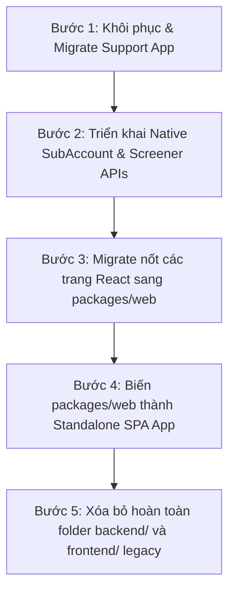

# BÁO CÁO KIỂM TOÁN KIẾN TRÚC SAAS NATIVE & MONOLITH DECOMMISSION

**Ngày audit:** 2026-06-10  
**Đối tượng kiểm toán:** Toàn bộ mã nguồn dự án VNInvest (Frontend React & Backend Django/SaaS Core)  
**Mục tiêu:** Đánh giá mức độ chuyển đổi sang kiến trúc SaaS native OpenAPI, chỉ ra các thành phần chưa được chuyển đổi còn phụ thuộc vào legacy monolith cũ (ở cả Backend và Frontend), và đề xuất lộ trình xử lý.

---

## 1. Tổng Quan Trạng Trạng Thái (Executive Summary)

Dự án đã đạt được bước tiến lớn khi chuyển đổi các REST API chính sang `core-api` và chính thức **tắt (decommission) toàn bộ legacy backend container** (`backend:8000`, `celery_worker`, `celery_beat`) trong cấu hình production (`docker-compose.prod.yml` và `docker-compose.yml`). Mọi traffic API từ Nginx hiện tại đều được định tuyến trực tiếp đến `packages/core/backend/` (`core-api` chạy Daphne/Gunicorn ở cổng `8100`).

Tuy nhiên, **kiến trúc hệ thống thực tế vẫn đang ở trạng thái lai (hybrid)** và tồn tại các khoảng trống nghiêm trọng (architectural gaps):
1. **Frontend Host vẫn là Legacy:** Ứng dụng Frontend triển khai trên production thực tế vẫn được build từ thư mục `frontend/` cũ (qua `frontend/Dockerfile.dev-package-shell`), đóng vai trò làm App Shell để import `@vninvest/web` như một thư viện ngoài.
2. **Nhiều trang/tính năng phía Frontend chưa migrate:** Các route quan trọng như `/support`, `/transactions`, `/watchlist`, `/settings` trên production vẫn render trực tiếp các trang legacy từ `frontend/src/pages/` thay vì dùng mã nguồn native từ `@vninvest/web`.
3. **Tính năng Support Ticket bị lỗi hoàn toàn (HTTP 404):** Hệ thống support ticket vẫn nằm 100% ở app legacy `backend/support/`. Khi tắt legacy backend, `core-api` không có route định tuyến cho `/api/support/`, khiến tính năng này hoàn toàn tê liệt ở production.
4. **Các API stubs trả về dữ liệu rỗng (GenericEmptyListView):** Các tính năng quan trọng như Tiểu khoản (`SubAccounts`), Trình lọc cổ phiếu (`Screener`), và một số danh sách của `AI Advisory` vẫn đang bị "khóa cứng" ở trạng thái rỗng do `core-api` chỉ triển khai stubs rỗng để tương thích ngược.

---

## 2. Kiểm Toán Phân Hệ Frontend (Frontend Architecture Audit)

Kiến trúc frontend hiện tại là mô hình **Package Shell Host** (không phải SaaS Native độc lập):

```
[Nginx Port 80] 
     │
     ▼
[Frontend Container] (Build từ thư mục /frontend cũ)
     │
     ├─ Route: /support, /transactions, /watchlist, /settings 
     │       └──► Gọi trực tiếp React pages legacy trong frontend/src/pages/
     │
     ├─ Route: /dashboard, /stocks/:symbol
     │       └──► Dùng bridge host (PackageDashboardHost, StockDetailPageHost) để wrap @vninvest/web pages
     │
     └─ Route: /login, /register, /whale-alerts
             └──► Dùng trực tiếp page từ packages/web (@vninvest/web)
```

### Các điểm tồn tại cụ thể:

1. **Thiếu cấu hình Build & Deploy độc lập cho `packages/web`:**  
   `packages/web` hiện tại chỉ được cấu hình như một thư viện NPM nội bộ (`@vninvest/web`), không có build tool standalone (như Vite hoặc Next.js), không có dev server và HTML entry point riêng. Việc deploy production bắt buộc phải chạy qua pipeline build của legacy `frontend/`.
2. **Các trang người dùng vẫn chạy code cũ (Legacy Pages):**  
   Trong file [App.jsx](file:///c:/Mujoco%20Projects/vninvest/frontend/src/App.jsx), khi `packageShellHostEnabled` là `false` (mặc định ở production):
   * **Transactions:** Render `<Transactions />` legacy từ `frontend/src/pages/Transactions.jsx`.
   * **Watchlist:** Render `<Watchlist />` legacy từ `frontend/src/pages/Watchlist.jsx`.
   * **Settings:** Render `<UserConfig />` legacy từ `frontend/src/pages/UserConfig.jsx` & `<AICommandCenter />` từ `frontend/src/pages/AICommandCenter.jsx`.
   * **Support:** Render `<Support />` legacy từ `frontend/src/pages/Support.jsx`.
3. **Các API call trong frontend chưa đồng nhất:**  
   Các trang legacy vẫn import và gọi trực tiếp `apiClient` từ `frontend/src/api/client.js` để gọi các API cũ thay vì đi qua `coreApiAdapter` của `packages/web`.

---

## 3. Kiểm Toán Phân Hệ Backend (Backend & API Audit)

Mặc dù `backend:8000` cũ đã bị tắt, `core-api` vẫn chứa nhiều vết tích chắp vá để giữ hệ thống không bị crash (tương thích ngược).

### 3.1 Tính năng Support Ticket bị lỗi hoàn toàn ở Production

Hệ thống Support Ticket (`/api/support/tickets/`) vẫn nằm hoàn toàn trong module `backend/support/` (chứa các model `SupportTicket`, `TicketMessage`, `TicketAttachment` và tệp cấu hình `views.py`/`urls.py`). 
* Nginx trong production chuyển toàn bộ `/api/` traffic sang `core-api:8100`.
* Ở `core-api` (`packages/core/backend/src/vninvest_core/urls.py`), **hoàn toàn không import hay cấu hình route cho phân hệ support**.
* **Hậu quả:** Mọi yêu cầu tạo hoặc xem ticket từ màn hình `/support` của người dùng đều trả về **HTTP 404 Not Found**, tính năng support bị tê liệt hoàn toàn.

### 3.2 Lạm dụng API Stubs trả về dữ liệu rỗng (GenericEmptyListView)

Để tránh lỗi crash frontend khi gọi các API chưa migrate, `core-api` đang cấu hình các class stub `GenericEmptyListView` và `GenericEmptyStaffView` tại [legacy_stubs.py](file:///c:/Mujoco%20Projects/vninvest/packages/core/backend/src/vninvest_core/utils/legacy_stubs.py). 

Đối chiếu với [urls.py của user_workspace](file:///c:/Mujoco%20Projects/vninvest/packages/core/backend/src/user_workspace/urls.py#L79-L115):

* **SubAccounts & Transactions:**
  * `/api/portfolio/subaccounts/` $\rightarrow$ Trả về `[]` (Stub).
  * `/api/portfolio/subaccounts/<id>/transactions/` $\rightarrow$ Trả về `[]` (Stub).
  * *Hậu quả:* Tính năng quản lý tiểu khoản giao dịch của người dùng không hiển thị dữ liệu nào trên production.
* **Screener (Bộ lọc cổ phiếu):**
  * `/api/portfolio/screener/rules/` $\rightarrow$ Trả về `[]` (Stub).
  * `/api/portfolio/admin/screener/...` $\rightarrow$ Trả về `[]` (Stub).
  * *Hậu quả:* Người dùng không thể tạo hoặc chạy các quy tắc lọc cổ phiếu.
* **AI Advisory lists:**
  * `/api/portfolio/ai-advisory/` $\rightarrow$ Trả về `[]` (Stub).
  * `/api/portfolio/ai-advisory-symbol-stats/` $\rightarrow$ Trả về `[]` (Stub).
  * *Lưu ý:* Các API chi tiết của từng mã (`/canonical/`, `/current/`, `/refresh/`) đã được migrate sang native, nhưng API danh sách tổng quan vẫn là stub rỗng.

---

## 4. Kiểm Toán Phân Hệ Dữ Liệu (Database Schema Audit)

Cơ sở dữ liệu production đã tách thành công sang database mới `vninvest_core` chạy PostgreSQL 16. Tuy nhiên, do các phân hệ chưa được migrate hoàn chỉnh, cấu trúc dữ liệu bị ảnh hưởng:

1. **Thiếu bảng dữ liệu Support:**  
   Bảng dữ liệu lưu trữ support ticket (`SupportTicket`, `TicketMessage`, v.v.) chưa từng được migrate sang schema `vninvest_core`. Dữ liệu support cũ vẫn nằm ở DB legacy và không thể truy cập từ core.
2. **Mồ côi dữ liệu do thiếu API ghi:**  
   Mặc dù các model như `SubAccount` đã được định nghĩa trong `user_workspace/models.py` của Core và có trường `tenant` để cô lập dữ liệu SaaS, nhưng do thiếu REST API để ghi (POST/PATCH), các bảng này hiện đang trống hoặc chỉ chứa dữ liệu đồng bộ một chiều từ DNSE LightSpeed API, người dùng không thể tự quản lý tiểu khoản.

---

## 5. Khuyến Nghị Hành Động & Lộ Trình Xử Lý (Action Plan)

Để giải quyết triệt để trạng thái hybrid và hoàn thành mục tiêu **SaaS Full Independence (Tách biệt hoàn toàn khỏi Legacy)**, đề xuất lộ trình 5 bước sau:



### Bước 1: Khôi phục và Migrate Support App (Ưu tiên 1 - Khẩn cấp)
* **Backend:** Copy app `support` từ `backend/support` sang `packages/core/backend/src/support`.
  * Thực hiện migrate schema tạo các bảng support trong DB `vninvest_core`.
  * Cấu hình route `/core/v1/support/` và `/api/support/` trỏ vào native views trong core.
  * Thêm logic lọc theo `tenant` (Tenant Isolation) cho các model support.
* **Frontend:** Di chuyển trang [Support.jsx](file:///c:/Mujoco%20Projects/vninvest/frontend/src/pages/Support.jsx) vào `packages/web/src/pages/SupportPage.js` và chuyển các hàm gọi API sang `coreApiAdapter`.

### Bước 2: Xây dựng REST API Native cho SubAccount & Screener
* **Backend:** Loại bỏ `GenericEmptyListView` trong [user_workspace/urls.py](file:///c:/Mujoco%20Projects/vninvest/packages/core/backend/src/user_workspace/urls.py).
  * Viết các view `SubAccountListCreateAPIView` và `TransactionListCreateAPIView` native trong core trỏ trực tiếp vào các model `SubAccount` và `Transaction` của core.
  * Porting logic Screener Rule từ legacy `backend/portfolio/views_screener.py` sang `packages/core/backend/src/user_workspace/views_screener.py`.

### Bước 3: Đồng bộ hóa toàn bộ Frontend Pages sang `packages/web`
* Di chuyển nốt các trang React còn lại trong `frontend/src/pages/` (`Transactions`, `Watchlist`, `UserConfig`, `AICommandCenter`) vào thư mục `packages/web/src/pages/`.
* Cập nhật `packages/web/src/index.js` để export toàn bộ các page này.
* Thay thế toàn bộ component render trong [App.jsx](file:///c:/Mujoco%20Projects/vninvest/frontend/src/App.jsx) bằng các page được import từ `@vninvest/web`.

### Bước 4: Chuyển đổi `packages/web` thành Standalone SPA App
* Thêm cấu hình bundler (Vite hoặc Webpack/Turbopack) trực tiếp vào `packages/web`.
* Tạo tệp `index.html` làm entry point cho `packages/web`.
* Cấu hình Dockerfile của frontend để build trực tiếp từ `packages/web` thay vì đi qua shell `frontend/`.
* **Xóa bỏ hoàn toàn** hai thư mục `backend/` và `frontend/` cũ ở gốc dự án để kết thúc quá trình decommission.
