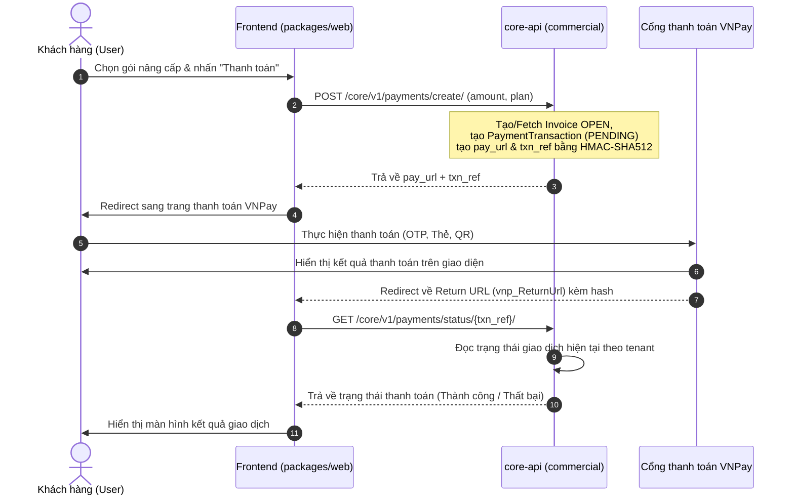
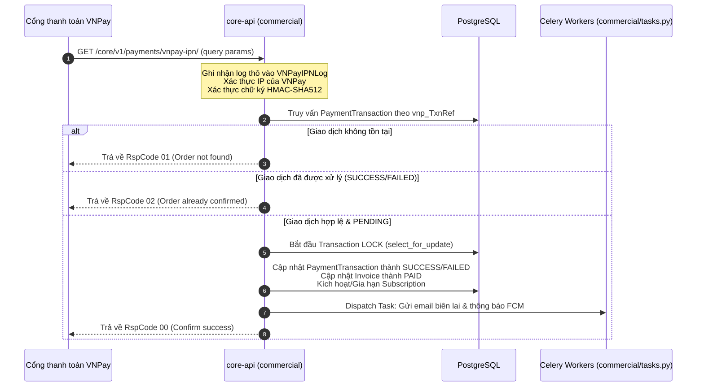
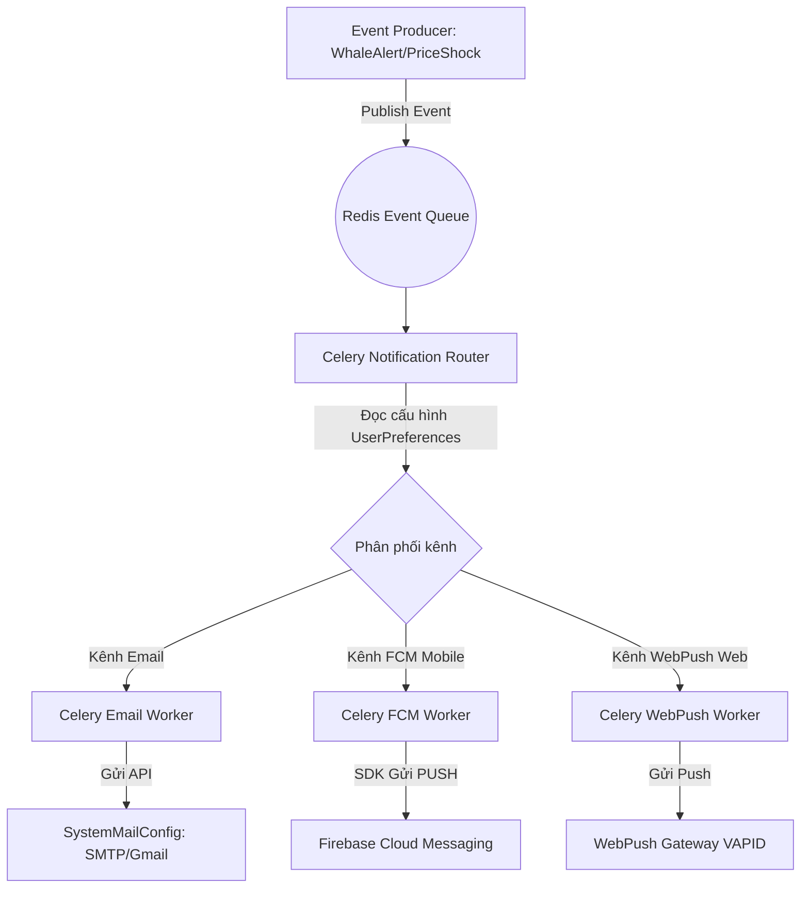
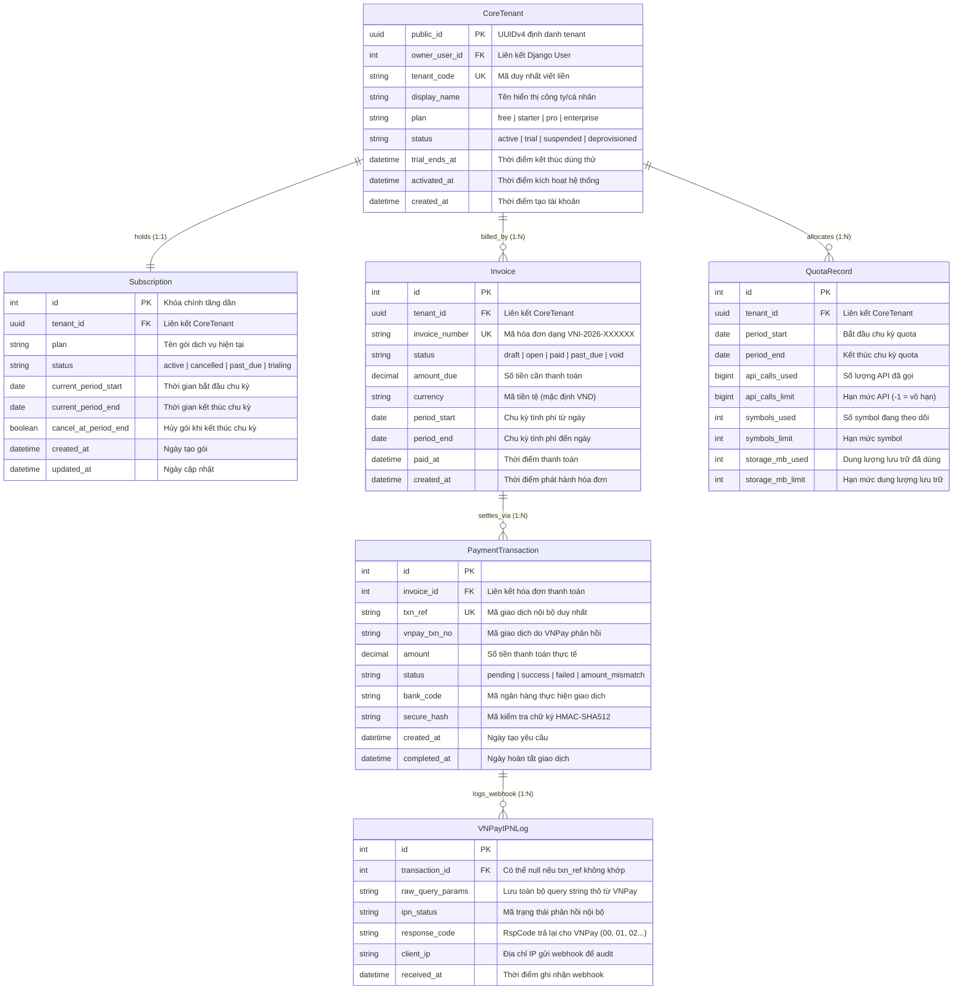

# BÁO CÁO THIẾT KẾ KIẾN TRÚC CHI TIẾT & LỘ TRÌNH PHÁT TRIỂN
## PHÂN HỆ BILLING, NOTIFICATIONS, CLEAN CODE REFACTOR & DOMAIN ERD
**Mã tài liệu:** `VNI-ADD-20260528-v1.0`
**Dự án:** VNInvest Enterprise SaaS Platform
**Thư mục lưu trữ:** `docs/detailed_designs/`
**Trạng thái:** CODE-ALIGNED WORKING DESIGN (SYNCED WITH CURRENT IMPLEMENTATION ANCHORS)

---

## 1. GIỚI THIỆU CHUNG
Tài liệu này được lập ra nhằm đào sâu, phân tích kỹ thuật chi tiết và đặc tả kiến trúc cho 4 cấu phần then chốt giúp nâng cấp **VNInvest** thành hệ thống đầu tư chứng khoán cấp thương mại (Enterprise SaaS-Native):
1. **Thiết kế chi tiết Payment Gateway**: Tích hợp cổng thanh toán VNPay, luồng IPN, kiểm tra mã chữ ký (HMAC-SHA512), xử lý đồng thời (Race Conditions), đối soát dữ liệu và Tenant/Subscription Isolation.
2. **Notification Pipeline đa kênh**: Pipeline gửi thông báo độ trễ thấp qua Email, Firebase Cloud Messaging (FCM) cho Mobile, WebPush cho Browser, quản lý cấu hình thông báo (UserPreferences) và chống nghẽn queue bằng Celery/Redis.
3. **Kế hoạch Refactor "Fat Files"**: Phân tích thực tế các tệp cồng kềnh trong `packages/core` và `packages/web`, thiết lập quy tắc Clean Architecture, và phân tách thành Services, Repositories, Custom Hooks.
4. **ERD & Schema chi tiết của Domain Billing & Subscriptions**: Sơ đồ Mermaid ERD và cấu trúc bảng chi tiết trong PostgreSQL, các khóa ngoại, ràng buộc liên kết (constraints), chỉ mục (indexes) phục vụ hiệu năng tối đa.

---

## 2. THIẾT KẾ CHI TIẾT PAYMENT GATEWAY (VNPAY INTEGRATION)

### 2.1 Luồng Nghiệp Vụ Thanh Toán (Payment Workflow)
Luồng thanh toán được thiết kế độc lập cho từng Tenant (SaaS Tenant Isolation). Mỗi giao dịch thanh toán sẽ được liên kết trực tiếp với `CoreTenant` và `Invoice` tương ứng.



> [!NOTE]
> Trong code hiện tại chưa có endpoint `verify-redirect` riêng. Frontend cần bám `txn_ref` và đọc `PaymentStatusCheckView` để phản ánh trạng thái giao dịch sau redirect.

### 2.2 Luồng IPN Webhook (Instant Payment Notification)
IPN là webhook bất đồng bộ từ VNPay gửi đến `core-api` để cập nhật trạng thái thanh toán cuối cùng một cách tin cậy. Nhằm loại bỏ rủi ro mất mát dữ liệu khi mạng lỗi, luồng này sử dụng cơ chế bảo vệ kép.



### 2.3 Bảo Mật và Xác Thực Chữ Ký (HMAC-SHA512 Checksum)
VNPay sử dụng thuật toán HMAC-SHA512 với mã bí mật `vnp_HashSecret` để ký số dữ liệu. Quy trình sinh mã bảo mật tại backend như sau:

```python
import hashlib
import hmac
import urllib.parse

def generate_vnpay_checksum(hash_secret: str, params: dict) -> str:
    # 1. Sắp xếp các tham số theo bảng chữ cái A-Z
    sorted_params = sorted(params.items())

    # 2. Xây dựng chuỗi query string gốc
    query_parts = []
    for key, value in sorted_params:
        if key.startswith('vnp_'):
            # Urlencode các giá trị tham số
            query_parts.append(f"{key}={urllib.parse.quote_plus(str(value))}")

    query_string = "&".join(query_parts)

    # 3. Ký số bằng HMAC-SHA512
    signature = hmac.new(
        hash_secret.encode('utf-8'),
        query_string.encode('utf-8'),
        hashlib.sha512
    ).hexdigest()

    return signature
```

### 2.4 Xử Lý Các Edge Cases
- **Thanh toán lặp (Race Conditions)**: Nếu VNPay gọi IPN đồng thời với việc người dùng chuyển hướng về Return URL, hệ thống sử dụng khóa hàng `select_for_update()` trong database đối với `PaymentTransaction`. Luồng nào lấy được khóa trước sẽ thực hiện việc cập nhật trạng thái, luồng thứ hai sẽ nhận thấy giao dịch đã xử lý (`Order already confirmed`) và bỏ qua.
- **Sai lệch số tiền (Amount Mismatch)**: Phải đối chiếu giá trị `vnp_Amount` (quy đổi về giá gốc) với thuộc tính `amount_due` của bản ghi `Invoice`. Nếu không khớp, cập nhật trạng thái giao dịch thành `AMOUNT_MISMATCH` và đánh dấu cảnh báo để quản trị viên kiểm soát thủ công.
- **VNPay Timeout/Không có IPN**: Thiết kế mục tiêu là có Celery beat quét các giao dịch PENDING lớn hơn 30 phút và gọi `vnpay_query_transaction`. Phần reconciliation này hiện chưa có evidence hoàn chỉnh trong codebase và phải được coi là backlog tiếp theo của payment workstream.

---

## 3. LOW-LATENCY NOTIFICATION PIPELINE (EMAIL + FCM + WEBPUSH)

Để đáp ứng tiêu chuẩn phần mềm đẳng cấp, pipeline thông báo cần xử lý real-time với độ trễ dưới 2 giây đối với thông báo khẩn cấp (như cảnh báo cá mập - Whale Alerts, biến động giá - Price Shock) và đảm bảo khả năng mở rộng tốt.

### 3.1 Kiến Trúc Pipeline
Hệ thống sử dụng mô hình **Publisher-Subscriber** qua Redis Broker và Celery Task để tách biệt việc xử lý logic nghiệp vụ và việc gửi thông báo.



### 3.2 Đặc Tả Từng Kênh Gửi (Kèm Code Cấu Trúc)

#### A. Kênh FCM (Mobile Push Notifications)
Sử dụng thư viện `firebase-admin` của Google để gửi thông báo đẩy trực tiếp đến app thiết bị di động của người dùng.

```python
import firebase_admin
from firebase_admin import credentials, messaging

def send_fcm_push(device_token: str, title: str, body: str, data: dict = None):
    # Khởi tạo Firebase App nếu chưa có
    if not firebase_admin._apps:
        cred = credentials.Certificate("/app/secrets/firebase_service_account.json")
        firebase_admin.initialize_app(cred)

    message = messaging.Message(
        notification=messaging.Notification(
            title=title,
            body=body,
        ),
        data=data or {},
        token=device_token,
        android=messaging.AndroidConfig(
            priority='high',
            notification=messaging.AndroidNotification(
                sound='default',
                icon='stock_ic_alert'
            )
        ),
        apns=messaging.APNSConfig(
            payload=messaging.APNSPayload(
                aps=messaging.Aps(
                    sound='default',
                    badge=1
                )
            )
        )
    )

    try:
        response = messaging.send(message)
        return {"status": "success", "msg_id": response}
    except Exception as e:
        return {"status": "failed", "error": str(e)}
```

#### B. Kênh WebPush (Browser Push Notifications)
Dùng phương thức mã hóa VAPID (Voluntary Application Server Identification) để gửi thông báo trực tiếp đến Service Worker trên trình duyệt của người dùng (Chrome, Safari, Firefox).

```python
from pywebpush import webpush, WebPushException
import json

def send_web_push(subscription_info: dict, title: str, body: str, icon_url: str = None, target_url: str = None):
    # subscription_info: {endpoint, keys: {p256dh, auth}} nhận được từ JS Navigator
    private_key_pem = "/app/secrets/vapid_private_key.pem"

    payload = {
        "title": title,
        "body": body,
        "icon": icon_url or "https://vninvest.vn/logo.png",
        "url": target_url or "https://vninvest.vn/dashboard"
    }

    try:
        webpush(
            subscription_info=subscription_info,
            data=json.dumps(payload),
            vapid_private_key=private_key_pem,
            vapid_claims={
                "sub": "mailto:support@vninvest.vn"
            }
        )
        return {"status": "success"}
    except WebPushException as ex:
        # Nếu thiết bị đã ngắt kết nối hoặc xóa đăng ký
        if ex.response is not None and ex.response.status_code in [404, 410]:
            # Đánh dấu subscription hết hạn trong DB
            pass
        return {"status": "failed", "error": str(ex)}
```

#### C. Kênh Email (Dynamic SystemMailConfig)
Tích hợp trực tiếp với lớp cấu hình `SystemMailConfig` đã có trong module `identity_access`. Hỗ trợ chuyển đổi giữa SMTP Server tiêu chuẩn (như SendGrid, Mailgun) và Google Gmail API sử dụng DWD (Domain-Wide Delegation).

### 3.3 Thiết Lập Bảng Notification Preferences Per User
Mỗi người dùng cần được tùy biến kênh thông báo để tránh gây phiền hà (Alert Spam). Cấu hình này được định nghĩa trực tiếp trong DB PostgreSQL:

- **Các nhóm sự kiện chính**:
  1. `whale_alert`: Biến động giao dịch của cổ đông lớn / lệnh khủng.
  2. `price_shock`: Giá đột biến đột ngột vượt 3% trong phiên.
  3. `billing_and_account`: Thông báo hóa đơn, hạn gia hạn gói, bảo mật.
  4. `ai_advisory`: Gợi ý danh mục từ AI Advisor.
- **Kênh thông báo**: `Email`, `MobilePush` (FCM), `WebPush` (Browser).

---

## 4. REFACTOR KẾ HOẠCH CHO CÁC FAT FILES

Dựa trên kết quả quét mã thực tế của dự án, chúng tôi đã phát hiện một số tệp đang phình to đáng báo động tại các phân hệ SaaS Native mới. Dưới đây là kế hoạch chi tiết để phân rã chúng theo tiêu chuẩn **Clean Architecture** (SaaS Enterprise grade).

### 4.1 Bảng Phân Tích Thực Trạng Tệp Lớn (Fat Files Inventory)

| Cấu phần | Đường dẫn tệp | Số dòng | Vấn đề kỹ thuật | Giải pháp Refactor |
| :--- | :--- | :--- | :--- | :--- |
| **Backend Core** | `staticfiles/rest_framework/css/...` | 1338 | Tệp CSS tĩnh mặc định. | Không cần refactor nghiệp vụ, bỏ qua khỏi kiểm tra linting. |
| **Backend Core** | `service_ops/views/dataops.py` | 7 | Đã refactor thành facade import. Các xử lý DataOps được tách thành `services/backfill_service.py` và `services/materializer.py`. | Tách thành các lớp xử lý nghiệp vụ riêng biệt. |
| **Backend Core** | `identity_access/views_auth.py` | 8 | Đã refactor thành facade. Các luồng đăng nhập, đăng ký, đổi mật khẩu được chia ra controller riêng. | Chia thành các Controller chuyên biệt: `views/login.py`, `views/register.py`, `views/password_reset.py`, vv. |
| **Backend Core** | `service_ops/tasks.py` | 1080 | Chứa logic của hàng chục task Celery xử lý bất đồng bộ. | Đưa logic thực tế ra `services/` layer, file `tasks.py` chỉ làm nhiệm vụ nhận tham số đầu vào và gọi Service tương ứng (Wrapper). |
| **Frontend Web** | `pages/AlertCenterPage.js` | 478 | Đã phân rã thành các component con độc lập trong thư mục `components/alert-center/`. | Phân rã thành các component con độc lập, quản lý state qua custom hook. |
| **Frontend Web** | `adapters/coreApiAdapter.js` | 56 | Đã phân rã thành các client API chuyên biệt theo Domain. | Phân rã thành các client API chuyên biệt, giữ tệp gốc làm Facade tương thích ngược. |

### 4.2 Hướng Dẫn Refactor Cho Một Tệp Cụ Thể (Ví dụ `coreApiAdapter.js`)

#### A. Kiến trúc tệp cũ (Fat Monolith):
```javascript
// packages/web/src/adapters/coreApiAdapter.js
class CoreApiAdapter {
    // 1270 dòng chứa API của User, Tenant, Billing, MarketData, Screener, Alerts...
    login(credentials) { ... }
    register(data) { ... }
    getSubscription() { ... }
    payInvoice(id) { ... }
    getKLineData(symbol) { ... }
    getWhaleAlerts() { ... }
    // ...
}
export const coreApiAdapter = new CoreApiAdapter();
```

#### B. Kiến trúc đề xuất mới (Decoupled Modular Architecture):
Tạo cấu trúc thư mục con tại `packages/web/src/adapters/core/`:
- `packages/web/src/adapters/core/client.js` (Lớp Base HTTP client cấu hình JWT, Interceptor, Error handling)
- `packages/web/src/adapters/core/auth.js` (Auth & User API)
- `packages/web/src/adapters/core/billing.js` (Payments, Invoices, Subscriptions)
- `packages/web/src/adapters/core/market.js` (KLine, Market Data, Symbols)

**Mã nguồn tệp `coreApiAdapter.js` sau khi refactor (hiện còn 56 dòng, giữ vai trò facade):**
```javascript
import { createCoreTransport } from './core/transport.js';
import { createAuthClient } from './core/auth.js';
import { createMarketClient } from './core/market.js';
import { createWorkspaceClient } from './core/workspace.js';

export function createCoreApiAdapter(options = {}) {
    const transport = createCoreTransport(options.env || {}, options);
    const authClient = createAuthClient(transport);
    const marketClient = createMarketClient(transport);
    const workspaceClient = createWorkspaceClient(transport);
    return { ...authClient, ...marketClient, ...workspaceClient };
}
```

---

## 5. BẢN VẼ ERD CHI TIẾT CHO DOMAIN "BILLING & SUBSCRIPTION"

Để giúp đội ngũ phát triển có góc nhìn nghiệp vụ rõ ràng nhất, chúng tôi đặc tả sơ đồ thực thể liên kết (ERD) chi tiết cho **Domain Billing & Subscription** tích hợp chặt chẽ với cơ chế multi-tenancy của VNInvest.

### 5.1 Sơ Đồ Thực Thể Liên Kết (Mermaid ERD)



### 5.2 Đặc Tả Schema và Ràng Buộc Dữ Liệu (PostgreSQL)

#### 1. Bảng `commercial_subscription`
Bảng lưu trữ thông tin gói đăng ký của từng Tenant.
- **Ràng buộc khóa ngoại**: `tenant_id` liên kết đến `identity_access_coretenant(public_id)` kiểu `ON DELETE CASCADE`.
- **Ràng buộc duy nhất (Unique)**: `tenant_id` phải là khóa duy nhất để đảm bảo mỗi Tenant chỉ có tối đa một gói Subscription hoạt động tại một thời điểm (One-to-One).
- **Indices**:
  - `IDX_subscription_status_plan`: Chỉ mục phức hợp trên (`status`, `plan`) nhằm tối ưu các truy vấn lọc danh sách khách hàng VIP hoặc khách hàng trễ hạn thanh toán.
  - `IDX_subscription_current_period_end`: Tối ưu tác vụ chạy ngầm kiểm tra hạn dùng gói cước hàng đêm.

#### 2. Bảng `commercial_invoice`
Lưu trữ hóa đơn thanh toán.
- **Ràng buộc khóa ngoại**: `tenant_id` liên kết `identity_access_coretenant(public_id)`.
- **Mã hóa đơn duy nhất (Unique)**: `invoice_number` phải là duy nhất trên toàn hệ thống.
- **Check Constraints**: `amount_due >= 0` (Số tiền hóa đơn không được âm).
- **Indices**:
  - `IDX_invoice_number`: Bắt buộc chỉ mục unique để truy vấn hóa đơn cực nhanh.
  - `IDX_invoice_tenant_status`: Tối ưu trang quản lý hóa đơn của người dùng (`WHERE tenant_id = ? AND status = ?`).

#### 3. Bảng `commercial_paymenttransaction`
Lưu các bản ghi yêu cầu thanh toán.
- **Ràng buộc khóa ngoại**: `invoice_id` liên kết đến `commercial_invoice(id)`.
- **Khóa duy nhất nội bộ**: `txn_ref` (Mã tham chiếu giao dịch sinh ngẫu nhiên khi người dùng nhấn thanh toán) là duy nhất.
- **Indices**:
  - `IDX_payment_txn_ref`: Unique index dùng để đối chiếu IPN từ VNPay (`WHERE txn_ref = vnp_TxnRef`).
  - `IDX_payment_vnpay_txn_no`: Chỉ mục phi độc lập hỗ trợ tìm kiếm khi đối soát thủ công qua admin portal của VNPay.

#### 4. Bảng `commercial_vnpayipnlog`
Lịch sử lưu trữ toàn bộ các webhook được gọi từ VNPay. Bảng này đóng vai trò như một sổ nhật ký kiểm toán (Audit Trail) không bao giờ được xóa hoặc sửa (Write-Once-Read-Only).
- **Ràng buộc khóa ngoại**: `transaction_id` liên kết `commercial_paymenttransaction(id)` kiểu `SET NULL` để tránh mất dữ liệu log khi tham chiếu bị lỗi.
- **Indices**:
  - `IDX_ipn_received_at`: Tối ưu việc lọc báo cáo log theo ngày.

---

## 6. KẾ HOẠCH BÀN GIAO & CÁC CÂU HỎI CẦN THẢO LUẬN
Báo cáo chi tiết này đã được lưu trữ an toàn trong dự án tại địa chỉ:
`docs/detailed_designs/SYSTEM_DETAILED_DESIGN_20260528.md`

### Các quyết định cần thảo luận tiếp theo:
1. **Chính sách gia hạn Subscription**:
   - Đối với gói PRO đang hoạt động, nếu người dùng thanh toán trước 5 ngày khi hết hạn chu kỳ, chúng ta sẽ **cộng dồn thời gian sử dụng** vào chu kỳ tiếp theo hay kích hoạt gói mới lập tức? *(Khuyến nghị: Cộng dồn ngày vào `current_period_end`)*.
2. **Kênh thông báo mặc định cho Người dùng mới**:
   - Khi tạo mới tài khoản, những loại thông báo nào sẽ mặc định được kích hoạt gửi Email? *(Khuyến nghị: Chỉ kích hoạt mặc định Email cho Billing/Security, còn các cảnh báo Whale Alert/Price Shock bắt buộc người dùng tự opt-in để tránh spam)*.
3. **Mức độ khắt khe của Guardrails chống "Fat Files"**:
   - Hiện tại file `check_large_files.ps1` đang đặt giới hạn cứng là 1200 dòng. Chúng ta có muốn siết chặt xuống 1000 dòng đối với mã nguồn viết mới hoàn toàn trong `packages/core` và `packages/web` hay không? *(Khuyến nghị: Enforce 1000 dòng cho code mới, giữ 1200 dòng cho code kế thừa)*.`n