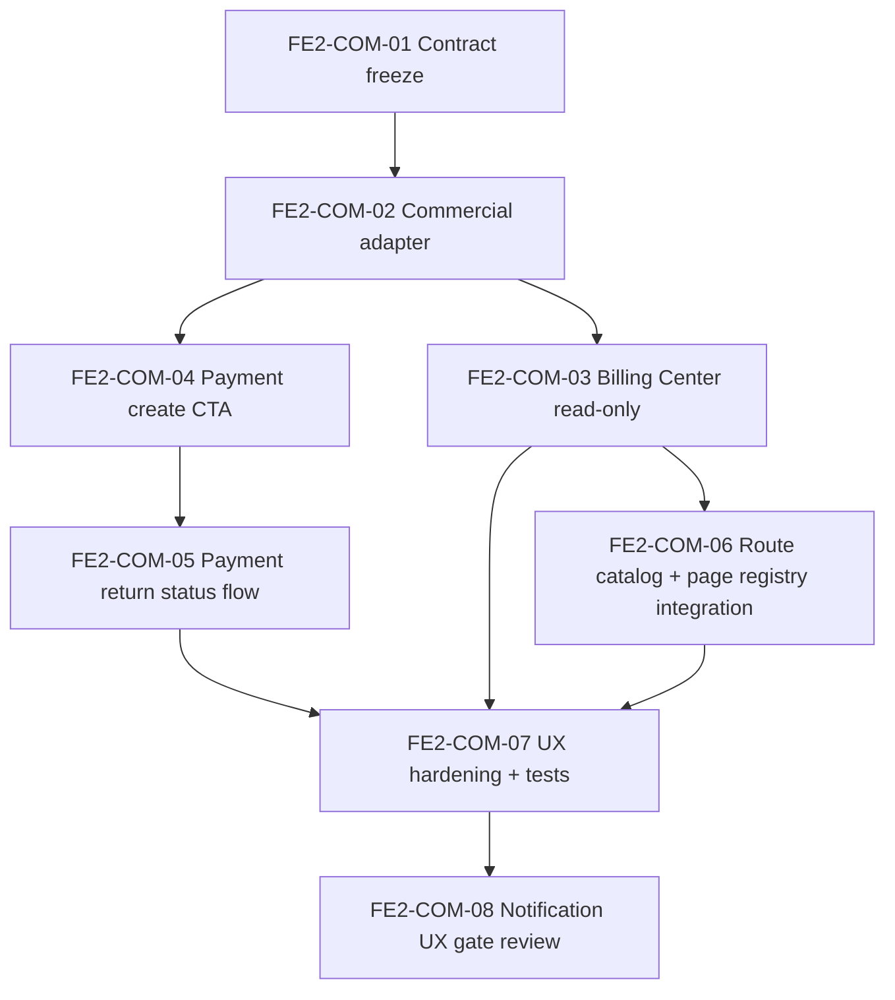

# Implementation Plan — VNPAY Billing Notification Frontend SaaS OpenAPI Phase 2
**Ngày**: 2026-05-28
**Trạng thái**: Execution-ready
**Program Name**: `VNPAY_BILLING_NOTIFICATION_FRONTEND_SAAS_OPENAPI_PHASE2`

---

## 1. Mục tiêu triển khai

1. Xây commercial self-service frontend trong `packages/web` cho Billing Center và Payment Return.
2. Thêm commercial domain adapter nhưng vẫn giữ `coreApiAdapter.js` làm facade duy nhất cho callers.
3. Thiết lập notification UX theo hướng contract-first; khóa deferred gate nếu backend notification API chưa sẵn sàng.

---

## 2. Dependency graph

---

## 3. Slice breakdown

| Task ID | Slice | Scope | Primary files | Definition of Done |
|---|---|---|---|---|
| FE2-COM-01 | Contract freeze | Review `/billing/*` và `/payments/*`, xác nhận OpenAPI semantics | `commercial/urls.py`, `commercial/views.py`, docs pack | Không còn mơ hồ về method, path, auth, success/error states |
| FE2-COM-02 | Commercial adapter | Tạo `adapters/core/commercial.js`, nối vào facade | `packages/web/src/adapters/core/commercial.js`, `coreApiAdapter.js` | Có API client cho subscription, quota, invoices, create payment, payment status; không direct fetch |
| FE2-COM-03 | Billing Center read-only | Page, hooks, view models cho summary + invoices | `pages/commercial/*`, `hooks/*`, `components/*` | Billing Center render đúng loading/empty/error/data state; invoices có pagination posture |
| FE2-COM-04 | Payment create CTA | CTA upgrade/pay từ Billing Center hoặc invoice row | `pages/commercial/BillingCenterPage.js`, `components/commercial/*` | Chặn double submit, validate payload, redirect đúng `pay_url` |
| FE2-COM-05 | Payment return flow | Route `/commercial/payment-return` và state machine đối soát | `pages/commercial/PaymentReturnPage.js` | Query params không còn là truth cuối; status endpoint quyết định UI outcome |
| FE2-COM-06 | Route integration | Đăng ký route catalog, page registry, navigation placement | `app/routeCatalog.js`, `pages/pageRegistry.js`, `navigationCatalog.js` | Routes được mount đúng build target `saas`/`vip` và có capability gates rõ |
| FE2-COM-07 | UX hardening + tests | Error mapping, accessibility, i18n, automated tests | tests cho adapter/page + copy bundle | Tests và build-community pass; field_errors map đúng UI |
| FE2-COM-08 | Notification UX gate review | Chỉ mở code nếu backend notification OpenAPI đã sẵn sàng | docs + route feature flag | Có quyết định rõ: implement hoặc defer; tuyệt đối không half-ship notification truth |

---

## 4. Deliverable breakdown theo slice

### FE2-COM-01
1. Freeze endpoint map cho commercial frontend.
2. Xác nhận rate-limit / auth / tenant isolation assumptions từ backend docs.
3. Cập nhật gap register nếu invoice pagination hoặc create-payment schema chưa đủ chặt.

### FE2-COM-02
1. Thêm commercial domain module vào `packages/web/src/adapters/core/`.
2. Chuẩn hóa error throw qua `CoreApiRequestError` hoặc wrapper tương thích.
3. Không làm phình `coreApiAdapter.js` trở lại trạng thái fat file.

### FE2-COM-03
1. Billing Center summary strip: plan, subscription status, invoice state, next invoice, quota posture.
2. Invoices table phải có server pagination semantics và empty state trung thực.
3. Không render commercial data trong admin/operator shell page user-facing.

### FE2-COM-04
1. CTA thanh toán chỉ hoạt động khi payload hợp lệ.
2. Nếu backend trả `pay_url`, frontend redirect đúng 1 lần.
3. Nếu create thất bại, UI phải giữ nguyên context và hiển thị error envelope chuẩn.

### FE2-COM-05
1. Parse `txn_ref` từ query string hoặc persisted route state ngắn hạn.
2. Gọi `getPaymentStatus(txn_ref)` và render state `pending/success/failed/not_found`.
3. Có manual refresh action và retry guidance rõ ràng.

### FE2-COM-06
1. Route IDs mới phải đồng bộ route catalog, page registry, export surface.
2. Không thêm route vào legacy shell nếu chưa có package-web canonical page.
3. Payment return route phải không yêu cầu navigation exposure trong menu chính.

### FE2-COM-07
1. Unit tests cho adapter normalization và error mapping.
2. Page tests cho billing states và payment-return state machine.
3. Build gate dùng `npm --prefix packages/web run build-community`.

### FE2-COM-08
1. Kiểm tra có `/core/v1/notifications/*` contract chuẩn hay chưa.
2. Nếu chưa có: chỉ ship placeholder roadmap + no-op route ban.
3. Nếu đã có: mở slice riêng cho notification preferences và activity feed.

---

## 5. Risk matrix

| Risk | Severity | Mitigation |
|---|---|---|
| Frontend tin query params từ VNPay return URL | Critical | Luôn đối soát qua status endpoint trước khi hiển thị kết luận |
| Tái sử dụng `ShellMailConfigPage` cho notification center người dùng | High | Khóa non-goal trong tech spec + code review reject condition |
| Commercial adapter bị bypass bằng `fetch()` trực tiếp | High | Route review + grep gate trong runbook |
| Invoice list bị full-scan ở client | High | Cursor pagination theo contract; chặn merge nếu chưa có posture pagination |
| Notification UX triển khai khi backend contract chưa đủ | High | FE2-COM-08 là mandatory gate trước khi mở code notification |
| Hardcode callback/base URL trong page code | High | Config ownership matrix + code review grep |
| `coreApiAdapter.js` phình lại thành fat facade | Medium | Chỉ thêm domain import + compose object, không nhét business logic vào facade |

---

## 6. Validation gates toàn workstream

1. Consumer contract phải bám `docs/CORE_API_OPENAPI_FUNCTION_DESIGN_CONSTITUTION_20260513.md`.
2. Không được merge nếu error path render raw payload hoặc không map `field_errors`.
3. `npm --prefix packages/web test -- --runInBand` phải pass cho slice chạm `packages/web`.
4. `npm --prefix packages/web run build-community` phải pass ở slice chạm route/page/adapter.
5. Nếu chạm backend contract song song, phải có bằng chứng manage.py test cho `commercial` và `identity_access`.
6. Mọi slice phải sync docs, taskboard, ledger, progress, modified-files và module tree.

---

## 7. Rollout strategy

1. Bật feature bằng route-level rollout trong `packages/web` trước, không thay đổi shell legacy route hiện hữu ngoài scope cần thiết.
2. `Billing Center` có thể ship trước ở chế độ read-only.
3. `Payment create` và `payment-return` chỉ mở sau khi adapter + tests + rate-limit expectations đã xác nhận.
4. `Notification UX` là lane cuối và có thể tiếp tục deferred nếu backend contract chưa đạt OpenAPI gate.

---

## 8. Slice-exit gate bắt buộc

1. CODE: file anchors đúng ownership, không direct fetch, không legacy imports.
2. TEST: adapter/page tests + build-community pass.
3. AUDIT: grep checks sạch, không hardcoded callback/base URLs, không localStorage lưu transaction data dài hạn.
4. DOC-SYNC: taskboard, traceability, evidence template cập nhật.
5. COMMIT/PUSH: commit message mô tả đúng slice và evidence.