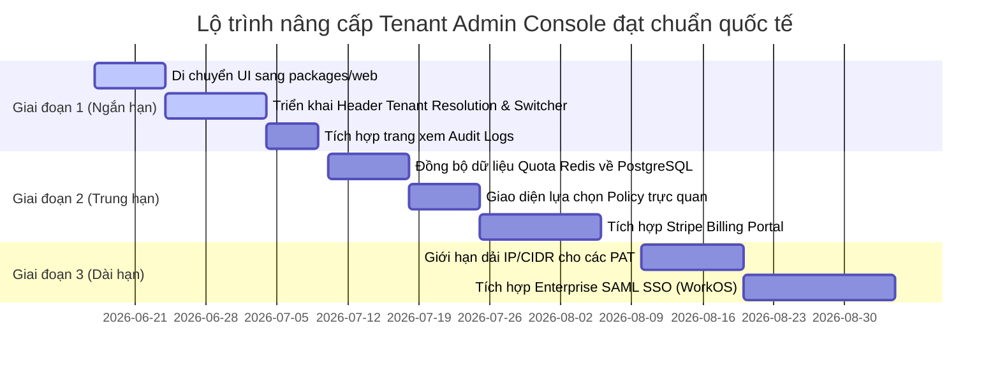

# BÁO CÁO RÀ SOÁT & ĐỀ XUẤT NÂNG CẤP HỆ THỐNG QUẢN TRỊ TENANT (TENANT CONSOLE)
**Dự án:** VNInvest Workspace  
**Tác giả:** Antigravity (Advanced Agentic Coding Agent)  
**Tài liệu:** `docs/feedback/tenant_admin_audit_report.md`  
**Trạng thái:** Sẵn sàng thảo luận  

---

## 1. Tóm tắt Đánh giá Chung (Executive Summary)

Hệ thống Tenant Administration của VNInvest hiện tại đã triển khai cấu trúc cơ bản của một sản phẩm **SaaS Native** đa người dùng (Multi-Tenancy) ở mức tối thiểu (MVP). Hệ thống bao gồm quản lý thông tin Workspace (Tenant Home/Capabilities), quản lý thành viên hợp tác (Tenant Members), cấu hình tài khoản máy/chương trình chạy tự động (Service Accounts) và Personal Access Tokens (PATs) phục vụ kết nối API, cùng với đo lường hạn mức (Usage) và thanh toán (Billing qua VNPay).

Tuy nhiên, hệ thống vẫn tồn tại các **khoảng cách kỹ thuật (Technical Gaps) và điểm chưa phù hợp nghiêm trọng** khi đối chiếu với các chuẩn mực SaaS quốc tế (như Vercel, Stripe, AWS, WorkOS). Điển hình nhất là thiết kế **1-đối-1 cứng nhắc giữa Người dùng và Tenant** ở mức API backend, thiếu cơ chế chuyển đổi không gian làm việc (Tenant Switcher) linh hoạt, thiếu cơ chế bảo mật nâng cao (như giới hạn IP cho token, MFA bắt buộc), và chưa hiển thị nhật ký kiểm định (Audit Logs) hay hỗ trợ Cổng thanh toán quốc tế (Stripe).

Tài liệu này phân tích chi tiết từng mã nguồn hiện có, chỉ ra các lỗ hổng kiến trúc và đề xuất lộ trình hành động chi tiết để nâng cấp sản phẩm đạt tiêu chuẩn B2B SaaS toàn cầu.

---

## 2. Rà Soát Chi Tiết Mã Nguồn Hiện Tại (Current Code Audits)

### 2.1. Phân tích Frontend (`frontend/src/pages/admin/tenant/`)
Các file giao diện quản trị tenant được viết bằng React sử dụng Tailwind CSS:
* **[TenantAdminHome.jsx](file:///c:/Mujoco%20Projects/vninvest/frontend/src/pages/admin/tenant/TenantAdminHome.jsx)**: Đóng vai trò Dashboard trung tâm hiển thị gói cước (`userPlan`), quyền truy cập (`abilities`), và hạn mức giới hạn (`quotaCaps`).
* **[TenantUsage.jsx](file:///c:/Mujoco%20Projects/vninvest/frontend/src/pages/admin/tenant/TenantUsage.jsx)**: Hiển thị các đồng hồ đo lưu lượng (meters) và quota.
* **[TenantBilling.jsx](file:///c:/Mujoco%20Projects/vninvest/frontend/src/pages/admin/tenant/TenantBilling.jsx)**: Liệt kê danh sách hóa đơn từ phân hệ `commercial` và tích hợp thanh toán.
* **[TenantMembers.jsx](file:///c:/Mujoco%20Projects/vninvest/frontend/src/pages/admin/tenant/TenantMembers.jsx)**: Quản lý thêm/bớt thành viên và danh sách lời mời chờ duyệt.
* **[TenantServiceAccounts.jsx](file:///c:/Mujoco%20Projects/vninvest/frontend/src/pages/admin/tenant/TenantServiceAccounts.jsx)** và **[TenantPATs.jsx](file:///c:/Mujoco%20Projects/vninvest/frontend/src/pages/admin/tenant/TenantPATs.jsx)**: Thiết lập tài khoản máy (M2M) và quản lý token (rotate/revoke/one-time secret reveal).

> [!WARNING]
> **Vấn đề tổ chức mã nguồn (Legacy vs SaaS Native)**
> Toàn bộ các file giao diện quản trị tenant hiện vẫn nằm trong thư mục deprecated `frontend/src/pages/admin/tenant/`. Mọi tính năng mới bắt buộc phải nằm ở thư mục SaaS native mới: **`packages/web`** (frontend) và **`packages/core`** (backend). Việc giữ UI ở thư mục cũ cản trở tiến trình đóng khóa legacy stack.

### 2.2. Phân tích Backend (`packages/core/backend/src/identity_access/`)
* **[models.py](file:///c:/Mujoco%20Projects/vninvest/packages/core/backend/src/identity_access/models.py)**: Định nghĩa `CoreTenant` chứa thông tin chủ sở hữu (`owner_user`), mã định danh (`public_id` UUID), cùng các gói cước (`PlanChoices`) và trạng thái (`StatusChoices`).
* **[tenant_member_views.py](file:///c:/Mujoco%20Projects/vninvest/packages/core/backend/src/identity_access/tenant_member_views.py)**: Điều phối phân quyền cộng tác.
* **[views_tenant.py](file:///c:/Mujoco%20Projects/vninvest/packages/core/backend/src/identity_access/views_tenant.py)**: API xử lý nghiệp vụ Service Accounts và Personal Access Token (PAT).
* **[permissions.py](file:///c:/Mujoco%20Projects/vninvest/packages/core/backend/src/identity_access/permissions.py)**: Cung cấp class `IsTenantActive` kiểm soát per-request ngăn chặn lập tức các tenant bị khóa (`SUSPENDED`/`DEPROVISIONED`).

---

## 3. Bảng So Sánh Với Phần Mềm SaaS Thương Mại Quốc Tế

Dưới đây là so sánh tính năng quản trị tenant của VNInvest với các chuẩn mực dịch vụ toàn cầu:

| Tính năng quản trị Tenant | Trạng thái VNInvest hiện tại | Chuẩn mực quốc tế (Stripe, Vercel, AWS, WorkOS, Supabase) | Đánh giá mức độ ưu tiên |
| :--- | :--- | :--- | :--- |
| **Không gian làm việc (Multi-Org / Switcher)** | **Yếu**. 1 User chỉ được sở hữu tối đa 1 Tenant chủ quản. Rất khó chuyển đổi linh hoạt. | 1 User (1 Email) có thể tạo nhiều Org, tham gia nhiều Org làm admin/viewer. Switcher cực kỳ mượt mà. | **Critical (P0)** |
| **Bảo mật API Token (PAT)** | **Khá tốt**. API dùng HMAC-SHA256, xoay vòng (grace period), reveal 1 lần. | Tương đương, nhưng có thêm giới hạn IP (CIDR restriction), ghi nhận log hành động chi tiết từng token. | **High (P1)** |
| **Phân quyền và Vai trò (RBAC)** | **Sơ sài**. Chỉ có role cứng `admin` và `viewer`. Phải gõ chuỗi text scope thủ công khi tạo SA. | RBAC tùy chỉnh (Custom Roles), gắn các Policy bảo mật có sẵn trực quan (Visual Policy Builder). | **High (P1)** |
| **Nhật ký tuân thủ (Audit Logs)** | **Ẩn**. Có ghi nhận xuống DB (`TenantLifecycleEvent`) nhưng chưa có UI cho khách xem. | Luồng Audit Logs xuất khẩu trực tiếp sang SIEM, bộ lọc tương tác trực tiếp trên giao diện portal (SOC 2). | **Medium (P2)** |
| **Thanh toán & Đăng ký cước** | **Nội địa**. Mới hỗ trợ VNPAY và cước tĩnh, không đổi cước tự động (Upgrade/Downgrade). | Hỗ trợ Stripe Billing Portal, tự phục vụ đổi gói cước, tính tiền theo tài nguyên sử dụng (Metered Billing). | **High (P1)** |
| **Đăng nhập một lần (Enterprise SSO)** | **Không có**. Đăng nhập bằng email/password hoặc JWT cơ bản. | Đăng nhập tích hợp SAML 2.0 / OIDC với Okta, Azure AD, Ping Identity chỉ bằng cấu hình tự phục vụ. | **Low (P3)** |
| **Tích hợp Webhooks** | **Không có**. Hệ thống chưa hỗ trợ bắn event thời gian thực cho các sự kiện tenant. | Cấu hình webhook URL, ký payload bảo mật, tự động gửi các sự kiện quota_exceeded, alert_triggered. | **Medium (P2)** |

---

## 4. Các Khoảng Cách Kỹ Thuật (Technical Gaps) & Điểm Chưa Phù Hợp

### Lỗ hổng 1: Lỗi Thiết kế Kiến trúc 1-đối-1 giữa User và Tenant trong APIs
Trong file [tenant_member_views.py:L67](file:///c:/Mujoco%20Projects/vninvest/packages/core/backend/src/identity_access/tenant_member_views.py#L67):
```python
# API liệt kê thành viên
tenant = CoreTenant.objects.filter(owner_user=user).first()
```
Và tương tự trong `views_tenant.py:L150`:
```python
# API quản lý Service Account
tenant = CoreTenant.objects.get(owner_user=self.request.user)
```
* **Phân tích:** API thiết kế mặc định rằng "Tenant đang thao tác là Tenant mà User đăng nhập đang làm Owner". Điều này phá vỡ cơ chế cộng tác nhiều người dùng (Multi-User Collaboration). Nếu User A được User B mời vào Tenant B với tư cách là `Admin`, User A **không bao giờ** quản lý được thành viên hay cấu hình Service Account của Tenant B từ API này, vì API sẽ luôn trả về dữ liệu của Tenant A (do User A sở hữu).
* **Chuẩn quốc tế:** API phải chấp nhận định danh Tenant đang thao tác qua Header (ví dụ: `X-Tenant-ID: <uuid>`) hoặc Route parameter (ví dụ: `/api/core/v1/tenant/<tenant_uuid>/members/`), sau đó kiểm tra quyền của `request.user` trong bảng quan hệ `TenantMember` đối với Tenant đó.

```mermaid
graph TD
    subgraph Hiện tại (Lỗi)
        User[User A] -->|Gọi API| API[GET /partner/tenant/]
        API -->|Tìm theo owner| TenantA[(Tenant A - do User A sở hữu)]
        style TenantA fill:#f99,stroke:#333
    end
    subgraph Chuẩn quốc tế (Đề xuất)
        User2[User A] -->|Đính kèm Header X-Tenant-ID: B| API2[GET /tenant/members/]
        API2 -->|Kiểm tra quan hệ| MemberTable{User A có là Admin/Owner của Tenant B?}
        MemberTable -->|Có| TenantB[(Truy xuất dữ liệu Tenant B)]
        MemberTable -->|Không| Denied[403 Forbidden]
        style TenantB fill:#9f9,stroke:#333
    end
```

### Lỗ hổng 2: Tạo Token gõ chuỗi Scopes thủ công thay vì Chọn Roles/Policies
* **Phân tích:** Trên UI [TenantServiceAccounts.jsx](file:///c:/Mujoco%20Projects/vninvest/frontend/src/pages/admin/tenant/TenantServiceAccounts.jsx#L50) và [TenantPATs.jsx](file:///c:/Mujoco%20Projects/vninvest/frontend/src/pages/admin/tenant/TenantPATs.jsx#L111), khi tạo tài khoản máy hoặc sinh PAT, người dùng phải tự gõ thủ công danh sách scope ngăn cách bởi dấu phẩy (ví dụ: `market:read, signals:read`). Điều này cực kỳ kém an toàn và dễ gây lỗi chính tả dẫn đến chết kết nối.
* **Chuẩn quốc tế:** Phái cung cấp giao diện tích hợp checkbox lựa chọn các Policy dựng sẵn (ví dụ: `Market Data Read-Only`, `AI Advisory Full-Access`) tương tự như cách AWS IAM quản lý Managed Policies.

### Lỗ hổng 3: Ẩn hoàn toàn Audit Logs (`TenantLifecycleEvent`) khỏi Tenant Console
* **Phân tích:** Khách hàng doanh nghiệp (B2B Tenants) luôn yêu cầu chứng chỉ an toàn thông tin (SOC 2, ISO 27001). Mặc dù backend đã tự động lưu trữ log cực kỳ chi tiết qua model `TenantLifecycleEvent` (khi đổi plan, mời thành viên, token bị revoke, bị quá hạn mức), nhưng phía Frontend **hoàn toàn không có giao diện** để Tenant xem nhật ký này.
* **Chuẩn quốc tế:** Cần cung cấp giao diện "Audit Logs" có tính năng lọc theo khoảng thời gian, loại sự kiện (`event_type`), người thực hiện (`actor_user`), và hiển thị IP thực hiện hành động.

### Lỗ hổng 4: Quản lý Hạn mức và Quota thiếu trực quan hóa dữ liệu
* **Phân tích:** Trang [TenantUsage.jsx](file:///c:/Mujoco%20Projects/vninvest/frontend/src/pages/admin/tenant/TenantUsage.jsx) hiện tại hiển thị các thông số dạng thẻ tĩnh (Card) chỉ chứa con số tổng và thanh tiến trình thô sơ.
* **Chuẩn quốc tế:** Cần cung cấp biểu đồ dạng Timeseries (cột/đường) trực quan hóa tần suất gọi API hoặc token sử dụng theo từng ngày/giờ để lập trình viên của đối tác có thể dễ dàng gỡ lỗi (debug) và tối ưu hóa hệ thống của họ khi chạm ngưỡng giới hạn (Rate Limit/Quota).

### Lỗ hổng 5: Hệ thống thanh toán Billing bó hẹp trong VNPAY (VND)
* **Phân tích:** Để ứng dụng đạt chuẩn quốc tế, bắt buộc phải hỗ trợ thanh toán đa quốc gia và đa tiền tệ. Hiện tại mô hình dữ liệu `Invoice` ghi nhận tiền tệ USD nhưng API cổng thanh toán VNPay chỉ xử lý được tiền tệ Việt Nam Đồng (VND), đồng thời việc nâng/hạ cấp gói cước tự động chưa được triển khai hoàn chỉnh.
* **Chuẩn quốc tế:** Triển khai cơ chế Stripe Billing Portal. Khi người dùng bấm "Quản lý thanh toán", hệ thống chuyển hướng an toàn sang cổng Stripe để họ tự quản lý thẻ tín dụng, xuất hóa đơn quốc tế, hoàn tiền (refund) hoặc đổi gói cước tự động.

---

## 5. Giải Pháp Đề Xuất Nâng Cấp Kỹ Thuật (Internationalization Blueprint)

Để đưa Tenant Console lên tiêu chuẩn quốc tế, chúng tôi đề xuất các giải pháp kỹ thuật cụ thể dưới đây:

### Giải pháp 1: Tái cấu trúc API Tenant Isolation & Hỗ trợ Tenant Switcher
* **Backend:**
  1. Thay thế các truy vấn phụ thuộc vào `owner_user` bằng việc xác định không gian làm việc hoạt động (Active Tenant) dựa trên custom HTTP header `X-Tenant-ID`.
  2. Bổ sung middleware `TenantResolutionMiddleware` để đọc header này, đối chiếu quyền của người dùng trong bảng `TenantMember` xem có quyền truy cập hay không, sau đó gán `request.tenant` cho view xử lý.
  3. Cung cấp API `GET /api/core/v1/user/tenants/` trả về toàn bộ danh sách các Tenant mà người dùng hiện tại có liên kết (bất kể họ là Owner hay Admin/Viewer).
* **Frontend:**
  1. Thiết kế một Component **Tenant Switcher** ở thanh điều hướng trên cùng (Top Navigation) cho phép người dùng chọn Tenant muốn làm việc.
  2. Lưu trữ `activeTenantId` vào `localStorage` hoặc React Context để tự động đính kèm vào header `X-Tenant-ID` của tất cả các yêu cầu API được gửi đi qua `coreApiAdapter`.

### Giải pháp 2: Xây dựng Trình duyệt Nhật ký kiểm định doanh nghiệp (Enterprise Audit Logs)
* **Backend:**
  1. Tạo API `GET /api/core/v1/partner/audit-logs/` kế thừa `CoreCursorPagination` để đọc dữ liệu từ model `TenantLifecycleEvent`.
  2. Lọc chặt chẽ theo tenant của request (`tenant=request.tenant`).
* **Frontend:**
  1. Xây dựng trang `/tenant-admin/audit-logs` hiển thị danh sách dòng thời gian (Timeline) các sự kiện có phân trang, bộ lọc theo loại sự kiện (`event_type`) và công cụ tìm kiếm theo địa chỉ IP hoặc tên thành viên.

### Giải pháp 3: Tích hợp Stripe Billing Portal & Chuyển đổi gói cước tự phục vụ (Self-service billing)
* **Backend:**
  1. Tạo API tạo phiên thanh toán (`POST /api/core/v1/billing/stripe/session/`) và webhook Stripe xử lý thanh toán tự động.
  2. Đồng bộ trạng thái hóa đơn quốc tế về model `Invoice` và cập nhật trực tiếp gói cước `plan` của `CoreTenant`.
* **Frontend:**
  1. Tạo nút "Manage Subscription" trên trang `TenantBilling.jsx` để gọi API lấy link Stripe Customer Portal và chuyển hướng người dùng sang đó cấu hình bảo mật thẻ tín dụng của họ.

---

## 6. Lộ Trình Triển Khai (Roadmap)

Quy trình nâng cấp được chia làm 3 giai đoạn rõ rệt để đảm bảo độ tin cậy và kiểm soát chất lượng không làm gián đoạn hệ thống đang hoạt động:



### 6.1. Giai đoạn 1: Sửa chữa cốt lõi & Di cư công nghệ (Q1 / Sprint 1-2)
1. **Di cư mã nguồn:** Di chuyển toàn bộ giao diện quản trị tenant từ `frontend/src/pages/admin/tenant/` sang cấu trúc SaaS Native sạch sẽ tại `packages/web/src/pages/tenant-admin/`. Loại bỏ hoàn toàn sự phụ thuộc vào legacy routes.
2. **Triển khai Header Tenant Resolution:** Viết lại phân quyền và adapter API để đính kèm `X-Tenant-ID` và sửa đổi backend chấm dứt việc dùng `owner_user` cho mọi API con của tenant.
3. **Audit Logs UI:** Xây dựng giao diện nhật ký sự kiện, đọc trực tiếp từ `TenantLifecycleEvent`.

### 6.2. Giai đoạn 2: Tự động hóa vận hành & Stripe Billing (Q2)
1. **Stripe Integration:** Triển khai song song Stripe bên cạnh cổng thanh toán VNPAY, mở đường cho người dùng quốc tế thanh toán bằng thẻ Visa/Mastercard.
2. **Quota & Usage Charts:** Thay thế các thông số Quota tĩnh bằng biểu đồ trực quan hóa dữ liệu sử dụng theo thời gian (sử dụng Recharts hoặc Chart.js).
3. **Visual Policy Editor:** Bỏ trường text input tự nhập scopes. Triển khai dạng hộp kiểm (Checkbox list) và gán nhãn mô tả cụ thể chức năng của từng quyền hạn bảo mật.

### 6.3. Giai đoạn 3: Bảo mật doanh nghiệp nâng cao (Q3)
1. **SAML SSO Configuration:** Cho phép khách hàng Enterprise cấu hình Single Sign-On của riêng họ thông qua WorkOS hoặc Auth0, giúp họ tự quản lý đăng nhập bằng tài khoản nội bộ công ty.
2. **IP Whitelisting:** Bổ sung trường `allowed_ips` (dạng CIDR block) trong model `CorePATCredential`. Lớp middleware xác thực PAT trên backend sẽ chặn lập tức các cuộc gọi API từ các máy chủ bên ngoài dải IP đã cấu hình.
