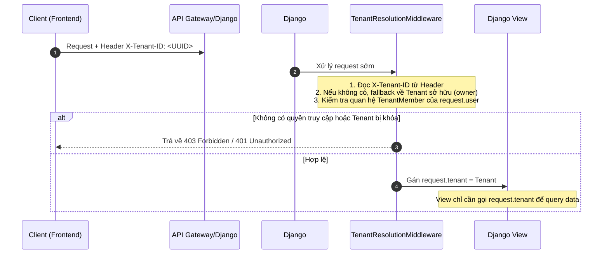

# Ý KIẾN PHẢN HỒI VÀ KHUYẾN NGHỊ KỸ THUẬT TỪ AGENT
**Tài liệu gốc:** `docs/feedback/tenant_admin_audit_report.md`  
**Phản hồi của User:** `docs/feedback/tenant_admin_audit_report_RESPONSE.md`  
**Ý kiến ghi lại:** `docs/feedback/tenant_admin_audit_report_AGENT_FEEDBACK.md`  
**Người lập:** Antigravity (Advanced Agentic Coding Agent)  
**Ngày:** 2026-06-16  

---

## 1. Đánh giá Phản hồi của User và Thống nhất Định hướng

Chúng tôi hoàn toàn nhất trí với tất cả các điểm xác nhận và phát hiện bổ sung từ phía bạn. Việc rà soát chi tiết codebase đã làm sáng tỏ thêm các khía cạnh kỹ thuật quan trọng giúp thiết kế giải pháp thực tế hơn:

1. **Về 4 vai trò (RBAC):** Việc có đủ 4 vai trò (`owner`, `admin`, `member`, `viewer`) trong `TenantMember.RoleChoices` là một lợi thế lớn. Chúng ta không cần định nghĩa lại model mà chỉ cần cập nhật giao diện phân quyền trên UI để phản ánh đúng thực tế này.
2. **Về Middleware:** Cơ sở phân giải Tenant qua `owner_user` hiện có trong `TenantQuotaMiddleware` cần được tách biệt (decouple) hoàn toàn sang một Middleware độc lập chạy sớm hơn.
3. **Về Vị trí Frontend:** Xác nhận việc di chuyển mã nguồn UI khỏi thư mục deprecated là việc bắt buộc để dọn sạch legacy code.

---

## 2. Chi Tiết Đề Xuất Giải Pháp Kỹ Thuật (Giai đoạn 1)

Dưới đây là thiết kế chi tiết cho các giải pháp ưu tiên cao (P0 và P1):

### 2.1. Giải pháp P0: Phân giải Tenant qua Header (`X-Tenant-ID`)
Chúng ta sẽ xây dựng một middleware mới tên là `TenantResolutionMiddleware` đặt trong phân hệ `identity_access`:



#### Mã nguồn phác thảo cho Middleware mới:
```python
# packages/core/backend/src/identity_access/middleware.py
from django.utils.deprecation import MiddlewareMixin
from django.core.exceptions import PermissionDenied
from identity_access.models import CoreTenant, TenantMember

class TenantResolutionMiddleware(MiddlewareMixin):
    """
    Middleware phân giải Active Tenant cho request của người dùng:
    1. Đọc X-Tenant-ID từ HTTP Headers.
    2. Nếu không có, tìm Tenant mà user là Owner (Primary Tenant).
    3. Nếu không có nữa, lấy Tenant đầu tiên mà user là thành viên.
    4. Kiểm tra quyền truy cập của user đối với Tenant đó.
    5. Gán request.tenant phục vụ các middleware/views phía sau.
    """
    def process_request(self, request):
        if not request.user or not request.user.is_authenticated:
            request.tenant = None
            return

        if request.user.is_superuser:
            # Bypass cho Superuser
            request.tenant = CoreTenant.objects.first() # Hoặc để None
            return

        tenant_id = request.headers.get('X-Tenant-ID')
        tenant = None

        if tenant_id:
            try:
                tenant = CoreTenant.objects.get(public_id=tenant_id)
            except CoreTenant.DoesNotExist:
                raise PermissionDenied("Tenant không tồn tại.")
        else:
            # Fallback 1: Lấy tenant sở hữu
            tenant = CoreTenant.objects.filter(owner_user=request.user).first()
            if not tenant:
                # Fallback 2: Lấy tenant đầu tiên làm thành viên
                member = TenantMember.objects.filter(user=request.user).select_related('tenant').first()
                if member:
                    tenant = member.tenant

        if not tenant:
            request.tenant = None
            return

        # Kiểm tra tính hợp lệ của tư cách thành viên
        if tenant.owner_user != request.user:
            is_member = TenantMember.objects.filter(tenant=tenant, user=request.user).exists()
            if not is_member:
                raise PermissionDenied("Bạn không có quyền truy cập vào không gian làm việc này.")

        request.tenant = tenant
```

---

### 2.2. Giải pháp P1: Thay ô nhập Scopes bằng Checkbox List (Visual Policy Editor)
Trong giao diện tạo Service Account và PATs, chúng ta sẽ bỏ ô nhập text tự do. Thay vào đó, giao diện sẽ render danh sách Checkbox tương ứng với 6 Policies được cấu hình sẵn trong backend:

| Tên hiển thị UI | Policy Code | Scopes Tương Ứng | Mô tả chức năng |
| :--- | :--- | :--- | :--- |
| **Đọc dữ liệu thị trường** | `pol_market_read` | `market:read` | Cho phép đọc bảng giá, KLine, chỉ số tài chính |
| **Đọc tín hiệu phân tích** | `pol_signals_read` | `signals:read` | Cho phép đọc tín hiệu cá mập (Whale Alerts), CVD |
| **Gọi AI Advisory** | `pol_ai_invoke` | `ai:invoke` | Quyền tương tác với AI Agent khuyên dùng danh mục |
| **Quản trị PATs** | `pol_manage_pats` | `manage_pats` | Cấp phát, xoay vòng và thu hồi API token |
| **Quản trị Tài khoản máy** | `pol_manage_service_accounts` | `manage_service_accounts` | Thêm mới hoặc vô hiệu hóa Service Accounts |
| **Quản lý thông tin Tenant** | `pol_manage_tenant` | `manage_tenant` | Thay đổi tên hiển thị và cấu hình chung của Tenant |

---

### 2.3. Giải pháp P1: Expose API Audit Logs & Tích hợp UI Lịch sử Vận hành
* **Backend:** Bổ sung endpoint `GET /api/core/v1/partner/audit-logs/` kế thừa lớp view danh sách phân trang con trỏ (Cursor Pagination) để trả ra lịch sử sự kiện từ bảng `tenant_lifecycle_event` (lọc cứng theo `tenant=request.tenant`).
* **Frontend:** Viết component hiển thị Audit Logs dạng bảng liệt kê (Timeline) gồm các cột: Thời gian, Sự kiện (`event_type`), Người thực hiện (`actor_username`), Mô tả chi tiết (ví dụ: *"Đã thay đổi vai trò của user A thành Admin"*), và IP thực hiện hành động.

---

## 3. Lộ Trình Hành Động Đề Xuất (Action Plan)

| Sprint / Milestone | Phân hệ | Đầu việc chính | Kết quả mong đợi |
| :--- | :--- | :--- | :--- |
| **Bước 1** | Frontend | Di cư toàn bộ mã nguồn UI sang `packages/web/src/pages/tenant-admin/` | UI chạy độc lập trên SaaS native port, loại bỏ hoàn toàn legacy route code. |
| **Bước 2** | Backend | Triển khai `TenantResolutionMiddleware`, cập nhật views sử dụng `request.tenant` | Xác thực per-request nhận diện được `X-Tenant-ID`. Kiểm thử tích hợp thông qua. |
| **Bước 3** | Cả hai | Phát triển API Audit Logs & Giao diện nhật ký vận hành | Người dùng xem được thời gian thực lịch sử thay đổi cấu hình, thành viên trên UI. |
| **Bước 4** | Frontend | Triển khai Checkbox List cho Scopes trong SA & PATs | Triệt tiêu lỗi chính tả nhập scope, cải thiện UX/DX. |
