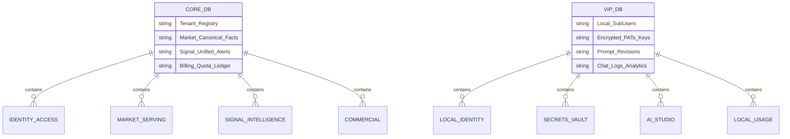
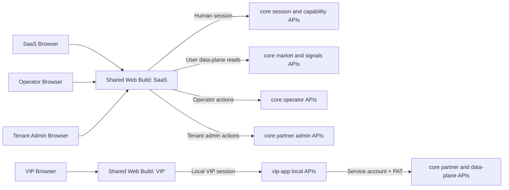
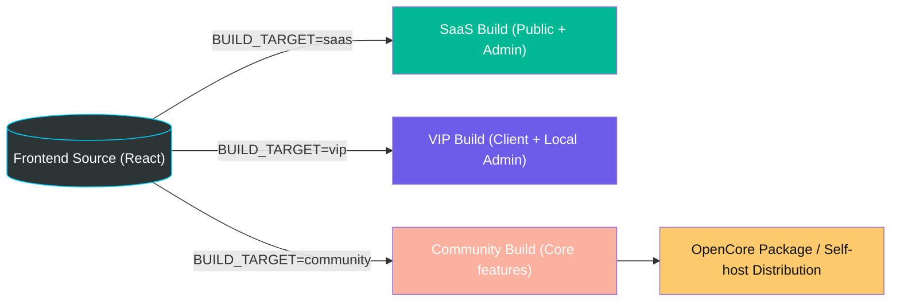
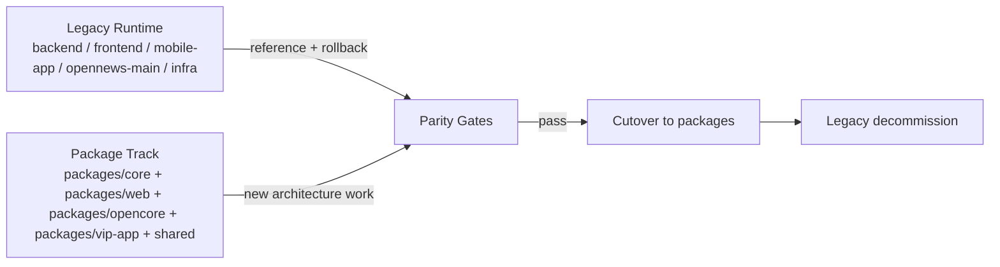

# VNInvest Integrated Architecture Blueprint (2026-05-02)

**Status:** Visual companion aligned to the integrated architecture SSOT  
**Purpose:** Provide a standardized, visual-first architecture document for fast comprehension of the major upgrade across `core`, `web`, `opencore`, and `vip-app` without replacing the normative architecture specs.

**Companion artifacts:**

- [CORE_WEB_VIP_APP_INTEGRATED_ARCHITECTURE_20260502](../core_web_vip/CORE_WEB_VIP_APP_INTEGRATED_ARCHITECTURE_20260502.md)
- [ENTERPRISE_CORE_PLATFORM_ARCHITECTURE_BLUEPRINT_20260502](../enterprise_core_platform/ENTERPRISE_CORE_PLATFORM_ARCHITECTURE_BLUEPRINT_20260502.md)
- [WEB_VIP_APP_SHARED_FRONTEND_BLUEPRINT_20260502](../web_vip_app/WEB_VIP_APP_SHARED_FRONTEND_BLUEPRINT_20260502.md)
- [PACKAGES_PARALLEL_MIGRATION_EXECUTION_PLAN_20260502](../packages_parallel_migration/PACKAGES_PARALLEL_MIGRATION_EXECUTION_PLAN_20260502.md)
- [ENTERPRISE_CORE_PARTNER_API_CONTRACT_DRAFT_20260502](../enterprise_core_partner/ENTERPRISE_CORE_PARTNER_API_CONTRACT_DRAFT_20260502.md)

> [!NOTE]
> The PNG above is a conceptual visual asset for fast comprehension, not the canonical source of architectural truth. The authoritative boundary and contract semantics remain in [CORE_WEB_VIP_APP_INTEGRATED_ARCHITECTURE_20260502](../core_web_vip/CORE_WEB_VIP_APP_INTEGRATED_ARCHITECTURE_20260502.md).

This document is the **standardized visual companion** for the integrated architecture of the VNInvest platform, covering the `core` platform, the `web` shared shell, the `opencore` funnel/distribution package, and the `vip-app` local client.

---

## 1. Global System Topology

The system is designed with a clear separation of concerns between the centralized platform (`core`), the shared user interface (`web`), and the local enterprise control plane (`vip-app`).

```mermaid
flowchart TD
    subgraph "Public / Operator Layer"
        U1["Investor Browser (SaaS)"]
        U2["Operator / Admin Browser"]
    end

    subgraph "Enterprise / VIP Layer"
        U3["VIP Browser"]
        VIP_APP["VIP-APP (Local Backend)"]
    end

    WEB["SHARED WEB FRONTEND (React Shell)"]

    subgraph "Central Platform Layer (CORE)"
        direction TB
        C_API["Core API Mesh"]
        C_SERVICES["Core Business Services"]
        C_DB[("PostgreSQL (Canonical Facts)")]
        C_CACHE[("Redis (Hot Tickers/Streams)")]
    end

    %% SaaS Flow
    U1 --> WEB
    U2 --> WEB
    WEB -->|"User/Admin Session"| C_API

    %% VIP Flow
    U3 --> WEB
    WEB -->|"Local VIP Session"| VIP_APP
    VIP_APP -->|"Partner PAT (Machine Cred)"| C_API

    %% Core Internals
    C_API --> C_SERVICES
    C_SERVICES --> C_DB
    C_SERVICES --> C_CACHE

    %% Styling
    style WEB fill:#2d3436,stroke:#00d2ff,stroke-width:2px,color:#fff
    style VIP_APP fill:#2d3436,stroke:#a29bfe,stroke-width:2px,color:#fff
    style C_SERVICES fill:#2d3436,stroke:#fab1a0,stroke-width:2px,color:#fff
    style C_DB fill:#000,stroke:#fff,stroke-width:1px
    style C_CACHE fill:#000,stroke:#fff,stroke-width:1px
```

---

## 2. Functional Ownership Matrix

The architecture defines strict functional boundaries to prevent data leakage and maintain system integrity.

### 2.1 Core Platform (The Brain)
- **Market Truth**: Ticker snapshots, chart serving, market reference data.
- **Signal Intelligence**: Whale events, unified alerts, session facts.
- **Control & Commercial**: Entitlements, quotas, billing, partner management.
- **Operator Plane**: Global health monitoring, scheduled jobs, audits.

### 2.2 Shared Web Shell (The Face)
- **UI Consistency**: One source for all dashboards, charts, and interaction models.
- **Capability Gating**: Dynamic UI features based on `BUILD_TARGET` and runtime capability snapshots.
- **Admin Surfaces**: Central Operator Admin and Tenant Admin Console (SaaS-only).

### 2.3 OpenCore Package (The Funnel)
- **Distribution Lane**: Community/self-host bundle, install flows, compose overlays.
- **Commercial Funnel**: Activation, upgrade hooks, feature catalog, pricing-safe public assets.
- **Boundary Rule**: No separate frontend source, no separate entitlement/billing truth.

### 2.4 VIP-App (The Local Orchestrator)
- **Local Identity**: Sub-user management, local RBAC, local login.
- **AI Orchestration**: Prompt studio, LLM provider key management, local chat logs.
- **Data Mediation**: Local facade/proxy for core APIs, providing secure data access without exposing PATs to the browser.

---

## 3. Data Persistence Architecture

The database strategy follows a **Logical Family** model to ensure scalability and clean migrations.

> [!IMPORTANT]
> **Database Hard Rule**: `IntradayTick` is for staging/recovery only. All external APIs (User/Partner) must read from **Canonical Tables** or **Materialized Read Models**.

---

## 4. API & Auth Mesh

The request plane is intentionally split so that browser UX remains simple while machine credentials stay server-side.

We distinguish between five distinct principal and access patterns to maintain a high security posture.

| Principal Type | Browser-facing target | Upstream API families | Auth Mechanism |
| :--- | :--- | :--- | :--- |
| **SaaS Investor** | Shared web SaaS build | `GET /core/v1/session/me`, `GET /core/v1/access/capabilities`, `/core/v1/market/*`, `/core/v1/signals/*` | Human session |
| **Central Operator** | Shared web SaaS build | `/core/v1/operator/*` | Human operator session |
| **Tenant Admin** | Shared web SaaS build | partner admin reads/writes under `/core/v1/partner/*`, plus `/core/v1/ai/runtime-config` | Human tenant admin session |
| **VIP Local User / Admin** | Shared web VIP build | `/vip/v1/auth/*`, `/vip/v1/users/*`, `/vip/v1/org/*`, `/vip/v1/market/*`, `/vip/v1/signals/*`, `/vip/v1/ai/*` | Local VIP session |
| **VIP Machine Client** | Not browser-facing | `/core/v1/partner/*`, `/core/v1/market/*`, `/core/v1/signals/*`, `/core/v1/ai/*` | **Service Account + PAT** |

> [!IMPORTANT]
> VIP browsers must not call `core` directly with machine credentials. Browser traffic goes to `vip-app`; only `vip-app` calls `core` with service account and PAT.

---

## 5. Build & Deployment Model: 1 Source, N Builds

The `web` package uses a compile-time `BUILD_TARGET` flag to generate different artifacts, and `opencore` packages the community/self-host distribution around the community build.

---

## 6. Transition Model: Packages-First Parallel Migration

The approved execution mode keeps legacy runtime alive only as a reference and rollback lane while the new architecture is built entirely under `packages/`.

> [!IMPORTANT]
> No second frontend is created for VIP, and legacy runtime is not kept indefinitely after cutover.

---

## 7. Execution Workstreams

To implement this architecture, 7 dedicated workstreams are established:

1.  **Core Foundation**: Identity, PAT, Quota, Billing.
2.  **Core Serving**: Tickers, Charts, Signals, Facts.
3.  **Web Shared Shell**: Build system, Routing catalog, Shared layout.
4.  **OpenCore Funnel**: Distribution bundle, activation, upgrade path.
5.  **Web Admin Surfaces**: Operator & Tenant Admin Consoles.
6.  **VIP Local Backend**: Local Auth, Sub-users, Secret Vault.
7.  **VIP AI & Ops**: Prompt Studio, Provider Keys, Local Analytics.

---

> [!NOTE]
> This blueprint is the visual companion for all future implementation plans. If any visual simplification conflicts with a normative architecture rule, [CORE_WEB_VIP_APP_INTEGRATED_ARCHITECTURE_20260502](../core_web_vip/CORE_WEB_VIP_APP_INTEGRATED_ARCHITECTURE_20260502.md) wins, and execution sequencing is governed by [PACKAGES_PARALLEL_MIGRATION_EXECUTION_PLAN_20260502](../packages_parallel_migration/PACKAGES_PARALLEL_MIGRATION_EXECUTION_PLAN_20260502.md).
