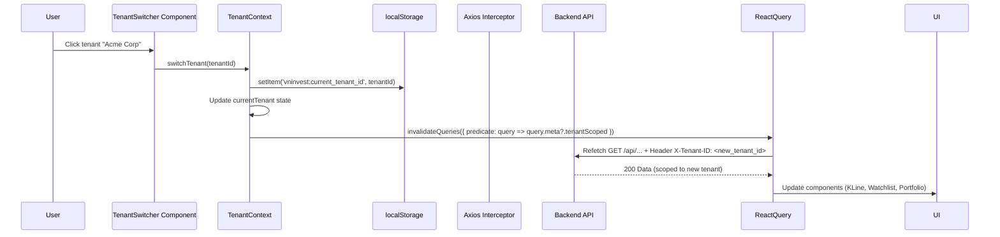
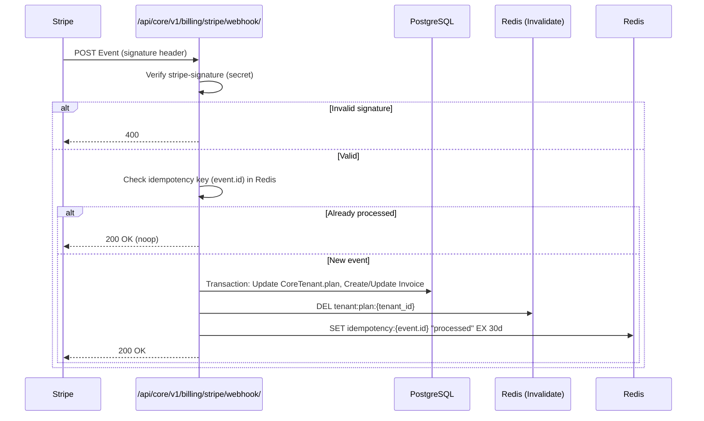

# Architecture Decision Record (ADR): Tenant Admin Console Upgrade

> **Status:** `PROPOSED` — Chờ Sign-off (xem `09-SIGN-OFF.md`)
> **Related:** `00-README-HANDOFF.md`, `02-DATA-MIGRATION.md`, `03-BACKEND-SPEC/01-middleware-spec.md`, `05-CONSTANTS-ENUMS.md`

---

## 1. Context & Problem Statement

**Current State (MVP):**
- Tenant identification: Static `owner_user` ForeignKey trên model `CoreTenant`.
- Authorization: `request.user == tenant.owner_user` (Owner-only).
- UI: Legacy admin pages, không có tenant context switching.
- Billing: Chỉ VNPay, manual invoice.
- Security: PAT không có IP whitelist, không có Audit Logs.

**Target State (Multi-Tenant SaaS):**
- **Dynamic Tenant Resolution** qua HTTP Header `X-Tenant-ID`.
- **Role-based Authorization** qua `TenantMember` (OWNER, ADMIN, MEMBER, VIEWER).
- **Multi-tenant UI** với Tenant Switcher, Audit Logs, Usage Charts.
- **Global Billing** (Stripe Billing Portal) + Domestic (VNPay).
- **Enterprise Security**: SAML SSO, PAT CIDR Whitelisting, Comprehensive Audit Logs.

---

## 2. Key Architectural Decisions

### ADR-001: Header-Based Tenant Resolution (Mandatory `X-Tenant-ID`)

**Decision:** Mọi request đến API Tenant Admin (`/api/core/v1/partner/*`) **BẮT BUỘC** có header `X-Tenant-ID: <UUID>`. Không có fallback tự động sang owner/member sau Phase 1 migration.

**Rationale:**
- Explicit > Implicit. Tránh "tenant confusion" (user nghĩ đang ở tenant A nhưng request rơi vào tenant B).
- Dễ debug, audit, rate-limit per tenant.
- Phù hợp với API-first, machine-to-machine (PAT/Service Account) cũng gửi header này.

**Consequences:**
- Frontend **bắt buộc** gắn header trên mọi request (xem `04-FRONTEND-SPEC/03-api-client-interceptor.md`).
- Middleware trả `400 Bad Request` (code: `TENANT_HEADER_MISSING`) nếu thiếu header.
- First-time login flow: FE gọi `GET /api/core/v1/partner/tenants/` (không cần header) → User chọn tenant → Lưu `tenant_id` → Tiếp tục.

**Exception:** Endpoint `GET /api/core/v1/partner/tenants/` (list tenant user có quyền truy cập) **KHÔNG** yêu cầu `X-Tenant-ID`.

---

### ADR-002: Middleware Stack Order (Critical)

**Decision:** Thứ tự middleware trong `settings.MIDDLEWARE` (từ ngoài vào trong):

```python
MIDDLEWARE = [
    # ... security, cors, session, auth ...
    'django.contrib.auth.middleware.AuthenticationMiddleware',  # 1. Xác định request.user
    'core.middleware.TenantResolutionMiddleware',               # 2. Xác định request.tenant, request.tenant_role
    'core.middleware.TenantQuotaMiddleware',                    # 3. Kiểm tra quota/rate-limit cho request.tenant
    # ... common middleware ...
]
```

**Rationale:**
- `AuthenticationMiddleware` phải chạy trước để có `request.user`.
- `TenantResolutionMiddleware` cần `request.user` để query `TenantMember`.
- `TenantQuotaMiddleware` cần `request.tenant` để lấy quota key Redis.
- Views chỉ dùng `request.tenant` và `request.tenant_role` — **không tự query tenant**.

**Enforcement:** Unit test `test_middleware_order.py` verify thứ tự.

---

### ADR-003: TenantMember as Single Source of Authorization Truth

**Decision:** Bảng `TenantMember` (user + tenant + role + status) là **duy nhất** nguồn xác thực quyền truy cập tenant. Column `CoreTenant.owner_user` **DEPRECATED** (giữ cho migration/history, không dùng trong logic mới).

**Roles (xem `05-CONSTANTS-ENUMS.md`):**
| Role | Code | Permissions |
|------|------|-------------|
| Owner | `OWNER` | Full: Billing, SSO, Delete Tenant, Manage Members, Manage PAT/SA, View Audit Logs |
| Admin | `ADMIN` | Manage Members, Manage PAT/SA, View Audit Logs, View Billing (no SSO, no Delete) |
| Member | `MEMBER` | View Dashboard, Create PAT/SA (self), View Usage |
| Viewer | `VIEWER` | Read-only: Dashboard, Usage, Audit Logs (no create/edit) |

**Status:** `ACTIVE`, `INVITED`, `SUSPENDED`, `REVOKED`. Chỉ `ACTIVE` mới được truy cập.

---

### ADR-004: Tenant Status Gate in Middleware

**Decision:** `TenantResolutionMiddleware` kiểm tra `tenant.status`. Nếu `SUSPENDED` hoặc `DEPROVISIONED` → Trả `403 Forbidden` (code: `TENANT_SUSPENDED`, `TENANT_DEPROVISIONED`) **trước** khi check role.

**Rationale:** Billing/Compliance có thể suspend tenant ngay lập tức. Middleware là chokepoint duy nhất.

---

### ADR-005: Redis Quota Key Schema

**Decision:** `TenantQuotaMiddleware` dùng Redis key format:

```
quota:{tenant_id}:{endpoint_group}:{window_seconds}
```

**Ví dụ:**
- `quota:550e8400-e29b-41d4-a716-446655440000:market_data:60` → 60 giây (rate limit 1p)
- `quota:550e8400-e29b-41d4-a716-446655440000:ai_advisory:86400` → 24h (daily quota)

**Implementation:** Lua script atomic `INCR` + `EXPIRE` + check limit. Trả `429 Too Many Requests` với header `Retry-After`, `X-Quota-Limit`, `X-Quota-Remaining`.

---

### ADR-006: Stripe as Source of Truth for Plan/Subscription

**Decision:** `CoreTenant.plan` (Starter/Pro/Enterprise) **sync từ Stripe Subscription** via Webhook. Local DB là read-only cache. Billing Portal URL từ Stripe Customer Portal Session.

**Rationale:** Tránh divergence. Stripe là hệ thống billing chuẩn.

---

### ADR-007: SAML SSO via WorkOS (Managed Service)

**Decision:** Tích hợp WorkOS SDK thay vì self-host SAML (python3-saml).

**Rationale:**
- Giảm maintenance burden (cert rotation, IdP compatibility, SP metadata).
- Hỗ trợ sẵn: Okta, Azure AD, Google Workspace, custom SAML/OIDC.
- Admin UI cho tenant tự cấu hình (Admin Portal).
- Cost acceptable cho Enterprise tier.

**Trade-off:** Vendor lock-in. Mitigation: Export config (IdP metadata, attribute mapping) để migrate sau nếu cần.

---

### ADR-008: PAT CIDR Whitelisting at Authentication Layer

**Decision:** Kiểm tra `allowed_cidr_blocks` trong `CorePATAuthentication.authenticate()` (DRF Authentication Class). Nếu IP không match → `403 Forbidden` (code: `PAT_IP_NOT_ALLOWED`).

**Rationale:** Fail fast. Không tốn resource cho permission check sau. PAT dùng cho machine-to-machine → IP whitelist là must-have.

---

### ADR-009: Audit Log Immutable Append-Only

**Decision:** `AuditLog` model **chỉ INSERT, không UPDATE/DELETE**. Partition theo tháng (`audit_log_2026_06`). Retention 7 năm (compliance).

**Fields:** `event_type`, `actor` (FK User, nullable), `tenant` (FK CoreTenant), `ip_address`, `user_agent`, `old_value` (JSONB), `new_value` (JSONB), `metadata` (JSONB), `created_at`.

**Index:** `(tenant_id, created_at DESC)`, `(tenant_id, event_type, created_at DESC)`.

---

### ADR-010: Frontend State Management — React Context + localStorage Sync

**Decision:**
- `TenantContext` (React Context) hold `currentTenant`, `availableTenants`, `switchTenant()`.
- `localStorage` key `vninvest:current_tenant_id` persist lựa chọn.
- Axios Interceptor đọc `localStorage` gắn `X-Tenant-ID` (xem `04-FRONTEND-SPEC/03-api-client-interceptor.md`).
- Khi `switchTenant()` → Update Context → Update localStorage → Trigger React Query/TanStack Query `invalidateQueries()` cho tất cả tenant-scoped data.

---

## 3. Sequence Diagrams

### 3.1 Request Flow (Middleware Stack)

```mermaid
sequenceDiagram
    participant Client
    participant AuthMiddleware as AuthenticationMiddleware
    participant TenantMiddleware as TenantResolutionMiddleware
    participant QuotaMiddleware as TenantQuotaMiddleware
    participant View as API View

    Client->>AuthMiddleware: Request + Cookie/JWT/PAT
    AuthMiddleware->>AuthMiddleware: Set request.user
    AuthMiddleware->>TenantMiddleware: Request (with user)
    alt Header X-Tenant-ID missing
        TenantMiddleware-->>Client: 400 TENANT_HEADER_MISSING
    else Header present
        TenantMiddleware->>TenantMiddleware: Query TenantMember(user, tenant_id)
        alt Member not found / status != ACTIVE
            TenantMiddleware-->>Client: 403 FORBIDDEN / TENANT_SUSPENDED
        else OK
            TenantMiddleware->>TenantMiddleware: Set request.tenant, request.tenant_role
            TenantMiddleware->>QuotaMiddleware: Request (with tenant)
            QuotaMiddleware->>Redis: Atomic INCR quota key
            alt Quota exceeded
                QuotaMiddleware-->>Client: 429 QUOTA_EXCEEDED
            else OK
                QuotaMiddleware->>View: Request (with tenant, role)
                View->>View: Business logic (scoped by request.tenant)
                View-->>Client: 200 Response
            end
        end
    end
```



### 3.2 Tenant Switcher Flow (Frontend)



### 3.3 Stripe Webhook Flow



---

## 4. Data Model Changes Summary (Detail in `03-BACKEND-SPEC/03-models-changes.md`)

| Model | Change | Phase |
|-------|--------|-------|
| `CoreTenant` | Add `plan` (Starter/Pro/Enterprise), `stripe_customer_id`, `status` (ACTIVE/SUSPENDED/DEPROVISIONED), DEPRECATE `owner_user` | 1, 2 |
| `TenantMember` | **NEW** Model: user, tenant, role, status, invited_by, invited_at, joined_at | 1 |
| `CorePATCredential` | Add `allowed_cidr_blocks` (ArrayField<CIDR>), `scopes` (ArrayField<PolicyCode>) | 1, 3 |
| `AuditLog` | **NEW** Model: event_type, actor, tenant, ip, user_agent, old_value, new_value, metadata, created_at | 1 |
| `QuotaRecord` | **NEW** Model (optional, for history): tenant, endpoint_group, count, window_start, window_end | 2 |
| `Invoice` | Extend: `stripe_invoice_id`, `stripe_subscription_id`, `plan_at_issue` | 2 |

---

## 5. Risk Register & Mitigations

| ID | Risk | Likelihood | Impact | Mitigation |
|----|------|------------|--------|------------|
| ARC-01 | Frontend quên gắn `X-Tenant-ID` → 400 storm | High | High | Axios Interceptor **bắt buộc** (tested), E2E test cover switch flow |
| ARC-02 | Middleware order sai → `request.user` is AnonymousUser | Medium | Critical | Unit test `test_middleware_order.py` trong CI gate |
| ARC-03 | Stripe webhook duplicate processing → double billing | Low | Critical | Idempotency key (event.id) in Redis với TTL 30 ngày |
| ARC-04 | `TenantMember` migration miss data → user mất quyền | Medium | High | Migration script có verification query, rollback plan, dry-run mode |
| ARC-05 | Redis quota key collision / memory leak | Low | Medium | Key schema có tenant_id + endpoint_group + window, TTL auto-expire |
| ARC-06 | WorkOS vendor lock-in / price hike | Low | Medium | Export config feature, document migration path to self-hosted |
| ARC-07 | Audit Log table bloat → slow queries | Medium | Medium | Partitioning by month, retention policy, index strategy |
| ARC-08 | PAT CIDR check bypass (IPv6, proxy headers) | Medium | High | Use `request.META.get('HTTP_X_FORWARDED_FOR')` parse correctly, test IPv6 CIDR |

---

## 6. Cross-References

- `02-DATA-MIGRATION.md` — Migration scripts cho ADR-003, ADR-004
- `03-BACKEND-SPEC/01-middleware-spec.md` — Implementation spec cho ADR-001, 002, 004, 005
- `03-BACKEND-SPEC/02-api-contracts.yaml` — API contracts cho tất cả ADR
- `03-BACKEND-SPEC/04-stripe-webhook-spec.md` — ADR-006 implementation
- `03-BACKEND-SPEC/05-saml-sso-spec.md` — ADR-007 implementation
- `04-FRONTEND-SPEC/02-state-management.md` — ADR-010 implementation
- `04-FRONTEND-SPEC/03-api-client-interceptor.md` — ADR-001, 010 FE side
- `05-CONSTANTS-ENUMS.md` — Single source cho Roles, Statuses, Error Codes, Policies
- `06-SECURITY-HARDENING.md` — ADR-008, 009 security controls
- `07-TEST-SPEC/*` — Test cases verify ADR compliance

---

## 7. Definition of Done (Architecture Level)

- [ ] All ADRs reviewed & approved by Tech Lead + Security.
- [ ] Middleware stack order verified in `settings.MIDDLEWARE` (test in CI).
- [ ] `TenantMember` model created, migration runnable.
- [ ] `CoreTenant.owner_user` marked deprecated (comment + docstring).
- [ ] Redis quota key schema documented & implemented in `TenantQuotaMiddleware`.
- [ ] Stripe webhook idempotency design approved.
- [ ] WorkOS integration plan approved (cost, contract).
- [ ] PAT CIDR validation logic spec complete.
- [ ] Audit Log partition strategy approved by DBA.
- [ ] Frontend Context + Interceptor spec complete.

---

**Next:** `02-DATA-MIGRATION.md` — Chi tiết migration strategy, scripts, verification, rollback.