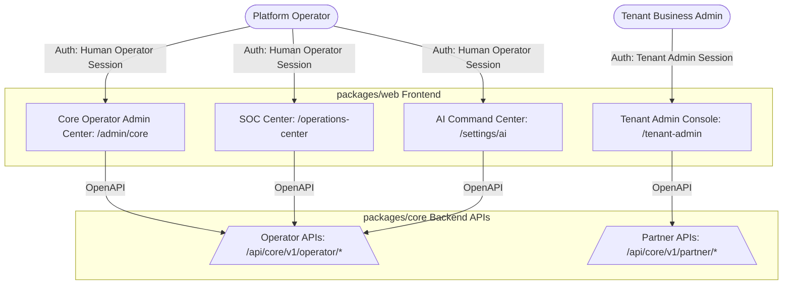

# KIẾN TRÚC ĐỀ XUẤT: TRUNG TÂM QUẢN TRỊ TRUNG ƯƠNG (CORE OPERATOR ADMIN CENTER)
## Nền tảng SaaS Native OpenAPI tại `packages/web` — VNInvest

**Ngày**: 2026-05-25  
**Trạng thái**: PROPOSAL FOR USER REVIEW  
**Phạm vi**: packages/web (Frontend) & packages/core (Backend APIs)  
**Tác giả**: Antigravity  

---

## 1. Bối Cảnh và Tổng Quan Hệ Thống

Qua quá trình review toàn diện cấu trúc codebase hiện tại của VNInvest, đặc biệt là các gói nâng cấp gần đây (SOC Config UI, SaaS Full Independence, OpenAPI Standardization), chúng tôi xác định được bức tranh quản trị hệ thống đang được phân cực thành ba bề mặt rõ rệt:

1. **AI Center (AI Command Center - `/settings/ai`)**: Chuyên biệt cho quản trị AI, bao gồm quản lý mô hình (models), prompt studio, cấu hình AI Lane, context kline và cơ chế failover giữa các nhà cung cấp AI.
2. **SOC Center (Shell Operations Center - `/operations-center`)**: Chuyên biệt cho quản trị hạ tầng kỹ thuật, bao gồm data ops, các kịch bản backfill dữ liệu (ticks, kline, whale alerts, dark flow, CVD), prefetch policies, quota limiters và giám sát benchmark của VnBroker.
3. **Tenant Admin Console (`/tenant-admin/*`)**: Dành riêng cho người dùng cuối của Tenant/Doanh nghiệp đối tác để tự quản trị thông tin cấu hình, service accounts, PAT credentials, billing và usage trong phạm vi cục bộ của Tenant đó.

> [!IMPORTANT]
> **KHOẢNG TRỐNG KIẾN TRÚC HIỆN TẠI (THE CORE GAP)**
> Toàn bộ các cấu hình mang tính **SaaS Business (vận hành thương mại, vòng đời khách hàng, kiểm toán hệ thống toàn cục, cấu hình gói cước, phân cấp quyền hạn)** hiện chưa có một bề mặt quản trị trung tâm thống nhất. 
> Sau khi khai tử `/admin-ops` cũ (trả về `410 GONE`), hệ thống cần thiết lập **Core Operator Admin Center** (Trung tâm Quản trị Trung ương) tại `/admin/core` (hoặc `/admin-center`) chạy trong `packages/web` nhằm quản lý toàn bộ các thành phần phi kỹ thuật còn lại của toàn hệ thống SaaS.

---

## 2. Kiến Trúc Phân Lớp Mục Tiêu (Boundary Architecture)

Để đảm bảo quy định nghiêm ngặt **PHÂN TÁCH LEGACY VÀ SAAS NATIVE** trong monorepo VNInvest:
* **`packages/core` (Control Plane Backend)**: Nắm giữ toàn bộ nghiệp vụ, DB Schema, Entitlement engines, Jobs, Audit Lineage và export ra hệ thống SaaS Native OpenAPI.
* **`packages/web` (Presentation Layer)**: Nắm giữ toàn bộ mã nguồn giao diện (React), định nghĩa Routes, Navigation, Components, State Management và giao tiếp hoàn toàn qua Open APIs Standardized.

### Sơ đồ định vị 4 Surface Quản trị của VNInvest



---

## 3. Danh Mục Các Phân Hệ & Tính Năng Chi Tiết Cho Admin Center

Phân hệ Admin Center sẽ bao gồm 7 module cốt lõi tương ứng với các thành phần kinh doanh & bảo mật còn lại của hệ thống:

```
/admin/core
├── 1. Platform Overview (Tổng quan Platform)
├── 2. Tenant Registry (Vòng đời Khách hàng Doanh nghiệp)
├── 3. Entitlements & Pricing Plan Matrix (Quản lý Quyền lợi & Gói cước)
├── 4. Personal Access Token & Service Accounts Auditor (Kiểm toán Token máy)
├── 5. Usage Metering & Quota Controller (Giám sát Tiêu thụ & Vượt hạn mức)
├── 6. Commercial & Billing Operations (Vận hành Doanh thu & Hóa đơn)
└── 7. Platform Feature Flags & Audit Trail (Cấu hình Tính năng & Truy vết Forensic)
```

---

### Phân Hệ 1: Platform Overview (Tổng quan Hoạt động Kinh doanh & Vận hành)
Giao diện dashboard trung tâm cung cấp số liệu phân tích tổng quan cho Platform Owner và Operator.

* **Tính năng chính**:
  * **Tổng quan Vận hành Kinh doanh**: Số lượng Tenant active, doanh thu đăng ký chạy thực (Monthly Recurring Revenue - MRR), số lượng người dùng đồng thời trên các tenant.
  * **Chỉ số Sức khỏe SaaS**: Số lượng sự cố chạm trần hạn mức quota (quota overage incidents), số lượng PAT sắp hết hạn hoặc có dấu hiệu rủi ro.
  * **Materialization Lag Tracking**: Biểu đồ trực quan hóa độ trễ tính toán dữ liệu whale/dark-money theo từng tenant (Option C - Data Isolation verification).
  * **Platform Alerts Lane**: Luồng cảnh báo tổng hợp các sự kiện tenant bị khóa (suspended), hạ gói cước, hoặc nợ phí quá hạn.

---

### Phân Hệ 2: Tenant Registry & Lifecycle Management (Quản lý Vòng đời Khách hàng Doanh nghiệp)
Cơ sở dữ liệu trung tâm quản lý tất cả các Client Tenants (SaaS standard, Partner Custom Zone, VIP Enterprise, Custom Retail Zone).

* **Tính năng chính**:
  * **Tenant Directory & Profile**: Tìm kiếm, phân lọc tenant theo Plan (Standard, Premium, VIP Enterprise), Trạng thái (Active, Suspended, Provisioning).
  * **Tenant Lifecycle Control**: Các nút thao tác nhanh:
    * *Create Tenant*: Khởi tạo nhanh tenant mới.
    * *Upgrade/Downgrade Plan*: Điều chỉnh tức thời hạng gói dịch vụ.
    * *Suspend/Unsuspend*: Khóa/mở khóa tài khoản tenant đi kèm lý do cụ thể (nợ phí, vi phạm bảo mật).
  * **Database Isolation Audit Visualizer**: Giám sát trạng thái cô lập dữ liệu (Data Isolation Verification) của từng tenant. Hiển thị thông tin Schema Name, Database Node, trạng thái đồng bộ hóa và mã hóa dữ liệu.

---

### Phân Hệ 3: Entitlements & Pricing Plan Matrix (Quản trị Ma trận Quyền lợi & Gói cước)
Bề mặt quản lý động ma trận năng lực hệ thống (Capability Matrix) theo phân lớp gói cước mà không cần code lại.

* **Tính năng chính**:
  * **Plan Capability Configurator**: Form kéo thả/tích chọn cấu hình quyền CASL (Abilities) áp dụng cho từng Plan Class (ví dụ: Standard không được bật CVD pane và Institutional Strength Pane; VIP Enterprise được mở rộng WebSocket feeds chuyên biệt).
  * **Quota Limit Templates**: Định nghĩa các hạn mức cơ bản đi kèm theo plan (ví dụ: standard = tối đa 5 watchlists, 50 symbols; premium = 20 watchlists, 500 symbols).
  * **Dynamic Promotion Manager**: Cho phép thăng cấp (promote) quyền truy cập cho các Symbol đặc biệt hoặc các tập người dùng đang trial (ví dụ: Watchlist/Tracked promotion).

---

### Phân Hệ 4: Personal Access Tokens (PAT) & Service Accounts Auditor (Kiểm toán Token và Account Máy)
Bảo mật hệ thống luôn là ưu tiên hàng đầu. Phân hệ này hỗ trợ kiểm toán các Service Account (Machine Principal) và Token tích hợp (PAT) kết nối vào hệ thống.

* **Tính năng chính**:
  * **Global Service Accounts Registry**: Liệt kê toàn bộ các Service Account đại diện cho tích hợp máy của đối tác (ví dụ: `vip-app` local-backend nối về SaaS Core).
  * **PAT Credential Console**:
    * Theo dõi danh sách PAT được phát hành trên toàn hệ thống: Ngày tạo, Ngày hết hạn, Lần dùng cuối cùng, IP kết nối gần nhất.
    * Thao tác cưỡng bức: Thu hồi (Revoke), Tạm đình chỉ (Suspend), hoặc Ép buộc xoay vòng (Force Rotate) token khi phát hiện rủi ro lộ bí mật.
  * **Suspicious Activity Alerting**: Tự động đánh dấu (flag) các PAT có hành vi bất thường (gọi API với tần suất đột biến, kết nối đồng thời từ nhiều quốc gia khác nhau).

---

### Phân Hệ 5: Usage Metering & Quota Controller (Giám sát Tiêu thụ & Thống kê Quota)
Giám sát thời gian thực lượng tài nguyên hệ thống mà mỗi Tenant đã tiêu thụ để phục vụ mục đích tính phí bổ sung hoặc điều phối tải.

* **Tính năng chính**:
  * **Granular Usage Meter Breakdown**: Biểu đồ phân tích lượng tiêu thụ tài nguyên theo:
    * *AI Query Counts*: Số lượt AI Advisor phân tích KLine.
    * *WebSocket Connection Hours*: Số giờ duy trì luồng dữ liệu thời gian thực.
    * *Scraping Data API calls*: Lượt truy cập API dữ liệu thô.
  * **Manual Quota Overrides Console**: Cho phép Operator tạm thời nới lỏng giới hạn tài nguyên (Quota Bypass/Override) cho một Tenant cụ thể trong giai đoạn cao điểm hoặc thử nghiệm (Grace Period Configuration).

---

### Phân Hệ 6: Commercial & Billing Operations (Quản lý Doanh thu & Hóa đơn)
Phân hệ hỗ trợ Operator theo dõi và vận hành các quy trình thương mại của hệ thống SaaS.

* **Tính năng chính**:
  * **Subscription Registry**: Tổng hợp chi tiết gói thuê bao đang chạy, ngày thanh toán tiếp theo, credit balance của tenant.
  * **Invoicing Management Center**: Registry lưu trữ toàn bộ hóa đơn phát hành. Hỗ trợ thay đổi trạng thái hóa đơn thủ công (ví dụ: Đánh dấu đã thanh toán ngoài hệ thống đối với khách hàng doanh nghiệp trả bằng chuyển khoản trực tiếp).
  * **Overage Billing Estimator**: Tự động ước tính chi phí phụ trội dựa trên dữ liệu tiêu thụ tài nguyên từ Phân hệ 5 trước khi xuất hóa đơn tháng.

---

### Phân Hệ 7: Security Audit Trail & Platform Feature Flags (Nhật ký Kiểm toán & Cấu hình Dynamic)
Công cụ forensic và điều khiển nóng dành riêng cho Platform Owner để giám sát hoạt động và tùy biến hệ thống an toàn.

* **Tính năng chính**:
  * **SaaS Feature Toggles (Cờ tính năng)**: Bật/tắt động các tính năng nâng cao (CVD pane, Institutional Strength, Heatmap Center, AI Suggests) toàn cục hoặc cho từng phân khúc tenant để phục vụ A/B testing hoặc xử lý khủng hoảng.
  * **Unified Request Audit Log**: Hỗ trợ truy vết nhật ký sử dụng hệ thống dựa trên Request UUID context.
    * Tìm kiếm vết hành động: "Ai đã sửa cấu hình prefetch lúc 10h?", "Token máy nào đã gọi backfill dữ liệu CVD?".
    * Xuất báo cáo kiểm toán bảo mật phục vụ tuân thủ (Compliance Export).

---

## 4. Thiết Kép Trải Nghiệm Premium (UX/UI Premium Aesthetics)

Sự thành bại của một giao diện quản trị nằm ở hiệu năng xử lý lượng dữ liệu khổng lồ nhưng vẫn phải giữ tính thẩm mỹ cao, tạo cảm giác vô cùng cao cấp (Premium).

### 4.1 Visual Styling & Design System (Thiết lập màu sắc HSL customized)
* **HSL Color Palette (Sleek Dark Mode)**:
  * Base Background: Deep Obsidian (`hsl(224, 71%, 4%)` - `#0B0F19`) mang lại chiều sâu.
  * Card Background: Slate Glass (`hsla(222, 47%, 11%, 0.7)`) với viền mờ `hsla(217, 32%, 18%, 0.5)`.
  * Brand Accent: Neon Emerald (`hsl(142, 70%, 50%)`) đại diện cho thị trường tăng giá và tài chính khỏe mạnh.
  * Warning Amber: Vibrant Gold (`hsl(48, 96%, 53%)`).
* **Glassmorphism (Inspired by Liquid Glass)**:
  * Áp dụng `backdrop-filter: blur(12px)` cho toàn bộ các thanh Navigation và Panel điều khiển, tạo cảm giác nổi bật và sang trọng.
  * Đổ bóng mờ nhẹ nhàng `box-shadow: 0 8px 32px 0 rgba(0, 0, 0, 0.37)`.

### 4.2 Triad & Full-Width Deck Layout (Bố cục giao diện)
Áp dụng tiêu chuẩn bố cục của dự án:
* **Triad Decks (Ba thẻ tóm tắt)** ở trên cùng:
  1. Thẻ 1: Sức khỏe Platform (Active Tenants / Active PATs / API Gateway Status).
  2. Thẻ 2: Trạng thái Sử dụng (Total AI Tokens Consumed / WebSocket Active Nodes).
  3. Thẻ 3: Doanh số & Hóa đơn (Nợ phí cần xử lý / MRR).
* **Full-Width Modular Position Deck** ở dưới: Grid hiển thị bảng dữ liệu chính (ví dụ: Tenant Registry Table) tích hợp bộ lọc nhanh thông minh (Smart Filter Matrix), cho phép export và thao tác nhanh không giật lag.

### 4.3 Micro-animations & Interactive Elements (Vi tương tác sinh động)
* **Smooth Card Expansion**: Thẻ chi tiết của Tenant mở rộng mượt mà bằng CSS transitions hoặc Framer Motion với spring Presets `stiffness: 300, damping: 30`.
* **Dynamic Progress Indicator**: Quota limits và Usage meters hiển thị dưới dạng thanh tiến trình bo tròn mềm mại với hiệu ứng gradient chạy mượt từ Neon Emerald sang Warning Amber khi lượng tiêu hao chạm mốc 80%.
* **Interactive Hover States**: Các nút hành động (Rotate PAT, Suspend Tenant) có hiệu ứng phát sáng nhẹ (glow effect) khi rê chuột qua, tăng tính phản hồi trực quan.

---

## 5. Security, Gating & Authorization Model (CASL & RBAC)

Hệ thống Admin Center được thiết kế bảo mật chặt chẽ bằng cách đồng bộ mô hình quyền CASL hiện có trong `packages/web` (`AbilityContext.js`):

### 5.1 Phân cấp Quyền hạn (Granular Abilities Subject Mapping)
* **`CoreTenantRegistry`**: Quyền đọc/ghi danh sách tenant.
* **`CoreTenantCommercial`**: Quyền thao tác quota, billing và pricing plan.
* **`CoreServiceAccountAdmin`**: Quyền cấu hình Service Account.
* **`CorePATAdmin`**: Quyền issue/rotate/revoke PAT credentials.
* **`CoreAuditTrace`**: Quyền xem audit logs và forensic trail.

### 5.2 Ma Trận Quyền Theo Vai Trò (Operator Roles Matrix)

| Vai Trò | Subjects được gán tối thiểu | Mục tiêu sử dụng |
|---|---|---|
| **`central_platform_owner`** | `manage all` | Quyền tối cao, điều phối toàn bộ hệ thống. |
| **`central_ops_admin`** | `read/update CoreTenantRegistry`, `read CoreRuntimeHealth` | Vận hành kỹ thuật, cấp phép nhanh cho Tenant. |
| **`central_billing_admin`** | `read/update CoreTenantCommercial` | Phụ trách kinh doanh, hóa đơn, điều chỉnh hạn mức tài nguyên. |
| **`central_support_auditor`** | `read CoreTenantRegistry`, `read CoreAuditTrace` | Hỗ trợ kỹ thuật, điều tra sự cố của đối tác, read-only. |

---

## 6. Lộ Trình Triển Khai Thực Thực Tế (Rollout Path)

Lộ trình được chia làm 4 Phase thực tế để đảm bảo tính an toàn, không gây gián đoạn và đạt độ chuẩn xác 100%:

```
[Phase 1: OpenAPI Schema Definitions]
            │
            ▼
[Phase 2: UI Foundation & Components] ── (packages/web)
            │
            ▼
[Phase 3: Integration & Ability Bridging]
            │
            ▼
[Phase 4: Smoke Test & Legacy Decommission]
```

### Phase 1: Chuẩn hóa Schema và Backend APIs (packages/core)
* Thiết lập hoặc rà soát các API endpoint canonical nằm trong `/api/core/v1/operator/*` and `/api/core/v1/partner/*`.
* Xuất file OpenAPI spec chuẩn hóa, đảm bảo kiểu trả về được đóng gói (Response Envelope) chuẩn xác theo quy định chất lượng.

### Phase 2: Xây dựng Core UI & Pages (packages/web)
* **Tạo Page mới**: `packages/web/src/pages/admin/core/CoreAdminCenterPage.js`.
* **Tạo các Components nhỏ**:
  * `TenantRegistryPanel.js` (Bảng danh sách tenant, tích hợp bộ lọc, nút Suspend/Upgrade).
  * `UsageQuotaPanel.js` (Biểu đồ tiêu thụ tài nguyên, thanh progress nạp dữ liệu).
  * `PATCredentialsAuditor.js` (Giao diện truy vết và thu hồi token máy).
  * `FeatureFlagPanel.js` (Bảng cờ tính năng bật/tắt nóng).
* Đăng ký route mới `/admin-center` (hoặc `/admin/core`) trong `routeCatalog.js` và gate bằng Ability check `read CoreAdminOverview`.

### Phase 3: Khớp nối Context Auth & CASL Bridging
* Kết nối thông tin quyền hạn trả về từ API `/api/auth/me` vào `AbilityContext.js` tại frontend để tự động bật/tắt các tab tương ứng với vai trò của Operator (Platform Owner, Billing Admin, Ops Admin).
* Rà soát đảm bảo các text mới hiển thị qua hệ thống i18n với tiếng Việt đầy đủ dấu chân thực.

### Phase 4: Kiểm thử Tích hợp & Nghiệm thu
* Thực hiện chạy thử kịch bản giả lập (Shadow run / Smoke tests):
  * Khởi tạo Tenant mới -> Verify DB Isolation Status.
  * Nới lỏng Quota Limit -> Kiểm tra xem Tenant có gọi vượt hạn mức thành công không.
  * Thu hồi PAT Token máy -> Đảm bảo ngay lập tức API trả về mã lỗi thích hợp và giao diện quản trị cập nhật real-time.
* Tiến hành tối ưu hóa build production bằng `npm run build` để kiểm định tính toàn vẹn của mã nguồn.

---

## 7. Kết Luận & Đóng Góp Ý Kiến từ Người Dùng

Đề xuất **Core Operator Admin Center** này hoàn thành mảnh ghép cuối cùng của hệ thống quản trị VNInvest:
* Phân định ranh giới rõ ràng: Kỹ thuật vận hành thuộc về **SOC**, Mô hình AI thuộc về **AI Center**, và Vận hành kinh doanh/Bảo mật SaaS thuộc về **Admin Center**.
* Tuân thủ kiến trúc SaaS Native Open API cao cấp.
* Giao diện Liquid Glass thời thượng tạo sự chuyên nghiệp tuyệt đối cho người vận hành.
