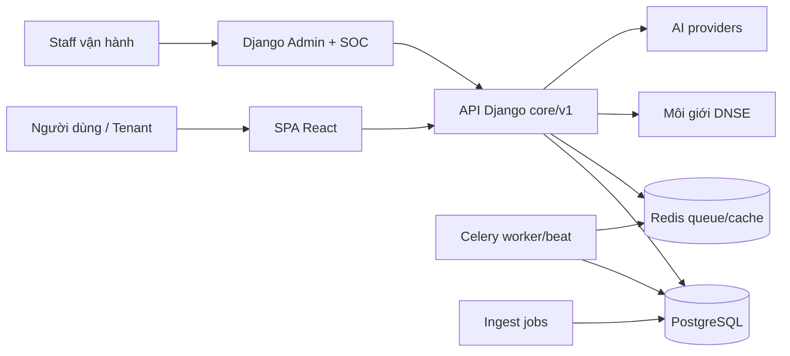
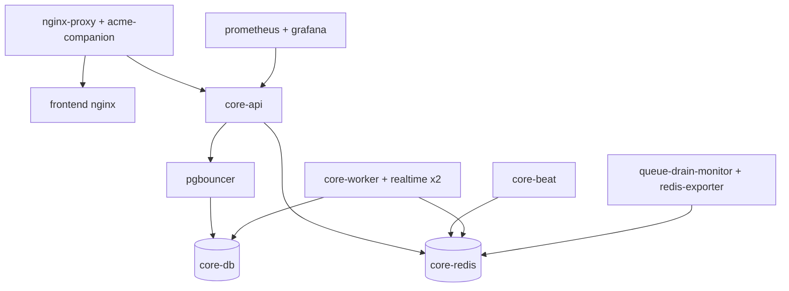
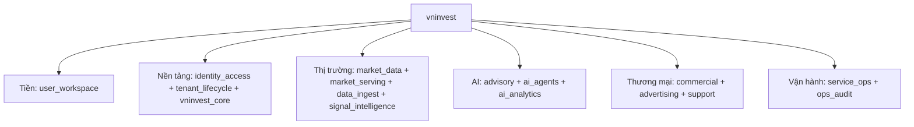
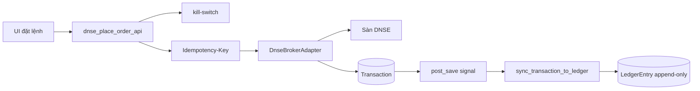
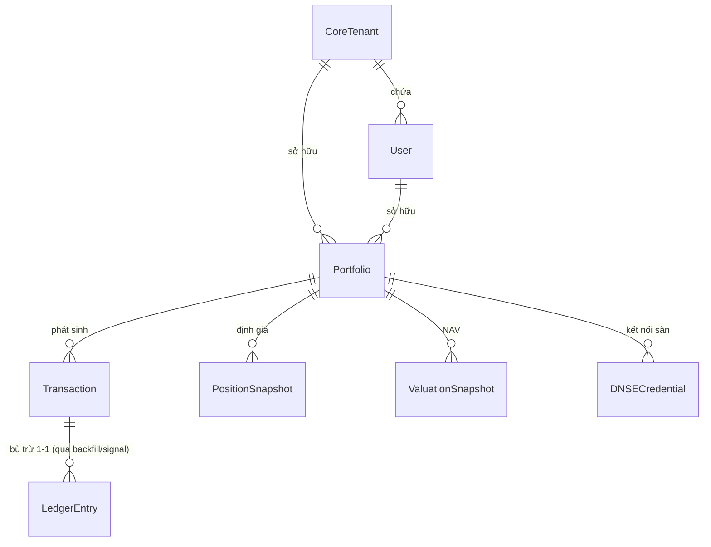

# 03.01 — Danh Mục Sơ Đồ

> Sơ đồ vẽ từ code đang chạy (AS-IS, ngày 2026-10-14). Chỉ dùng cú pháp Mermaid
> cơ bản (`flowchart`, `erDiagram`) để render được mọi nơi. Nguồn của mỗi sơ đồ
> ghi ngay dưới nó.

## C4-01 — Ngữ cảnh hệ thống

Nguồn: `02.01` §1 + `docker-compose.prod.yml`.

## C4-02 — Container triển khai

Nguồn: `docker-compose.prod.yml` + overlay staging (danh sách service đo 2026-10-14).

## FBD-01 — Phân rã chức năng

Nguồn: 15 app (claim `C-001`) + `04.01`.

## DFD-01 — Đặt lệnh DNSE đến sổ cái

Nguồn: `05.01` WF-02 (mỗi bước có `file:line`).

## ERD-01 — Thực thể tiền cốt lõi

Nguồn: `user_workspace/models.py` (Portfolio `:22`, LedgerEntry `:1040`) +
`06.02`. Quan hệ chi tiết (FK nào, unique nào) xem `06.02`.

## Quy ước duy trì

- Sơ đồ lỗi thời không xóa ngầm: đánh dấu `LỖI THỜI (ngày)` + liên kết thay thế.
- Thêm sơ đồ mới vào danh mục ở đầu file này (C4-03…, SEQ-…).
- Sơ đồ vẽ lại khi container/route/model đổi (gate không bắt được hình vẽ —
  người rà ở mỗi slice chạm kiến trúc).
