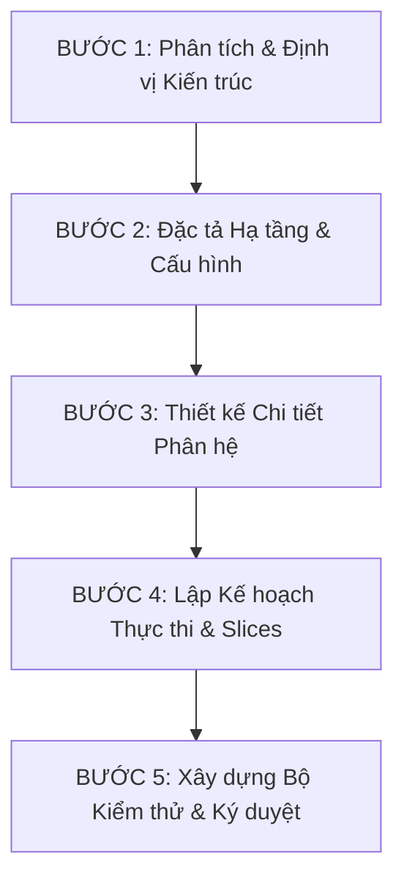

# Standard Operating Procedure (SOP) - Feature Pack Handover & 10-Document Template Standards
**Mã tài liệu**: `SOP_FEATURE_PACK_HANDOVER_BASELINE`  
**Ngày phát hành**: 24-05-2026  
**Trạng thái**: BAN HÀNH CHÍNH THỨC TOÀN DỰ ÁN  
**Phạm vi**: Áp dụng bắt buộc cho tất cả lập trình viên và các AI coding agents khi xây dựng bộ tài liệu bàn giao.

---

## 1. TIẾN TRÌNH 5 BƯỚC THIẾT KẾ & BÀN GIAO (MANDATORY WORKFLOW)

Mọi tính năng mới hoặc nâng cấp trong hệ thống VNInvest bắt buộc phải đi qua quy trình thiết kế và bàn giao gồm 5 bước nghiêm ngặt sau:

1. **BƯỚC 1: Phân tích & Định vị Kiến trúc (Architectural Alignment)**: Xác định rõ phạm vi ảnh hưởng, định vị code native nằm trong `packages/core` và `packages/web`, tuyệt đối phân tách và cô lập phần legacy deprecated.
2. **BƯỚC 2: Đặc tả Hạ tầng & Cấu hình (Infrastructure & Config Design)**: Chốt cấu trúc mô hình ERD ở mức DB (Unique constraints, indexes, keys) và thiết lập ma trận phân chia biến cấu hình môi trường (.env).
3. **BƯỚC 3: Thiết kế Chi tiết Phân hệ (Detailed Subsystem Design)**: Viết mã giả (pseudo-code) chi tiết cho Backend (models, serializers, tasks) và đặc tả cấu trúc components, bẫy honeypot, turnstile widget, CSS tokens và i18n bundle cho Frontend.
4. **BƯỚC 4: Lập Kế hoạch Thực thi & Slices (Implementation & Slices Planning)**: Phân rã tính năng thành chuỗi Slices độc lập, gán chặt Definition of Done (DoD) nghiêm ngặt cho mỗi slice ở cả 5 khía cạnh (Code, Test, Audit, Doc-Sync, Commit/Push).
5. **BƯỚC 5: Xây dựng Bộ Kiểm thử & Ký duyệt (Validation & Handoff Sign-off)**: Cung cấp bộ unit test/integration test tự động, kịch bản curl kiểm thử thủ công và biên bản thu thập bằng chứng chạy test thành công.

---

## 2. HỆ THỐNG 10 TEMPLATE TÀI LIỆU BẮT BUỘC (THE 10-DOCUMENT STANDARD)

Mỗi Feature Pack khi bàn giao cho đội ngũ code bắt buộc phải cấu thành từ 10 tài liệu sau với đầy đủ các mục chi tiết:

### TEMPLATE 1: Chỉ mục Bàn giao Master
* **Đường dẫn**: `docs/plans/[FEATURE_NAME]_HANDOFF_MASTER_[YYYYMMDD].md`
* **Mục tiêu**: Nguồn sự thật duy nhất (SSOT) liệt kê, phân loại và lưu vết toàn bộ tài liệu bàn giao.
* **Cấu trúc bắt buộc**:
    1. Tóm tắt mục tiêu & Bối cảnh nghiệp vụ.
    2. Bảng chỉ dẫn liên kết đến 9 tài liệu còn lại (Link click trực tiếp).
    3. Ma trận ký duyệt kỹ thuật (AI Assistant, Tech Lead, QA Lead).
    4. Trạng thái đồng bộ Pull Request (PR Ledger).

### TEMPLATE 2: Đặc tả Kỹ thuật (Technical Specification)
* **Đường dẫn**: `docs/plans/TECH_SPEC_[FEATURE_NAME]_[YYYYMMDD].md`
* **Mục tiêu**: Bản vẽ kiến trúc dữ liệu và ủy quyền của tính năng.
* **Cấu trúc bắt buộc**:
    1. Thiết kế Mô hình dữ liệu (ERD Schema, fields, nullability, DB constraints).
    2. Đặc tả API Contract (Request/Response JSON Schema chuẩn VNInvest Core).
    3. Sơ đồ tuần tự (Sequence Diagrams) dữ liệu.
    4. Đặc tả ủy quyền quyền tối thiểu (Least Privilege Scopes & Progressive Elevation).

### TEMPLATE 3: Kế hoạch Triển khai (Implementation Plan)
* **Đường dẫn**: `docs/plans/IMPLEMENTATION_PLAN_[FEATURE_NAME]_[YYYYMMDD].md`
* **Mục tiêu**: Lộ trình cài đặt, nâng cấp thư viện và giảm thiểu rủi ro.
* **Cấu trúc bắt buộc**:
    1. Kiến trúc giải pháp kỹ thuật tổng thể.
    2. Khai báo cài đặt biến môi trường và dependencies mới (`package.json`, `requirements.txt`).
    3. Trình tự di cư Database (DB Migrations) và kế hoạch Rollback khẩn cấp.
    4. Ma trận Rủi ro & Giải pháp Giảm thiểu (Risk & Mitigation Matrix).

### TEMPLATE 4: Thiết kế Chi tiết Phía Backend (Backend Design Spec)
* **Đường dẫn**: `docs/plans/BACKEND_DESIGN_[FEATURE_NAME]_[YYYYMMDD].md`
* **Mục tiêu**: Đặc tả chi tiết cấu trúc code và các cơ chế tin cậy phía Backend.
* **Cấu trúc bắt buộc**:
    1. Mã giả / Cấu trúc Lớp chi tiết (Models, Serializers, Views, Tasks).
    2. Cơ chế mã hóa đối xứng AES-256 Fernet cho credentials.
    3. CDC & Reliability Specs (OutboxEvent status, Exponential Backoff, Idempotency keys via ProcessedEvent).
    4. Runbook khôi phục dữ liệu bằng Django Management Command.

### TEMPLATE 5: Thiết kế Chi tiết Phía Giao diện (Frontend Design Spec)
* **Đường dẫn**: `docs/plans/FRONTEND_DESIGN_[FEATURE_NAME]_[YYYYMMDD].md`
* **Mục tiêu**: Đặc tả chi tiết giao diện mỹ thuật, micro-animations và bẫy chống bot.
* **Cấu trúc bắt buộc**:
    1. Premium UI tokens (Bảng màu curated HSL, Outfit font, glassmorphism styles, hover/shake animations).
    2. Hướng dẫn nhúng Cloudflare Turnstile explicit render widget.
    3. HTML/CSS Honeypot Trap định vị ngoài viewport (`left: -9999px`) cô lập tab-index.
    4. API Error Handler và input red border validation mapping.
    5. i18n bundle ngôn ngữ tiếng Việt có dấu đầy đủ cho form và lỗi.

### TEMPLATE 6: Bảng Tiến độ & Định nghĩa Hoàn thành Lát cắt (Taskboard)
* **Đường dẫn**: `docs/plans/TASKBOARD_[FEATURE_NAME]_[YYYYMMDD].md`
* **Mục tiêu**: Phân rã tiến độ thành các Slices tăng trưởng và kiểm soát chất lượng qua Definition of Done (DoD).
* **Cấu trúc bắt buộc**:
    1. Danh sách Slices phân rã từ DB Schema đến UI Integration.
    2. Ma trận DoD 5 cột cho từng Slice:
        * **CODE**: Định nghĩa hoàn thành về code.
        * **TEST**: Assertions cần vượt qua.
        * **AUDIT**: Security, locks và leak checks.
        * **DOC-SYNC**: Đồng bộ hóa tài liệu tương ứng.
        * **COMMIT/PUSH**: Quy ước đặt tên nhánh và commit message.

### TEMPLATE 7: Nghị định thư Tự kiểm toán & Chạy Test (Self-Audit & Test Protocol)
* **Đường dẫn**: `docs/plans/[FEATURE_NAME]_SELF_AUDIT_AND_TEST_PROTOCOL_[YYYYMMDD].md`
* **Mục tiêu**: Hướng dẫn chạy kiểm thử tự động và thủ công trước khi merge.
* **Cấu trúc bắt buộc**:
    1. Thiết lập môi trường chạy test local.
    2. Câu lệnh chạy test suite chỉ định chi tiết bằng pytest/django test.
    3. Kịch bản và lệnh curl kiểm thử thủ công từng góc biên (Edge Cases).
    4. Checklist chốt chặn trước khi mở PR (CI Gate Checklist).

### TEMPLATE 8: Hiến pháp Chất lượng Code (Code Quality Constitution)
* **Đường dẫn**: `docs/plans/[FEATURE_NAME]_CODE_QUALITY_CONSTITUTION_[YYYYMMDD].md`
* **Mục tiêu**: Quy tắc viết code sạch và bảo mật an ninh cấp cao.
* **Cấu trúc bắt buộc**:
    1. Quy tắc viết code native, cấm import từ legacy cũ.
    2. **Chính sách lọc thông tin nhạy cảm (Log Masking)**: Cấm tuyệt đối in mật khẩu SMTP, Google SA private key, client secrets ra console, log file hay Sentry.
    3. Quality Gates: Cyclomatic Complexity < 10, Coverage >= 90%.

### TEMPLATE 9: Ma trận Sở hữu Cấu hình (Configuration Ownership Matrix)
* **Đường dẫn**: `docs/plans/[FEATURE_NAME]_CONFIG_OWNERSHIP_MATRIX_[YYYYMMDD].md`
* **Mục tiêu**: Phân loại và quản lý các thiết lập môi trường an toàn.
* **Cấu trúc bắt buộc**:
    1. Bảng ánh xạ biến môi trường chi tiết cho Local, Staging và Production.
    2. Định nghĩa Owner chịu trách nhiệm cấu hình khóa bảo mật.

### TEMPLATE 10: Biên bản Thực thi & Bằng chứng Chạy Test (Execution Evidence Template)
* **Đường dẫn**: `docs/plans/[FEATURE_NAME]_EXECUTION_EVIDENCE_TEMPLATE_[YYYYMMDD].md`
* **Mục tiêu**: Thu thập toàn bộ log thực thi thật làm bằng chứng nghiệm thu chất lượng.
* **Cấu trúc bắt buộc**:
    1. Nhật ký thực thi DB Migrations.
    2. Nhật ký chạy lệnh khôi phục dữ liệu thực tế (CLI command output).
    3. Nhật ký chạy thành công 100% của suite test tự động (Automated Test Suite Output).

---

## 3. CHẾ TÀI VÀ CỦNG CỐ CHẤT LƯỢNG (QUALITY GATES ENFORCEMENT)

* **Bản vá không chạm (Zero-Drift Rule)**: Code thực tế và tài liệu thiết kế phải song hành tuyệt đối. Bất kỳ sự trôi lệch dữ liệu (drift) nào không được đồng bộ sẽ lập tức dẫn đến Quality Gate Failure.
* **Tự động hóa hoàn toàn**: Một Feature Pack chỉ được coi là đạt trạng thái sẵn sàng phát hành khi toàn bộ 10 tài liệu được điền đầy đủ và đính kèm bằng chứng thực thi thành công từ môi trường thật.
